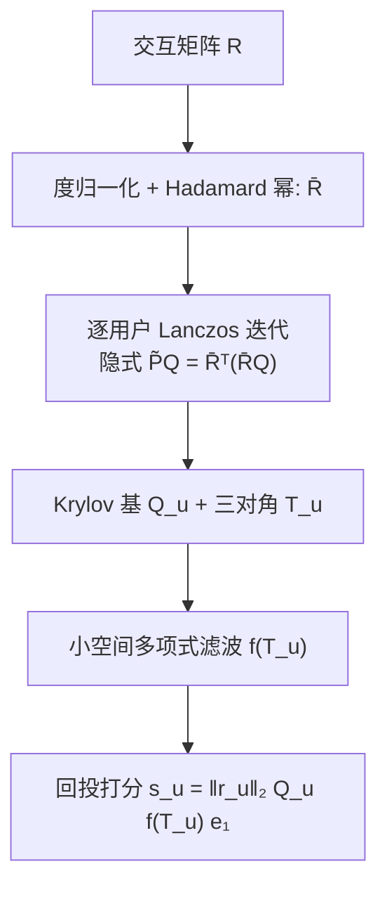
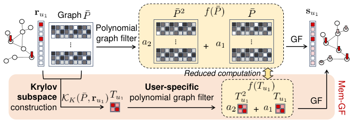
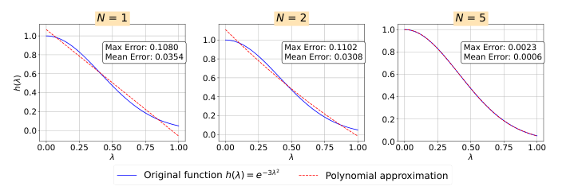

# Memory Is No Longer a Bottleneck: Memory-Efficient Graph Filtering for Scalable Collaborative Filtering (内存不再是瓶颈：面向可扩展协同过滤的内存高效图滤波)

- **会议/期刊**: IEEE Transactions on Knowledge and Data Engineering (TKDE, to appear)
- **作者与机构**: Jin-Duk Park, Won-Yong Shin（延世大学数学与计算学院）
- **推荐链路定位**: 召回（候选生成/打分，免训练 GF 模块）
- **研究方向**: 协同过滤与双塔召回 / 图神经网络与知识图谱推荐
- **论文原文**: [https://arxiv.org/abs/2606.21540v1](https://arxiv.org/abs/2606.21540v1)
- **开源代码**: [https://github.com/jindeok/Mem-GF](https://github.com/jindeok/Mem-GF)

## TL;DR (1分钟核心速览)

免训练图滤波 (GF) 类 CF 方法虽快，却必须显式构造并存储 $|I|\times|I|$ 的物品相似度图 $\tilde{P}=\bar{R}^\top\bar{R}$，在 Amazon-book 上六种代表性方法全部 OOM。本文提出 Mem-GF：对每个用户信号 $r_u$ 用 Lanczos 算法构造 $K$ 维 Krylov 子空间 $K_K(\tilde{P},r_u)$，把多项式滤波 $f(\tilde{P})r_u$ 精确投影为 $f(T_u)$ 上的 $K\times K$ 小矩阵运算，全程不落地 $\tilde{P}$。理论上证明 $N<K$ 时零近似误差，空间/时间均对 $|I|$、$|U|$、$\mathrm{nnz}(R)$ 线性。在 Yelp/Amazon-book/ML-20M 上内存最多降 5.74×、预处理加速 4.38×、推理加速 26.2×，且 Recall@20/NDCG@20 全面超越 21 个基线。

## Background & Motivation (背景与核心矛盾)

- **主流范式**: 谱视角下 GCN 即"可学习图滤波器"，而 GF-CF/EASE/PGSP/Turbo-CF/HiGSP 等免训练方法用**预定义**滤波器（线性 LPF、理想 LPF、多项式 LPF）直接在物品相似度图上平滑用户交互信号，省去迭代训练。
- **前人局限**: ① 所有方法共享一个**用户无关 (user-agnostic) 的通用滤波器**，维度恒为 $|I|\times|I|$，即使稀疏化/top-$k$ 特征分解/多项式展开，滤波阶段仍依赖全尺寸相似度矩阵；② 为规避内存，多项式阶数被硬性限制在 3 阶以内，频率响应表达能力受限，无法逼近高斯等复杂滤波器。
- **核心洞察 (Key Insight)**: 真正被需要的只是 $f(\tilde{P})r_u$ 这一个**向量**，而非整个 $\tilde{P}$。Krylov 子空间 $K_K(\tilde{P},r_u)=\mathrm{span}\{r_u,\tilde{P}r_u,\dots,\tilde{P}^{K-1}r_u\}$ 恰好张成了多项式作用于 $r_u$ 后所有可能的方向，且 $\tilde{P}Q_u=\bar{R}^\top(\bar{R}Q_u)$ 可用稀疏矩阵乘法"隐式"完成。
- **本文切入点**: 把 Krylov 子空间从"计算加速技巧"升格为"滤波原理本身"——滤波器与信号都变成**逐用户 (user-specific)** 的，内存按 batch 分配、用完即释放。

## Method (核心方法设计)

### 1. 整体框架 (Overall Architecture)

输入交互矩阵 $R$，先做度归一化 $\tilde{R}=D_U^{\gamma}RD_I^{1-\gamma}$，再施加 Hadamard 幂 $\bar{R}=\tilde{R}^{\circ s}$（注意：直接作用于 $\bar{R}$ 而非 $\tilde{P}$，这是避免显式存储的关键）。对每个用户 $u$，以 $r_u$ 为初始向量跑 $K$ 步 Lanczos，得到正交基 $Q_u\in\mathbb{R}^{|I|\times K}$ 与三对角矩阵 $T_u=Q_u^\top\tilde{P}Q_u$；在 $K\times K$ 的小空间内计算多项式 $f(T_u)=\sum_{n=0}^{N}a_nT_u^n$，最后回投得到打分 $s_u=\|r_u\|_2Q_uf(T_u)e_1$。全流程免训练，$(Q_u,T_u)$ 可预计算缓存，推理仅剩轻量矩阵乘法。

<figure class="paper-figure" markdown="span">
  <figcaption>图 3：Mem-GF 的示意图概览。</figcaption>
</figure>

### 2. 关键设计拆解 (Key Designs)

1. **逐用户 Krylov 投影滤波（核心算子）**：痛点是用户无关的 $|I|\times|I|$ 滤波器无法扩展。Mem-GF 利用 Lanczos 初始化 $Q_u^\top r_u=\|r_u\|_2e_1$，对任意 $N<K$ 的多项式有**精确恒等式**
$$f(\tilde{P})r_u=\|r_u\|_2\,Q_u\Big(\sum_{n=0}^{N}a_nT_u^n\Big)e_1=\|r_u\|_2Q_uf(T_u)e_1 .$$
直觉：$T_u$ 是 $\tilde{P}$ 在用户自身信号张成的子空间上的"压缩快照"，所有多项式作用都被无损搬进 $K$ 维空间，$\tilde{P}$ 从未被构造。

2. **高阶多项式滤波器设计（Gaussian LPF）**：痛点：传统方法因内存只能停在 3 阶，频率响应粗糙。Mem-GF 因 $T_u$ 仅 $K\times K$，可廉价地算到 5 阶；通过非线性最小二乘拟合高斯响应 $h(\lambda)=e^{-\tau\lambda^2}$（$\tau=3$），得到预定义 5 阶滤波器
$$f(T_u)=8T_u+3.1T_u^2-11.2T_u^3+6.2T_u^4-1.1T_u^5 .$$
图 4 显示 $N=5$ 时最大误差 0.0023，比 $N=1,2$（约 0.11）低两个数量级——这正是精度反超的物理来源。

<figure class="paper-figure" markdown="span">
  <figcaption>图 4：函数 h(λ) = e−γλ2 与其不同多项式阶数（N = 1, 2, 5）的多项式近似之间的比较。每个子图中标注了最大误差和平均误差，以指示近似精度。</figcaption>
</figure>

3. **训练目标、负采样与推理效率**：**无损失函数、无负采样、无训练**（training-free），滤波器系数由 LS 数值求解一次性确定。空间复杂度 $O(\mathrm{nnz}(R)+|I|K+K^2)$（对比 $O(|I|^2)$ 或 $\mathrm{nnz}(\tilde{P})$），时间复杂度 $O(|U|K(\mathrm{nnz}(R)+|I|))$，均线性。额外红利：一旦建好 $(Q_u,T_u)$，任意 $K'<K$ 阶滤波器只需前 $K'$ 个基向量即可切换，验证集选滤波器几乎零成本。

## Experimental Setup & Evaluation Protocol (实验设置与评估协议)

- **数据集与预处理**:

| 数据集 | #Users | #Items | #Interactions | 密度 | 说明 |
| :--- | :---: | :---: | :---: | :---: | :--- |
| Yelp | 31,668 | 38,048 | 1,561,406 | 0.130% | 本地生活 |
| Amazon-book | 52,643 | 91,599 | 2,984,108 | 0.062% | 图书，物品数大 |
| ML-20M | 138,493 | 26,744 | 20,000,263 | 0.540% | 大规模，10-core 过滤 |

- **数据划分与防穿越**: Yelp/Amazon-book 沿用 LightGCN/NGCF/PGSP/Turbo-CF 的公开划分与报告值以保证一致性；ML-20M 采用 **80:20 比例划分**，并从训练集再留 10% 作验证集，`10-core` 过滤。
- **排名评测协议**: 采用文献通用的 **top-20 全库排序**（Recall@20、NDCG@20），确定性方法（含 Mem-GF）单次运行，其余取 10 次均值。
- **对比基线与超参**: 21 个基线，覆盖 MF（BPR/NeuMF）、AE（Multi-VAE/RecVAE/SVD-AE）、GCN（NGCF/LightGCN/DGCF/SGL/SimpleX/SGDE）、生成式（DiffRec/L-DiffRec/FlowCF）、链接传播（LinkProp）与 GF（EASE/GF-CF/PGSP/FPSR/Turbo-CF/HiGSP）。Mem-GF 默认 $(\gamma,s,N)$：Yelp $(0.55,0.9,5)$、Amazon-book $(0.5,0.9,2)$、ML-20M $(0.5,1.1,2)$，统一取 $K=N+1$；显著性 $p\le0.01$。硬件：RTX A6000 48GB + 128GB RAM。

## Key Experimental Results (实验关键数据)

### 1. 主实验对比 (Main Results)

| 方法 | Yelp R@20 | Yelp N@20 | Amazon R@20 | Amazon N@20 | ML-20M R@20 | ML-20M N@20 |
| :--- | :---: | :---: | :---: | :---: | :---: | :---: |
| LightGCN | 0.0649 | 0.0530 | 0.0411 | 0.0315 | 0.0402 | 0.1702 |
| SGL | 0.0675 | 0.0555 | 0.0478 | 0.0379 | 0.0388 | 0.1677 |
| SVD-AE | 0.0681 | 0.0572 | 0.0602 | 0.0479 | 0.0536 | 0.2379 |
| LinkProp-Multi | 0.0690 | 0.0571 | 0.0721 | 0.0588 | OOM | OOM |
| DiffRec | 0.0656 | 0.0552 | 0.0514 | 0.0418 | 0.0549 | 0.2258 |
| FlowCF | 0.0686 | 0.0587 | 0.0497 | 0.0431 | 0.0531 | 0.2340 |
| EASE | 0.0657 | 0.0552 | 0.0710 | 0.0567 | 0.0522 | 0.2264 |
| GF-CF | 0.0697 | 0.0571 | 0.0710 | 0.0584 | 0.0487 | 0.2076 |
| Turbo-CF | 0.0693 | 0.0574 | 0.0730 | 0.0611 | 0.0534 | 0.2299 |
| HiGSP | OOM | OOM | OOM | OOM | OOM | OOM |
| **Mem-GF** | **0.0705** | **0.0586** | **0.0753** | **0.0620** | **0.0566** | **0.2402** |
| Improv.% (vs 最优基线) | +0.7%¹ | +0.3%¹ | +3.2% | +1.5% | +3.1% | +1.0% |

¹ Yelp 上 Recall 略低于 PGSP (0.0710)，NDCG 略低于 FPSR (0.0584)，其余数据集全面最优。

**效率对比（预处理，Amazon-book）**：EASE/GF-CF/PGSP/HiGSP/FPSR/Turbo-CF 中多数 OOM；Mem-GF 一阶仅 5.1GB、五阶 8.0GB，对比次优者（Turbo-CF 45.7GB）内存降 **5.74×**、时间 6.6s vs 35.5s 加速 **4.38×**。**推理（Yelp 单 batch）**：Mem-GF 0.0044s / 0.57GB，对比 GF-CF 0.1197s / 28.79GB，加速 **26.2×**、显存降 **>10.5×**。**vs 训练型**：ML-20M 上 Mem-GF 102.2s，LightGCN 需 $3.1\times10^5$s。

### 2. 消融实验 (Ablation Study)

| 配置 | Yelp R@20 | Amazon R@20 | ML-20M R@20 | 说明 |
| :--- | :---: | :---: | :---: | :--- |
| Mem-GF-1 ($K{=}2$) | 0.0684 | 0.0710 | 0.0554 | 一阶线性 LPF |
| Mem-GF-2 ($K{=}3$) | 0.0692 | **0.0754** | **0.0566** | 二阶 LPF，Amazon/ML 最优 |
| Mem-GF-3 ($K{=}4$) | 0.0683 | 0.0707 | 0.0516 | 三阶逼近理想 LPF |
| Mem-GF-5 ($K{=}6$) | **0.0703** | 0.0739 | 0.0564 | 五阶高斯 LPF，Yelp 最优 |
| Mem-GF-$k$（去掉 Krylov，$K{=}1$） | 0.0035 | 0.0011 | 0.0248 | 性能崩塌，验证子空间必要性 |

### 3. 关键实验发现 (Key Findings)

1. **$K=N+1$ 是零误差的临界点，且实验完全吻合定理**：表 VII 中当 $K\ge N+1$ 时各阶滤波器 Recall 与完整 Mem-GF-$k$ 完全一致（如 Amazon 上 Mem-GF-2 在 $K{=}3$ 起稳定于 0.0754），而 $K\le N$ 的灰色区域性能剧烈抖动（Yelp Mem-GF-5 在 $K{=}2$ 时仅 0.0684 vs 0.0703），说明 Krylov 维度不是"越大越好"的玄学超参，而是有严格代数下界的可解释量。
2. **精度增益来自"能负担得起的高阶滤波器"，而非内存节省本身**：Amazon-book 上 Turbo-CF 因 OOM 被迫锁死一阶（0.0730），Mem-GF 可自由选二阶（0.0754，+3.2%）；Yelp 上五阶高斯滤波器（0.0705）优于一阶（0.0684），印证图 4 中 $N=5$ 误差低两个数量级带来的频率响应保真度。
3. **内存瓶颈的解除直接转化为规模可行性**：Amazon-book 上 6/7 个 GF 基线 OOM，ML-20M 上多数方法因 GPU buffer OOM 退化到 CPU 导致 2735s–7432s 的预处理时间，而 Mem-GF 始终在 8GB 显存内完成，且图 5 显示内存/时间对 $|U|,|I|,\mathrm{nnz}(R)$ 均呈近线性增长，验证了 $O(\mathrm{nnz}(R)+|I|K+K^2)$ 的理论界。

## Highlights, Limitations & Rating (亮点、对比与审稿评价)

- **与代表作对比 (vs. Prior Work)**: 与 **Turbo-CF**（同为多项式 GF）的本质区别是后者仍显式构造 $\tilde{P}$ 并受限于 3 阶，Mem-GF 把滤波搬进逐用户 Krylov 空间从而解锁高阶；与 **GF-CF** 的区别是后者依赖稠密理想 LPF 矩阵（$|I|\times|I|$，实践中超线性内存），Mem-GF 完全规避；与 **LanczosNet** 的区别是后者用 Krylov 做**可学习** GNN 谱卷积，Mem-GF 是**免训练** CF 且以内存效率为第一目标。
- **可迁移亮点**: ① "只算 $f(M)v$ 不算 $M$"的隐式算子思路可迁移到任何大规模图平滑/标签传播场景（如社交传播、KG 推理）；② 预计算 $(Q_u,T_u)$ 后任意低阶滤波器零成本切换，天然适配**逐用户个性化滤波器选择**（不同用户最优滤波器差异大，见 PGSP/HiGSP 的动机）。
- **审稿级局限批判**: ① 仅适用于由交互构造的**对称**物品相似度图，社交网络/知识图谱等异构结构需重新设计滤波器，且逐用户 Lanczos 的 $|U|$ 次串行循环在分布式部署时需额外工程（论文自认留作 future work）；② 极稀疏/冷启动用户信号会使 Krylov 子空间信息不足，精度退化，且高阶 $N$ 在 $K$ 不足时有数值敏感性；③ 精度提升幅度在 Yelp 上仅 +0.3%~+0.7%，且未报告与 PGSP/FPSR 的显著性细节，收益主要仍体现在效率维度。
- **四维评分**: 创新性 ⭐⭐⭐⭐ | 实验扎实度 ⭐⭐⭐⭐⭐ | 方法清晰度 ⭐⭐⭐⭐⭐ | 落地价值 ⭐⭐⭐⭐⭐

