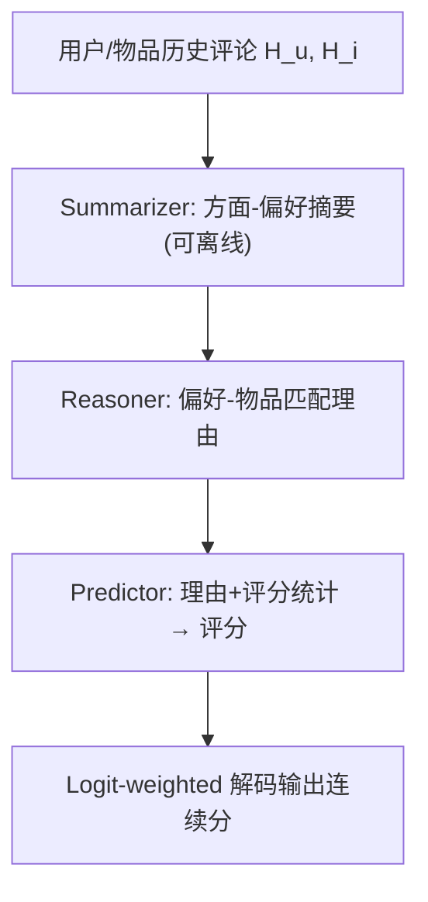
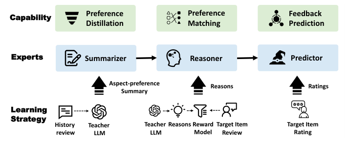

# Reason4Rec: Deliberative User Preference Alignment of Large Language Models for Recommendation (面向推荐的大语言模型审慎用户偏好对齐)

- **会议/期刊**: IEEE TKDE (Accepted)
- **作者与机构**: Yi Fang, Wenjie Wang, Yang Zhang, Fengbin Zhu, Qifan Wang, Fuli Feng, Xiangnan He (USTC / 中关村学院 / NUS / Meta AI)
- **推荐链路定位**: 精排（评分预测 / Top-K 排序）
- **研究方向**: 大语言模型推荐 / 对话推荐与智能体仿真
- **论文原文**: [https://arxiv.org/abs/2502.02061v3](https://arxiv.org/abs/2502.02061v3)
- **开源代码**: [https://github.com/Peter-Fy/Reason4Rec](https://github.com/Peter-Fy/Reason4Rec)

## TL;DR (1分钟核心速览)

现有 RecLLM 的对齐目标让模型"直接吐标签"，导致其依赖数据偏置与虚假相关、在冷启动/长尾场景失效。本文提出 **Deliberative Recommendation** 任务：强制模型在预测前显式推理用户偏好，并以用户评论文本作为推理监督信号；据此设计 Reason4Rec，用 Summarizer / Reasoner / Predictor 三个 QLoRA 专家分步完成"偏好蒸馏→偏好匹配→反馈预测"。在 Amazon Music/Book 与 Yelp 三个数据集上，MAE 相对最优基线平均降低约 0.02、RMSE 降低约 0.01，Top-5 排序 NDCG@5 在 Music 上从 0.3000 提升至 0.3311（+10.4%）。

## Background & Motivation (背景与核心矛盾)

- **主流范式**: 通过 SFT 或 DPO 将 LLM 对齐到推荐任务，输入用户历史与候选物品，直接输出评分/点击标签；近期工作（Rec-SAVER、EXP3RT）尝试引入推理，但仍是"单步生成推理+预测"的联合训练。
- **前人局限**: ① 标签导向目标使模型走"模式捷径"，易受数据偏置与虚假相关影响，对低频/冷启动物品泛化差；② 单步压缩复杂推理，且缺乏细粒度监督，生成的推理常与用户真实偏好错位。
- **核心洞察 (Key Insight)**: 用户评论（verbalized feedback）是免费可得、细粒度的偏好显式表达，可作为推理过程的"真值"监督；而推理本身应被分解为可独立学习的子能力，否则单步 CoT 会在训练集上过拟合（表 6：单步 CoT 从训练到测试 GPTScore 掉 9.03，Reason4Rec 仅掉 3.44）。
- **本文切入点**: 将推荐对齐重构为"先审慎推理、后预测"的多步任务，并用评论做步骤级监督。

## Method (核心方法设计)

### 1. 整体框架 (Overall Architecture)

输入用户历史 $H_u$与物品历史$H_i$（各取最近 10 条交互）。Summarizer 先将每条历史评论压缩为"方面-偏好摘要"（正/负方面关键词 + 用户偏好要素），该步可离线预计算；Reasoner 聚合用户与物品两侧摘要，生成"用户是否会喜欢该物品"的理由文本；Predictor 将理由、历史评分统计（用户/物品均值）拼接后输出评分。三个专家共享同一 LLaMA3-8B 主干，各挂一个独立 QLoRA 适配器（约 45M 可训练参数，<1% 全参），顺序训练。推理时仅需执行后两步，且 Predictor 只解码单个评分 token。

<figure class="paper-figure" markdown="span">
  <figcaption>图2. 推理驱动的推荐框架示意图。</figcaption>
</figure>

### 2. 关键设计拆解 (Key Designs)

1. **评论监督的"生成-过滤"理由构造**：直接用目标评论监督有噪声（含低质/无关内容），而用评论反推理由又会引入历史中不存在的偏好。做法是 ChatGPT 按 Reasoner prompt 多次采样候选理由，再由奖励模型打分筛选；若首轮不合格，则在 prompt 中附加"用户实际打了 $r_{ui}$ 星"的 hint 重新生成（最多 2 轮）。直觉：hint 只约束偏好方向、不泄露具体措辞，能在保证理由与真实偏好同向的前提下提升采样命中率。

2. **奖励模型与阈值化理由判定**：奖励模型是另一个 QLoRA，输入为 Predictor prompt 模板但 Reason Placeholder 填入目标评论，训练它从评论中还原真实偏好并预测评分；其训练数据（8000 对）与 Reasoner 指令数据严格不重叠，防止"背答案"。判定分数定义为
$$s_{\text{eval}}=\left|r_{ui}-r_{\text{reason}}\right|-\left|r_{ui}-r_{\text{review}}\right|,$$
即"用生成理由预测"与"用真实评论预测"的误差差；$s_{\text{eval}}<\tau$判为高质量理由。$\tau$越小理由越精但数量越少，构成质量-数量权衡（表 9：Yelp 上$\tau=0.08$最优，MAE 0.7515；$\tau=0.02$ 仅 2705 条样本，MAE 退化至 0.7751）。

3. **Logit-weighted 解码与训练目标**：评分 token 的 logits $l_1,\dots,l_N$经 softmax 得$p_k$，输出期望$\hat{r}_{ui}=\sum_{k=1}^{N}k\cdot p_k$，把离散评分连续化以提升精度；由于输出前缀"Predicted Rating:"固定，可跳过其解码、仅生成一个评分 token。三个专家均用标准 SFT 交叉熵，监督源分别为教师摘要、过滤后理由、真实评分，无需负采样。

## Experimental Setup & Evaluation Protocol (实验设置与评估协议)

- **数据集与预处理**（均 `5-core` 过滤）：

| 数据集 | #Users | #Items | #Interactions | 场景说明 |
| :--- | :---: | :---: | :---: | :--- |
| Amazon Music | 5,541 | 3,568 | 64,706 | 全量音乐评论 |
| Amazon Book | 174,050 | 127,821 | 540,074 | 取最近两个月 |
| Yelp | 173,099 | 67,854 | 302,558 | 取最近六个月 |

- **数据划分与防穿越**: 按交互时间戳 `8:1:1` 比例划分，测试集严格晚于训练/验证集，防止信息泄漏。
- **排名评测协议**: 评分预测用 MAE / RMSE；理由质量用 BLEURT 与 GPTScore（GPT-4o 打分，0–100）；排序任务为**采样候选排序**——每个用户 1 个高评分正例（≥4 星）+ 随机 19 个未交互负例，共 20 候选，报告 NDCG@5 / Precision@5。
- **对比基线与超参**: 基线含 CF（MF）、评论建模（DeepCoNN / NARRE / DAML）、LLM（GPT-4o few-shot、DeepSeek-R1、Rec-SAVER、EXP3RT）；所有微调方法统一 LLaMA3-8B + QLoRA、12000 条指令样本、教师为 GPT-3.5-turbo，阈值 $\tau$ 在验证集网格搜索（Music 0.1 / Book 0.2 / Yelp 0.08）。

## Key Experimental Results (实验关键数据)

### 1. 主实验对比 (Main Results)

| 类型 | 方法 | Music MAE↓ | Music RMSE↓ | Book MAE↓ | Book RMSE↓ | Yelp MAE↓ | Yelp RMSE↓ |
| :--- | :--- | :---: | :---: | :---: | :---: | :---: | :---: |
| CF | MF | 0.6188 | 0.8142 | 0.6277 | 0.8565 | 0.7980 | 1.0711 |
| 评论 | DeepCoNN | 0.6034 | 0.8057 | 0.6221 | 0.8403 | 0.8312 | 1.0665 |
| 评论 | NARRE | 0.5799 | 0.7881 | 0.6242 | 0.8435 | 0.8177 | 1.0785 |
| 评论 | DAML | 0.5703 | 0.7848 | 0.6214 | 0.8371 | 0.7964 | 1.0405 |
| LLM | GPT-4o | 0.7438 | 1.1069 | 0.7591 | 1.1558 | 0.8766 | 1.3005 |
| LLM | DeepSeek-R1 | **0.5197** | 0.8849 | 0.6155 | 1.0019 | 0.8253 | 1.2959 |
| LLM | Rec-SAVER | 0.6463 | 0.9262 | 0.6645 | 0.9356 | 0.8295 | 1.1282 |
| LLM | EXP3RT | 0.5608 | 0.8385 | 0.6135 | 0.9370 | 0.8306 | 1.2311 |
| Ours | **Reason4Rec** | 0.5442 | **0.7722** | **0.6029** | **0.8345** | **0.7515** | **1.0343** |

理由质量（表 2）：Music GPTScore 80.53 / BLEURT 0.4067，Book 77.31 / 0.4731，Yelp 72.70 / 0.4565，全面超过 DeepSeek-R1（79.62 / 0.3863 等）。人工评测（表 3）中 Preference Alignment 由 3.67 升至 3.85。排序任务（表 4）：Music NDCG@5 0.3311 vs. DAML 0.3000（+10.4%），Book 0.2365 vs. 0.2197（+7.6%）。

### 2. 消融实验 (Ablation Study)

| 配置 | Music MAE↓ | Music RMSE↓ | Book MAE↓ | Book RMSE↓ |
| :--- | :---: | :---: | :---: | :---: |
| w/o Step1 (Summarizer) | 0.5529 | 0.7742 | 0.6225 | 0.8394 |
| w/o Step2 (Reasoner) | 0.5640 | 0.7744 | 0.6305 | 0.8376 |
| w/o Step3 (Predictor 合并) | 显著上升 | 显著上升 | 显著上升 | 显著上升 |
| 单步推理 | 更高 | 更高 | 更高 | 更高 |
| 单步 CoT | 更高 | 更高 | 更高 | 更高 |
| **Reason4Rec** | **0.5442** | **0.7722** | **0.6029** | **0.8345** |

### 3. 关键实验发现 (Key Findings)

1. **多步拆分的收益主要来自"预测与推理解耦"**：合并 Reasoner 与 Predictor（w/o Step3）带来的误差增幅最大，说明让同一模型同时做匹配分析与打分是主要瓶颈；而 w/o Step2 时 RMSE 涨幅小、MAE 涨幅大，反映无推理时模型仍能靠历史评分避开极端错误，但精细精度显著丢失。
2. **推理质量与预测精度强正相关**：按 GPTScore 四分位分组（图 5），Music 上 Q1（均值 55.4）MAE 高达 0.9014，Q4（均值 95.6）仅 0.3372；预测正确的样本理由 GPTScore 为 86.75，错误样本仅 79.20，说明提升推理质量本身即是提升精度的手段。
3. **评论监督必须"过滤"而非"直用"**：Review-guided（直接用评论监督）在 Music 上 MAE 0.5825、Book 0.6376，反而劣于无理由版本（0.5529 / 0.6225），因为评论含噪声且引入历史中不存在的偏好；经奖励模型过滤后降至 0.5442 / 0.6029，验证生成-过滤策略的必要性。

## Highlights & Limitations (亮点、对比与审稿批判)

- **与代表作对比 (vs. Prior Work)**: 相比 Rec-SAVER（大模型蒸馏推理、单步、无偏好对齐监督）与 EXP3RT（先建画像再单步推理+预测），本文的核心差异是**步骤级分解 + 评论作为推理侧监督**；相比 DeepSeek-R1 的原生慢思考，本文在 RMSE 上领先 0.11 以上，说明通用推理能力不能替代任务特定的偏好对齐。
- **可迁移亮点**: ① "生成-过滤 + hint 重采样"构造高质量推理监督的流程，可直接迁移到任何需要理由标注的 LLM 推荐/解释任务；② 离线预计算摘要 + 单 token 解码，把多步推理的在线开销压到约 5.86s / 148 tokens，与单步方法持平。
- **审稿级局限批判**: ① 排序评测仅用 1:19 采样候选，未做全库 Full-Ranking，NDCG 的绝对可比性有限；② 三专家顺序训练 + 教师模型生成 + 奖励模型筛选的流水线较重，且 $\tau$ 需按域网格搜索（0.08–0.2 跨度大），跨域迁移成本高；③ 仅在评分预测范式验证，未涉及真实工业级召回/排序链路与在线 A/B。

## Rating (四维评分)

- **方法创新性 (Novelty)**: ⭐⭐⭐⭐ （将"审慎对齐"从安全域迁移到推荐，并以评论做步骤级监督，任务形式新颖，但三专家结构本身工程味较重）
- **评估协议与实验扎实度 (Protocol & Experiments)**: ⭐⭐⭐⭐ （三数据集 + 自动指标 + 人工评测 + 排序任务 + 推理成本分析齐全，扣分在排序仅采样候选、缺全库评测）
- **写作与数学规范度 (Clarity & Rigor)**: ⭐⭐⭐⭐ （任务形式化与各步 prompt、奖励判定公式清晰，但缺少复杂度与收敛性层面的理论分析）
- **工业落地与复现价值 (Industrial & Practical Value)**: ⭐⭐⭐⭐ （代码开源、QLoRA 单卡 5 小时可训、离线摘要 + 单 token 解码使在线成本可控，适合高价值低频决策场景）
