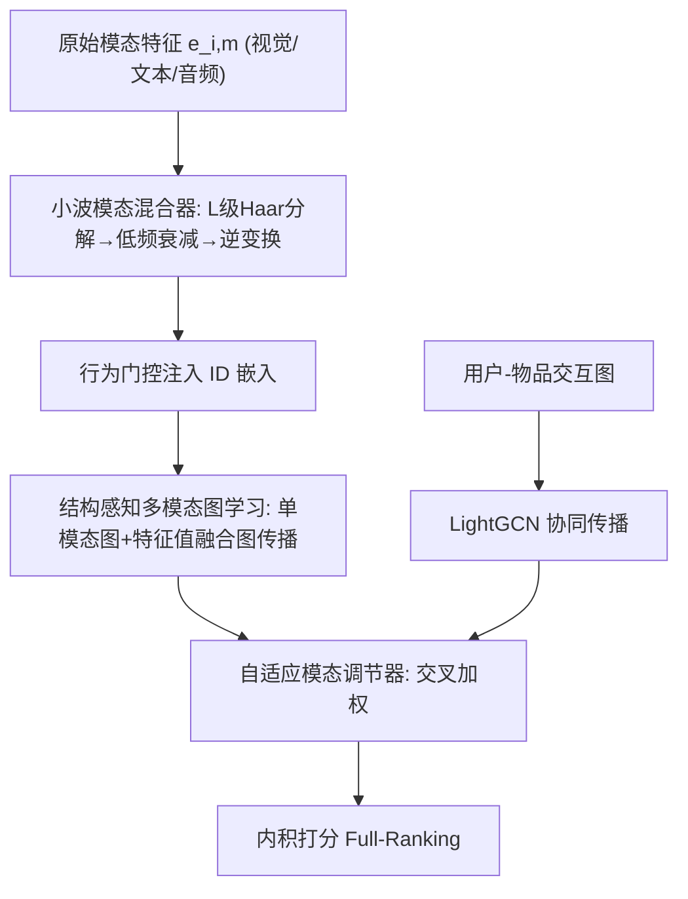
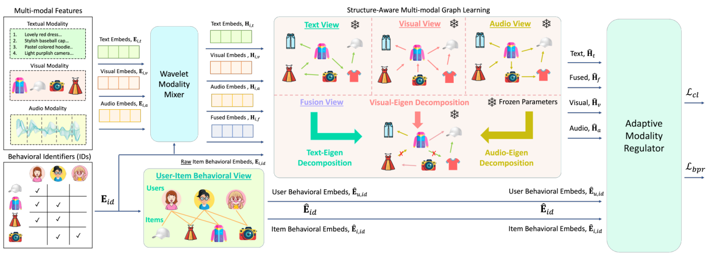

# Tackling the Modality Inhibitance Effect with Wavelet-based Modality Integration in Multi-modal Recommendation (基于小波模态整合缓解多模态推荐中的模态抑制效应)

- **会议/期刊**: IEEE TKDE 2026
- **作者与机构**: Rongqing Kenneth Ong, Andy W. H. Khong（南洋理工大学 EEE 学院）
- **推荐链路定位**: 召回（多模态表征学习 + 全库排序）
- **研究方向**: 多模态推荐 / 图神经网络推荐
- **论文原文**: [https://arxiv.org/abs/2610.16229v1](https://arxiv.org/abs/2610.16229v1)
- **开源代码**: [https://github.com/kennethorq/MMWave](https://github.com/kennethorq/MMWave)

## TL;DR (1分钟核心速览)

本文首次提出**模态抑制效应 (Modality Inhibitance Effect, MIE)**：现有融合式多模态推荐从双模态扩展到三模态（视觉+文本+音频）时性能反而显著下降——新模态不仅自带噪声，还引入跨模态冗余信号。作者用**Haar 小波多分辨率分解**只保留各模态低频近似分量并做可学习衰减，配合**结构感知多模态图学习**与**交叉加权自适应调节器**实现精细融合。在 Baby/Sports/Clothing/TikTok 四数据集、`Full-Ranking` 协议下，相对 12 个基线平均提升 **6.48%**（TikTok R@10 达 0.0827，较 BM3 提升 14.5%）。

## Background & Motivation (背景与核心矛盾)

- **主流范式**: 以 MMGCN、LATTICE、FREEDOM、LGMRec 为代表的融合式 MRS，将各模态特征投影到共享隐空间后通过注意力求和或拼接融合，再叠加 GNN 传播高阶协同信号。
- **前人局限**: ① 融合前先投影到压缩隐空间，会把噪声与有效信号纠缠在一起（"先压缩后去噪"的固有缺陷）；② 融合权重依赖启发式规则或预定义注意力，模态数增加时超参线性膨胀，且无法感知各模态图结构差异。
- **核心洞察 (Key Insight)**: 作者在 TikTok 上实测（表 I）发现 MMGCN/FREEDOM/LGMRec 从双模态切到三模态时 R@5 全面下滑（如 MMGCN 0.0299→0.0309 但 N@5 0.0199→0.0152），而非融合的 BM3 反而在 Full 模态下最优。作者将 MIE 与经典"模态不平衡"严格区分：后者是梯度共享导致弱模态欠优化（$\partial L/\partial s^{m_1}=\partial L/\partial s^{m_2}$），MIE 则是**跨模态冗余**——定义 $R_{m_1,m_2}=|\text{Corr}(s^{m_1}_{uij},s^{m_2}_{uij})|$，当 $\Delta R(m'|S)>0$ 且 $\Delta P_{\text{MRS}}(m'|S)<0$ 时即发生 MIE。
- **本文切入点**: 噪声多集中于高频分量，故直接在**原始模态信号**上做小波分解，仅保留低频近似系数并学习衰减权重，从源头切断冗余。

## Method (核心方法设计)

### 1. 整体框架 (Overall Architecture)

输入为物品三模态原始特征 $\mathbf{e}_{i,m}$ 与用户-物品交互矩阵。先经**小波模态混合器**：对每个模态做 $L$ 级 Haar 离散小波变换，仅对低频近似系数 $A_m^{(L)}$ 施加可学习逐点衰减并逆变换重构，得到"去冗余"模态特征；再经行为门控注入 ID 信息。随后**结构感知多模态图学习**在单模态相似图与结构融合图上做 LightGCN 式传播，同时用户-物品二部图传播协同信号。最后**自适应模态调节器**用融合表征的注意力去重加权单模态表征、反之亦然，交叉加权后与 ID 表征相加做内积预测。

<figure class="paper-figure" markdown="span">
  <figcaption>图 1：所提出架构的概览，突出其三个核心组件：(i) 小波模态滤波器，(ii) 结构感知多模态图学习，(iii) 自适应模态调节器模块。</figcaption>
</figure>

### 2. 关键设计拆解 (Key Designs)

1. **小波模态混合器（Wavelet Modality Mixer）**：针对"先投影后去噪导致噪声纠缠"的痛点，直接在原始信号上做多分辨率分解。用 Haar 低/高通滤波器 $\delta[k]=[\tfrac{1}{\sqrt2},\tfrac{1}{\sqrt2}]$、$\eta[k]=[-\tfrac{1}{\sqrt2},\tfrac{1}{\sqrt2}]$ 递归分解得近似系数 $A_m^{(L)}$ 与细节系数 $\{D_m^{(l)}\}$，仅对近似分量施加模态专属可学习衰减 $\tilde{A}_m^{(L)}=W_{1,m}\odot A_m^{(L)}$，再用**仅含低频合成滤波器**的修正逆变换重构 $\tilde{E}_{i,m}=W_m^{-1}(\tilde{A}_m^{(L)})$。直觉：高频即噪声，丢弃细节系数等价于显式频域硬去噪，比 MLP 隐式映射更具可解释性与定位性（时频局部化同时适配序列模态文本/音频与空间模态图像）。

2. **结构感知多模态图学习（Structure-aware Multi-modal Graph Learning）**：针对"启发式融合图忽略结构信息且超参随模态数膨胀"的痛点，先对各单模态 top-$K$ 稀疏化相似图 $\ddot{S}_m$ 做谱分解 $V_m\Lambda_m V_m^\top=\ddot{S}_m$，再用**其他模态的特征值**重构本模态图：$\hat{S}_m=\frac{1}{|\mathcal{M}|-1}\sum_{m'\neq m}\ddot{S}_m\odot\hat{\lambda}_{m'}$，最后平均池化得融合图 $\hat{S}_f$。所有图**训练前预构建**，零额外训练开销；特征值加权使各模态结构贡献均衡且免调融合超参。

3. **自适应模态调节器与训练目标**：针对"注意力求和无法处理跨模态互补"的痛点，设计**互加权**：用融合注意力 $\gamma_f$ 重加权单模态 $\ddot{H}_{i,m}=\gamma_f\hat{H}_{i,m}$，用各单模态注意力均值重加权融合表征 $\ddot{H}_{i,f}=\frac{1}{|\mathcal{M}|}\sum_m\gamma_m\hat{H}_{i,f}$，再经协同信号门控 $\sigma(W\hat{E}_{id})$ 调制后聚合。总损失 $\mathcal{L}=\mathcal{L}_{\text{bpr}}+\psi_1\mathcal{L}_{\text{cl}}+\psi_2\|\Theta\|_2^2$，其中 $\mathcal{L}_{\text{cl}}$ 为 ID 表征与模态侧表征间的 InfoNCE（批内负采样，温度 $\tau$）；BPR 采用标准均匀负采样，推理为内积全库排序。

## Experimental Setup & Evaluation Protocol (实验设置与评估协议)

- **数据集与预处理**（均 `5-core` 过滤）：

| 数据集 | #Users | #Items | #Interactions | 密度 | 模态/场景 |
| :--- | :---: | :---: | :---: | :---: | :--- |
| Baby | 19,445 | 7,050 | 160,792 | 0.117% | 视觉+文本（电商） |
| Sports | 35,598 | 18,357 | 296,337 | 0.045% | 视觉+文本（电商） |
| Clothing | 39,387 | 23,033 | 278,677 | 0.031% | 视觉+文本（电商） |
| Tiktok | 9,308 | 6,710 | 68,722 | 0.110% | 视觉+文本+音频（短视频） |

- **数据划分与防穿越**: 按 80%/10%/10% 比例随机划分训练/验证/测试（沿用 FREEDOM/LGMRec 惯例），非时间戳切分。
- **排名评测协议**: 无偏 `Full-Ranking`（全库未交互物品排序），指标 Recall@{5,10,20} 与 NDCG@{5,10,20}。
- **对比基线与超参**: 2 个通用（BPR、LightGCN）+ 10 个多模态（VBPR、LGCN-M、MMGCN、GRCN、SLMRec、BM3、FREEDOM、LGMRec、MIG-GT 等）；嵌入维度 $d=64$，Xavier 初始化，Adam，1000 epoch，batch=2048，早停 patience=20；3 个随机种子重复，paired t-test $p<0.01$ 显著。

## Key Experimental Results (实验关键数据)

### 1. 主实验对比 (Main Results)

| 数据集/指标 | LightGCN | BM3 | FREEDOM | LGMRec | MIG-GT | **MMWave** | Improv. |
| :--- | :---: | :---: | :---: | :---: | :---: | :---: | :---: |
| Baby R@10 | 0.0453 | 0.0548 | 0.0626 | 0.0653 | 0.0650 | **0.0690** | +5.7% vs LGMRec |
| Baby N@10 | 0.0246 | 0.0297 | 0.0327 | 0.0353 | 0.0352 | **0.0373** | +5.7% |
| Sports R@10 | 0.0542 | 0.0613 | 0.0724 | 0.0719 | 0.0738 | **0.0760** | +3.0% vs MIG-GT |
| Sports N@10 | 0.0300 | 0.0339 | 0.0390 | 0.0388 | 0.0402 | **0.0419** | +4.2% |
| Clothing R@10 | 0.0338 | 0.0418 | 0.0635 | 0.0556 | 0.0629 | **0.0673** | +6.0% vs FREEDOM |
| Clothing N@10 | 0.0185 | 0.0225 | 0.0340 | 0.0305 | 0.0343 | **0.0365** | +6.4% |
| Tiktok R@10 | 0.0529 | 0.0722 | 0.0571 | 0.0502 | 0.0624 | **0.0827** | +14.5% vs BM3 |
| Tiktok N@10 | 0.0266 | 0.0379 | 0.0319 | 0.0267 | 0.0303 | **0.0408** | +7.7% |

### 2. 消融实验 (Ablation Study)

| 变体 | Baby R@10 | Sports R@10 | Clothing R@10 | Tiktok R@10 |
| :--- | :---: | :---: | :---: | :---: |
| **MMWave (Full)** | **0.0690** | **0.0760** | **0.0673** | **0.0827** |
| w/o 小波模态混合器 | 0.0636 | 0.0712 | 0.0627 | 0.0781 |
| w/o 结构感知图学习 | 0.0552 | 0.0698 | 0.0462 | 0.0739 |
| w/o 自适应调节器 | 0.0578 | 0.0698 | 0.0549 | 0.0676 |
| 仅文本模态 | 0.0636 | 0.0619 | 0.0627 | 0.0781 |
| 仅视觉模态 | 0.0552 | 0.0712 | 0.0462 | 0.0739 |
| 仅融合表征 | 0.0578 | 0.0698 | 0.0549 | 0.0676 |

### 3. 关键实验发现 (Key Findings)

1. **结构感知图学习是最大贡献项**：移除后 Clothing R@10 从 0.0673 暴跌至 0.0462（-31.4%），远超其他组件，说明单模态图 + 特征值融合图的双图结构是性能基石；而 TikTok 上移除小波混合器或调节器均造成约 7.6% 平均下降，证明三模态场景下"去冗余"与"精细融合"同等关键。
2. **MIE 被有效缓解**：在 TikTok 0%/5%/10% 模态污染下，MMWave 的 Full 模态配置始终优于任意双模态子集（对比表 I 中基线 Full 反而最差），且污染加剧时视觉+音频组合逼近 Full，说明交叉加权能动态抑制不可靠文本模态的冗余贡献。
3. **小波优于 MLP 去噪且对基函数鲁棒**：替换为 MLP 去噪（参数量更多）性能全面下降，证明增益来自频域显式分解而非模型容量；Haar/Db4/Sym4/Coif1/Bior4.4/Dmey 六种基函数下性能波动小，仅 TikTok 上 Bior4.4 因线性相位特性略优。分解层数 $L=2\sim3$ 最优，$L=4$ 在 TikTok 上因过度分解细节敏感特征而退化。

## Highlights, Limitations & Rating (亮点、对比与审稿评价)

- **与代表作对比 (vs. Prior Work)**: 相比 LATTICE/FREEDOM 的"投影后融合 + 冻结图"，MMWave 在**原始信号域**做小波去噪并让融合图吸收跨模态特征值结构；相比 LGMRec 的注意力求和，交叉加权调节器实现单模态↔融合表征的双向互导，天然可扩展到任意模态数。
- **可迁移亮点**: ① "仅保留低频近似系数 + 可学习衰减 + 低频逆变换"是极轻量的即插即用去噪模块，可迁移到序列推荐的多源特征清洗；② 用其他模态特征值重构本模态图的谱融合技巧，可迁移到多视图图对比学习。
- **审稿级局限批判**: ① 内存开销显著高于基线（Sports 上 4.67GB vs FREEDOM 3.08GB，训练 10.41s/epoch），谱分解预处理成本未计入，工业级规模（千万物品）下 $N\times N$ 特征分解不可行；② 仅在 TikTok 单数据集验证三模态，且文本模态在短视频场景被证明不可靠，MIE 理论（式 43-47）缺乏跨更多模态数（4+）的实证支撑。
- **四维评分**: 创新性 ⭐⭐⭐⭐ | 实验扎实度 ⭐⭐⭐⭐ | 方法清晰度 ⭐⭐⭐⭐ | 落地价值 ⭐⭐⭐

