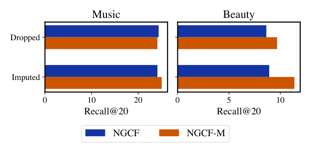
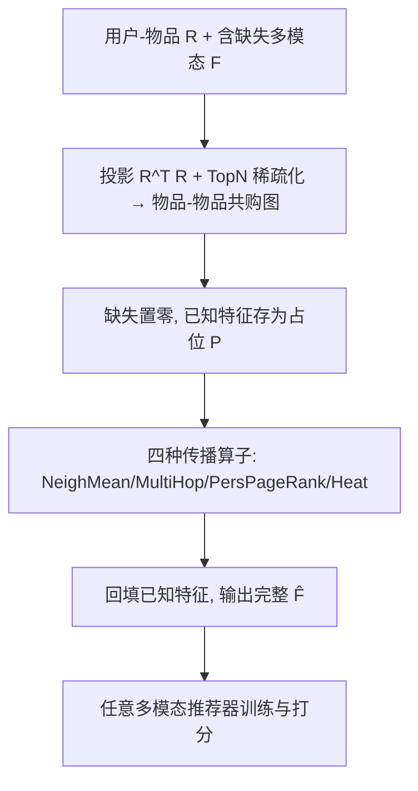
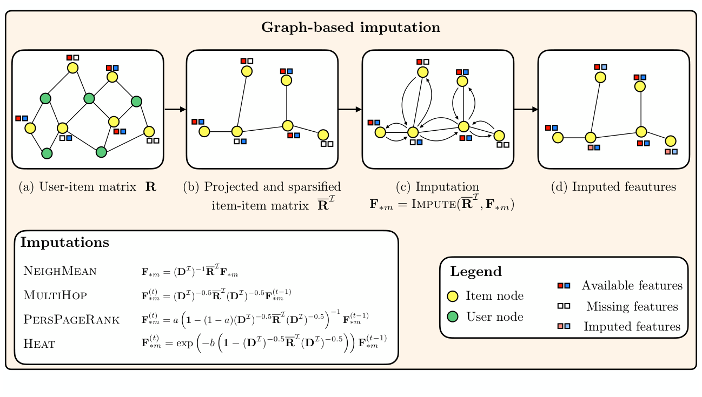

# Training-free Graph-based Imputation of Missing Modalities in Multimodal Recommendation (多模态推荐中缺失模态的免训练图填补)

- **会议/期刊**: IEEE TKDE 2026
- **作者与机构**: Daniele Malitesta, Emanuele Rossi, Claudio Pomo, Tommaso Di Noia, Fragkiskos D. Malliaros（CentraleSupélec/Inria、VantAI、Politecnico di Bari）
- **推荐链路定位**: 召回（多模态表征预处理阶段）
- **研究方向**: 多模态推荐 / 图神经网络推荐
- **论文原文**: [论文原文链接](https://arxiv.org/abs/2602.17354v1)
- **开源代码**: [开源代码仓库链接](https://github.com/westlake-repl/MicroLens)（论文自述代码库为 `danielemalitesta/Graph-Missing-Modalities-TKDE`）

## TL;DR (1分钟核心速览)

多模态推荐长期默认物品的视觉/文本特征完整，实践中却大量缺失，主流做法是直接丢弃这些物品，反而削弱了多模态数据缓解稀疏性的初衷。本文首次形式化"多模态推荐缺失模态"问题，并将其重铸为**物品-物品共购图上的图特征插值**，提出四种**免训练**传播算子（NeighMean / MultiHop / PersPageRank / Heat）在预处理阶段填补缺失特征。在 7 个数据集、14 个推荐模型上，填补设置不仅保持、甚至扩大（如 NGCF-M 对 NGCF 在 Office 上 +35.33% Recall）多模态与传统推荐的性能差距，且普遍优于零填充、均值填充与自编码器填补。

## Background & Motivation (背景与核心矛盾)

- **主流范式**: 多模态推荐（VBPR、MGCN、MMSSL、LGMRec、DiffMM 等）通过注入物品图像/文本特征缓解交互稀疏，是当前 SOTA 范式。
- **前人局限**: ① 真实与学术数据（Amazon Reviews）中大量物品缺图或缺描述，标准做法是**丢弃**这些物品及其交互，直接抵消了多模态数据抗稀疏的价值；② 少数端到端填补/鲁棒方法（如生成式重建、模态 VAE）与特定推荐模型**强耦合**，无法迁移到其他 SOTA 推荐器。
- **核心洞察 (Key Insight)**: 图特征插值理论指出，若图上节点特征满足**同质性 (feature homophily)**，则可用邻居已知特征插值缺失特征；共购物品天然语义相近（与 CF 同源假设），因此用户-物品图投影出的物品-物品共购图可作为插值载体。
- **本文切入点**: 把缺失模态填补从"模型内训练"搬到"模型外预处理"，用共购图多跳传播实现**免训练、模型无关**的填补。

<figure class="paper-figure" markdown="span">
  <figcaption>图 1：动机示例，展示在 Music 和 Beauty 数据集上，NGCF（蓝色）与 NGCF-M（棕色）在丢弃和填补设置下的性能提升（Recall@20）。显然，在填补设置下，NGCF-M 相对 NGCF 的性能提升更大（在 Music 数据集上甚至出现反转）。</figcaption>
</figure>

## Method (核心方法设计)

### 1. 整体框架 (Overall Architecture)

输入为用户-物品交互矩阵 $\mathbf{R}$ 与含缺失的多模态张量 $\mathbf{F}$。流程：先由 $\mathbf{R}^\top\mathbf{R}$ 投影得到物品-物品共购矩阵并按行 TopN 稀疏化得 $\bar{\mathbf{R}}^I$；对每个模态 $m$，将缺失项置零、保留已知项为占位 $P$，在 $\bar{\mathbf{R}}^I$ 上执行传播算子得到填补值，再**回填原始已知特征**（避免污染观测值），最后把完整特征张量送入任意现成多模态推荐器训练。整个填补在预处理阶段完成，不参与推荐模型的反向传播。

<figure class="paper-figure" markdown="span">
  <figcaption>图 2：基于图的填补方法的可视化表示。从具有不完整多模态特征的用户-物品图（a）出发，对其进行投影和稀疏化以获得物品-物品共购图（b）。然后，在所得物品-物品图（c）中传播可用的多模态特征，从而填补缺失特征（d）。</figcaption>
</figure>

### 2. 关键设计拆解 (Key Designs)

1. **问题形式化与掩码重定义（区别于传统 ML 缺失）**：传统 ML 缺失是"样本-特征"级随机缺失，可用同特征的其他样本插值；本文缺失是**整条模态向量**级缺失，掩码 $\mathbf{B}\in\{0_C,1_C\}^{I\times M}$ 以整块为单位，且只能在**同一模态内**跨物品插值：$\hat{\mathbf{F}}_{im}=\text{IMPUTE}(\mathbf{F}_{*m}[\mathbf{B}_{*m}])$。这一区分决定了必须借助物品间关系（图）而非特征间统计量。

2. **四种图传播算子（核心增量）**：在稀疏共购图 $\bar{\mathbf{R}}^I$ 上迭代传播，每轮将已知特征重置为 $P$：
   - NeighMean（一阶均值）：$\mathbf{F}_{*m}=(\mathbf{D}^I)^{-1}\bar{\mathbf{R}}^I\mathbf{F}_{*m}$；
   - MultiHop（对称归一化多跳）：$\mathbf{F}^{(t)}_{*m}=(\mathbf{D}^I)^{-0.5}\bar{\mathbf{R}}^I(\mathbf{D}^I)^{-0.5}\mathbf{F}^{(t-1)}_{*m}$，度归一化防止高度数热门物品在插值中被过度代表，缓解流行度偏置；
   - PersPageRank（图扩散）：$\mathbf{F}^{(t)}_{*m}=a\big(\mathbf{1}-(1-a)(\mathbf{D}^I)^{-0.5}\bar{\mathbf{R}}^I(\mathbf{D}^I)^{-0.5}\big)^{-1}\mathbf{F}^{(t-1)}_{*m}$；
   - Heat（热核扩散）：$\mathbf{F}^{(t)}_{*m}=\exp\big(-b(\mathbf{1}-(\mathbf{D}^I)^{-0.5}\bar{\mathbf{R}}^I(\mathbf{D}^I)^{-0.5})\big)\mathbf{F}^{(t-1)}_{*m}$。
   直觉：多跳+扩散归一化把"局部邻居均值"升级为"全局平滑插值"，在低同质图上更稳健。

3. **训练目标、负采样与推理效率**：本文**无训练损失、无负采样**——填补是纯矩阵传播，复杂度约为 $O(T\cdot|\bar{\mathbf{R}}^I|\cdot C)$，仅需一次预处理；相比需训练的自编码器填补（AutoEnc/GraphAutoEnc），在同等或更优精度下计算开销显著更低，且与推荐器解耦。

## Experimental Setup & Evaluation Protocol (实验设置与评估协议)

- **数据集与预处理**: 6 个 Amazon 类目（Office/Music/Baby/Toys/Beauty/Sports，视觉+文本两模态）+ MicroLens（视觉+文本+视频三模态，7-core 过滤后 7,556 用户/4,628 物品/81,505 交互）。每个数据集构造 **dropped**（删缺失物品及孤立用户）与 **imputed**（填补）两版本：

| 数据集 | #Users | #Items(原始/丢弃后) | #Interactions(原始/丢弃后) | 缺失率 |
| :--- | :---: | :---: | :---: | :---: |
| Office | 4,905 | 2,420 / 1,746 | 53,258 / 35,185 | 28% |
| Music | 5,541 | 3,568 / 2,453 | 64,706 / 51,516 | 31% |
| Baby | 19,445 | 7,050 / 6,382 | 160,792 / 138,149 | 9% |
| Toys | 19,412 | 11,924 / 11,089 | 167,597 / 146,640 | 7% |
| Beauty | 22,363 | 12,101 / 11,124 | 198,502 / 165,772 | 8% |
| Sports | 35,598 | 18,357 / 15,633 | 296,337 / 251,201 | 15% |

- **数据划分与防穿越**: Hold-out **80%/20%** train/test，另留 10% 训练集作验证（以 Recall@20 选填补超参）。
- **排名评测协议**: 采用 **Full-Ranking**（全库未交互物品排序），指标 Recall@20 与 nDCG@20；BPR 类负采样训练沿用各基线默认设置。
- **对比基线与超参**: 传统 BPRMF/NGCF/LightGCN/SGL，多模态 VBPR/NGCF-M/LightGCN-M/FREEDOM/BM3/MGCN/MMSSL/LGMRec/DiffMM/MENTOR；填补基线 ZEROS/RANDOM/GLOBALMEAN/AutoEnc/GraphAutoEnc；TopN∈{10,…,100}，Hops∈{1,…,20}，学习率 {1e-4…1e-2}，batch 1024，epoch 200。

## Key Experimental Results (实验关键数据)

### 1. 主实验对比 (Main Results)

填补设置下各推荐器 Recall@20（节选，加粗为最优）：

| 模型 | Office | Music | Baby | Toys | Beauty | Sports |
| :--- | :---: | :---: | :---: | :---: | :---: | :---: |
| LightGCN | 11.55 | 26.61 | 7.36 | 10.22 | 11.61 | 8.26 |
| VBPR | 9.47 | 26.25 | 5.90 | 10.36 | 10.92 | 6.65 |
| NGCF-M | 11.07 | 25.04 | 6.96 | 9.21 | 11.37 | 7.43 |
| FREEDOM | 12.01 | 26.53 | 8.34 | 13.01 | 13.59 | 9.26 |
| MGCN | 11.63 | 24.60 | 8.44 | 12.35 | 12.73 | 8.53 |
| MMSSL | **13.50** | 29.28 | 8.80 | 12.04 | 13.72 | 9.22 |
| LGMRec | 13.19 | 29.05 | **8.91** | 12.74 | 13.76 | 9.23 |
| DiffMM | 12.60 | 28.49 | 8.81 | 11.92 | 13.27 | 9.29 |
| MENTOR | 12.76 | 27.63 | 8.73 | **13.23** | **14.04** | **9.33** |

多模态 vs 传统性能差距（dropped → imputed，Recall 提升）：

| 对比对 | Office | Music | Beauty |
| :--- | :---: | :---: | :---: |
| VBPR vs BPRMF | +29.07% → +11.28% | −4.83% → **+6.75%** | +13.35% → +15.80% |
| NGCF-M vs NGCF | +31.32% → **+35.33%** | −1.11% → +3.81% | +12.04% → **+27.47%** |
| LightGCN-M vs LightGCN | −5.52% → 0.00% | +0.72% → +0.79% | −3.48% → **+4.39%** |

### 2. 消融实验 (Ablation Study)

以 VBPR / MGCN 在 Sports 上的 Recall@20 为例（不同填补算子）：

| 填补方法 | VBPR-Sports | MGCN-Sports |
| :--- | :---: | :---: |
| ZEROS | 6.31 | 5.13 |
| GLOBALMEAN | 6.31 | 8.29 |
| AutoEnc | 6.30 | 5.70 |
| GraphAutoEnc | 6.54 | 5.65 |
| NeighMean | 6.71 | 8.54 |
| MultiHop | 6.56 | 8.53 |
| PersPageRank | 6.66 | 8.55 |
| **Heat** | **6.65** | **8.59** |

### 3. 关键实验发现 (Key Findings)

1. **填补可"反转"多模态增益符号**：Music 上 VBPR 相对 BPRMF 在 dropped 下为 −4.83%，填补后转为 +6.75%；NGCF-M 在 Office 上从 +31.32% 升至 +35.33%，说明丢弃策略系统性低估了多模态价值。
2. **图传播 > 传统/自编码器填补**：在 6 数据集 × 6 推荐器上，图方法几乎总是最优或次优；MGCN-Sports 上 Heat（8.59）比 GLOBALMEAN（8.29）高约 3.6%，且无需训练，而 AutoEnc 仅 5.70。
3. **超参与同质性敏感**：VBPR 偏好小 TopN（高同质性），MGCN 偏好大 TopN（低同质性），因后者本身在用户-物品图上工作、可从更广邻居获益；整体特征同质性仅落在 [0, 0.20]，是当前性能上限的潜在瓶颈。

## Highlights, Limitations & Rating (亮点、对比与审稿评价)

- **与代表作对比 (vs. Prior Work)**: 相比端到端缺失模态方法（生成式重建、模态 VAE、不变学习），本文完全**模型无关、免训练**，可插入 Elliot/MMRec/原生代码库；相比 FREEDOM/BM3 等利用物品-物品相似图的方法，本文的图由**协同共购**而非多模态相似度构建——后者在特征缺失时根本无法计算，这是本质区别。
- **可迁移亮点**: ① "缺失置零 + 传播 + 回填已知值"的三步模板可直接迁移到序列推荐/CTR 的侧信息补全；② 用度归一化与图扩散抑制热门物品在插值中的过度代表，是低成本去偏技巧。
- **审稿级局限批判**: ① 依赖共购图质量，冷启动物品邻居稀少时插值退化，且可能传播噪声特征；② 仅做同模态插值，未探索跨模态（视觉↔文本）填补；③ 特征同质性普遍偏低（≤0.20），TopN/Hops 需逐模型调参，落地调优成本不低。
- **四维评分**: 创新性 ⭐⭐⭐⭐ | 实验扎实度 ⭐⭐⭐⭐⭐ | 方法清晰度 ⭐⭐⭐⭐⭐ | 落地价值 ⭐⭐⭐⭐

