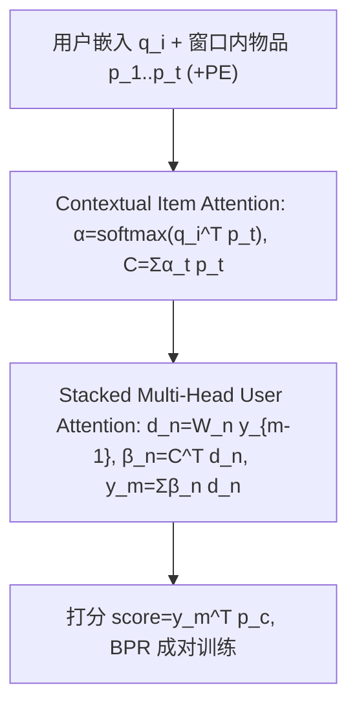
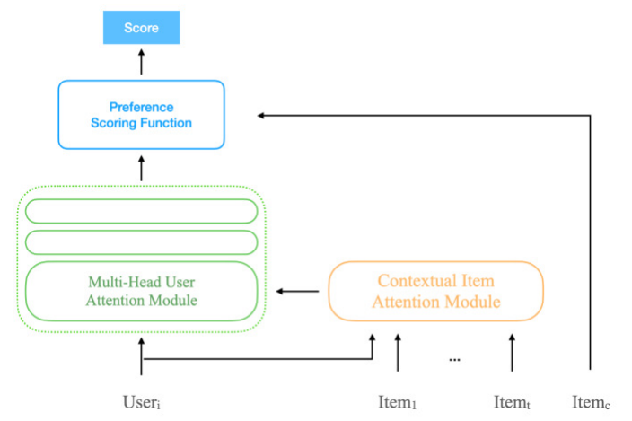

# An Adaptive, Context-Aware, and Stacked Attention Network-Based Recommendation System to Capture Users' Temporal Preference (自适应上下文感知堆叠注意力推荐系统)

- **会议/期刊**: IEEE TKDE
- **作者与机构**: Jung-Hsien Chiang, Chung-Yao Ma, Chi-Shiang Wang, Pei-Yi Hao（台湾成功大学等）
- **推荐链路定位**: 召回（Next-Item 排序打分）
- **研究方向**: 序列与会话推荐 / CTR 特征交叉
- **论文原文**: [arXiv:2611.11278v1](https://arxiv.org/abs/2611.11278v1)
- **开源代码**: [GitHub 仓库](https://github.com/solitude6060/An-Adaptive-Context-Aware-and-Stacked-Attention-Network-Based-Recommendation-System)

## TL;DR (1分钟核心速览)

针对用户偏好随年龄/社交而漂移、RNN 序列模型只重近期行为且难并行的问题，本文提出 Contextual User Preference Attention Model：先用「上下文物品注意力」在固定时间窗内聚合交互物品为上下文向量 $C$（叠加正弦位置编码），再用「堆叠多头用户注意力」把用户嵌入反复投影到多子空间重构偏好 $y_m$，最后以 $y_m^\top p_c$ 打分、BPR 成对训练。在 MovieLens-100k / Pinterest / Beauty 上采用 Leave-One-Out + 100 负采样排序，HR/NDCG/MRR@10 相对最强基线最高提升 10.35%（MRR@10）。

## Background & Motivation (背景与核心矛盾)

- **主流范式**: 协同过滤（BPR/NCF/NAIS）建模静态全局偏好；会话推荐（GRU4REC/SASRec）用 RNN 或自注意力建模短期序列。
- **前人局限**: ① RNN 类方法对近期行为加权过重，长交互序列才能收敛，在 Pinterest（99.94% 稀疏）上 GRU 直接垫底；② 时间感知 CARS 多仍以 RNN 为骨架，且把交互时间点当协同特征（DaCosta），无法区分窗口内各物品的重要性，易被离群/无关物品带偏。
- **核心洞察 (Key Insight)**: 偏好变化是「窗口内物品重要性重分配」的过程——当用户开始交互与历史不同的物品时，注意力权重应自动迁移，无需显式建模时间戳差值。
- **本文切入点**: 用两层注意力（物品级上下文聚合 + 用户级多头子空间重构）替代循环结构，既保留长期静态兴趣又捕捉窗口内漂移，且完全可并行。

## Method (核心方法设计)

### 1. 整体框架 (Overall Architecture)

输入为用户嵌入 $q_i$ 与固定时间窗内最近 $t$ 个交互物品嵌入 $p_1,\dots,p_t$。Contextual Item Attention 先算物品注意力权重并加权求和得到上下文物品表示 $C$（物品嵌入先叠加正弦位置编码）；Multi-Head User Attention 将 $q_i$ 线性投影到 $h$ 个子空间，与 $C$ 做点积注意力后加权聚合为用户偏好 $y$；堆叠 $m$ 层时以 $y_{m-1}$ 替代 $q_i$ 迭代精炼。最终以 $y_m^\top p_c$ 对候选物品打分排序，BPR 成对损失端到端训练。

<figure class="paper-figure" markdown="span">
  <figcaption>图2. 上下文用户偏好注意力模型概览</figcaption>
</figure>

### 2. 关键设计拆解 (Key Designs)

1. **上下文物品注意力 + 位置编码（窗口内重要性重分配）**：痛点是把窗口内物品一视同仁或被最近物品主导。核心算子为 $\alpha_t=\mathrm{softmax}(q_i^\top p_t)$、$C=\sum_t \alpha_t p_t$，并在输入侧叠加 $p_t \leftarrow p_t + PE_{pos}$（正弦/余弦，$pos$ 为交互顺序）。直觉：$q_i$ 作为 query 让「与用户当前画像契合」的物品获得高权重，偏好漂移时权重自然迁移；位置编码提供相对顺序信号，使注意力可学习「越近越重要」的偏移。
2. **堆叠多头用户注意力（子空间重构偏好）**：单头点积只能刻画一个偏好方向。将用户表示并行投影 $h$ 次得 $d_n=W_n q_i$，以 $\beta_n=C^\top d_n$ 为权重聚合 $y=\sum_{n=1}^{h}\beta_n d_n$；堆叠层中 $d_n^m=W_n^m y_{m-1}$、$y_m=\sum_n \beta_n^m d_n^m$。直觉：不同头对应「电影类型/商品品类」等不同偏好侧面，堆叠则反复投影以剥离出更本质的偏好基底，等价于在偏好空间做逐层解耦。
3. **训练目标、负采样与推理效率**：损失为 BPR 成对形式 $\min \sum_{(i,j,k)\in D} -\log\sigma(y_i^\top p_j - y_i^\top p_k)$，其中用户嵌入被替换为注意力输出 $y_i$；每正样本随机采 10 个未观测负样本（沿用 NCF 策略），Adam 优化，学习率 0.001，嵌入维度 $k=32$，BPR 预训练初始化。时间/空间复杂度 $O(hmk^2+tk^2)$ 与 $O(|I|k+|U|k+k^2hm)$，全注意力可并行，作者称 GPU 下比 RNN 类快 5 倍以上；在线打分与标准 MF 同为 $O(k)$。

## Experimental Setup & Evaluation Protocol (实验设置与评估协议)

- **数据集与预处理**: 过滤交互数 < 10 的用户；MovieLens-100k 显式评分转为 0/1 隐式反馈。

| 数据集 | #Users | #Items | #Interactions | 稀疏度 | 场景说明 |
| :--- | :---: | :---: | :---: | :---: | :--- |
| MovieLens-100k | 932 | 1,682 | 100,000 | 93.62% | 电影评分，稠密、口味复杂 |
| Pinterest | 24,935 | 38,756 | 532,203 | 99.94% | 图片社交，极稀疏、短序列 |
| Beauty | 4,412 | 8,670 | 79,861 | 99.79% | 亚马逊美妆评论，高稀疏高变异 |

- **数据划分与防穿越 (Splitting Strategy)**: `Leave-One-Out`——每用户最后一条交互作测试真值，其余训练；输入序列为窗口 $t=5$ 的连续物品预测下一物品。
- **排名评测协议 (Ranking Protocol)**: `Sampled Ranking`——每测试正样本随机配 100 个用户未交互负样本共同排序，报告 HR@10 / NDCG@10 / MRR@10（二值相关性）。
- **对比基线与超参设置**: BPR、NCF、NAIS、GRU4REC、SASRec 五类基线；$k=32$，堆叠层数 $\{0,1,2,3\}$、头数 $\{1..6\}$ 网格搜索，窗口 $\{2..7\}$；未报告显著性检验。

## Key Experimental Results (实验关键数据)

### 1. 主实验对比 (Main Results)

| 数据集 | 指标@10 | BPR | NCF | NAIS | GRU | SASRec | **Ours** | Improv. |
| :--- | :--- | :---: | :---: | :---: | :---: | :---: | :---: | :---: |
| MovieLens-100k | HR | 0.6861 | 0.6532 | 0.6638 | 0.7256 | 0.6957 | **0.7603** | 4.78% |
| | NDCG | 0.4107 | 0.3803 | 0.3863 | 0.4387 | 0.4166 | **0.4747** | 8.21% |
| | MRR | 0.3261 | 0.2969 | 0.3015 | 0.3499 | 0.3308 | **0.3861** | 10.35% |
| Pinterest | HR | 0.8688 | 0.8750 | 0.8663 | 0.8415 | 0.9017 | **0.9046** | 0.32% |
| | NDCG | 0.6199 | 0.6194 | 0.5954 | 0.5633 | 0.6348 | **0.6450** | 1.61% |
| | MRR | 0.5405 | 0.5384 | 0.5096 | 0.4754 | 0.5493 | **0.5619** | 2.29% |
| Beauty | HR | 0.5338 | 0.5174 | 0.5274 | 0.4337 | 0.5247 | **0.5587** | 4.66% |
| | NDCG | 0.2952 | 0.2893 | 0.2985 | 0.2344 | 0.2944 | **0.3132** | 4.92% |
| | MRR | 0.2222 | 0.2193 | 0.2285 | 0.1736 | 0.2241 | **0.2382** | 4.25% |

### 2. 消融实验 (Ablation Study)

| 配置 | ML-100k HR | ML-100k NDCG | Pinterest HR | Pinterest NDCG | Beauty HR | Beauty NDCG |
| :--- | :---: | :---: | :---: | :---: | :---: | :---: |
| w/o Positional Encoding | 0.7338 | 0.4545 | **0.9064** | **0.6491** | 0.5542 | 0.3097 |
| Full (with PE) | **0.7603** | **0.4747** | 0.9046 | 0.6450 | **0.5587** | **0.3132** |

### 3. 关键实验发现 (Key Findings)

1. **稠密数据吃深度与宽度，稀疏数据吃窗口**：MovieLens-100k 上头数从 1 增至 6、堆叠加深均带来显著增益（口味复杂需多子空间解耦）；而 Pinterest/Beauty 上深度与头数几乎不敏感甚至过拟合下降，说明极稀疏场景下 $k^2hm$ 参数冗余是主要风险。
2. **位置编码并非普适增益**：去掉 PE 后 Pinterest 的 HR 反升 0.0018（0.9064 vs 0.9046），因该数据集交互序列极短、顺序信息噪声大于信号；而 ML-100k 上去掉 PE 使 NDCG 掉 0.0202，验证 PE 的价值与序列长度正相关。
3. **RNN 的稀疏性失效被定量证实**：GRU 在稠密 ML-100k 上 HR 0.7256 位列第二，但在 Pinterest/Beauty 上 HR 仅 0.8415/0.4337 全面垫底，与本文注意力模型在 Beauty 上 4.66% 的 HR 领先形成对照，说明并行注意力对短序列更鲁棒。

## Highlights, Limitations & Rating (亮点、对比与审稿评价)

- **与代表作对比 (vs. Prior Work)**: 相比 SASRec 的自注意力编码器-解码器，本文不做序列自注意力而是「用户 query 引导的物品注意力 + 用户侧多头重构」，把建模重心从物品转移序列移到用户偏好子空间；相比 NAIS 的物品相似度注意力，本文额外引入时间窗上下文与堆叠结构；相比 GRU4REC，彻底摆脱循环依赖，稀疏短序列下优势明显。
- **可迁移亮点**: ① 用「上一轮偏好输出替代用户嵌入」作为堆叠层输入的残差式迭代，可低成本移植到任何双塔召回的用户塔；② 位置编码按数据集稀疏度自适应开关（短序列关闭）是实用的工程 trick。
- **审稿级局限批判**: ① 评估仅用 100 负采样的 Sampled Ranking，未做 Full-Ranking，且未报告显著性检验，0.32% 的 Pinterest 提升可信度存疑；② 窗口长度 $t$、层数、头数均需按数据集手工调参，缺乏自适应机制；③ 与 SASRec 等强序列基线相比提升幅度在稀疏集上偏小，且未与近年图/对比学习序列模型对比。
- **四维评分**: 创新性 ⭐⭐⭐ | 实验扎实度 ⭐⭐⭐ | 方法清晰度 ⭐⭐⭐⭐ | 落地价值 ⭐⭐⭐

