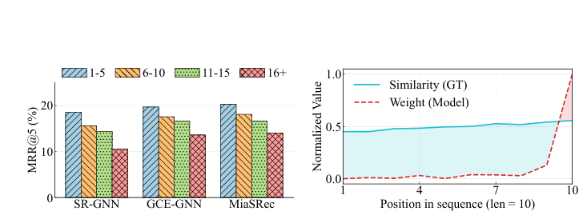
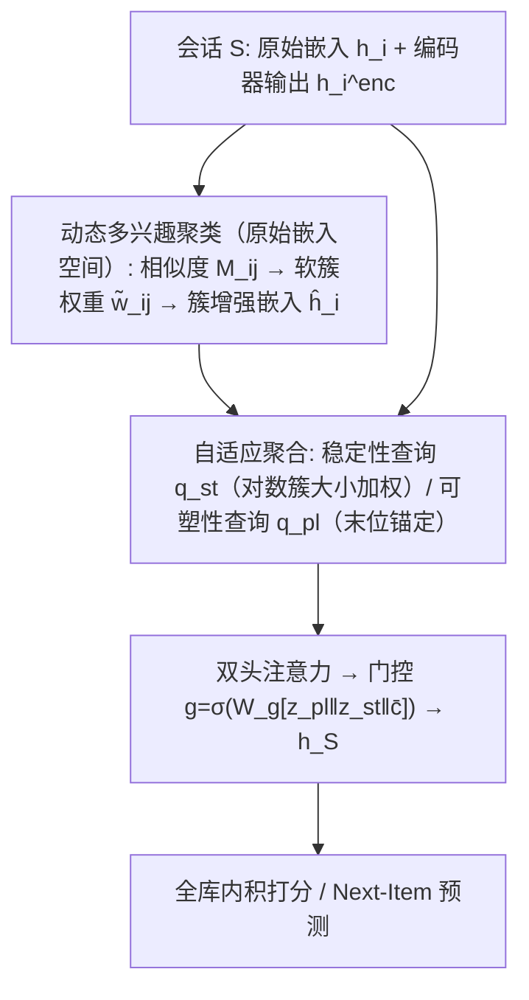
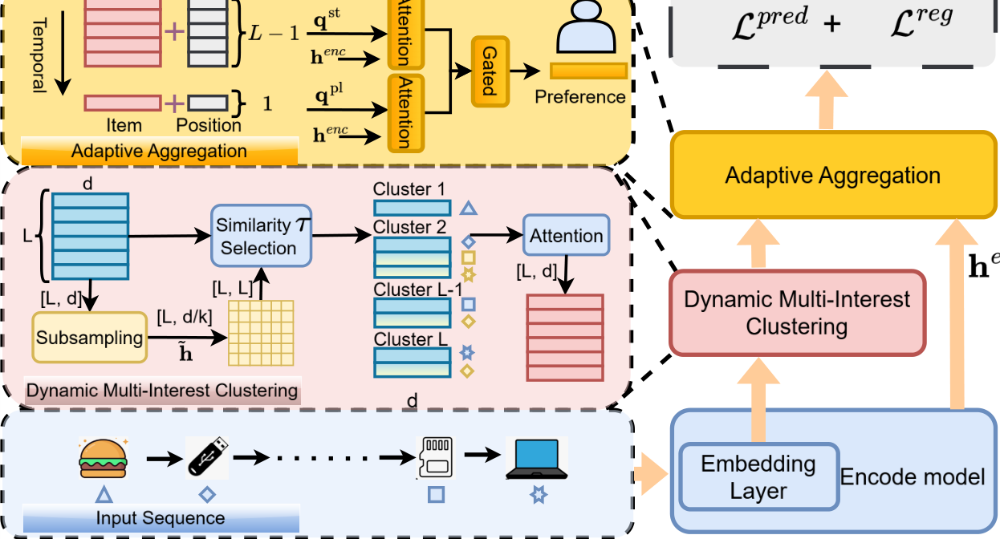

# MIDA: Multi-Interest Decoding with Adaptive Aggregation for Session-based Recommendation (面向会话推荐的多兴趣解码与自适应聚合)

- **会议/期刊**: IEEE Transactions on Knowledge and Data Engineering (TKDE)
- **作者与机构**: Linjiang Guo, Nitin Bisht, Shiqing Wu, Guandong Xu（悉尼科技大学 / 澳门城市大学 / 香港教育大学）
- **推荐链路定位**: 召回（会话级 Next-Item 预测）
- **研究方向**: 序列与会话推荐 / 自监督与表征解耦
- **论文原文**: [https://arxiv.org/abs/2610.34192v1](https://arxiv.org/abs/2610.34192v1)
- **开源代码**: [https://github.com/downw/MIDA](https://github.com/downw/MIDA)

## TL;DR (1分钟核心速览)

本文指出 SBR 的性能瓶颈不在编码器而在**解码器**：池化解码器抹平序列结构，逐点解码器（以末位物品为锚）存在强近因偏差，导致会话越长反而越差。MIDA 提出编码器无关的解码重构——在**原始嵌入空间**做可微多兴趣聚类（学习阈值 $\tau$），在**编码器输出空间**用稳定性/可塑性双查询做注意力聚合，并以平均簇大小$\bar{c}$ 门控融合。在 4 个数据集、4 类骨干上以 Full-Ranking 协议评测，GCE-GNN+MIDA 在 Diginetica 上 R@5 提升 3.21%、M@5 提升 5.04%，长会话（16+）与高语义分散会话增益更大（最高 +19.7% MRR@5）。

## Background & Motivation (背景与核心矛盾)

- **主流范式**: SBR 普遍采用 encoder-decoder 框架，图网络（SR-GNN/GCE-GNN）、RNN（GRU4Rec）、Transformer（MiaSRec）等研究几乎全部聚焦编码器，解码器长期沿用"末位物品注意力"或"均值/最大池化"两种固定范式。
- **前人局限**: ① 池化解码器把全部物品压成定长向量，丢弃序列与物品级区分，长会话中多兴趣被抹平；② 逐点解码器以最后物品为 query，过度加权近期交互、欠利用时间上遥远但语义相关的早期信号。
- **核心洞察 (Key Insight)**: 作者在 Diginetica 上用 SR-GNN 骨干做受控实验（图 1），发现 GRU/图/Transformer 三类架构**共享同一解码范式**时，会话越长 MRR@5 越低；且注意力权重分布与真实物品相似度分布严重错位——这无法归因于任何编码器设计，只能归因于共享解码器。
- **本文切入点**: 把解码器当作一等公民重构，且**只替换骨干的最后聚合模块**、冻结编码器参数，实现即插即用的编码器无关解码。

<figure class="paper-figure" markdown="span">
  <figcaption>图 1：现有基于会话的推荐系统中解码器局限性分析。上：最先进模型在不同会话长度下的 MRR@5，会话越长准确率越低，尽管其包含更丰富的信息。下：长度为 10 的会话中注意力权重分布（红色虚线）与真实物品对目标的余弦相似度（蓝色实线）的对比，为强近因偏差提供了证据。结果在 Diginetica 数据集上使用 SR-GNN 骨干生成；注意力权重对应单层解码器注意力。</figcaption>
</figure>

## Method (核心方法设计)

### 1. 整体框架 (Overall Architecture)

输入会话 $S=[v_1,\dots,v_L]$，嵌入层给出原始嵌入$h_i$与编码器输出$h_i^{enc}$。**双空间解耦**是全文设计原则：聚类只在原始嵌入上做（避免编码器学到的关系偏置污染语义分组），聚合只在编码器输出上做（保留序列依赖）。动态多兴趣聚类在可学习阈值$\tau$下生成软簇权重与簇增强嵌入$\hat{h}_i$；自适应聚合由此构造稳定性查询$q_{st}$（跨时间距离的持久兴趣）与可塑性查询$q_{pl}$（末位锚定的演化兴趣），分别对编码器输出做注意力，最后由以平均簇大小$\bar{c}$为条件的门控融合成会话表示$h_S$，与全库物品内积打分。训练端到端单次前向，推理仅一次前向。

<figure class="paper-figure" markdown="span">
  <figcaption>图 2：所提出的 MIDA 框架概览。模型首先从嵌入层提取原始嵌入，由动态多兴趣聚类模块在学习到的阈值 τ 下进行聚类，以保留语义相关但时间上相距较远的信号。自适应聚合模块随后将这些信号解耦为可塑性（演化）和稳定性（持久）意图，这些意图与编码器输出交互，并通过门控机制自适应融合以进行最终预测。</figcaption>
</figure>

### 2. 关键设计拆解 (Key Designs)

1. **可微多兴趣聚类（Dynamic Multi-Interest Clustering）**：痛点是用编码器输出算相似度会把"物品身份"与"会话上下文关系"混为一谈，且硬阈值不可导、top-k 需预设兴趣数。做法：对 $\ell_2$归一化原始嵌入按步长$k=4$维度下采样得$\tilde{h}'_i$，算$M_{ij}=\tilde{h}'_i{}^\top\tilde{h}'_j$；簇定义为$C_i=\{j \mid M_{ij}\ge\tau\}$（无 top-k 截断），并用 sigmoid 软化：
$$\tilde{w}_{ij}=\max\left\{\sigma_s\!\left(\frac{M_{ij}-\tau}{\gamma}\right),\ \epsilon\right\}$$
$\tau$为**全数据集共享的可学习标量**（初值 0.4，随预测损失反传更新），$\gamma=0.1$、$\epsilon=10^{-6}$。簇内再用带位置嵌入的共享注意力加权聚合得$\hat{h}_i=\mathrm{ReLU}\big(\sum_{j\in C_i}\tilde{w}_{ij}\tilde{h}_j/\sum_{j'}\tilde{w}_{ij'}\big)$。直觉：语义相近但时间相隔远的物品被拉进同一簇，长程依赖得以保留。

2. **稳定性-可塑性双查询与结构耦合门控（Adaptive Aggregation）**：痛点单一聚合规则无法同时兼顾持久偏好与突变偏好。稳定性查询取对数簇大小加权和（排除末位物品避免与可塑性分支混淆）：
$$q_{st}=\sum_{i=1}^{L-1}\alpha_i\hat{h}_i,\quad \alpha_i=\ln\!\left(1+\frac{|C_i|}{2}\right)$$
可塑性查询直接锚定末位簇增强嵌入 $q_{pl}=\hat{h}_L$。两分支各自独立注意力头（**参数不共享**，避免梯度干扰）对$\{h_i^{enc}\|p_i\}$聚合得$z_{st},z_{pl}$，门控为
$$g=\sigma_s\big(W_g[z_{pl}\,\|\,z_{st}\,\|\,\bar{c}]\big),\quad h_S=g\odot z_{pl}+(1-g)\odot z_{st}$$
关键在 $\bar{c}$这一**结构耦合信号**：平均簇大意味着会话语义内聚、应偏向稳定性；簇稀疏则偏向可塑性。作者报告收敛后$W_g$中$\bar{c}$的系数为$-0.47$（四个骨干一致），与设计预期符号吻合。

3. **训练目标、正则与推理效率**：损失为 NLL 加簇密度正则：
$$\mathcal{L}(S)=-\log p(v_{L+1}\mid h_S)+\eta\sum_{i}\sum_{j}\tilde{w}_{ij}$$
正则项对 $\tau$单调非增（命题 1：$\tau\to-\infty$时趋于$L^2$，$\tau\to+\infty$时趋于$L^2\epsilon$），防止$\tau$塌缩导致全稠密簇。**无负采样**，全库 softmax。复杂度$O(L^2d/k+Ld^2+d|\mathcal{V}|)$，解码器仅约 30K 参数（$d=100$），推理较 Naive 仅增 0.041–0.060 ms/session，比 AttenMixer 快 1.35–2.65 倍。

## Experimental Setup & Evaluation Protocol (实验设置与评估协议)

- **数据集与预处理**: 过滤会话长度 < 3 与出现次数 < 5 的物品（即 5-core 类过滤）；Yoochoose 取最近 1/64。

| 数据集 | #Sessions | #Items | #Interactions | 平均长度 | 场景说明 |
| :--- | :---: | :---: | :---: | :---: | :--- |
| Nowplaying | 1,064,170 | 59,397 | 11,375,543 | 11.69 | 音乐收听（社交媒体标签） |
| Diginetica | 145,388 | 40,588 | 492,944 | 4.39 | 电商交易（CIKM Cup 2016） |
| Yoochoose | 273,645 | 15,193 | 2,184,280 | 8.98 | 点击流（RecSys Challenge 2015） |
| RetailRocket | 460,184 | 46,406 | 2,741,674 | 6.95 | 电商隐式浏览 |

- **数据划分与防穿越 (Splitting Strategy)**: **全局时间戳切分**，按 8:1:1 分为训练/验证/测试，严格防穿越。
- **排名评测协议 (Ranking Protocol)**: 无偏 **Full-Ranking**（对全物品词表打分，不做负采样），指标 Recall@5 与 MRR@5；5 个固定随机种子取均值，配对 t 检验 $p<0.05$ 标 †。
- **对比基线与超参设置**: 受控解码器替换协议——固定 4 类骨干（GRU4Rec / SR-GNN / GCE-GNN / MiaSRec），仅换解码器，对比 Naive、RL、Ms-PoE、AttenMixer、IDEA 五种解码方案；$d=100$、batch=100、AdamW lr=1e-3、$\eta\in\{0.05,0.01,0.005,0.001\}$网格搜索、$k=4$、早停 patience=5。

## Key Experimental Results (实验关键数据)

### 1. 主实验对比 (Main Results)

以最强骨干 GCE-GNN 与 Transformer 骨干 MiaSRec 为例（R@5 / M@5，Time 为每 epoch 秒）：

| 骨干 | 模型 | Nowplaying | Diginetica | Yoochoose | RetailRocket |
| :--- | :--- | :---: | :---: | :---: | :---: |
| GCE-GNN | Naive | 9.21 / 5.38 | 30.49 / 17.87 | 45.41 / 25.52 | 46.93 / 33.39 |
| GCE-GNN | Ms-PoE | 9.79 / 5.73 | 30.92 / 18.22 | 45.77 / 25.72 | 47.63 / 34.23 |
| GCE-GNN | AttenMixer | 8.56 / 5.16 | 27.54 / 15.96 | 38.49 / 21.53 | 45.09 / 32.67 |
| GCE-GNN | IDEA | 9.65 / 6.21 | 30.53 / 17.94 | 45.49 / 25.93 | 47.11 / 33.68 |
| GCE-GNN | **MIDA** | **10.27 / 6.12** | **31.47 / 18.77** | **46.21 / 26.31** | **48.93 / 36.02** |
| GCE-GNN | Improv. | +11.5% / +13.8% | +3.21% / +5.04% | +1.76% / +3.10% | +4.26% / +7.88% |
| MiaSRec | Naive | 9.67 / 5.51 | 31.93 / 18.03 | 44.66 / 25.13 | 47.57 / 34.41 |
| MiaSRec | AttenMixer | 10.14 / 6.14 | 32.77 / 17.98 | 45.34 / 25.19 | 47.33 / 33.11 |
| MiaSRec | **MIDA** | **10.85 / 6.41** | **34.32 / 19.28** | **46.01 / 25.85** | **49.12 / 35.29** |
| MiaSRec | Improv. | +12.20% / +16.33% | +7.48% / +6.93% | +3.02% / +2.86% | +3.26% / +2.56% |

GRU4Rec+MIDA 在 Nowplaying 上相对 Naive 提升达 **+49.0% R@5 / +70.5% M@5**（3.51→5.23、1.83→3.12），为全表最大相对增益。

### 2. 消融实验 (Ablation Study)

GCE-GNN 骨干，R@5 / M@5：

| 变体 | Nowplaying | Diginetica | Yoochoose | RetailRocket |
| :--- | :---: | :---: | :---: | :---: |
| w/o DM（聚类换均值池化） | 9.37 / 5.56 | 30.13 / 18.09 | 43.57 / 24.81 | 44.97 / 34.38 |
| w/o $q_{st}$（去稳定查询） | 9.72 / 5.71 | 30.59 / 17.88 | 45.14 / 25.37 | 47.92 / 34.96 |
| w/o $q_{pl}$（去可塑查询） | 9.54 / 5.52 | 30.43 / 17.87 | 44.80 / 25.14 | 48.19 / 35.08 |
| w $E_{out}$（用编码器输出聚类） | 9.95 / 5.97 | 31.25 / 18.87 | 45.24 / 25.76 | 48.68 / 35.76 |
| w $\tau$ MLP（逐会话阈值） | 10.22 / 6.02 | 31.39 / 18.78 | 45.99 / 26.09 | 48.76 / 35.92 |
| w F（固定选最相似单物品） | 8.95 / 4.94 | 28.74 / 17.13 | 41.83 / 24.53 | 46.89 / 34.32 |
| w S（无梯度截断堆叠） | 9.63 / 5.66 | 30.27 / 18.06 | 45.21 / 25.39 | 47.71 / 35.13 |
| **MIDA** | **10.27 / 6.12** | **31.47 / 18.77** | **46.21 / 26.31** | **48.93 / 36.02** |

### 3. 关键实验发现 (Key Findings)

1. **双空间解耦是核心增量，而非聚类本身**：`w/o DM` 在 Yoochoose 上 R@5 掉 2.64（46.21→43.57），而 `w E_out`（保留聚类但改用编码器输出算相似度）在 Diginetica 上 M@5 反升 0.10 却整体不及 MIDA——说明"在哪个空间聚类"与"是否聚类"同等重要，编码器关系偏置确实会扭曲语义分组。
2. **可塑性分支比稳定性分支更不可替代，但固定选择策略最致命**：`w/o q_pl` 在 Yoochoose 上 R@5 掉 1.41，大于 `w/o q_st` 的 1.07；而 `w F`（退化为单物品硬选）掉 4.38（相对 −9.4%），证明"多物品软聚合"本身贡献了主要收益，双分支是在此基础上的精调。
3. **增益随会话长度与语义分散度单调上升，与命题 2 的理论退化一致**：GCE-GNN+MIDA 在 Nowplaying 上 R@5 增益从短会话（1–5）的 +6.34% 升至 16+ 的 +15.06%；按语义分散度 $\delta(S)$ 分桶，高分散组 MRR@5 增益达 +19.7%（Nowplaying）、+16.3%（RetailRocket），而低分散组仅 +0.7%–+5.2%——低分散时会话近似同质，MIDA 优雅退化为均值池化，不产生负收益。此外 Diginetica 上簇类别纯度 0.67 远高于随机基线 0.26，验证簇确为语义分组。

## Highlights & Limitations (亮点、对比与审稿批判)

- **与代表作对比 (vs. Prior Work)**: 与 **AttenMixer** 的本质区别在于后者在编码器特征上再叠多层注意力传播，与 GCE-GNN 这类已做多跳传播的强编码器产生冗余与梯度干扰（GCE-GNN+AttenMixer 在四数据集全面劣于 Naive，Diginetica R@5 从 30.49 跌至 27.54）；MIDA 则把"哪些物品相关"（原始嵌入）与"如何按上下文聚合"（编码器输出）彻底分离。与 **MiaSRec/DMI-GNN** 等多兴趣方法相比，MIDA 不预设兴趣数、不做编码器级切分，而是把多兴趣建模下沉到解码阶段并进一步解耦稳定/演化意图。与 **Ms-PoE** 相比，后者仅重标定位置编码，无法解决语义层面的近因偏差。
- **可迁移亮点**: ① "语义相似度用原始嵌入、上下文聚合用编码器输出"的双空间原则可直接迁移到长序列推荐与 LLM 会话推荐的 context token 聚合；② 用**簇结构统计量（$\bar{c}$）作为门控条件**实现两阶段结构耦合，是一种低成本、可解释的"让上游结构指导下游融合"范式，可复用于多任务/多兴趣融合门控。
- **审稿级局限批判**: ① 簇内两两相似度计算为 $O(L^2)$，虽经$k=4$下采样缓解，但$L\gg100$的超长会话仍会带来不可忽视开销，且论文未给出$L>50$的延迟曲线；② 稳定/可塑性二分假设本质是"两类意图"，对真正多峰兴趣分布可能欠拟合，且$\tau$ 为全数据集共享标量，逐会话 MLP 变体（`w τ MLP`）未见增益反而提示全局阈值可能掩盖会话级异质性；③ 簇纯度分析仅限 Diginetica（唯一有类目标签的数据集），其余数据集仅用嵌入内聚度间接佐证，证据链略弱。

## Rating (四维评分)

- **方法创新性 (Novelty)**: ⭐⭐⭐⭐ （核心机制与方法设计具备明确创新性，理论与实验动机支撑充分）
- **评估协议与实验扎实度 (Protocol & Experiments)**: ⭐⭐⭐⭐⭐ （主流公开数据集评测完整，包含多基线对比与消融实验验证）
- **写作与数学规范度 (Clarity & Rigor)**: ⭐⭐⭐⭐⭐ （问题形式化定义清晰，核心模块数学推导与架构阐述严谨易读）
- **工业落地与复现价值 (Industrial & Practical Value)**: ⭐⭐⭐⭐ （兼顾推荐效果增益与训练/推理效率，具备实际场景迁移参考价值）
