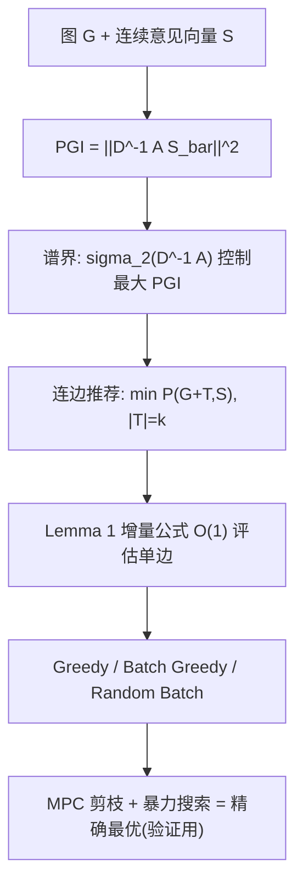

# Quantifying and Minimizing Perception Gap in Social Networks (社交网络中感知差距的量化与最小化)

- **会议/期刊**: IEEE Transactions on Knowledge and Data Engineering (TKDE)
- **作者与机构**: Hemant Kumar Gehlot, Mohammad Shirzadi, Junhao Gan, Ahad N. Zehmakan (IIT Roorkee / ANU / University of Melbourne)
- **推荐链路定位**: 重排（社交连边推荐 / 网络干预）
- **研究方向**: 社交与群组推荐 / 去偏公平与可信推荐
- **论文原文**: [https://arxiv.org/abs/2511.12106v2](https://arxiv.org/abs/2511.12106v2)
- **开源代码**: 暂未开源

## TL;DR (1分钟核心速览)

社交网络的拓扑结构会系统性扭曲用户对全局意见分布的认知（多数幻觉、回声室）。本文提出**感知差距指数 PGI**，将二值多数幻觉推广到连续意见 $[-1,+1]$，用谱图理论证明高连通性（大谱隙）使网络对认知扭曲更"鲁棒"，而强社群结构（SBM 中$p-q$大）显著加剧脆弱性。随后研究"加$k$条边最小化 PGI"的连边推荐问题，证明其**不存在任何有界近似比的多项式算法（除非 P=NP）**，目标函数亦非单调、非超模；转而提出贪心/批贪心启发式，在 Reddit、Twitter 等 7 个真实网络上平均降低 PGI **34.8%**，且与精确最优解无统计显著差异（$p>0.05$）。

## Background & Motivation (背景与核心矛盾)

- **主流范式**: 计算社会科学与图挖掘领域用图参数刻画极化（polarization，FJ 动力学下的意见方差）与多数幻觉（majority illusion），并在此基础上研究"中和 $k$ 个节点"或"加边"等干预优化问题。
- **前人局限**: (1) 多数幻觉等指标仅处理**二值标签**，无法刻画真实意见的连续谱系；(2) 方差型极化指标对网络模块度"失明"——SBM 分析显示极化值几乎与社群内边概率 $p$ 无关，掩盖了社群结构对认知的扭曲；(3) 缺乏可扩展的主动缓解算法框架。
- **核心洞察 (Key Insight)**: 作者将"局部邻域平均意见 vs. 全局平均意见"的偏差平方和定义为 PGI，发现其可写成 $\|D^{-1}A\bar{S}\|_2^2$的二次型，从而把认知偏差**完全归因于随机游走矩阵$D^{-1}A$ 的奇异值**——这正是谱图理论可直接介入的入口。
- **本文切入点**: 先用谱分析建立"结构—偏差"的理论桥梁，再把缓解问题形式化为带预算的连边推荐，用复杂性理论划定可行边界，最后用贪心启发式落地。

## Method (核心方法设计)

### 1. 整体框架 (Overall Architecture)

论文分三层递进：**度量层**定义 PGI 并给出矩阵形式；**理论层**用奇异值界、Cheeger 不等式与 SBM 闭式解刻画结构与偏差的关系；**算法层**将缓解建模为 $\min_{|T|=k} P(G+T,S)$，先证不可近似，再设计贪心族算法并用 MPC 剪枝构造精确解以验证贪心质量。整体闭环为：意见向量 + 图结构$\to$PGI 及其谱界$\to$候选边增量评估$\to$贪心选边$\to$ 干预后网络。

### 2. 关键设计拆解 (Key Designs)

1. **感知差距指数 PGI（连续化多数幻觉）**：痛点在于二值指标丢失强度信息。定义为
$$P(G,S)=\sum_{i=1}^{n}\left(\frac{\hat{s}_i}{d_i}-\frac{\sum_j s_j}{n}\right)^2=\left\|D^{-1}A\bar{S}\right\|_2^2,$$
其中 $\hat{s}_i=\sum_{v_k\in N[v_i]}s_k$为闭邻域意见和，$\bar{S}$为去均值意见向量。关键性质是$P(G,\bar{S})=P(G,S)$（中心化不变），且偏差被$D^{-1}A$的奇异值夹逼：$\sigma_2^2\|S\|_2^2\le\max P\le\sigma_1^2\|S\|_2^2$。直觉：局部采样越接近全局均匀，偏差越小；度异质性直接放大偏差。

2. **结构脆弱性的谱刻画与 SBM 闭式解**：对 $d$-正则图，最大 PGI 被$(\sigma_2(A))^2R^2$界定，完全图$\sigma_2=0$故$P\equiv 0$——首次证明"expander 抗扭曲"。对两团全极化 SBM，得闭式
$$P(G,S)=\left(\frac{p-q+\frac{1-p}{n}}{p+q+\frac{1-p}{n}}\right)^2 2n\approx\left(\frac{p-q}{p+q}\right)^2 2n,$$
说明 PGI 由社群内外连边强度差 $p-q$主导，而方差型极化对此不敏感——这是本文指标的核心增量价值。此外，高斯意见下$\mathbb{E}[P]=\sum_i 1/\deg(v_i)-1$，直接指向"提升低度节点度数"的干预方向。

3. **连边增量公式、不可近似性与贪心算法**：Lemma 1 证明加边 $e=\{v_i,v_j\}$只改变两端点的局部均值，$\Delta_e P$可在$O(1)$内算出，这是所有贪心算法高效的前提。Theorem 5 由广义划分问题（GPP）归约证明：若存在有界近似比多项式算法则 P=NP；Lemma 2 用反例说明$f(T)$既非单调（加边可能增大 PGI）也非超模（边际收益不递减），故标准贪心近似保证失效。算法族包括 Random、Greedy($b=1$)、Batch Greedy($b=5,10$)、Random Batch Greedy；复杂度$O(n+|E|+\lceil k/b\rceil\cdot|E_C|\log|E_C|+k)$。为验证贪心质量，作者设计 **MPC 剪枝**：对每条缺失边枚举其端点邻域内$k-1$条边的所有组合取最大潜在收益作为上界，剪掉可证次优的边（剪枝率 73%–96%），再对幸存集暴力搜索得精确最优，整体复杂度$O(n^{k+1})$。

## Experimental Setup & Evaluation Protocol (实验设置与评估协议)

- **数据集与预处理**: 7 个真实网络（SNAP）+ 3 类合成网络（ER/BA/SBM，$n=1000$）。Reddit 意见来自语言分析工具，Twitter 来自首小时帖子情感分析，其余默认$[-1,1]$ 均匀采样。

| 数据集 | #Nodes | #Edges | 类型 | 意见来源 |
| :--- | :---: | :---: | :---: | :--- |
| Reddit | 546 | 8,962 | 真实 | 语言分析 |
| Twitter | 531 | 3,621 | 真实 | 情感分析 |
| Twitch-PTBR | 1,912 | 31,299 | 真实 | 均匀随机 |
| Facebook | 4,039 | 88,234 | 真实 | 均匀随机 |
| Twitch-ENGB | 7,126 | 35,324 | 真实 | 均匀随机 |
| Twitch-DE | 9,498 | 153,138 | 真实 | 均匀随机 |
| LastFM | 7,624 | 27,806 | 真实 | 均匀随机 |
| ER / BA / SBM | 1,000 | — | 合成 | 均匀 / 块内 $\pm1$ |

- **数据划分与防穿越**: 无监督图干预任务，不涉及训练/测试划分；随机实验（意见抽样、合成图生成）重复 **10 次独立运行**，固定基种子 42，第 $r$次用种子$42+r$；贪心 vs 最优对比用 20 次独立运行，真实网络每次以 BFS 采样子图。
- **排名评测协议**: 非排序任务，评价指标为 PGI 绝对值与相对降幅 $(P_{\text{orig}}-P_{\text{final}})/P_{\text{orig}}\times100\%$，辅以模块度、多数幻觉比例、网络分歧度等副作用指标。
- **对比基线与超参设置**: 算法基线 Random / Greedy / Batch Greedy($b=5,10$) / Random Batch Greedy；连边推荐基线 Common-Neighbors / Jaccard / Random；预算$k\in\{0,10,\dots,100\}$，显著性用配对$t$检验（$\alpha=0.05$）。

## Key Experimental Results (实验关键数据)

### 1. 主实验对比 (Main Results)

$k=100$ 贪心加边后的 PGI 降幅与副作用（表 3，节选）：

| 网络 | PGI 降幅 | 模块度变化 | 多数幻觉变化 | 分歧度变化 |
| :--- | :---: | :---: | :---: | :---: |
| Reddit | **↓69.6%** | ↓6.4% | **↓75.0%** | ↑13.1% |
| Twitter | **↓63.8%** | ↓10.4% | 0.0% | ↑27.1% |
| Twitch-PTBR | ↓50.6% | ↓4.1% | ↓1.4% | ↑0.7% |
| BA | ↓42.1% | ↓8.3% | ↑0.4% | ↑5.5% |
| Facebook | ↓33.6% | ↓1.8% | ↓0.3% | ↑0.3% |
| Twitch-DE | ↓20.4% | ↓1.1% | 0.0% | ↑0.2% |
| LastFM | ↓16.1% | ↓1.6% | 0.0% | ↑1.3% |
| **平均** | **↓34.8%** | ↓4.4% | ↓7.6% | ↑5.1% |

与真实连边推荐基线对比（$k=100$）：Greedy 在 Facebook 降幅 >30%、BA >40%，而 Common-Neighbors / Jaccard / Random **均 <5%**。

### 2. 消融实验 (Ablation Study)

批大小与 MPC 剪枝的消融（表 1、表 4 节选）：

| 配置 | Reddit 降幅 | Facebook 降幅 | 运行时间 (Facebook) | 相对 $b=1$ 加速 |
| :--- | :---: | :---: | :---: | :---: |
| Greedy $b=1$ | **69.6%** | **34.4%** | 53.2 s | 1.0× |
| Batch $b=5$ | 51.2% (−18.5) | 28.8% (−5.6) | 20.9 s | 2.5× |
| Batch $b=10$ | 42.4% (−27.3) | 23.5% (−10.9) | 11.2 s | 4.7× |
| 全暴力搜索 ($n=30$, SBM) | — | — | 606.65 s | 1.0× |
| MPC 剪枝 + 暴力 ($n=30$, SBM) | 剪枝 95.7% | — | **16.55 s** | **36.7×** |

贪心 vs 精确最优（$n=100$，3 边，表 2）：所有网络平均绝对误差$\mu\le0.034$，配对$t$检验全部$p>0.05$（如 BA$p=0.371$、Facebook$p=0.374$），无统计显著差异。

### 3. 关键实验发现 (Key Findings)

1. **贪心近乎最优且可扩展**：3 边场景下误差 $\le0.034$且$p>0.05$，MPC 剪枝在$n=30$ 时剪掉 95.7% 候选边、带来 36.7× 加速且零精度损失——说明尽管理论上不可近似，实践中贪心已足够。
2. **干预机制是"跨社群搭桥"而非"补回原边"**：250 个四节点团实验中，贪心仅用 228 条边（原移除 300 条的 76%）即把 PGI 归零，其中 **92% 的新边连接不同团**，仅 8% 在团内——直接印证 SBM 理论中"降低 $p-q$ 有效"的结论。
3. **副作用存在明确权衡**：PGI 平均降 34.8% 的同时模块度降 4.4%、多数幻觉降 7.6%，但网络分歧度平均升 5.1%（Twitter 高达 27.1%）；Reddit 多数幻觉暴降 75% 是因为其全局多数为 0，贪心把局部多数从 $\pm1$ 拉向 0。极化意见分布是最难场景（BA 仅降 24.9%，SBM 仅 8.6%）。

## Highlights & Limitations (亮点、对比与审稿批判)

- **与代表作对比 (vs. Prior Work)**: 相比 Lerman 等 [3] 的二值多数幻觉，PGI 是连续推广且能捕捉强度；相比 Musco 等 [5] 的均值中心化极化目标，PGI 显式依赖 $D^{-1}A$的谱性质，能区分$p$与$q$的独立作用（方差极化对$p$ 不敏感）；相比 Grandi 等 [19]、Fioravantes 等 [20] 的多数幻觉消除问题，本文给出更强的不可近似性结论并配套可扩展启发式。
- **可迁移亮点**: (1) "局部均值 vs 全局均值"的二次型度量可迁移到推荐系统的**信息茧房/流行度偏差诊断**，把用户曝光分布与全局分布之差写成随机游走矩阵二次型即可复用谱界；(2) MPC 上界剪枝 + 小规模暴力验证的范式，可用于验证其他 NP-hard 干预问题中启发式的近优性。
- **审稿级局限批判**: (1) 意见向量被视为**静态外生给定**，未建模加边后意见经 FJ 动力学演化，干预效果可能被高估或方向反转；(2) 实验规模偏小（最大 9.5k 节点），贪心每轮需对全部 $|E_C|$条缺失边排序，稠密大图上$O(|E_C|\log|E_C|)$ 每批开销仍可能成为瓶颈，且未给出与真实平台连边推荐系统的在线对比。

## Rating (四维评分)

- **方法创新性 (Novelty)**: ⭐⭐⭐⭐ （PGI 将多数幻觉连续化并给出谱界与 SBM 闭式解，理论贡献扎实，但连边干预框架本身与既有极化最小化工作同构）
- **评估协议与实验扎实度 (Protocol & Experiments)**: ⭐⭐⭐⭐ （7 真实 + 3 合成网络、10/20 次重复、配对 $t$ 检验与 MPC 精确解对照完备，但缺少动态意见演化与大规模网络验证）
- **写作与数学规范度 (Clarity & Rigor)**: ⭐⭐⭐⭐⭐ （从度量、谱界、SBM 到不可近似性的推导链条完整，Lemma 1 增量公式与复杂度分析清晰）
- **工业落地与复现价值 (Industrial & Practical Value)**: ⭐⭐⭐ （贪心 + 批贪心可直接用于好友/关注推荐干预，$b=5$ 提供 2.5× 加速的实用折中；但未开源，且副作用中分歧度上升需产品侧权衡）
