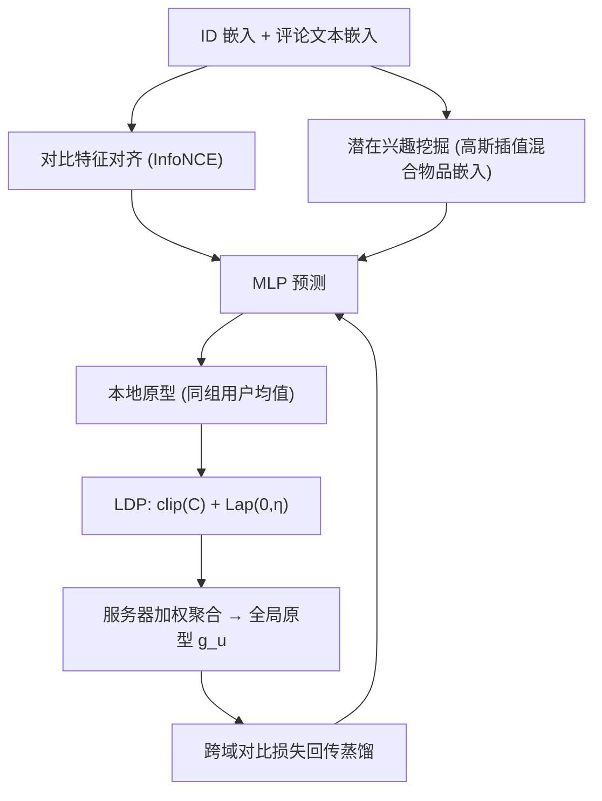
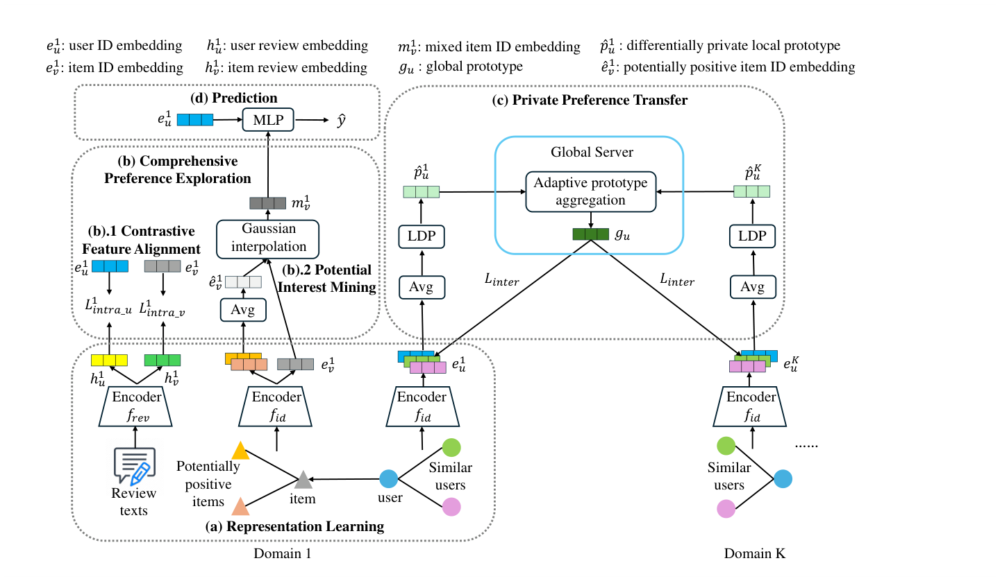

# Federated User Preference Modeling for Privacy-Preserving Cross-Domain Recommendation (面向隐私保护跨域推荐的联邦用户偏好建模)

- **会议/期刊**: IEEE Transactions on Multimedia (TMM)
- **作者与机构**: Li Wang, Shoujin Wang, Quangui Zhang, Qiang Wu, Min Xu（悉尼科技大学、重庆文理学院）
- **推荐链路定位**: 召回（跨域用户表征学习与迁移）
- **研究方向**: 跨域与多场景推荐 / 去偏公平、可信隐私与工业架构
- **论文原文**: [https://arxiv.org/abs/2408.14689v1](https://arxiv.org/abs/2408.14689v1)
- **开源代码**: [https://github.com/Lili1013/FUPM](https://github.com/Lili1013/FUPM)

## TL;DR (1分钟核心速览)

现有隐私保护跨域推荐（PPCDR）只迁移由交互历史学到的简单嵌入，既忽略评论等侧信息导致偏好刻画不准，又因直接发布差分隐私嵌入而可被外部数据关联反推。FUPM 先在域内用对比学习对齐 ID 与评论嵌入、并用高斯插值融合"潜在正物品"挖掘综合偏好，再把用户分组均值构成的本地原型经 LDP 加噪后上传联邦服务器聚合为全局原型，以跨域对比损失回传蒸馏。在 Amazon/Douban 四个 CDR 任务、Leave-One-Out + 99 负采样协议下，HR@10 较最强基线 CL-DTCDR 平均提升约 13.28%。

## Background & Motivation (背景与核心矛盾)

- **主流范式**: 多目标 CDR 通过映射函数、图注意力或对比学习在域间迁移用户/物品嵌入（EMCDR、BiTGCF、GA-DTCDR、CL-DTCDR）；PPCDR 则叠加 LDP 或 FL 以合规化数据共享（PriCDR、P2FCDR、FedCDR）。
- **前人局限 CH1**: 仅用 user-item 交互矩阵学习并迁移嵌入，丢弃了评论文本与"未交互但可能感兴趣"的物品，稀疏域下偏好刻画严重失真。
- **前人局限 CH2**: 直接发布加噪后的交互矩阵或嵌入，攻击者可借公开数据集学参考嵌入做关联推断，隐私保护上界很弱。
- **核心洞察 (Key Insight)**: 用户组级别的原型是多人行为的不可逆聚合，天然比个体嵌入更难反推；若再叠加 LDP，则隐私预算有显式上界 $\epsilon \le 2C/\eta$。
- **本文切入点**: 用"综合偏好探索 + 原型级隐私迁移"替代"个体嵌入直传"，在联邦框架内同时提升精度与隐私强度。

## Method (核心方法设计)

### 1. 整体框架 (Overall Architecture)

每个域作为联邦客户端，本地持有 ID 嵌入与评论文档嵌入（Amazon 用 Doc2Vec、Douban 用 Sentence Transformer）。域内先做两件事：对比特征对齐把同一用户/物品的 ID 与评论嵌入拉近，潜在兴趣挖掘用评论相似度筛出潜在正物品并与真实正物品做高斯插值得到混合物品嵌入；随后 MLP 预测交互概率。每轮联邦通信时，客户端按"同交互模式用户组"求均值得到本地原型，经 L2 裁剪 + 拉普拉斯噪声得到 $\hat{p}_u^i$上传；服务器按用户在各域的交互数加权聚合为全局原型$g_u$回传，客户端再以跨域对比损失把$g_u$ 蒸馏进本地用户嵌入。

<figure class="paper-figure" markdown="span">
  <figcaption>图 2. FUPM 的整体框架。包含四个模块：(a) 表示学习模块旨在学习用户/物品 ID 和评论文本的嵌入。(b) 综合偏好探索模块专注于在每个域内探索全面的用户偏好，进一步分为两个组件：(b).1 对比特征对齐旨在通过 CL 对齐 ID 嵌入和评论文本嵌入。(b).2 潜在兴趣挖掘利用潜在正物品捕捉用户的潜在兴趣。(c) 隐私偏好迁移模块旨在隐私迁移用户偏</figcaption>
</figure>

### 2. 关键设计拆解 (Key Designs)

1. **综合偏好探索（对比对齐 + 潜在兴趣挖掘）**：痛点是非交互物品被一律当负样本，假阴性污染训练。做法是对同一用户/物品的 ID 与评论嵌入构造正对、跨用户构造负对，用 InfoNCE 对齐：$\mathcal{L}_{intra}^{u}=-\log\frac{\exp(f(e_u^i,h_u^i))}{\sum_{h_{u'}^i\in\mathcal{A}}\exp(f(e_u^i,h_{u'}^i))}$，其中$f$为带温度$\tau$的余弦相似度；同时以评论嵌入相似度$>0.5$筛出潜在正物品均值$\hat{e}_v^i$，再以$m_v^i=\beta e_v^i+(1-\beta)\hat{e}_v^i,\ \beta\sim\mathcal{N}(\mu,\delta)$ 插值。随机系数而非固定系数保证嵌入多样性，负物品同样插值以稀释假阴性偏差。
2. **隐私偏好迁移（原型 + LDP + 联邦聚合）**：痛点是个体嵌入可被关联推断。做法是把与 $u$交互模式相同的用户组嵌入取均值得$p_u^i=\frac{1}{N}\sum_{j\in\mathcal{N}}e_j^i$，再裁剪加噪$\hat{p}_u^i=\mathrm{clip}(p_u^i,C)+\mathrm{Lap}(0,\eta)$，服务器按交互占比$w_i=|M^i|/|M|$聚合$g_u=\sum_{i=1}^{K}w_i\hat{p}_u^i$。原型是组级不可逆聚合，攻击者无法定位个体；加权聚合则避免稀疏域被过拟合。
3. **训练目标与推理开销**：总损失 $\mathcal{L}^i=\mathcal{L}_{prd}+\gamma(\mathcal{L}_{intra}^{u}+\mathcal{L}_{intra}^{v})+\alpha\mathcal{L}_{inter}$，其中$\mathcal{L}_{inter}$以$(e_u^i,g_u)$为正对、其他用户全局原型为负对做 InfoNCE。负采样为每用户随机 1 个未交互物品（训练）/ 99 个（测试），无需难负样本挖掘；推理仅需本地 MLP 前向，联邦通信只传$|U|$ 个低维原型向量，开销远低于传嵌入或梯度。

## Experimental Setup & Evaluation Protocol (实验设置与评估协议)

- **数据集与预处理**: 过滤交互数 $<5$的用户与$<10$ 的物品（5-core 类过滤），显式评分二值化为隐式 0/1：

| 任务 | 数据集 | #Users | #Items | #Interactions | 密度 |
| :--- | :--- | :---: | :---: | :---: | :---: |
| Task 1 | Phone / Sport | 4,998 | 14,618 / 22,101 | 47,444 / 55,556 | 0.065% / 0.050% |
| Task 2 | Book / Music | 909 | 3,222 / 2,546 | 46,374 / 40,761 | 1.58% / 1.76% |
| Task 3 | Sport / Cloth / Phone | 2,229 | 15,321 / 16,664 / 9,789 | 30,512 / 25,660 / 25,175 | 0.089% / 0.069% / 0.115% |
| Task 4 | Book / Movie / Music | 901 | 3,222 / 14,501 / 2,546 | 46,200 / 560,675 / 40,512 | 1.59% / 4.29% / 1.77% |

- **数据划分与防穿越**: `Leave-One-Out`，每用户最后一条交互作测试、其余训练。
- **排名评测协议**: `Sampled Ranking`，每测试正样本随机配 99 个未交互负样本，在 100 候选内排序，报告 HR@{5,10} 与 NDCG@{5,10}，五次重复取均值。
- **对比基线与超参**: 单域（NeuMF、SSL、FedNCF）、CDR（BiTGCF、DDTCDR、GA-DTCDR、CL-DTCDR、GA-MTCDR-P）、PPCDR（PriCDR、P2FCDR）三类共 10 个基线；嵌入维度 $d=256$、batch 128、lr 0.001、epoch 200，$\alpha=0.05$、$\gamma=0.2$，显著性$p<0.01$。

## Key Experimental Results (实验关键数据)

### 1. 主实验对比 (Main Results)

Task 1（Phone/Sport）与 Task 4（Book/Movie/Music）代表性结果（HR@10 / NDCG@10）：

| 数据集 | 指标 | CL-DTCDR | GA-MTCDR-P | P2FCDR | FUPM | Improv. |
| :--- | :--- | :---: | :---: | :---: | :---: | :---: |
| Phone | HR@10 | 0.6198 | 0.4690 | 0.4896 | **0.7291** | +10.93% |
| Phone | NDCG@10 | 0.3833 | 0.2885 | 0.3369 | **0.5332** | +14.99% |
| Sport | HR@10 | 0.6278 | 0.3941 | 0.3827 | **0.7195** | +9.17% |
| Sport | NDCG@10 | 0.4025 | 0.2682 | 0.2719 | **0.5238** | +12.13% |
| Book | HR@10 | 0.4308 | 0.4463 | 0.4080 | **0.5188** | +7.25% |
| Movie | HR@10 | 0.6049 | 0.5432 | 0.5128 | **0.7851** | +17.91% |
| Movie | NDCG@10 | 0.3385 | 0.4012 | 0.3169 | **0.5418** | +14.06% |
| Music | HR@10 | 0.2552 | 0.3316 | 0.3186 | **0.3412** | +0.96% |

### 2. 消融实验 (Ablation Study)

Task 2（Book/Music）与 Task 3（Sport/Cloth）HR@10：

| 变体 | Book | Music | Sport | Cloth |
| :--- | :---: | :---: | :---: | :---: |
| w/o inter CL | 0.5127 | 0.3585 | 0.5886 | 0.5500 |
| inter sum | 0.4499 | 0.3520 | 0.5958 | 0.5092 |
| w/o intra CL | 0.4775 | 0.3549 | 0.5666 | 0.4814 |
| intra sum | 0.5038 | 0.3432 | 0.6981 | 0.6411 |
| w/o PI | 0.3795 | 0.3608 | 0.5769 | 0.5626 |
| rand sam | 0.3630 | 0.3212 | 0.5428 | 0.5173 |
| **FUPM** | **0.5188** | **0.3630** | **0.7354** | **0.7201** |

### 3. 关键实验发现 (Key Findings)

1. **潜在兴趣挖掘是最大增益源**：去掉 PI 后 Book 的 HR@10 从 0.5188 跌至 0.3795（-26.8%），随机采样潜在正物品（rand sam）更差至 0.3630，说明"按评论相似度筛选"而非"随机补正样本"才是关键，假阴性纠偏贡献远超其他模块。
2. **跨域对比迁移优于简单相加**：inter sum 在 Book 上仅 0.4499，远低于 FUPM 的 0.5188，证明原型蒸馏必须走对比损失而非逐元素相加，否则域间语义空间不对齐反而引入负迁移。
3. **隐私-效用可调且稀疏鲁棒**：去掉 LDP 后 Book HR@10 升至 0.6044（+16.5%），即隐私代价约 16 个百分点；在交互密度 0.2 的极稀疏设定下 FUPM 仍全面领先 BiTGCF/CL-DTCDR/P2FCDR，说明原型聚合对稀疏域尤其友好。

## Highlights & Limitations (亮点、对比与审稿批判)

- **与代表作对比 (vs. Prior Work)**: 相比 CL-DTCDR 仅做双域对比迁移，FUPM 支持 $K>2$ 域并引入评论侧信息；相比 P2FCDR 直接对个体嵌入加 LDP，FUPM 把噪声施加在组级原型上，攻击面从"个体可关联"降为"组不可逆"，隐私强度与精度同时占优。
- **可迁移亮点**: ①"组均值原型 + LDP + 加权聚合"可作为任意联邦推荐系统的轻量通信协议，通信量仅 $O(|U|d)$；②用评论相似度筛潜在正物品再做高斯插值，可直接移植到序列推荐缓解假阴性。
- **审稿级局限批判**: ①隐私评估仅停留在隐私预算 $\epsilon$的理论上界与 w/o LDP 对比，缺少成员推断/属性推断等实际攻击实验，说服力不足；②假设跨域用户完全重叠、物品完全不重叠，部分重叠需额外启发式扩展，无重叠场景直接失效；③Music 域提升仅 0.9%，在评论信息弱的域上增益边际化，且$\eta$、$C$、$T$、$\alpha$、$\gamma$ 五个超参均需逐数据集调优。

## Rating (四维评分)

- **方法创新性 (Novelty)**: ⭐⭐⭐⭐ （组级原型 + LDP + 联邦聚合的组合在 PPCDR 中较新颖，但各组件均为已有技术拼接，理论分析仅给出隐私预算上界）
- **评估协议与实验扎实度 (Protocol & Experiments)**: ⭐⭐⭐ （四任务十基线覆盖完整、五次重复，但仅用 99 负采样排序而非全库 Full-Ranking，且缺实际隐私攻击验证）
- **写作与数学规范度 (Clarity & Rigor)**: ⭐⭐⭐⭐ （公式与符号定义清晰、算法伪代码完整，隐私预算推导引用充分，但部分符号上下标在域间切换处略含混）
- **工业落地与复现价值 (Industrial & Practical Value)**: ⭐⭐⭐⭐ （代码已开源，联邦通信仅传低维原型、推理为本地 MLP，工程开销低，适合多业务方合规联合建模）

