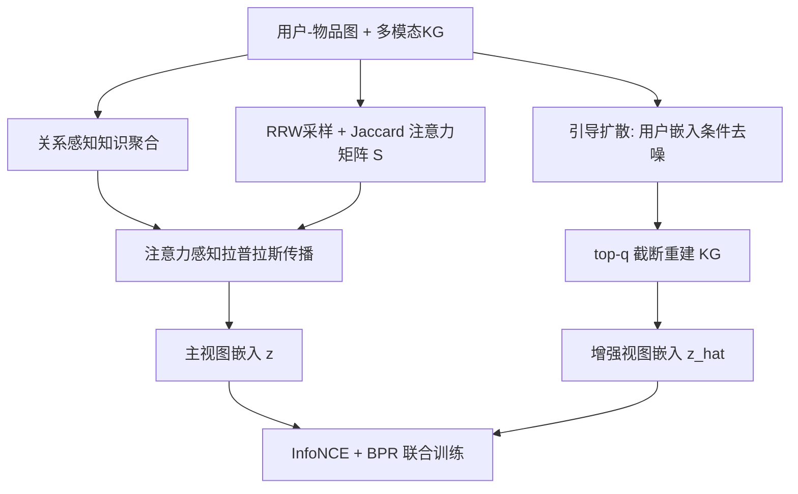

# Knowledge-aware Diffusion-Enhanced Multimedia Recommendation (知识感知扩散增强的多媒体推荐)

- **会议/期刊**: IEEE Transactions on Multimedia (TMM)
- **作者与机构**: Xian Mo, Fei Liu, Rui Tang, Jintao Gao, Hao Liu（宁夏大学信息工程学院；四川大学网络空间安全学院）
- **推荐链路定位**: 召回（图协同过滤表征学习）
- **研究方向**: 多模态推荐 / 自监督对比学习与交互去噪
- **论文原文**: [https://arxiv.org/abs/2507.16396v1](https://arxiv.org/abs/2507.16396v1)
- **开源代码**: [https://github.com/1453216158/KDiffE](https://github.com/1453216158/KDiffE)

## TL;DR (1分钟核心速览)

多模态推荐面临两大痛点：GNN 对用户-物品交互做**平均聚合**，无法区分邻居重要性；多模态内容噪声使对比视图被污染。KDiffE 提出用**重启随机游走采样的 Jaccard 指数**离线构建注意力感知矩阵注入拉普拉斯算子（免训练、可解释），并用**用户嵌入引导的扩散模型**重建低噪知识图谱、经 top-$q$ 截断生成对比视图。在 TikTok / Amazon-Baby / Amazon-Sports 三数据集上，Recall@20 达 0.112 / 0.095 / 0.102，相对最强基线 MGCL 分别提升 2.8% / 9.2% / 2.0%。

## Background & Motivation (背景与核心矛盾)

- **主流范式**: MMRec 先用 PNASNet 等预训练网络抽取视觉/文本/声学实体构建知识图谱，再以 GNN 在用户-物品图上做多层消息传播学习表征；近年 DiffMM、DiffKG 等引入扩散模型做图增强。
- **前人局限一（聚合无权重）**: 基于拉普拉斯矩阵的 GNN 平均聚合全部邻居，只刻画"是否相连"而非"多重要"；而 DualGNN/MGCN/MONET 等自适应注意力方案需在训练中反复更新权重，计算开销高且缺乏直观可解释性。
- **前人局限二（增强带噪）**: 多模态内容稀疏且含大量主题无关连接，随机增广或朴素扩散生成的对比视图被噪声污染，图卷积后噪声被显式注入所有节点表征。
- **核心洞察 (Key Insight)**: 用户-物品图的**拓扑结构本身**就蕴含重要性信号——若两节点在重启随机游走中频繁共现，则其交互更可信；同时扩散模型的逆过程若以"与该物品相连的用户嵌入"为条件，可保证重建出的关系**任务相关**而非任意合理。
- **本文切入点**: 用离线可算的拓扑相似度替代可学习注意力，用条件引导 + top-$q$ 截断替代无约束扩散增强。

## Method (核心方法设计)

### 1. 整体框架 (Overall Architecture)

模型分两支。**主视图支路**：先用关系感知知识嵌入层将 KG 中实体聚合进物品表征（式 1-2），再以重启随机游走 Jaccard 相似度构建注意力矩阵 $S$并融入归一化拉普拉斯算子，做多层轻量图传播得到主视图嵌入。**对比视图支路**：对物品-实体关系向量$x_0$加噪至$x_T$，逆过程中以邻接用户嵌入均值$\tilde{z}_i$为条件引导去噪，取 top-$q$关系重建低噪 KG$\hat{\mathcal{G}}_k$，再经同一传播层得到增强视图。两视图嵌入经 InfoNCE 对齐，与 BPR 主损失联合优化。

### 2. 关键设计拆解 (Key Designs)

1. **拓扑注意力矩阵 $S$（免训练的重要性建模）**：针对平均聚合失真与可学习注意力高开销的矛盾，从节点$u$/$v$出发各采样$R$条长度$M$的重启随机游走路径，取访问节点集合的 Jaccard 指数作为相似度，并以系数$\xi$ 注入邻接矩阵：

$$S(u,v)=\frac{|A_{M,R}(u)\cap B_{M,R}(v)|}{|A_{M,R}(u)\cup B_{M,R}(v)|},\quad \bar{L}=D_{(u)}^{-\frac{1}{2}}(A+\xi S)D_{(v)}^{-\frac{1}{2}}$$

   直觉：共现路径越多说明该交互越"结构性可信"，且 $S(u,v)$可直接读出每个邻居的贡献比例，天然具备可解释性；整个$S$ 离线预计算一次，训练期零额外参数更新。

2. **用户引导扩散 + top-$q$截断（任务相关的去噪增强）**：针对扩散增强"生成合理但与任务无关关系"的问题，将逆过程均值网络条件化于物品邻接用户的平均嵌入$\tilde{z}_i=\mathrm{Avg}(\sum_{i\in N_j} z_i)$：

$$p_\theta(x_{t-1}\mid x_t,\tilde{z}_i)=\mathcal{N}\big(x_{t-1};\,u_\theta(x_t,t,\tilde{z}_i),\,\Sigma_\theta(x_t,t,\tilde{z}_i)\big)$$

   再仅保留重建关系概率 $\hat{r}_j$中 top-$q$的边重构$\hat{\mathcal{G}}_k$。直觉：用户嵌入编码了"谁真的会消费该物品"，作为条件把生成分布拉向协同信号；top-$q$截断则充当硬阈值去噪器，$q$ 越小噪声引入越少。

3. **训练目标与推理开销**：总损失 $\mathcal{L}=\mathcal{L}_r+\theta_1(\mathcal{L}_s^{(u)}+\mathcal{L}_s^{(v)})+\theta_2\|\Theta\|_2^2$，主损失为 BPR 成对损失$\mathcal{L}_r=\sum_{(u,i,j)\in O}-\log(y_{u,i}-y_{u,j})$，对比损失为跨视图 InfoNCE（温度$\tau$），负样本为批内其他节点（in-batch，无需额外采样）。训练复杂度$O(L|Y|d + RM(I+J) + BL(I+J)d + |Y|d^2T)$，扩散步$T=10$ 即可收敛。

## Experimental Setup & Evaluation Protocol (实验设置与评估协议)

- **数据集与预处理**: 三数据集均采用多模态特征（V=视觉、A=声学、T=文本），视觉用 PNASNet 抽取：

| 数据集 | #Users | #Items | #Interactions | 模态 | 场景说明 |
| :--- | :---: | :---: | :---: | :---: | :--- |
| TikTok | 9,319 | 6,710 | 59,541 | V A T | 短视频 |
| Amazon-Baby | 19,445 | 7,050 | 139,110 | V T | 母婴电商 |
| Amazon-Sports | 35,598 | 218,357 | 256,308 | V T | 运动户外电商 |

- **数据划分与防穿越 (Splitting Strategy)**: 原文未显式声明划分方式（按 MMRec 惯例应为 Leave-One-Out 或比例划分），**此为复现风险点**。
- **排名评测协议 (Ranking Protocol)**: 采用 Recall@20 与 NDCG@20；原文未明确标注 Full-Ranking 或采样排序，需以开源代码核实。
- **对比基线与超参设置**: 基线含 CL 类（SGL、NCL、HCCF）与多模态类（CLCRec、MMGCL、SLMRec、BM3、MGCL、MHGCF、DiffKG）。超参：$\theta_1=10^{-2}$、$\theta_2=10^{-5}$、$R=12$、$M=50$、$\xi=0.7$、$t=10$、$\tau\in\{0.5,0.7\}$、$q=1$；结果取 10 次实验均值。

## Key Experimental Results (实验关键数据)

### 1. 主实验对比 (Main Results)

| 模型 | TikTok R@20 | TikTok N@20 | Baby R@20 | Baby N@20 | Sports R@20 | Sports N@20 |
| :--- | :---: | :---: | :---: | :---: | :---: | :---: |
| SGL | 0.060 | 0.024 | 0.068 | 0.030 | 0.078 | 0.036 |
| HCCF | 0.066 | 0.027 | 0.071 | 0.031 | 0.078 | 0.036 |
| MMGCL | 0.080 | 0.033 | 0.076 | 0.033 | 0.088 | 0.041 |
| BM3 | 0.096 | 0.040 | 0.084 | 0.036 | 0.098 | 0.044 |
| MGCL | 0.109 | 0.040 | 0.087 | 0.038 | 0.100 | 0.044 |
| MHGCF | 0.100 | 0.043 | 0.091 | 0.039 | 0.097 | 0.040 |
| DiffKG | 0.099 | 0.044 | 0.087 | 0.037 | 0.095 | 0.042 |
| **KDiffE** | **0.112** | **0.046** | **0.095** | **0.040** | **0.102** | **0.046** |
| Improv.% (vs 最强基线) | +2.8% | +4.5% | +4.4% | +2.6% | +2.0% | +4.5% |

### 2. 消融实验 (Ablation Study)

| 变体 | TikTok R | TikTok N | Baby R | Baby N | Sports R | Sports N |
| :--- | :---: | :---: | :---: | :---: | :---: | :---: |
| KDiffE 1 (w/o 注意力矩阵 $S$) | 0.107 | 0.041 | 0.094 | 0.040 | 0.101 | 0.045 |
| KDiffE 2 (w/o 用户引导 $\tilde{z}_i$) | 0.110 | 0.045 | 0.093 | 0.040 | 0.101 | 0.045 |
| KDiffE 3 (w/o 对比损失) | 0.107 | 0.046 | 0.091 | 0.038 | 0.098 | 0.043 |
| **KDiffE (完整)** | **0.112** | **0.046** | **0.095** | **0.041** | **0.102** | **0.046** |

### 3. 关键实验发现 (Key Findings)

1. **注意力矩阵 $S$ 是最大增益源**：移除后 TikTok Recall 从 0.112 降至 0.107、NDCG 从 0.046 降至 0.041，说明拓扑相似度确实比平均聚合更能区分邻居贡献；且该模块离线预计算，相比可学习注意力反而降低训练开销。
2. **用户引导扩散的收益集中在稀疏场景**：去掉 $\tilde{z}_i$ 后 TikTok Recall 掉 0.002、Baby 掉 0.002，而 Sports（物品数 21.8 万、极度稀疏）几乎无变化，暗示引导信号的有效性依赖物品侧有足够邻接用户，冷门物品上引导条件近似噪声。
3. **对比损失主要提升召回而非排序精度**：KDiffE 3 在 TikTok 上 NDCG 与完整模型持平（0.046），但 Recall 在三个数据集上均下降（0.107/0.091/0.098），说明跨视图对齐扩大了对正样本的覆盖，但对头部排序的精细化贡献有限；此外 $q$ 从 1 增大时性能单调下降，验证了"多引入的关系即为噪声"的假设。

## Highlights & Limitations (亮点、对比与审稿批判)

- **与代表作对比 (vs. Prior Work)**: 相比 **MHGCF**（同样构建 KG 增强语义，但用平均聚合且无去噪增强），KDiffE 在 Baby 上 Recall 高出 4.4%；相比 **DiffKG**（扩散 + 图对比但无用户条件引导），KDiffE 在 TikTok NDCG 上高出 4.5%，差异核心在于"条件化 + top-$q$ 截断"两道去噪闸门；相比 **MGCL**（多模态线索对比），KDiffE 用扩散重建替代随机增广，避免了噪声注入。
- **可迁移亮点**: ① 用重启随机游走 Jaccard 相似度作为**免训练边权重**注入拉普拉斯算子，可直接移植到 LightGCN 类模型作为轻量重要性先验；② 以"邻接用户嵌入均值"作为扩散条件，是把协同信号注入生成过程的低成本范式，可迁移至其他图增强任务。
- **审稿级局限批判**: ① **评估协议披露不足**——未说明数据划分方式与是否 Full-Ranking，且主实验仅报告 @20 单一截断，缺少 @10/@50 与显著性检验，复现与横向比较存在风险；② **扩散开销与增益不匹配**——$T=10$步扩散带来$O(|Y|d^2T)$额外训练成本，但相对 MGCL 的 Recall 提升仅 2.0%（Sports），且$q$、$\xi$、$\tau$ 均需逐数据集调参，超参敏感度较高。

## Rating (四维评分)

- **方法创新性 (Novelty)**: ⭐⭐⭐⭐ （拓扑 Jaccard 注意力 + 用户条件引导扩散的组合有新意，但两个模块各自并非全新，属精巧工程整合）
- **评估协议与实验扎实度 (Protocol & Experiments)**: ⭐⭐⭐ （三数据集 + 10 基线较完整，但划分/打分协议未披露、缺显著性检验与多截断指标）
- **写作与数学规范度 (Clarity & Rigor)**: ⭐⭐⭐ （公式链条完整、符号基本自洽，但存在 $\delta$/$\xi$ 符号混用、复杂度分析中模型名笔误等瑕疵）
- **工业落地与复现价值 (Industrial & Practical Value)**: ⭐⭐⭐⭐ （代码已开源，注意力矩阵离线预计算、扩散仅 10 步，训练开销可控，具备中等规模部署可行性）

