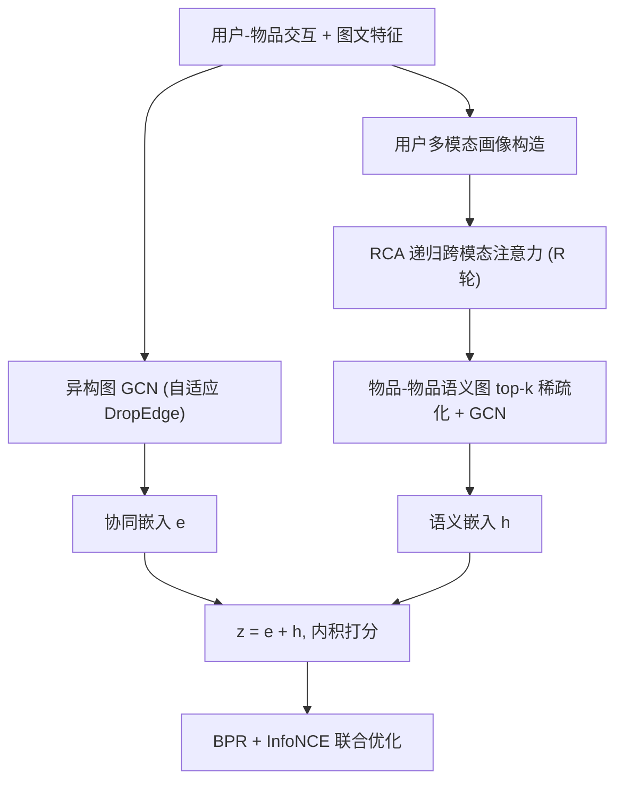
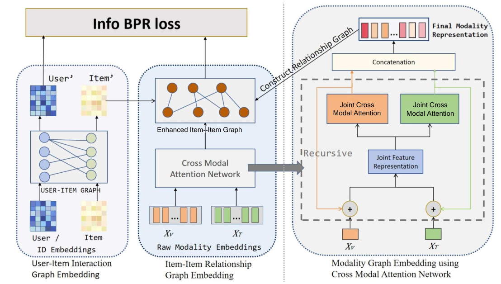

# Cross-Modal Attention Network with Dual Graph Learning in Multimodal Recommendation (双图学习跨模态注意力网络)

- **会议/期刊**: ACM TOMM 2026
- **作者与机构**: Ji Dai, Quan Fang (通讯), Jun Hu, DeSheng Cai, Yang Yang, Can Zhao（北邮 / NUS / 天工大 / 北航 / 民航数据通信）
- **推荐链路定位**: 召回（Top-K 排序）
- **研究方向**: 多模态推荐 / 自监督对比学习
- **论文原文**: [arXiv:2601.11151v1](https://arxiv.org/abs/2601.11151v1)
- **开源代码**: [MKC-Lab/CRANE](https://github.com/MKC-Lab/CRANE)

## TL;DR (1分钟核心速览)

现有多模态推荐存在两大痛点：模态融合停留在简单拼接/线性组合，无法挖掘模态内与模态间的高阶协同关系；且用户仅由交互 ID 刻画、物品却享有丰富多模态特征，形成"非对称表征"，阻碍共享语义空间学习。本文提出 CRANE：用递归跨模态注意力（RCA）在联合隐空间迭代对齐图文特征，显式构造用户多模态画像实现对称建模，并以"用户-物品异构图 + 物品-物品语义图"双图 + 自监督对比损失统一行为与语义信号。在四个 Amazon 数据集、8:1:1 随机划分、Full-Ranking 协议下，Recall/NDCG 平均提升约 5%（如 Clothing Recall@20 较 LightGCN 提升 75.6%）。

## Background & Motivation (背景与核心矛盾)

- **主流范式**: 以 LATTICE、FREEDOM 为代表的双图范式——用户-物品交互图 + 基于模态相似度的物品-物品图，用 GCN 传播高阶语义；近期 DGAVE（VAE 解耦）、LPIC（可学习 prompt）进一步引入生成式/提示式对齐。
- **前人局限一（浅层融合）**: 多数方法用均值、注意力求和或直接拼接融合图文，把所有模态等同对待，无法刻画"视觉管外观、文本管功能"的细粒度互补（如图 1 中冠层设计与户外耐久性需跨模态对齐才能识别潜在偏好）。
- **前人局限二（非对称表征）**: 物品有多模态特征，用户却只有交互 ID，形成 item-centric 偏置，用户与物品难以落入同一语义空间。
- **核心洞察 (Key Insight)**: 若把用户画像也用其交互物品的多模态特征显式构造，则用户与物品天然共享视觉/文本空间；而模态融合不应是一次性算子，应是可迭代细化的"跨模态注意力"过程。
- **本文切入点**: 用递归跨模态注意力做深度融合 + 用双图 + 对比学习把协同视图与语义视图对齐，同时保持近线性计算开销。

## Method (核心方法设计)

### 1. 整体框架 (Overall Architecture)

CRANE 分三阶段闭环：① 在用户-物品异构图上做带自适应 DropEdge 的 LightGCN 式传播，得到协同嵌入 $e_u,e_i$；② 用交互物品特征求和构造用户多模态画像，与物品特征拼成统一模态矩阵，送入 RCA 迭代$R$轮细化图文特征，得到$X_{att}$；③ 以$X_{att}$的余弦相似度 top-$k$稀疏化构建物品-物品语义图，并以协同嵌入$e_i$为初值传播得到语义嵌入$h_i$，用户侧$h_u$由交互物品聚合；最终$z=e+h$ 内积打分，BPR + 对比损失联合优化。

<figure class="paper-figure" markdown="span">
  <figcaption>图 2. CRANE 的整体框架。模型首先利用异构用户-物品图（左）从历史交互中提取基础协同信号。随后，核心 RCA 机制（右）迭代对齐并细化视觉与文本特征，以挖掘深层模态内与模态间依赖关系。这些细化特征随后用于构建同构物品-物品语义图（中），将高阶语义亲和力注入物品表示。最后，融合协同视图与语义视图以预测用户偏好。</figcaption>
</figure>

### 2. 关键设计拆解 (Key Designs)

1. **递归跨模态注意力 RCA（深度融合）**：痛点是一次性拼接无法建模高阶跨模态依赖。RCA 每轮先拼接 $E=[X^v;X^t]$并线性变换到联合空间，再投影回各模态锚点$P^m=E'W^m$，用相关矩阵$C^m=\tanh(X^m(P^m)^\top)$度量实体级跨模态相关性，最后残差更新$X^m\leftarrow \mathrm{ReLU}(C^mX^mW_a^m)+X^mW_f^m$。直觉：$C^m$相当于"以联合语义为查询、以单模态特征为键"的自注意力，迭代$R$ 轮即逐层剥离模态噪声、放大互补信号。

2. **对称双图 + 用户多模态画像（消除非对称）**：用户画像取交互物品特征**求和**而非均值 $x_u^m=\sum_{i\in\mathcal{N}(u)}x_i^m$，保留隐式反馈的累积强度（消融显示均值池化会稀释活跃用户置信度）。语义图以$S_{ij}=\cos(x_{i,att},x_{j,att})$取 top-$k$行归一化得$\tilde{S}$，传播$h_i^{(l+1)}=\sum_{j\in\mathcal{N}_S(i)}\tilde{S}_{ij}h_j^{(l)}$，且**以协同嵌入$e_i$为初值**$h_i^{(0)}=e_i$，使语义图一开始就锚定在行为空间，避免纯内容相似度漂移。

3. **训练目标、负采样与推理效率**：总损失 $\mathcal{L}=\mathcal{L}_{BPR}+\beta(\mathcal{L}^{U}_{CL}+\mathcal{L}^{I}_{CL})+\lambda\|\Theta\|_2^2$，其中对比损失把同一节点的协同视图$e$与语义视图$h$作正对、batch 内其他节点作负对（InfoNCE，温度$\tau$）；BPR 采用全局均匀负采样（1 正 1 负）。理论复杂度$T=\mathcal{O}((L_{UI}\|A\|_0+L_{II}Nk+RN^2)d)$，RCA 的$N^2$ 项为唯一二次开销，但实测受稀疏 SpMV 主导，Electronics（63k 物品）单 epoch 仅 17.54s、显存 16.87GB。

## Experimental Setup & Evaluation Protocol (实验设置与评估协议)

- **数据集与预处理**: 四个 Amazon 评论数据集，沿用 MMRec 公开预处理（视觉 ResNet50 4096 维、文本 BERT 384 维），过滤保留交互数 ≥ 4 的用户，1-5 星转二值隐式反馈：

| 数据集 | #Users | #Items | #Interactions | 稀疏度 | 场景说明 |
| :--- | :---: | :---: | :---: | :---: | :--- |
| Baby | 19,445 | 7,050 | 160,792 | 99.88% | 母婴，中小规模 |
| Sports | 35,598 | 18,357 | 296,337 | 99.95% | 运动户外 |
| Clothing | 39,387 | 23,033 | 278,677 | 99.97% | 服饰，视觉主导 |
| Electronics | 192,403 | 63,001 | 1,689,188 | 99.99% | 大规模极稀疏 |

- **数据划分与防穿越 (Splitting Strategy)**: 随机 **8:1:1** 划分训练/验证/测试，固定 5 个随机种子（9, 672, 5368, 12784, 2023）生成 5 份划分，报告均值；配对 t 检验 $p<0.005$。
- **排名评测协议 (Ranking Protocol)**: 采用 **Full-Ranking（全库未交互物品排序）**，指标 Recall@{10,20} 与 NDCG@{10,20}；训练负采样为全局均匀随机 1:1。
- **对比基线与超参设置**: 10 个基线，含通用 CF（BPR、LightGCN）与多模态（VBPR、MMGCN、SLMRec、LATTICE、FREEDOM、LGMRec、DGA VE、LPIC）；嵌入维度 $d=64$、batch 1024、Adam、早停 patience=5；$L_{UI}=2$、$L_{II}=1$、$R\in\{2,3\}$、$k\in\{10,15\}$、$\beta\in[0.6,0.8]$、$\tau\in[0.4,0.6]$。

## Key Experimental Results (实验关键数据)

### 1. 主实验对比 (Main Results)

| 数据集 | 指标 | LightGCN | LATTICE | FREEDOM | LGMRec | DGA VE | LPIC | **CRANE** | Improv.(vs 最优基线) |
| :--- | :--- | :---: | :---: | :---: | :---: | :---: | :---: | :---: | :---: |
| Baby | R@20 | 0.0754 | 0.0850 | 0.0992 | 0.1002 | 0.1009 | 0.0977 | **0.1021** | +1.2% |
| Baby | N@20 | 0.0328 | 0.0370 | 0.0424 | 0.0440 | 0.0436 | 0.0422 | **0.0458** | +4.1% |
| Sports | R@20 | 0.0864 | 0.0953 | 0.1089 | 0.1068 | 0.1127 | 0.1113 | **0.1129** | +0.2% |
| Sports | N@20 | 0.0387 | 0.0421 | 0.0481 | 0.0480 | 0.0501 | 0.0485 | **0.0503** | +0.4% |
| Clothing | R@20 | 0.0544 | 0.0733 | 0.0941 | 0.0828 | 0.0917 | 0.0928 | **0.0956** | +1.6% |
| Clothing | N@20 | 0.0243 | 0.0330 | 0.0420 | 0.0371 | 0.0412 | 0.0405 | **0.0431** | +2.6% |
| Electronics | R@20 | 0.0579 | 0.0551 | 0.0647 | 0.0661 | 0.0657 | – | **0.0678** | +2.6% |
| Electronics | N@20 | 0.0272 | 0.0261 | 0.0295 | 0.0304 | 0.0301 | – | **0.0390** | +28.3% |

### 2. 消融实验 (Ablation Study)

| 变体 | Baby R@20 | Baby N@20 | Sports R@20 | Clothing R@20 |
| :--- | :---: | :---: | :---: | :---: |
| w/o Item Graph | 0.0965 | 0.0428 | 0.1072 | 0.0912 |
| w/o RCA ($R=1$) | 0.0982 | 0.0439 | 0.1095 | 0.0935 |
| w/o Attention（改拼接） | 0.0975 | 0.0432 | 0.1088 | 0.0928 |
| w/o GCN | 0.0910 | 0.0395 | 0.1025 | 0.0885 |
| w/o CL | 0.0935 | 0.0408 | 0.1050 | 0.0892 |
| w/o Dual Fusion（晚融合） | 0.0958 | 0.0422 | 0.1065 | 0.0905 |
| **CRANE** | **0.1021** | **0.0458** | **0.1129** | **0.0956** |

### 3. 关键实验发现 (Key Findings)

1. **结构传播是性能骨架，语义图是稀疏场景的"救命桥"**：去掉 GCN 掉点最狠（Baby R@20 0.1021→0.0910，-10.9%），去掉物品语义图次之（-5.5%）；在 99.99% 稀疏的 Electronics 上 CRANE 仍取得最高 R@20=0.0678，说明物品-物品图能在无共交互时传播偏好。
2. **递归深度与图深度需"反向"配置**：$L_{UI}=2$捕捉二阶协同（User→Item→User）最优，而$L_{II}$从 1 增至 2 即掉点（Baby 0.1021→0.0995），因$k$-NN 语义图稠密，2 跳即过平滑；RCA 递归$R=3$最优（0.0977→0.1021），$R=4$ 出现过度细化。
3. **静态早融合会"互相抑制"**：Clothing 上简单拼接 CRANE-C（0.0855）甚至不如纯视觉 CRANE-V（0.0925），且模态重要性随域变化（Baby 文本主导、Clothing 视觉主导）；用户画像用求和优于均值/最大/注意力（R@20 0.0956 vs 0.0952/0.0948/0.0954），注意力聚合还带来 4.98s vs 4.76s 的额外开销与过拟合风险。

## Highlights & Limitations (亮点、对比与审稿批判)

- **与代表作对比 (vs. Prior Work)**: 相比 LATTICE/FREEDOM 的"静态模态相似度图 + 冻结/剪枝"，CRANE 的语义图由 RCA 细化后的特征动态生成，且以协同嵌入为初值，实现行为-语义的即时融合；相比 DGA VE 的 VAE 隐变量与 LPIC 的 prompt 对齐，CRANE 保留显式 GCN 拓扑，实验证明其在排序任务上更占优（作者归因于变分推断会抽象掉关键拓扑连通性）。
- **可迁移亮点**: ① "以协同嵌入初始化语义图传播"可低成本移植到任何双图推荐；② 用户画像用**求和而非均值**保留隐式反馈强度，是一个反直觉但被消融验证的轻量 trick。
- **审稿级局限批判**: ① RCA 的 $C^m\in\mathbb{R}^{(M+N)\times(M+N)}$为$O(N^2)$稠密相关矩阵，$N>10^6$ 时显存将超单卡容量，文中仅给出 LSH/块稀疏的"未来方向"而无实测；② 评估仅用随机 8:1:1 划分，未做时间切分或冷启动划分，且 Electronics 上部分基线（SLMRec、LPIC）缺失，跨方法比较的完整性略打折扣。

## Rating (四维评分)

- **方法创新性 (Novelty)**: ⭐⭐⭐⭐ （RCA 的"联合空间→模态锚点→相关矩阵→残差细化"迭代范式与对称双图组合有新意，但各组件均可溯源至 CAMR/LATTICE 系谱）
- **评估协议与实验扎实度 (Protocol & Experiments)**: ⭐⭐⭐⭐ （四数据集 + 5 随机种子 + 配对 t 检验 + 六变体消融 + 融合策略/聚合策略/超参三组专项分析，较完整；扣分在缺时间切分与部分基线缺失）
- **写作与数学规范度 (Clarity & Rigor)**: ⭐⭐⭐⭐ （符号表、算法伪代码、复杂度推导齐备，公式编号规范；RCA 中 $C^m$ 的语义解释略偏启发式，缺理论收敛性讨论）
- **工业落地与复现价值 (Industrial & Practical Value)**: ⭐⭐⭐⭐ （代码开源、基于 MMRec 框架易复现，Electronics 单 epoch 17.54s 可接受；但 $O(N^2)$ 项限制超大规模部署，需工程侧稀疏化改造）

