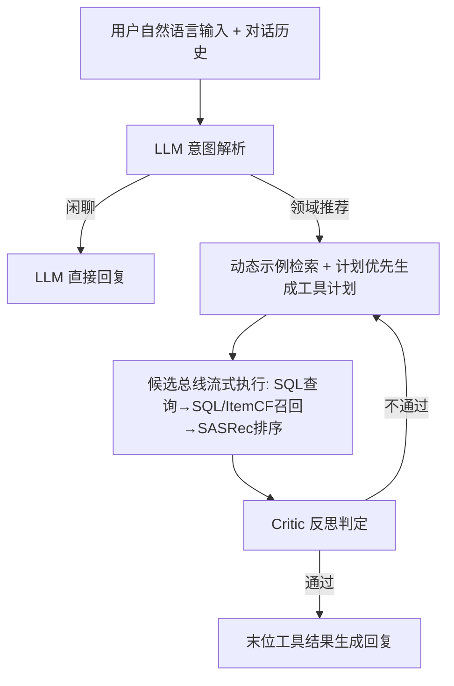
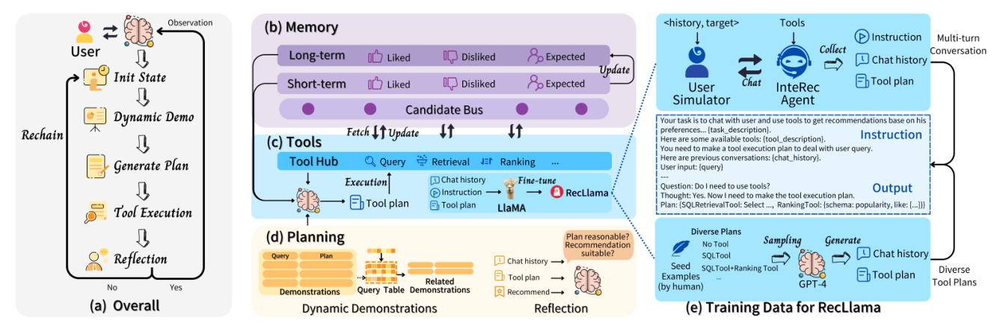

# Recommender AI Agent: Integrating Large Language Models for Interactive Recommendations (推荐 AI 智能体：融合大模型实现交互式推荐)

- **会议/期刊**: TOIS 2025
- **作者与机构**: Xu Huang, Jianxun Lian, Yuxuan Lei, Jing Yao, Defu Lian, Xing Xie（中国科学技术大学、微软亚洲研究院）
- **推荐链路定位**: 重排（对话式端到端调度：查询 → 召回 → 排序）
- **研究方向**: 对话推荐与智能体仿真 / 大语言模型推荐
- **论文原文**: [https://arxiv.org/abs/2308.16505v3](https://arxiv.org/abs/2308.16505v3)
- **开源代码**: [https://github.com/Significant-Gravitas/Auto-GPT](https://github.com/Significant-Gravitas/Auto-GPT)（论文正文声明代码发布于 aka.ms/recagent）

## TL;DR (1分钟核心速览)

通用 LLM 具备指令理解与常识推理，却缺乏领域物品目录与细粒度行为模式，在私有域（如 Amazon Beauty）幻觉严重；而 ID-based 推荐模型是领域专家却无法对话与解释。本文提出 InteRecAgent，以 LLM 为大脑、SQL/ItemCF/SASRec 三类工具为领域知识源，配合候选总线、长短期用户画像、计划优先执行 + 动态示例、Actor-Critic 反思，并用 GPT-4 蒸馏出 7B 的 RecLlama。在 Steam/MovieLens/Beauty 的用户模拟器协议下，Hit@5 达 0.87/0.85/0.54，全面超越 GPT-4（0.78/0.79/0.15），Beauty 域提升尤为显著。

## Background & Motivation (背景与核心矛盾)

- **主流范式**: 对话推荐分两支——属性问答式（少轮次问属性收敛兴趣）与开放式对话（预训练语言模型 + 外部知识生成回复）；LLM 时代则出现 Chat-Rec 这类"文本嵌入召回 + LLM 生成"的简化 Agent。
- **前人局限**: 其一，LLM 预训练语料无法覆盖私有域/新物品的细粒度目录与行为模式，逐域微调既不经济也不高效；其二，ReAct 式 step-by-step 工具调用在推荐场景下观察（候选物品名）极长、易污染 prompt，且 LLM 常选错工具、漏步骤、格式出错。
- **核心洞察 (Key Insight)**: 推荐任务天然是"漏斗式多阶段过滤"，候选集应在工具间流式传递而非塞进 prompt；同时工具调用计划可一次性生成，无需每步都让 LLM 推理。
- **本文切入点**: 把 LLM 与推荐模型解耦为"大脑 + 工具"，用记忆总线承载候选流、用计划优先执行压缩 API 调用、用反思纠错，再用 GPT-4 蒸馏小模型降本。

## Method (核心方法设计)

### 1. 整体框架 (Overall Architecture)

用户以自然语言输入，LLM 先判断是闲聊还是领域推荐：闲聊直接自答，推荐则触发工具链。工具分三类——信息查询（SQL 查物品详情）、物品召回（SQL 处理硬条件如"RPG 且低于 100 元"，ItemCF 处理软条件如"类似使命召唤"）、物品排序（SASRec 去位置嵌入，结合用户画像打分）。候选物品不进入 prompt，而是存入候选总线在工具间流式过滤；每轮对话由 LLM 合成"喜欢/不喜欢/期望"三维画像。规划阶段一次性产出完整工具计划并严格执行，执行后由 critic LLM 判定是否重规划。最终仅末位工具的 Top 结果作为观察生成回复。

<figure class="paper-figure" markdown="span">
  <figcaption>图1：InteRecAgent框架。(a) InteRecAgent的整体流程；(b) 记忆模块，由候选记忆总线、长期和短期用户画像组成；(c) 工具模块，由多种工具、计划优先执行策略和RecLlama微调组成；(d) 规划模块，涉及动态演示和反思策略；(e) RecLlama的微调数据来源。</figcaption>
</figure>

### 2. 关键设计拆解 (Key Designs)

1. **候选总线 + 长短期用户画像（Memory）**：痛点是把上千候选物品名塞进 prompt 会超窗且降智。候选总线由 data bus（存当前候选）与 tracker（记录第 $k$次调用三元组$(f_k, i_k, o_k)$）构成，每次工具执行前读、执行后刷新，形成漏斗式流式过滤；画像按"like/dislike/expect"字典建模，对话超窗时切段并把前段画像并入长期记忆，短期记忆取自当前 prompt 内最近对话，调用工具时二者拼接。直觉：把"状态"从文本上下文搬到结构化存储，LLM 只做决策不做搬运。
2. **计划优先执行 + 动态示例（Plan-first + Dynamic Demonstration）**：痛点 ReAct 需 $N+1$次 API 调用且难以构造含动态观察的示例。本文改为两阶段：$p^t=\{p_1^t,\dots,p_n^t\}=\text{plan}(x^t, C^{t-1}, \mathcal{F}, D_{x^t})$，其中$p_k^t=(f_k,i_k)$，随后$o^t=\text{exec}(p^t,\mathcal{F})$一次性执行，仅需 2 次 API 调用。示例$D_{x^t}$ 用 sentence-transformers 编码 + ChromaDB ANN 检索最相似的 3 条；示例本身用 Self-Instruct 的 input-first / output-first 双策略由 LLM 扩增（output-first 会反向校验计划一致性以过滤低质意图）。
3. **Actor-Critic 反思与 RecLlama 蒸馏**：actor 负责规划，critic 计算 $\gamma=\text{reflect}(x^t, C^{t-1}, p^t, o^t, y^t)$，$\gamma$ 为负则携反馈重入 plan。训练侧用 GPT-4 与用户模拟器对话生成 16,183 条 [指令, 工具计划] 样本（13,525 来自对话、2,658 来自 30 条模板对话随机组合），微调 LLaMA-2-7B 得 RecLlama；训练数据仅含 Steam 与 MovieLens，Beauty 留作域外泛化测试。总目标即标准指令微调交叉熵，无负采样环节，推理开销主要来自 2 次 LLM 调用 + 工具执行。

## Experimental Setup & Evaluation Protocol (实验设置与评估协议)

- **数据集与预处理**: Steam、MovieLens、Amazon Beauty，均含交互历史与物品元数据；工具在 train+val 上训练。

| 数据集 | #Users | #Items | #Interactions | 稀疏度/密度 | 特征/场景说明 |
| :--- | :---: | :---: | :---: | :---: | :--- |
| Steam | 未在正文给出 | 未在正文给出 | 未在正文给出 | — | 游戏域，世界知识覆盖较好 |
| MovieLens | 未在正文给出 | 未在正文给出 | 未在正文给出 | — | 电影域，世界知识覆盖较好 |
| Amazon Beauty | 未在正文给出 | 未在正文给出 | 未在正文给出 | — | 私有美妆域，物品名专业冗长、新物品多 |

- **数据划分与防穿越 (Splitting Strategy)**: `Leave-One-Out`，最后一件为测试目标；用户模拟器与单轮评测分别随机采样 1000 / 500 条测试实例，终身模拟仅用 100 条。
- **排名评测协议 (Ranking Protocol)**: 双协议——(a) 用户模拟器多轮对话，指标 Hit@k 与 AT@k（k 轮内命中率与平均成功轮数，失败记 $k+1$）；(b) 单轮推荐，检索任务用 `Full-Ranking` 式 Recall@5（全库召回 5 件），排序任务用 1 正 + 19 随机负的 `Sampled Ranking` 计算 NDCG@20。
- **对比基线与超参设置**: Random、Popularity、LLaMA-2-7B/13B、Vicuna-v1.5-7B/13B、Chat-Rec(3.5/4)、GPT-3.5、GPT-4；动态示例数 3，硬条件召回上限 1000，软条件截断 Top 5%。

## Key Experimental Results (实验关键数据)

### 1. 主实验对比 (Main Results)

用户模拟器 session-wise（Hit@5 ↑ / AT@5 ↓）：

| 方法 | Steam H@5 | Steam AT@5 | MovieLens H@5 | MovieLens AT@5 | Beauty H@5 | Beauty AT@5 |
| :--- | :---: | :---: | :---: | :---: | :---: | :---: |
| LLaMA2-13B | 0.39 | 4.56 | 0.53 | 4.52 | 0.05 | 5.87 |
| Vicuna-13B | 0.40 | 4.60 | 0.54 | 4.56 | 0.07 | 5.85 |
| Chat-Rec(3.5) | 0.74 | 3.63 | 0.76 | 3.78 | 0.39 | 4.89 |
| Chat-Rec(4) | 0.83 | 3.42 | 0.82 | 3.62 | 0.40 | 4.80 |
| GPT-3.5 | 0.69 | 3.68 | 0.75 | 3.75 | 0.13 | 5.68 |
| GPT-4 | 0.78 | 3.34 | 0.79 | 3.70 | 0.15 | 5.59 |
| **Ours** | **0.87** | **2.86** | **0.85** | **3.15** | **0.54** | **3.99** |
| Improv. vs GPT-4 | +11.5% | -14.4% | +7.6% | -14.9% | +260% | -28.6% |

单轮推荐（Recall@5 / NDCG@20）：Ours 在 Steam 达 65.05 / 60.28，MovieLens 52.02 / 63.86，Beauty 30.28 / 40.05，均超 GPT-4 的 56.77 / 57.29、47.78 / 55.78、12.80 / 33.28；Beauty 检索相对提升 +136.6%。

### 2. 消融实验 (Ablation Study)

用户模拟器下移除各模块（P=计划优先，D=动态示例，R=反思）：

| 配置 | Steam H@5 | Steam AT@5 | 说明 |
| :--- | :---: | :---: | :--- |
| Ours 完整 | 最高 | 最低 | 三模块齐备 |
| w/o R | 下降最显著 | 上升最显著 | 无法纠正工具误用与格式错误 |
| w/o P | 小幅下降 | 小幅上升 | API 调用从 2.78 增至 4.51 次/轮，延迟 +10~20s |
| w/o D | 小幅下降 | 小幅上升 | 仍超多数基线 |

### 3. 关键实验发现 (Key Findings)

1. **私有域是 Agent 的真正价值区**：Beauty 上 GPT-4 仅 0.15 Hit@5，InteRecAgent 达 0.54（+260%），而 Steam/MovieLens 提升仅 7~12%，说明世界知识覆盖好的域 LLM 本身已够用，工具增益集中在专业冗长物品名导致的幻觉场景。
2. **反思是纠错主力，计划优先是降本主力**：移除反思性能跌幅最大；移除计划优先精度仅小降但 API 调用从 2.78 涨到 4.51 次/轮，延迟增加 10~20 秒，二者分别对应"准"与"快"。
3. **长期记忆在长对话中必要且有效**：LONG-CHAT 下 Beauty 从 0.69 升至 0.74（AT@50 从 27.14 降至 25.88）；LONG-CONTEXT 下 Beauty 从 0.38 升至 0.51（AT@5 从 4.58 降至 3.99），且无长期记忆时已全面超 GPT-4。
4. **小模型可蒸馏替代**：RecLlama（7B）在 Steam 达 0.801 Hit@5，逼近 GPT-4 的 0.868，远超 GPT-3.5 的 0.181 与 ToolLLaMA 的近乎 0；且训练仅用 Steam+MovieLens，却在 Beauty 上泛化到 0.408，说明学到的是"规划能力"而非域记忆。

## Highlights & Limitations (亮点、对比与审稿批判)

- **与代表作对比 (vs. Prior Work)**: 相比 Chat-Rec 仅用单一文本嵌入召回工具，本文补齐查询/召回/排序全链路，能处理"先查某游戏发售日、再按该日期做硬条件过滤、最后按历史排序"的复合查询；相比 ReAct 的 step-by-step，本文计划优先把 API 调用从 $N+1$ 压到 2 且示例构造从"难"变"易"；相比 ToolLLaMA 的通用 API 调用训练，RecLlama 专注推荐意图解析与计划生成，效果差距悬殊。
- **可迁移亮点**: ①"候选总线"思路可迁移到任何 LLM 调用大规模候选集的场景（如 RAG 多跳检索、Agent 工具链中间态管理）；②output-first 示例生成 + 一致性反校验，是低成本扩充高质量 ICL 示例的通用技巧。
- **审稿级局限批判**: ①评测完全依赖 GPT-4 用户模拟器，模拟器自身偏好注入与终止规则可能引入偏差，缺乏真实用户 A/B；②工具链固定为 SQL+ItemCF+SASRec，未讨论工具选择错误时的级联失败，且每轮 2 次 GPT-4 调用的成本对高并发线上场景仍偏高；③数据集统计量与显著性检验在正文缺失，Beauty 域提升幅度的置信区间不明。

## Rating (四维评分)

- **方法创新性 (Novelty)**: ⭐⭐⭐⭐ （首个系统化将 LLM+Tools 范式落地推荐域，候选总线与计划优先执行是针对推荐场景的原创适配，但整体属工程集成创新而非理论突破）
- **评估协议与实验扎实度 (Protocol & Experiments)**: ⭐⭐⭐ （三数据集 + 双评测协议 + 终身对话设定较完整，但依赖 GPT-4 模拟器、缺真实用户与显著性检验，数据集统计缺失）
- **写作与数学规范度 (Clarity & Rigor)**: ⭐⭐⭐⭐ （框架图与 ReAct 对比表清晰，公式简洁；但部分模块仅文字描述、缺形式化，工具实现细节散落）
- **工业落地与复现价值 (Industrial & Practical Value)**: ⭐⭐⭐⭐ （RecLlama 蒸馏显著降本、模块可插拔易接入现有推荐栈；但多工具编排的延迟与失败级联在超大规模场景仍需工程打磨）

