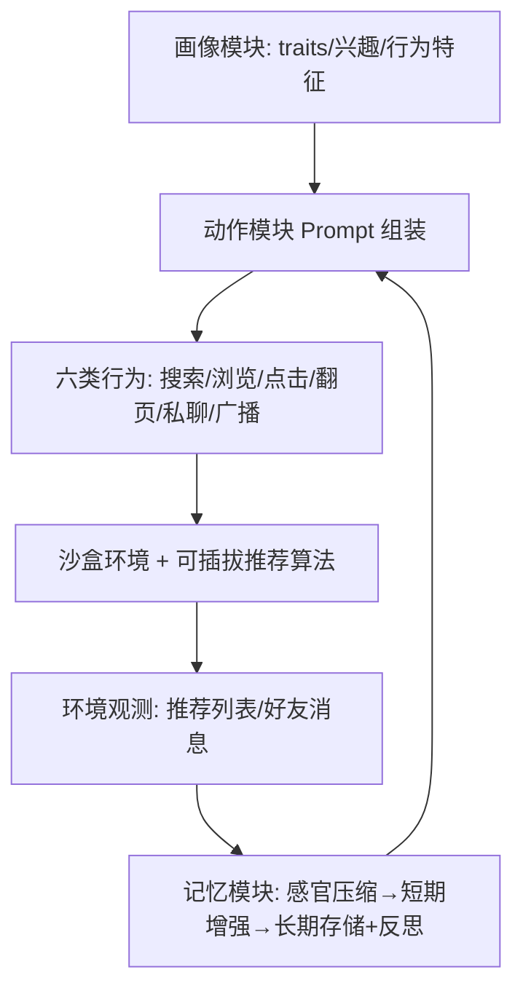
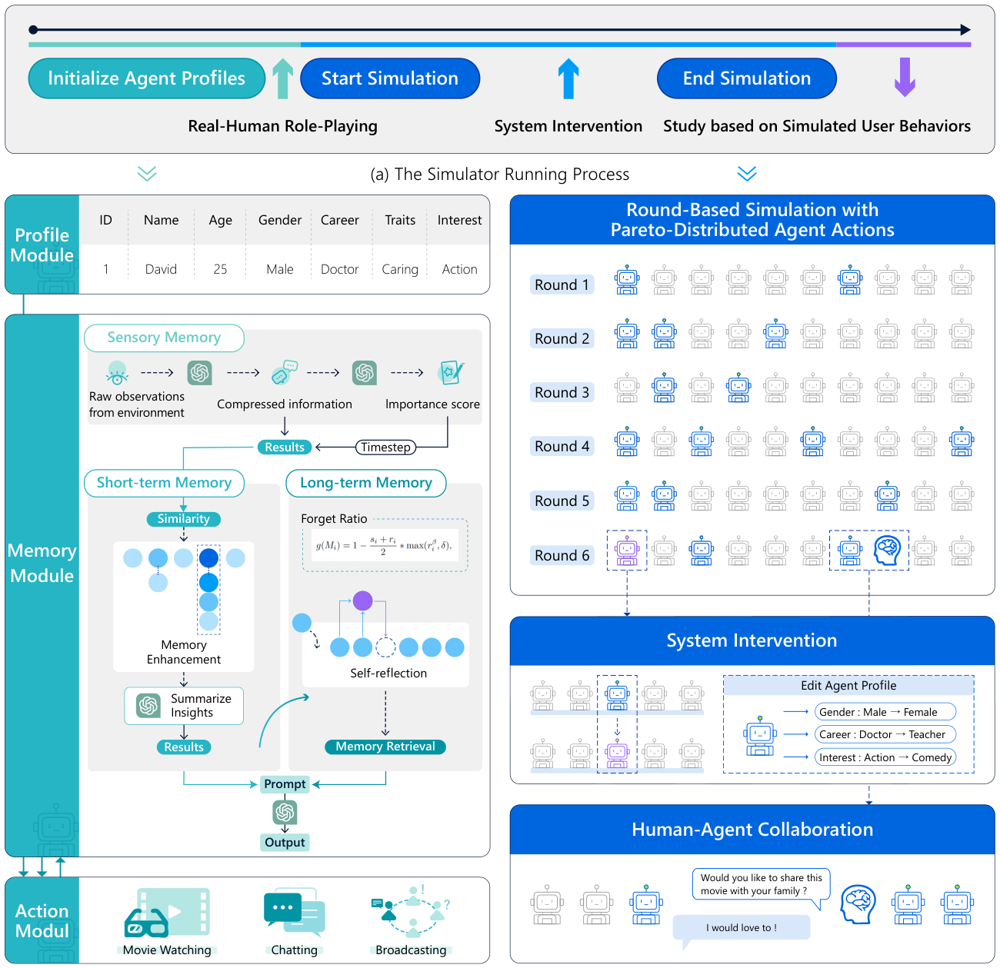

# User Behavior Simulation with Large Language Model based Agents (基于大语言模型智能体的用户行为模拟)

- **会议/期刊**: TOIS 2025 (arXiv 2306.02552v3)
- **作者与机构**: Lei Wang, Jingsen Zhang, Hao Yang, Zhi-Yuan Chen, Jiakai Tang, Zeyu Zhang, Xu Chen, Yankai Lin, Wayne Xin Zhao, Ji-Rong Wen 等（中国人民大学高瓴人工智能学院、大数据管理与分析方法北京市重点实验室、UCL）
- **推荐链路定位**: 端到端生成式（仿真沙盒，可挂载任意召回/排序算法）
- **研究方向**: 对话推荐与智能体仿真 / 大语言模型推荐
- **论文原文**: [https://arxiv.org/abs/2306.02552v3](https://arxiv.org/abs/2306.02552v3)
- **开源代码**: [https://github.com/RUCAIBox/RecSysDatasets](https://github.com/RUCAIBox/RecSysDatasets)（仅数据集仓库，模拟器主体暂未开源）

## TL;DR (1分钟核心速览)

传统用户行为模拟器用内积/MLP 刻画决策、必须依赖真实数据冷启动、且局限于单一场景，无法生成可信的多环境行为。本文提出 LLM Agent 框架 RecAgent：画像模块定角色、认知神经科学启发的三级记忆模块驱动行为动态、动作模块统一 Prompt 生成搜索/浏览/点击/翻页/私聊/广播六类行为，并搭建可干预可重置的沙盒。在 MovieLens-1M 上以 $p@(a,b)$ 命中率评估，模拟器平均超越最佳基线约 68%，仅比真人低 8%；并成功复现信息茧房（熵降 8.5%）与从众现象。

## Background & Motivation (背景与核心矛盾)

- **主流范式**: 以 Embedding 内积或 RecSim 等基于 MLP 的用户模型，在真实交互数据上拟合用户决策函数，再在单场景环境中采样行为序列。
- **前人局限**: 其一，决策过程被简化为浅层打分函数，无法刻画认知层面的复杂权衡；其二，模拟器启动必须先用真实数据训练，陷入"先有数据才能造数据"的鸡生蛋困境，且只能复现已知数据分布，无法零样本迁移到新场景。
- **核心洞察 (Key Insight)**: 观影、聊天、发帖等用户行为本质上都能用自然语言表达，而 LLM 已在海量网页语料中习得这些行为模式与人类心智逻辑，因此仅凭少量甚至零真实数据即可"角色扮演"出可信用户。
- **本文切入点**: 用认知神经科学的三级记忆机制增强 LLM，把单点行为预测升级为可长期演化、可外部干预的多环境沙盒仿真。

## Method (核心方法设计)

### 1. 整体框架 (Overall Architecture)

RecAgent 为每个用户实例化一个 LLM Agent，由三模块构成：**画像模块**给出 ID、姓名、性别、年龄、性格 traits、职业、兴趣（物品类目）以及五种行为特征（Watcher/Explorer/Critic/Chatter/Poster），支持手工设定、GPT 生成、真实数据对齐三种构造方式并可混用；**记忆模块**按感官→短期→长期三级流转，负责写入、读取与反思；**动作模块**用统一 Prompt 模板（画像摘要 + 记忆检索结果 + 指令 + 上下文）驱动六类行为。系统以轮次（round）推进，每轮各 Agent 依 Pareto 分布抽取活跃度决定是否行动，推荐算法与模拟器完全解耦（可插 RecBole 任意模型），并支持真人扮演与全局干预（改画像、暂停、采访）。

<figure class="paper-figure" markdown="span">
  <figcaption>图1：a，模拟器的简要运行流程。b，智能体框架，包括画像模块、记忆模块和动作模块。c，模拟器的关键角色。不同智能体基于Pareto分布以轮次方式行动，其中每轮只有少量智能体（蓝色标注）执行动作。用户可通过例如修改智能体属性主动改变模拟过程，也可参与模拟过程与推荐系统或其他智能体交互。</figcaption>
</figure>

### 2. 关键设计拆解 (Key Designs)

1. **Pareto 活跃度调度（让轮次仿真贴近真实长尾）**：真实用户访问频率高度长尾，若每轮全员行动则算力爆炸且失真。本文令活跃度 $x$服从$p(x)=\frac{\alpha x_{\min}^{\alpha}}{x^{\alpha+1}}$，每轮仅少量高活跃 Agent 行动。作者用该分布拟合 MovieLens、Amazon-Beauty、Book-Crossing、Steam 四个真实数据集均吻合良好，说明长尾调度不是拍脑袋设定，而是有数据支撑的仿真先验。

2. **三级记忆与幂律遗忘（支撑行为动态演化）**：纯 LLM 无状态，无法体现"越看越偏"的演化。感官记忆先把原始观测压缩为三元组 $M=\langle c,s,t\rangle$（内容、重要性分、时间戳）；短期记忆中若新记录与已有记录嵌入相似度超阈值则相互增强，累计增强$K$ 次后连同 LLM 生成的抽象 insight 一起升入长期记忆；长期记忆按认知科学的幂律曲线遗忘：
$$g(M_i)=1-\frac{s_i+r_i}{2}\cdot\max\left(r_i^{\beta},\delta\right)$$
其中 $s_i,r_i$为归一化重要性与新近度，$\beta>1$控制曲线形状，$\delta$保证久远但重要的记忆仍可被召回。读取时以当前观测为 query 从长期记忆取 top-$N$、并拼接全部短期记忆，兼顾长期偏好与即时兴趣。

3. **训练目标、负采样与推理效率**：本文无监督训练损失，全部能力来自 LLM 零样本 Prompt 与记忆检索，属"免训练"范式。效率上，10 个 Agent 单轮约 220 秒、100 个 Agent 单轮约 1.9 小时；支持多 API key 并行可降时但方差大（网络抖动）；轮次增加时因记忆累积耗时呈加速上升；私聊因生成内容最复杂而最贵。ChatGPT 下 10 Agent 单轮约 0.25 美元，成本随 Agent 数近似线性增长。

## Experimental Setup & Evaluation Protocol (实验设置与评估协议)

- **数据集与预处理**: 行为可信度实验从 MovieLens-1M 采样 20 名用户，每人留最后 $a$ 个物品作 ground truth，其余交互用于初始化画像；信息茧房实验部署 50 Agent、跑 50 轮，推荐算法用 MF 每轮增量训练；从众实验用 5 个社交关系充分的 Agent。

| 数据集 | #Users | #Items | #Interactions | 稀疏度/密度 | 特征/场景说明 |
| :--- | :---: | :---: | :---: | :---: | :--- |
| MovieLens-1M | 6,040 | 3,706 | 1,000,209 | 密度约 4.5% | 观影评分，用于可信度与茧房实验 |
| Amazon-Beauty | — | — | — | 长尾 | 仅用于拟合 Pareto 活跃度分布 |
| Book-Crossing | — | — | — | 长尾 | 同上 |
| Steam | — | — | — | 长尾 | 同上 |

- **数据划分与防穿越 (Splitting Strategy)**: 采用 `Leave-Last-a-Out` 式划分（每用户末 $a$ 个交互作测试真值），其余交互仅用于画像初始化，不存在训练集泄漏。
- **排名评测协议 (Ranking Protocol)**: 判别能力评测为 `Sampled Ranking`——将 $a$个真值混入$b$个负样本构成$a+b$候选列表，令 Agent 选$a$个，用$p=\sum_{u}\frac{|T_u\cap S_u|}{|T_u|}$ 度量；生成能力评测采用三人对抗主观评测（win/tie/lose），聊天与广播行为用 1–5 分 Likert 可信度打分。
- **对比基线与超参设置**: 基线为 Embedding、RecSim、真人（Real Human）与非专家人类（NH）；$a,b$取$(1,5),(3,3),(3,7),(1,9)$四组，生成序列长度$N\in\{5,10\}$，记忆增强阈值与$K$、遗忘参数$\beta,\delta$ 为人工设定。

## Key Experimental Results (实验关键数据)

### 1. 主实验对比 (Main Results)

判别能力（$p$值，越高越好，四组$(a,b)$ 平均）：

| 方法 | $(1,5)$|$(3,3)$|$(3,7)$|$(1,9)$ | 相对最佳基线 |
| :--- | :---: | :---: | :---: | :---: | :---: |
| Embedding | 低 | 低 | 低 | 低 | — |
| RecSim | 与 Embedding 相当 | 相当 | 相当 | 相当 | — |
| **RecAgent** | **最优** | **最优** | **最优** | **最优** | **+68%** |
| Real Human | 最高 | 最高 | 最高 | 最高 | RecAgent 仅低 8% |

生成能力对抗评测（win 率）：

| 对比 | $N=5$|$N=10$ |
| :--- | :---: | :---: |
| **RecAgent vs. RB** | **45.0%** | **41.7%** |
| RecSim vs. RB | 33.3% | 36.7% |
| Tie | 18.3% | 10.0% |

聊天/广播可信度（1–5 分）：5/10/15 轮后多数维度高于 4 分，但 15 轮后全部跌破 4 分。

### 2. 消融实验 (Ablation Study)

记忆模块整体消融（信息量 / 相关性，1–5 分）：

| 变体 | 信息量 | 相关性 |
| :--- | :---: | :---: |
| w/o short（去短期记忆） | 显著下降 | 尚可 |
| w/o long（去长期记忆） | 尚可 | 下降 |
| w/o reflection（去反思） | 尚可 | 下降 |
| **完整 RecAgent** | 接近最优 | **最优** |

记忆关键功能 vs. 非专家人类（NH）：摘要任务 RecAgent 获 40.0% 支持，仅比 NH 低 1.7%；反思任务 RecAgent 反超 NH 约 3.3%。

### 3. 关键实验发现 (Key Findings)

1. **LLM 零样本即可逼近真人判别力**：RecAgent 平均超最佳基线 68%、距真人仅 8%，而 Embedding 与 RecSim 在四组 $(a,b)$ 下几乎无差异，说明浅层打分函数的能力天花板与 LLM 的世界知识存在量级差距。
2. **记忆是"信息量"与"相关性"的分工器件**：去掉短期记忆信息量骤降（短期记忆承载近期多样观测），去掉长期记忆或反思则相关性下降（长期记忆按嵌入相似度检索），完整模块在两者间取得最佳折中，验证三级记忆设计并非冗余堆叠。
3. **茧房可复现且可干预，但存在体验代价**：50 轮后推荐熵较峰值下降 8.5%，确认茧房自发形成；每轮替换 1 个随机物品（Rec-Strategy）比加 1 个异质好友（Soc-Strategy）更有效，每轮干预比每 5/10 轮干预分别提升熵 15.3%/19.6%，替换 3/5 个物品比替换 1 个提升 30.8%/52.6%——但干预越强用户满意度评分越低，揭示了多样性与满意度的显式 trade-off。从众实验中，好友越多评分改变概率越高，评分分布从初始 3–8 均匀分布收敛至 6–7。

## Highlights & Limitations (亮点、对比与审稿批判)

- **与代表作对比 (vs. Prior Work)**: 相比 Embedding/RecSim 等"数据驱动打分函数"模拟器，本文是"知识驱动角色扮演"，无需真实数据冷启动且天然支持跨场景；相比同期 LLM 社会模拟工作（如 Generative Agents），本文首次把推荐系统、社交聊天、广播三类行为纳入同一沙盒，并给出可量化的推荐侧可信度评测协议 $p@(a,b)$。
- **可迁移亮点**: 其一，Pareto 活跃度调度可直接迁移到任何多智能体推荐仿真，显著降低无效算力；其二，幂律遗忘函数 $g(M_i)$ 可作为 LLM 长上下文记忆压缩的通用剪枝策略，缓解长轮次注意力衰减。
- **审稿级局限批判**: 其一，可信度评测样本仅 20 名用户、3 名标注者，统计功效弱，且 $p$ 指标依赖采样负例规模，缺乏 Full-Ranking 无偏验证；其二，仿真成本高昂（10 Agent 单轮 0.25 美元、100 Agent 单轮 1.9 小时），且 15 轮后记忆膨胀导致可信度跌破 4 分，长程仿真稳定性未解决；此外 Prompt 对 LLM 版本敏感，换模型需重调，复现门槛高。

## Rating (四维评分)

- **方法创新性 (Novelty)**: ⭐⭐⭐⭐ （首次将认知神经科学三级记忆与 Pareto 长尾调度系统化嵌入 LLM 推荐仿真，范式新颖但单点技术多为已有组件的巧妙组合）
- **评估协议与实验扎实度 (Protocol & Experiments)**: ⭐⭐⭐ （$p@(a,b)$ 与对抗主观评测设计巧妙，但样本量小、缺 Full-Ranking 与显著性检验，消融仅覆盖记忆模块）
- **写作与数学规范度 (Clarity & Rigor)**: ⭐⭐⭐⭐ （框架图与 Prompt 附录极为详尽，公式简洁；但遗忘函数与增强阈值等超参缺乏敏感性分析）
- **工业落地与复现价值 (Industrial & Practical Value)**: ⭐⭐⭐ （沙盒与推荐算法解耦、可插 RecBole，工程友好；但主体代码未开源、API 成本与延迟制约大规模部署）

