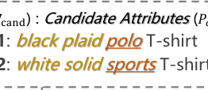
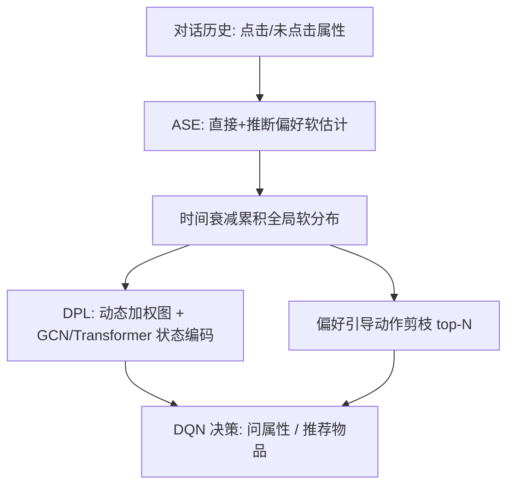

# Vague Preference Policy Learning for Conversational Recommendation (面向对话推荐的模糊偏好策略学习)

- **会议/期刊**: ACM Transactions on Information Systems (TOIS)
- **作者与机构**: Gangyi Zhang, Chongming Gao (USTC), Wenqiang Lei (Sichuan University), Xiaojie Guo (IBM T.J. Watson), Shijun Li (UT Austin), Hongshen Chen 等 (JD.com), Lingfei Wu (Anytime.AI)
- **推荐链路定位**: 多轮对话交互策略（问属性 / 推荐物品的端到端决策）
- **研究方向**: 对话推荐与智能体仿真 / 强化学习与动态探索推荐
- **论文原文**: [https://arxiv.org/abs/2306.04487v6](https://arxiv.org/abs/2306.04487v6)
- **开源代码**: 暂未开源

## TL;DR (1分钟核心速览)

现有 MCR/MIMCR 对话推荐把用户点击/未点击当作二值信号硬过滤候选集，导致"过度过滤"——用户对颜色、图案等属性本无明确偏好时，潜在目标物品被过早剔除。本文提出 VPMCR 场景，用软估计机制给所有候选物品分配非零置信度，并设计 VPPL 框架：歧义感知软估计 (ASE) 区分"直接偏好"与"推断偏好"并做时间衰减，动态感知策略学习 (DPL) 以软分布构建动态图并剪枝动作空间。在四个真实数据集上，SR@15 相对最强基线 MCMIPL 在 Yelp 提升 23.6%、MovieLens 达 100%，平均轮次从 4.39 降至 1.60。

## Background & Motivation (背景与核心矛盾)

- **主流范式**: MCR 假设用户有单一明确目标物品，属性问答为二值接受/拒绝；MIMCR 扩展为多兴趣，允许一次点击多个属性实例，但底层哲学仍是"未点击即过滤"。
- **前人局限**: (1) 假设用户偏好清晰且决策二值，无法刻画"对颜色无所谓、对款式明确"这类混合偏好；(2) 一旦未点击某属性就永久移除相关物品，偏好分布骤缩且不可逆，后续轮次无法复活被误删的候选。
- **核心洞察 (Key Insight)**: 用户选择是"相对的"而非绝对的——未点击某选项只代表偏好倾向较弱，不代表完全不喜欢；因此应维护覆盖全物品空间的软偏好分布，让点击与未点击共同驱动分布演化。
- **本文切入点**: 用软估计替代硬过滤，把偏好分布直接喂给 RL 策略，使对话决策与模糊偏好演化对齐。

<figure class="paper-figure" markdown="span">
  <figcaption>图 1. 该图简单说明了 MIMCR 与 VPMCR 场景下用户偏好建模的对比。在 MIMCR 场景（图 (a)）中，未点击属性可能导致潜在目标物品被过早移除，从而造成用户偏好分布突然且可能错误的收窄，如图 (b) 左侧所示。在 VPMCR 场景（图 (c)）中，点击与未点击属性共同促进整个物品空间上软偏好分布的演化，能够容纳模糊或动态的用户偏好。与 M</figcaption>
</figure>

## Method (核心方法设计)

### 1. 整体框架 (Overall Architecture)

VPPL 由 ASE 与 DPL 两模块构成。ASE 在每轮融合三类信号：用户-物品静态协同偏好、本轮点击属性的直接偏好、本轮未点击属性的推断偏好，并以时间衰减累积成全局软分布 $f_u^{(t)}(v)$与$f_u^{(t)}(p)$。DPL 以该分布为边权构建动态异构图（用户-物品边权即软偏好分），经 GCN + Transformer 编码对话状态，再用 DQN 在剪枝后的 top-N 动作空间上决策"问属性还是推荐物品"。训练采用 Dueling DQN + 优先经验回放 + Double Q 稳定收敛。

### 2. 关键设计拆解 (Key Designs)

1. **选择式偏好提取 (Choice-based Preference Extraction)**：痛点是把未点击当负信号。本文对物品 $v$ 分别计算点击与未点击属性的平均偏移，并减去未展示属性的平均偏好以校正曝光偏差：
$$w_{v\text{-}click}^{(t)}=\frac{1}{|\mathcal{P}_{click}^{(t)}|}\sum_{p\in\mathcal{P}_{click}^{(t)}}(e_v^\top e_p-w_{v\text{-}avg}^{(t)})$$
未点击项同式。最终 $w_v^{(t)}=\sigma(w_{v\text{-}u}+\lambda_1 w_{v\text{-}click}^{(t)}+\lambda_2 w_{v\text{-}noclick}^{(t)})$。直觉：未点击只贡献一个较小的正/负增量（$\lambda_2\ll\lambda_1$），而非清零，从而保留候选多样性。

2. **时间感知偏好衰减 (Time-aware Preference Decay)**：痛点是历史点击被过度加权、无法跟踪偏好漂移。用线性衰减累积 $w_v^{(t)}=\sum_{i=0}^{t-1}\gamma^{t-i-1}w_v^{(i)}$，再归一化为软分布$f_u^{(t)}(v)$。直觉：近期反馈权重最高，早期误判可被后续轮次"稀释并复活"，这正是 VPMCR 相对 MIMCR 的关键能力。

3. **偏好引导动作剪枝与训练目标**：全候选动作空间过大拖慢 DQN 收敛，故取 ASE 分布 top-N 物品与属性构成 $\mathcal{A}_{action}^{(t)}=\mathcal{V}_{top\text{-}N}^{(t)}+\mathcal{P}_{top\text{-}N}^{(t)}$（$N=10$）。损失为标准 TD 误差（Double Q + 优先回放）：
$$\mathcal{L}(\theta)=\mathbb{E}_{(s,a,r,s')\sim\mathcal{D}}\left[\left(r+\gamma Q(s',\arg\max_{a'}Q(s',a';\theta);\theta^-)-Q(s,a;\theta)\right)^2\right]$$
奖励沿用 MCR 设定（推荐成功 $+1$、失败$-0.01$、提问$-0.1$、退出$-0.3$），无需负采样。

## Experimental Setup & Evaluation Protocol (实验设置与评估协议)

- **数据集与预处理**: Amazon-Book 保留 ≥10 次交互的用户/物品；MovieLens-20M 仅保留评分 >3；Yelp 用 2 层 taxonomy（29 类型/590 实例）；LastFM 聚类得 34 类型。

| 数据集 | #Users | #Items | #Interactions | #Attributes | 场景说明 |
| :--- | :---: | :---: | :---: | :---: | :--- |
| Yelp | 27,675 | 70,311 | 1,368,609 | 590 | 本地商户 |
| LastFM | 1,801 | 7,432 | 76,693 | 8,438 | 音乐人 |
| Amazon-Book | 30,291 | 17,739 | 478,099 | 988 | 图书 |
| MovieLens | 20,892 | 16,482 | 454,011 | 1,498 | 电影 |

- **数据划分与防穿越**: 按 7:1.5:1.5 比例划分训练/验证/测试；对话由用户模拟器在线生成，最大轮次 $T=15$，每用户 2 个目标物品集。
- **排名评测协议**: 交互式模拟评测，指标为 SR@15（15 轮内成功率）、AT（平均轮次）、hDCG@(15,10)（top-10 推荐排序质量）；显著性 $p<0.01$。
- **对比基线与超参**: Max Entropy、CRM、EAR、SCPR、UNICORN、MCMIPL；嵌入维度 64、隐藏 100，GCN 2 层 + Transformer 1 层，$\lambda_1=0.1$、$\lambda_2=0.01$、$\gamma=0.1$（衰减实验另测），TransE 预训练节点嵌入。

## Key Experimental Results (实验关键数据)

### 1. 主实验对比 (Main Results)

VPMCR 场景（SR@15 / AT / hDCG）：

| Models | Yelp | LastFM | Amazon-Book | MovieLens |
| :--- | :---: | :---: | :---: | :---: |
| Max Entropy | 0.062 / 14.44 / 0.030 | 0.376 / 11.25 / 0.189 | 0.180 / 12.91 / 0.107 | 0.448 / 9.93 / 0.315 |
| EAR | 0.232 / 13.05 / 0.080 | 0.414 / 11.61 / 0.146 | 0.324 / 12.14 / 0.119 | 0.792 / 5.50 / 0.361 |
| SCPR | 0.322 / 12.34 / 0.115 | 0.596 / 10.18 / 0.206 | 0.374 / 11.62 / 0.139 | 0.806 / 4.90 / 0.387 |
| UNICORN | 0.314 / 12.11 / 0.140 | 0.632 / 9.17 / 0.280 | 0.396 / 11.05 / 0.193 | 0.810 / 4.81 / 0.548 |
| MCMIPL | 0.322 / 12.16 / 0.136 | 0.634 / 9.52 / 0.267 | 0.412 / 10.90 / 0.205 | 0.820 / 4.39 / 0.579 |
| **VPPL** | **0.398** / **11.26** / **0.175** | **0.686** / **8.58** / **0.306** | **0.424** / **10.75** / **0.206** | **1.000** / **1.60** / **0.689** |
| Improv. (SR) | +23.6% | +8.2% | +2.9% | +22.0% |

MIMCR 场景（清晰偏好）下 VPPL 同样领先：Yelp SR@15 0.636 vs MCMIPL 0.552，MovieLens 0.988 vs 0.838，hDCG 全面最优。

### 2. 消融实验 (Ablation Study)

| 变体 | Yelp SR@15 | LastFM SR@15 | Amazon SR@15 | ML SR@15 |
| :--- | :---: | :---: | :---: | :---: |
| VPPL 完整 | 0.398 | 0.686 | 0.424 | 1.000 |
| w/o ASE Item.Score | 0.328 | 0.618 | 0.386 | 0.852 |
| w/o ASE Attr.Score | 0.354 | 0.614 | 0.412 | 1.000 |
| w/o Personalized Pref. | 0.142 | 0.444 | 0.284 | 0.858 |
| w/o Average Pref. | 0.368 | 0.630 | 0.416 | 1.000 |
| w/o Decaying Pref. | 0.382 | 0.628 | 0.410 | 1.000 |

### 3. 关键实验发现 (Key Findings)

1. **个性化静态偏好是命门**：移除后 Yelp SR@15 从 0.398 暴跌至 0.142（-64%），远超移除 ASE 物品/属性打分的降幅，说明软估计必须锚定在协同过滤学到的用户-物品先验上，否则纯对话信号不足以定位目标。
2. **物品侧软估计比属性侧更关键**：去掉 ASE Item.Score 使 MovieLens SR 从 1.000 降至 0.852、AT 从 1.60 升至 3.84，而属性侧几乎无损——点击行为对物品偏好是更直接的证据，属性偏好则噪声更大。
3. **衰减并非万能**：MovieLens 上去掉衰减反而 AT 更短（1.49 vs 1.60），因该数据集对话极短（平均 1.6 轮），历史衰减会稀释当前轮精度；衰减因子取 0.6–0.8 时整体最优，极端值（0.1/1.0）均显著劣化。

## Highlights & Limitations (亮点、对比与审稿批判)

- **与代表作对比 (vs. Prior Work)**: 相比 UNICORN/MCMIPL 仍把未点击当负信号做二值打分，VPPL 的核心差异是把未点击建模为"弱推断偏好"并保留非零置信度；相比 EAR/SCPR 依赖离线 FM 打分、对话与推荐解耦，VPPL 用统一软分布同时驱动状态图与动作剪枝，端到端一致。
- **可迁移亮点**: (1) "未展示属性平均偏好校正"（Eq.3）是通用的曝光偏差修正技巧，可迁移到任何属性级反馈建模；(2) 用偏好分布 top-N 剪枝 RL 动作空间，可复用到大规模候选的交互式决策场景。
- **审稿级局限批判**: (1) 用户模拟器按规则随机生成模糊偏好，与真实用户行为分布存在 gap，SR@15 在 MovieLens 达 1.000 明显偏乐观，缺乏真人 A/B 验证；(2) 动态图每轮重建 + GCN/Transformer 前向，虽用采样缓解，但实时性仍依赖候选规模，论文未给出端到端延迟数据。

## Rating (四维评分)

- **方法创新性 (Novelty)**: ⭐⭐⭐⭐ （VPMCR 场景定义切中二值过滤的真实痛点，软估计+衰减+剪枝组合自洽，但各组件均为已有技术的针对性改造）
- **评估协议与实验扎实度 (Protocol & Experiments)**: ⭐⭐⭐⭐ （四数据集 + 六基线 + 六组 RQ 覆盖充分，消融完整；扣分在模拟器评测与 MovieLens 饱和指标）
- **写作与数学规范度 (Clarity & Rigor)**: ⭐⭐⭐⭐ （公式与符号表清晰，软分布归一化与衰减推导完整；部分公式排版在原文中有轻微错位）
- **工业落地与复现价值 (Industrial & Practical Value)**: ⭐⭐⭐ （思路可直接用于电商导购对话，但未开源、图重建开销与模拟器依赖降低复现与上线确定性）

