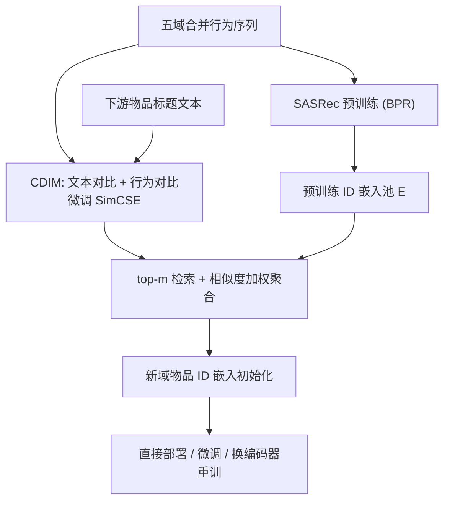
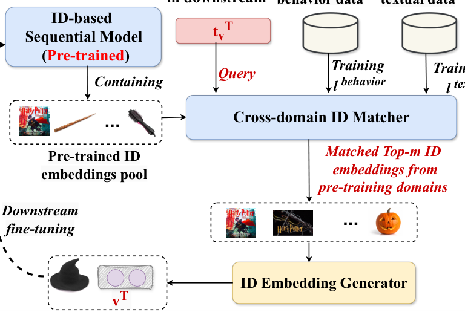
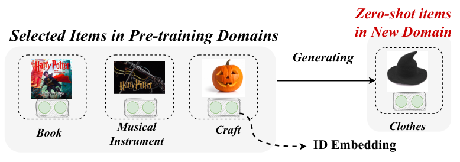

# ID-centric Pre-training for Recommendation (以 ID 为中心的多域推荐预训练)

- **会议/期刊**: TOIS 2025（arXiv 2405.03562v2）
- **作者与机构**: Yiqing Wu, Zhao Zhang, Xu Zhang, Yongjun Xu（中科院计算所/国科大）；Ruobing Xie, Leyu Lin, Zhanhui Kang（腾讯）；Fuzhen Zhuang（北航）
- **推荐链路定位**: 召回（序列下一物品预测）+ 跨域冷启动初始化
- **研究方向**: 冷启动与长尾推荐 / 序列推荐
- **论文原文**: [https://arxiv.org/abs/2405.03562v2](https://arxiv.org/abs/2405.03562v2)
- **开源代码**: 暂未开源

## TL;DR (1分钟核心速览)

针对"ID 嵌入无法跨域迁移、而 PLM 文本表征又打不过 ID 行为信息"这一核心矛盾，本文提出 IDP：预训练阶段在五域合并数据上训练 SASRec 并构建行为-文本双监督的跨域 ID 匹配器 CDIM；微调阶段用下游物品文本经 CDIM 检索 top-$m$预训练 ID 嵌入并加权聚合，直接生成新物品 ID 嵌入。在 Amazon 四域 Leave-One-Out + 99 负采样协议下，IDP$_{ID+t}$相对最强基线 UniSRec$_{ID+t}$ 在 Prime 上 NDCG@1 提升 21.18%，冷启动零样本场景亦全面领先。

## Background & Motivation (背景与核心矛盾)

- **主流范式**: 序列推荐以 SASRec/BERT4Rec 等 ID 嵌入模型为主；跨域迁移则走两条路——重叠用户/物品对齐（DACDR、PterRec）或 PLM 文本表征替代 ID（UniSRec、Recformer）。
- **前人局限**: ① 重叠用户/物品在真实场景稀疏，缺乏普适性；② 文本相似 ≠ 行为相似（"尿布与啤酒"语义无关却行为共现），且已有工作实证即使 LLM 加持，文本协同过滤仍难超越 ID 协同过滤，文本无法承载动态个性化偏好。
- **核心洞察 (Key Insight)**: 交换实验（表 11）显示跨域交换 SASRec 编码器后性能仅温和下降，说明**领域知识主要存储在 ID 嵌入而非序列编码器中**——因此迁移的正确对象是 ID 嵌入本身，文本只应充当"跨域桥梁"。
- **本文切入点**: 用文本做检索键、用 ID 嵌入做迁移载体，构建 ID-centric 预训练范式。

## Method (核心方法设计)

### 1. 整体框架 (Overall Architecture)

三阶段闭环：① 在五域合并交互（无任何用户/物品对齐）上用 BPR 预训练 SASRec，得到 ID 嵌入池 $\mathbf{E}$与编码器$f_{seq}$；② 用文本对比 + 行为对比双任务微调 SimCSE 得到 CDIM，使文本空间同时编码语义与协同信号；③ 下游阶段对每个新物品取其标题文本$t^T_{v_i}$，经 CDIM 在预训练池中检索 top-$m$ 相似物品，以其 ID 嵌入的相似度加权和作为新物品初始化，再按三种模式（直接部署 / 微调 / 换编码器重训）落地。

<figure class="paper-figure" markdown="span">
  <figcaption>图 3. 我们的 IDP 的整体架构。</figcaption>
</figure>

### 2. 关键设计拆解 (Key Designs)

1. **CDIM 的行为-文本双监督对齐（核心创新）**：纯 SimCSE 文本相似无法反映协同共现，故在文本自对比损失 $l^{text}_{v_i}$之外，用预训练 ID 嵌入的 top-$k$近邻$V^s_{v_i}$ 构造行为正样本对，加入行为对比项：

$$l^{behavior}_{v_i}=\sum_{v_j\in V^s_{v_i}}\frac{e^{sim(t_{v_i},t_{v_j})/\tau}}{e^{sim(t_{v_i},t_{v_j})/\tau}+\sum_{k}^{N-1}e^{sim(t_{v_i},t_{v_k})/\tau}}$$

总损失 $\mathcal{L}=\sum_{v_i}(l^{behavior}_{v_i}+l^{text}_{v_i})$。直觉：把"行为近邻"拉进文本空间，使检索键同时具备语义泛化性与协同判别性。

2. **ID 嵌入的检索-注意力生成**：新物品嵌入不学新参数，而是对 top-$m$ 预训练 ID 嵌入做相似度归一化注意力聚合：

$$e^T_{v_i}=\sum_{k}score_{i,k}\cdot e^S_{v_k},\quad score_{i,v_j}=\frac{sim(t^T_{v_i},t^S_{v_j})}{\sum_{k}sim(t^T_{v_i},t^S_{v_k})}$$

好处：新物品嵌入天然继承预训练域的行为结构，且维度/语义空间与预训练编码器完全兼容，可直接热插拔。

3. **训练目标与推理效率**：预训练用标准 BPR（1 个均匀负样本）；CDIM 用 in-batch 负采样 + 温度 $\tau$。检索朴素复杂度$O(MdN^2\log m)$，经 HNSW 近似最近邻可降至$O(M\log\log N)$，且 CDIM 仅用于初始化、不参与在线服务，推理开销与基座 SASRec 同量级。

## Experimental Setup & Evaluation Protocol (实验设置与评估协议)

- **数据集与预处理**: Amazon 评论数据，评分转隐式（0/1），预训练域按 5-core 过滤（冷启动非预训练关注点），下游域不过滤以保留冷物品；物品描述统一用商品标题。

| 数据集 | #Users | #Items | #Interactions | 平均序列长 | 角色 |
| :--- | :---: | :---: | :---: | :---: | :--- |
| 预训练合并(5域) | 1,125,233 | 729,305 | 13,920,393 | 19.09 | Home/CD/Grocery/Kindle/Movie |
| Arts | 1,576,189 | 302,370 | 2,726,742 | 9.02 | 下游(大) |
| Office | 3,402,597 | 306,612 | 5,382,474 | 17.55 | 下游(大) |
| Instruments | 903,060 | 112,132 | 1,469,965 | 13.11 | 下游(中) |
| Prime | 247,640 | 10,812 | 447,359 | 41.38 | 下游(小,稀缺) |

- **数据划分与防穿越**: `Leave-One-Out`（最后一件为测试、倒数第二件为验证）。
- **排名评测协议**: `Sampled Ranking`——每个 ground-truth 随机采 99 个未交互物品作负样本（1:99），指标 HR@{1,3,5}、NDCG@{1,3,5}、MRR。
- **对比基线与超参**: 基线含 GRU4Rec、SASRec、BERT4Rec、FDSA、DACDR、PterRec、Recformer、UniSRec$_{ID+t}$；嵌入维度$d=64$，batch 256，Adam，学习率网格$\{1e^{-3},3e^{-4},1e^{-4},3e^{-5}\}$，early stop patience 20；所有提升经$t$-test$p<0.05$ 显著。

## Key Experimental Results (实验关键数据)

### 1. 主实验对比 (Main Results)

| Dataset | Model | NDCG@1 | NDCG@5 | HR@5 | MRR |
| :--- | :--- | :---: | :---: | :---: | :---: |
| Arts | SASRec | 0.3228 | 0.4298 | 0.5262 | 0.4211 |
| Arts | Recformer | 0.3281 | 0.4438 | 0.5486 | 0.4366 |
| Arts | UniSRec$_{ID+t}$ | 0.3841 | 0.5261 | 0.6514 | 0.5081 |
| Arts | **IDP$_{ID+t}$** | **0.4176** | **0.5454** | **0.6581** | **0.5302** |
| Arts | Improv. | +8.02% | +3.54% | +1.02% | +4.17% |
| Instruments | UniSRec$_{ID+t}$ | 0.3404 | 0.4846 | 0.6135 | 0.4686 |
| Instruments | **IDP$_{ID+t}$** | **0.3977** | **0.5305** | **0.6481** | **0.5149** |
| Instruments | Improv. | +14.41% | +8.65% | +5.34% | +8.99% |
| Office | UniSRec$_{ID+t}$ | 0.3899 | 0.5418 | 0.6763 | 0.5205 |
| Office | **IDP$_{ID+t}$** | **0.4096** | **0.5528** | **0.6798** | **0.5331** |
| Office | Improv. | +4.81% | +1.99% | +0.51% | +2.36% |
| Prime | SASRec | 0.1520 | 0.2536 | 0.3503 | 0.2584 |
| Prime | UniSRec$_{ID+t}$ | 0.1280 | 0.2313 | 0.3302 | 0.2372 |
| Prime | **IDP$_{ID+t}$** | **0.1842** | **0.2953** | **0.3996** | **0.2965** |
| Prime | Improv. | +21.18% | +16.44% | +14.07% | +16.37% |

### 2. 消融实验 (Ablation Study)

| 变体 | Arts HR@10 | Arts NDCG@10 | Office HR@10 | Office NDCG@10 |
| :--- | :---: | :---: | :---: | :---: |
| SASRec (单域) | 基线 | 基线 | 基线 | 基线 |
| IDP w/o M (去 CDIM) | 低于 SASRec | 低于 SASRec | 低于 SASRec | 低于 SASRec |
| IDP w/o BCL (去行为对比) | 居中 | 居中 | 居中 | 居中 |
| **IDP 完整** | **最优** | **最优** | **最优** | **最优** |

### 3. 关键实验发现 (Key Findings)

1. **下游越稀疏、迁移收益越大**：Prime（仅 1 万物品、44 万交互）上 NDCG@1 相对提升 21.18%，而数据充足的 Office 仅 4.81%，说明 IDP 的价值集中在目标域行为信息匮乏的场景，正对应冷启动诉求。
2. **去 CDIM 会触发负迁移**：IDP w/o M 甚至劣于单域 SASRec，证明"只迁移预训练编码器"不可行——知识确实在 ID 嵌入里，必须靠 CDIM 做嵌入级对齐；去掉行为对比项（w/o BCL）性能居中，量化了行为监督的独立贡献。
3. **编码器可解耦、ID 嵌入才是知识载体**：预训练 SASRec + 下游 BERT4Rec 重训（IDP$_{B\&S}$）在 Prime 上 HR@5 从 0.2747 升至 0.3444；跨平台 Amazon→Movielens 仍有 +1.10% NDCG@1；零样本下 IDP$_{ID+t}$在 Arts 上 HR@5 0.3234 vs UniSRec$_t$ 0.2620，验证了"文本桥 + ID 载体"的普适性。

## Highlights & Limitations (亮点、对比与审稿批判)

- **与代表作对比 (vs. Prior Work)**: 与 UniSRec 的本质区别在于迁移对象——UniSRec 迁移文本编码器与适配器（重、耦合、文本主导），IDP 迁移 ID 嵌入（轻、解耦、ID 主导）；与 DACDR/PterRec 相比不依赖重叠用户/物品，仅需物品文本即可跨域；与 Recformer 相比避免将行为序列翻译为自然语言带来的语义-行为鸿沟。
- **可迁移亮点**: ① "文本检索 + ID 聚合"的嵌入初始化套路可直接用于新物品冷启动与跨域召回冷启；② 用预训练 ID 近邻构造对比正样本，是把协同信号注入任意文本/多模态编码器的通用技巧。
- **审稿级局限批判**: ① 评测仅用 1:99 采样排序，未做 Full-Ranking，且负样本均匀采样可能高估绝对指标；② 预训练域与下游域同属 Amazon 生态，跨平台实验（Movielens）提升仅 0.1%–1.1%，跨生态泛化性证据偏弱；③ 依赖物品标题文本质量，无文本场景失效，且 top-$m$与温度$\tau$ 的敏感性分析缺失。

## Rating (四维评分)

- **方法创新性 (Novelty)**: ⭐⭐⭐⭐ （首次系统论证"知识在 ID 嵌入而非编码器"，并以 CDIM 给出可操作的嵌入级迁移路径，视角新颖但组件本身较常规）
- **评估协议与实验扎实度 (Protocol & Experiments)**: ⭐⭐⭐⭐ （四下游域 + 零样本 + 跨平台 + 换编码器 + 域内冷启 + 多模态扩展，覆盖面广；扣分在仅采样排序、缺 Full-Ranking 与超参敏感性）
- **写作与数学规范度 (Clarity & Rigor)**: ⭐⭐⭐⭐ （三阶段流程与公式定义清晰，复杂度分析到位；部分符号在正文重复定义、表 10 存在排版笔误）
- **工业落地与复现价值 (Industrial & Practical Value)**: ⭐⭐⭐⭐ （推理开销与基座 SASRec 同量级、CDIM 仅离线初始化、可与现有 ID 系统无缝集成，工程友好；代码未开源略降分）

<figure class="paper-figure" markdown="span">
  <figcaption>图 1. 一个以 ID 为中心的预训练推荐示例。核心思想是选择相关的预训练 ID 嵌入来生成新领域中的物品嵌入。</figcaption>
</figure>

