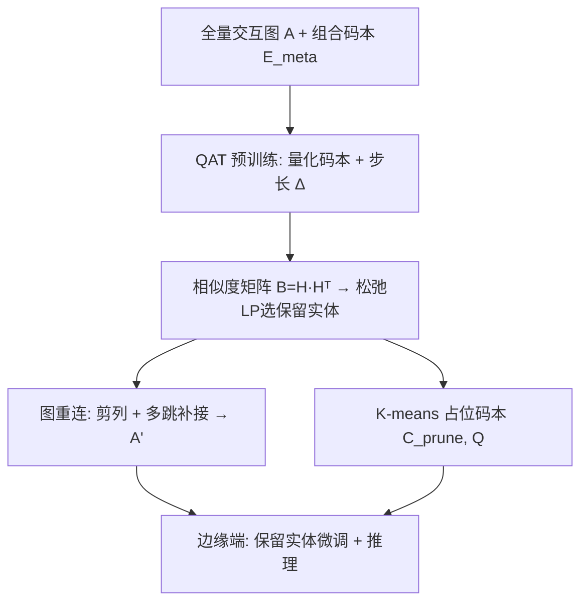
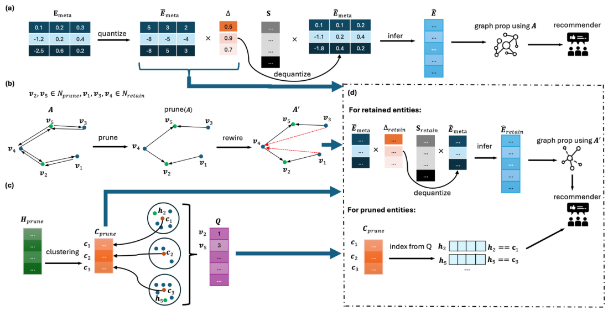

# Lightweight Embeddings with Graph Rewiring for Collaborative Filtering (基于图重连的轻量化嵌入协同过滤)

- **会议/期刊**: TOIS 2025
- **作者与机构**: Xurong Liang, Tong Chen, Wei Yuan, Hongzhi Yin（The University of Queensland）
- **推荐链路定位**: 召回（GNN 协同过滤表征学习）
- **研究方向**: 协同过滤与双塔召回 / 图神经网络推荐
- **论文原文**: [https://arxiv.org/abs/2505.18999v1](https://arxiv.org/abs/2505.18999v1)
- **开源代码**: 暂未开源

## TL;DR (1分钟核心速览)

针对 GNN 推荐在边缘设备部署时的两大瓶颈——嵌入表存储爆炸与图传播 MACs 过高，本文在作者前作 LEGCF 的组合码本基础上引入**码本量化（LSQ, INT16）**，使同等存储预算下可容纳更多元嵌入、缓解哈希碰撞；并提出**图重连（Graph Rewiring）**：用预训练传播嵌入的实体相似度构造二元整数规划，剪除低贡献实体并为其补接多跳邻居，配合占位码本填补被剪实体。在 Yelp2020/Amazon-book/iFashion 三数据集上，LERG 在存储仅 1.76MB–17.12MB 时 NDCG@10 全面超越 LEGCF 与 Post4bits，iFashion 上存储较 UD-128 降低 97.7% 而 NDCG@10 仅降 15.1%，峰值内存减半。

## Background & Motivation (背景与核心矛盾)

- **主流范式**: GNN 推荐（LightGCN 类）依赖全量嵌入表 $E\in\mathbb{R}^{N\times d}$与多层邻接矩阵传播$D^{-\frac{1}{2}}AD^{-\frac{1}{2}}$，精度强但参数与算力开销巨大。
- **前人局限一（存储）**: 维度搜索（ESAPN/CIESS）与剪枝（PEP/CERP）在严格预算下要么约束弱、要么大幅削减可用维度；组合嵌入 LEGCF 虽将存储从 $O(Nd)$降至$O(cd+2N)$，但元嵌入仍为 32-bit 浮点，预算紧张时码本条目$c$ 被迫压缩，导致大量实体共享同一元嵌入的**碰撞**，表征唯一性崩塌。
- **前人局限二（算力）**: LEGCF 需在扩展图上同时传播实体与码本嵌入以更新分配矩阵 $S$，iFashion（2600 万交互）单次 GCN 传播即需约 100 亿 MACs；采样类方法（GraphSAINT 等）采样耗时长且启发式质量直接决定嵌入质量。
- **核心洞察 (Key Insight)**: 图传播中节点重要性高度不均；预训练传播嵌入 $H^{pretrain}$ 已编码协同语义，其行间相似度可量化实体对信号传播的贡献——低相似度实体多为高异质/弱连接节点，剪除其出边对整体语义损失极小。
- **本文切入点**: 用**量化**换码本容量（治存储），用**图重连剪枝**换传播稀疏度（治算力），二者均在服务器端一次性完成，边缘端仅做轻量微调与推理。

## Method (核心方法设计)

### 1. 整体框架 (Overall Architecture)

LERG 分四阶段闭环：(a) 服务器端以量化感知训练（QAT）预训练量化组合码本 $\bar{E}_{meta}$与可学习步长$\Delta$，前向用反量化码本$\hat{E}_{meta}=\bar{E}_{meta}\times\Delta$经$S$合成全表并做图传播；(b) 基于预训练传播表$H^{pretrain}$的实体相似度求解松弛线性规划，选出保留实体集$\mathcal{N}_{retain}$，对被剪实体列清零并补接多跳邻居生成重连图$A'$；(c) 对被剪实体嵌入做 K-means 聚类得到占位码本$C^{prune}$与分配向量$Q$；(d) 边缘端仅用保留实体嵌入在$A'$上微调码本并推理，被剪实体嵌入由$C^{prune}[Q]$查表填补。分配矩阵$S$ 初始化后**冻结**，避免 LEGCF 中扩展图传播的额外开销。

<figure class="paper-figure" markdown="span">
  <figcaption>图 1. LERG 的整体工作流程。(a) 对应第 3.4 节所述的量化组合嵌入表预训练阶段，(b) 对应第 3.5 节所述的用于图稀疏化的图重连，(c) 对应第 3.6 节所述的剪枝实体嵌入填补，(d) 对应第 3.6 节所述的推理与微调阶段中的实体嵌入生成。(a)、(b)、(c) 均在资源丰富的服务器端进行，(d) 中的微调阶段可在服务器端或边缘端进行。(b) 中的红色虚线箭头表示所构建的边，位于</figcaption>
</figure>

### 2. 关键设计拆解 (Key Designs)

1. **码本量化感知训练（LSQ）**：痛点在于 32-bit 元嵌入使码本条目数受存储硬约束。LERG 对每个元嵌入做逐元素低比特量化 $\bar{E}_{meta}=\mathrm{Round}(\mathrm{Clip}(E_{meta}/\Delta,Q_{min},Q_{max}))$，反量化$\hat{E}_{meta}=\bar{E}_{meta}\times\Delta$，反向用 STE 直通估计梯度。码本存储由$O(4\,\text{bytes}\times cd)$降至$O(4\,\text{bytes}\times c(\frac{b}{32}d+1))$——同预算下$c$ 可放大数倍，直接缓解碰撞、提升实体嵌入唯一性。

2. **基于 BIP 的图重连**：以 $B=H^{pretrain}H^{pretrain\top}$衡量实体贡献，构造$\max\sum_j v_j(\sum_k B_{jk})$s.t.$\sum_j v_j=m,\ v_j\in\{0,1\}$。BIP 为 NP-complete，故松弛为$[0,1]$连续变量用单纯形法多项式求解，再以阈值$o=0.5$取整。对被剪实体列清零（式 13），并对因此产生的全零行按$t=2,\dots,T$（$T=4$）用多跳邻居$\mathrm{sign}(A^t_{:,j})$ 补接，保证每个实体仍有感受野。直觉：保留与大多数实体高相似的节点，即最大化保留原图协同语义。

3. **训练目标、占位填补与推理效率**：总损失仍为 BPR $\mathcal{L}=\sum-\ln\sigma(\hat{y}_{ui^+}-\hat{y}_{ui^-})+\lambda\|\Theta\|^2$，负采样为每正样本 5 个均匀负例。微调阶段仅保留实体参与传播，峰值内存被$O(md)$封顶；被剪实体嵌入由$r\ll c$个占位元嵌入查表得到，额外存储仅$O(4\,\text{bytes}\times(rd+(N-m)))$。整体空间复杂度$O(c(\frac{b}{32}d+1)+rd+(N-m))$，远低于$O(Nd)$。

## Experimental Setup & Evaluation Protocol (实验设置与评估协议)

- **数据集与预处理**:

| 数据集 | #Users | #Items | #Interactions | 密度 | 说明 |
| :--- | :---: | :---: | :---: | :---: | :--- |
| Yelp2020 | 71,135 | 45,063 | 1,782,999 | 0.056% | 中等规模 |
| Amazon-book | 52,643 | 91,599 | 2,984,108 | 0.062% | 中等规模 |
| iFashion | 500,000 | 1,465,817 | 26,069,309 | 0.004% | 工业级，采样 50 万用户 |

- **数据划分与防穿越**: 按交互 **80%/20%/10% 比例划分** train/test/validation；训练集每正样本采样 5 个负例。
- **排名评测协议**: 采用 **Sampled Ranking**（每正样本配 5 负例打分），指标 NDCG@{10,20}、Recall@{10,20}；同时报告嵌入层存储（MB）与峰值运行时内存（MEM）。
- **对比基线与超参**: 基线含 ESAPN、OptEmbed、PEP、CERP、CIESS、Post4bits、LEGCF 及 UD-64/128 全表；嵌入维度 $d=128$，码本条目$c=2000$（iFashion 为 10000），量化位宽$b=16$，保留率默认 0.7，$T=4$，$o=0.5$，传播层$L=4$，占位码本$r=500$（iFashion 为 2000），Adam 学习率 1e-3、$\lambda=5e\text{-}4$。

## Key Experimental Results (实验关键数据)

### 1. 主实验对比 (Main Results)

| 方法 | Yelp2020 存储/MEM | N@10 | R@20 | Amazon-book 存储/MEM | N@10 | R@20 | iFashion 存储/MEM | N@10 | R@20 |
| :--- | :---: | :---: | :---: | :---: | :---: | :---: | :---: | :---: | :---: |
| UD-dim128 | 56.74MB/1.15GB | 0.0284 | 0.0721 | 70.43MB/1.66GB | 0.0172 | 0.0367 | 760.46MB/26.22GB | 0.0053 | 0.0145 |
| PEP | 1.76MB/1.47GB | 0.0185 | 0.0351 | 2.01MB/1.71GB | 0.0047 | 0.0081 | 21.55MB/31.87GB | 0.0001 | 0.0003 |
| CERP | 1.76MB/1.06GB | 0.0149 | 0.0375 | 2.01MB/1.48GB | 0.0092 | 0.0198 | 17.12MB/30.70GB | 0.0012 | 0.0025 |
| CIESS | 1.85MB/2.12GB | 0.0178 | 0.0521 | 2.12MB/2.75GB | 0.0041 | 0.0084 | — | — | — |
| Post4bits | 1.77MB/1.05GB | 0.0191 | 0.0463 | 2.06MB/1.46GB | 0.0132 | 0.0261 | 17.82MB/22.57GB | 0.0014 | 0.0028 |
| LEGCF | 1.76MB/1.09GB | 0.0194 | 0.0475 | 2.01MB/1.48GB | 0.0142 | 0.0244 | 17.12MB/30.72GB | 0.0025 | 0.0047 |
| **LERG** | **1.76MB/0.57GB** | **0.0216** | **0.0550** | **2.01MB/0.83GB** | **0.0146** | **0.0280** | **17.12MB/16.54GB** | **0.0045** | **0.0081** |
| Improv. vs LEGCF | — | +11.3% | +15.8% | — | +2.8% | +14.8% | — | +80.0% | +72.3% |

### 2. 消融实验 (Ablation Study)

保留率 0.7 下 NDCG@10（Yelp / Amazon / iFashion）：

| 变体 | Yelp2020 | Amazon-book | iFashion |
| :--- | :---: | :---: | :---: |
| Default | **0.0216** | **0.0146** | **0.0045** |
| w/o Fine-tuning | 0.0214 | 0.0139 | 0.0043 |
| w/o BIP（随机剪枝） | 0.0218 | 0.0129 | 0.0038 |
| w/o $C^{prune}$（均值填补） | 0.0164 | 0.0116 | 0.0046 |
| 保留 $H^{prune}$ 全表 | 0.0166 | 0.0142 | 0.0044 |
| Post-compression | 0.0136 | 0.0101 | 0.0029 |

### 3. 关键实验发现 (Key Findings)

1. **量化是碰撞的解药**：同存储下 LERG 与 LEGCF 存储完全相同（1.76MB/2.01MB/17.12MB），但 iFashion 上 NDCG@10 从 0.0025 跃至 0.0045（+80%），证明 INT16 码本换来的条目扩容显著提升实体嵌入唯一性；而 Post4bits 直接量化全表在 iFashion 仅 0.0014，说明"量化码本而非量化全表"是关键。
2. **BIP 剪枝在低保留率下价值放大**：保留率降至 0.1 时，w/o BIP 在 iFashion 的 NDCG@10 仅 0.0015，而 Default 为 0.0031（约 2 倍），随机剪枝会破坏协同语义；同时图 2 显示 iFashion 保留 40% 实体仍维持满意精度，MACs 与每轮耗时随保留率单调下降。
3. **占位码本填补不可省**：w/o $C^{prune}$在 Yelp2020 保留率 0.1 时 NDCG@10 暴跌至 0.0063（Default 0.0157，降 60%），说明被剪实体不能共享单一均值嵌入，需保留足够区分度；而直接保留$H^{prune}$ 全表虽略优却违背存储初衷。

## Highlights & Limitations (亮点、对比与审稿批判)

- **与代表作对比**: 相较 LEGCF，本文以量化扩容码本 + 冻结 $S$ + 重连图，同时解决碰撞与传播开销；相较 Post4bits 的全表量化，本文量化对象是共享码本，精度损失被组合结构吸收；相较 PEP/CERP 的剪枝，本文剪的是**图节点**而非嵌入维度，保留完整表征维度。
- **可迁移亮点**: (1) "预训练传播嵌入相似度 → 松弛 LP 选节点" 的免梯度剪枝范式可迁移至任何 GNN 召回图的稀疏化；(2) 占位码本 + 分配向量填补被剪节点，是边缘端"冷节点"存储压缩的通用技巧。
- **审稿级局限批判**: (1) 评测采用 5 负例采样排序而非全库 Full-Ranking，且未报告显著性检验，绝对数值偏低（NDCG@10 量级 1e-3），结论稳健性存疑；(2) 图重连依赖多跳邻接矩阵 $A^t$预计算与 LP 求解，虽在服务器端一次性完成，但大规模图上的预处理成本与超参（$m$、$o$、$T$、$r$）敏感性未充分讨论。

## Rating (四维评分)

- **方法创新性 (Novelty)**: ⭐⭐⭐⭐ （量化码本 + BIP 图重连的组合在轻量 GNN 推荐中较新颖，但各组件均为已有技术的巧妙拼装）
- **评估协议与实验扎实度 (Protocol & Experiments)**: ⭐⭐⭐ （三数据集含工业级规模、消融覆盖多保留率，但采样排序协议与缺失显著性检验削弱说服力）
- **写作与数学规范度 (Clarity & Rigor)**: ⭐⭐⭐⭐ （四阶段流程与算法伪代码清晰，复杂度分析完整，符号表规范）
- **工业落地与复现价值 (Industrial & Practical Value)**: ⭐⭐⭐⭐ （存储降 97.7%、峰值内存减半、支持边缘端微调，工程价值明确，但代码未开源）

