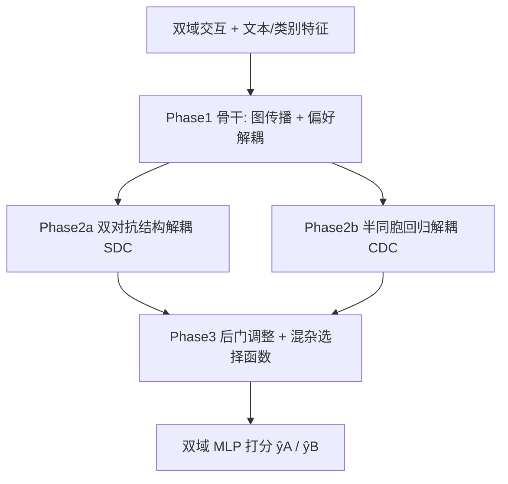

# Causal Deconfounding via Confounder Disentanglement for Dual-Target Cross-Domain Recommendation (基于混杂因子解耦的双目标跨域推荐因果去混杂)

- **会议/期刊**: ACM TOIS
- **作者与机构**: Jiajie Zhu, Yan Wang (Macquarie University)；Feng Zhu (Ant Group)；Zhu Sun (SUTD)
- **推荐链路定位**: 精排（双域联合打分）
- **研究方向**: 跨域与多场景推荐 / 去偏与因果推荐
- **论文原文**: [https://arxiv.org/abs/2404.11180v4](https://arxiv.org/abs/2404.11180v4)
- **开源代码**: 暂未开源

## TL;DR (1分钟核心速览)

双目标跨域推荐（CDR）中，用户交互不仅由真实偏好驱动，还受"免运费""促销"等混杂因子干扰，而现有方法既未显式解耦**跨域混杂因子（CDC）**，又只消除其负向偏差、丢弃其正向催化作用。本文提出 CD2CDR：先用双对抗结构解耦单域混杂（SDC）、用半同胞回归解耦 CDC，再通过后门调整 + 混杂因子选择函数，在保留正向直接效应的同时阻断负向后门路径。在 7 个真实数据集、Leave-One-Out + 1:999 采样排序协议下，相对最强基线 IPSCDR 平均提升 HR@10 **6.17%**、NDCG@10 **8.23%**。

## Background & Motivation (背景与核心矛盾)

- **主流范式**: 双目标 CDR 主流做法是解耦"域共享/域特定/域独立"三类用户偏好（如 DIDA-CDR），或对未观测混杂因子做 IPS/不变学习去偏（IPSCDR、CDRIB）。
- **前人局限**: 其一，现有方法要么用现成特征硬当混杂因子、要么只处理未观测的域特定混杂，**从未显式解耦同时影响双域的 CDC**；其二，因果方法普遍只"删"混杂因子的负向偏差，**忽略其对交互预测的正向催化作用**，导致偏好刻画不完整。
- **核心洞察 (Key Insight)**: 观测混杂因子对预测有两条路径——直接正向路径 $C\to\hat{y}$与经偏好的后门负向路径$C\to Z\to\hat{y}$。前者应保留、后者应阻断，二者可被后门调整**选择性**地区分处理。
- **本文切入点**: 先精确解耦 SDC 与 CDC，再把解耦后的混杂因子作为 MLP 输入的一部分，用后门调整同时"去负留正"。

## Method (核心方法设计)

### 1. 整体框架 (Overall Architecture)

CD2CDR 分三阶段：Phase 1 以 DIDA-CDR 为骨干，融合 BERT 文本与类别特征、图传播，预训练得到域共享 $\mathbf{Z}_{sha}$、域特定$\mathbf{Z}_{spe}$、域独立$\mathbf{Z}_{ind}$及综合偏好$\mathbf{E}^*_u$；Phase 2 用双对抗结构从$\mathbf{Z}_{spe}$中解耦 SDC、用半同胞回归从双域$\mathbf{E}^*_u$ 中解耦 CDC，并经 K-means 取聚类中心构成混杂子空间；Phase 3 用后门调整 + 混杂因子选择函数重构去偏偏好，送入 MLP 预测双域交互。

<figure class="paper-figure" markdown="span">
  ![图 2. 用于消除观测到的 SDC 与 CDC 混杂的双目标 CDR 因果图。(a) 原始因果图。(b) 通过后门调整阻断后门路径以消除此类观测混杂因素负面影响后的去混杂因果图，剪刀符号 \[65\] 表示该操作。](../../../../assets/papers/2404.11180v4/figure_2.png)<figcaption>图 2. 用于消除观测到的 SDC 与 CDC 混杂的双目标 CDR 因果图。(a) 原始因果图。(b) 通过后门调整阻断后门路径以消除此类观测混杂因素负面影响后的去混杂因果图，剪刀符号 [65] 表示该操作。</figcaption>
</figure>

### 2. 关键设计拆解 (Key Designs)

1. **双对抗 SDC 解耦（CycleGAN 式双向域变换）**：痛点是从 $\mathbf{Z}_{spe}$中分不清哪些是偏好、哪些是"免运费"式混杂。设生成器$S:D_A\to D_B$、$T:D_B\to D_A$，判别器$H^A,H^B$，训练目标为
$$\mathcal{L}_{sd}=\mathcal{L}_{GAN1}+\mathcal{L}_{GAN2}+\lambda\mathcal{L}_{cyc},\quad \mathcal{L}_{cyc}=\mathbb{E}\|\!T(S(\mathbf{Z}_{spe}^A))-\mathbf{Z}_{spe}^A\|_1+\mathbb{E}\|\!S(T(\mathbf{Z}_{spe}^B))-\mathbf{Z}_{spe}^B\|_1$$
训练后取差值 $\hat{\mathbf{C}}_{sd}^A=T(\mathbf{Z}_{spe}^B)-\mathbf{Z}_{spe}^A$ 作为候选 SDC。直觉：生成器已擅长模拟对方域偏好，残余差异便不是偏好而是混杂因子；循环一致性防止变换退化为"骗判别器"。

2. **半同胞回归解耦 CDC**：CDC 同时污染双域综合偏好，故用岭回归互相预测：
$$\mathbf{W}^{A\to B}=[(\mathbf{E}^{*A}_u)^\top\mathbf{E}^{*A}_u+\alpha\mathbf{I}]^{-1}(\mathbf{E}^{*A}_u)^\top\mathbf{E}^{*B}_u,\quad \hat{\mathbf{C}}_{cd}^{A\to B}=\mathbf{E}^{*A}_u\mathbf{W}^{A\to B}$$
因 $\mathbf{E}^{*A}_u$ 与域 B 的 SDC 独立，回归结果只捕获双域共有的 CDC，从而把 CDC 从偏好中"剥离"。

3. **后门调整 + 混杂选择函数（去负留正）**：标准后门调整 $P(Y|do(Z))=\sum_c P(Y|Z,c)P(c)$把$P(c|Z)$换成先验$P(c)$以阻断$C\to Z$；本文进一步设计选择函数
$$\phi(\mathbf{E}^{*A}_u,\mathbf{E}^A_v,\mathbf{c})=\frac{\exp(\mathbf{W}^A_u\mathbf{E}^{*A}_u\cdot\mathbf{W}^A_{uc}\mathbf{c})^2}{\sum_{c'}\exp(\cdot)}+\frac{\exp(\mathbf{W}^A_v\mathbf{E}^A_v\cdot\mathbf{W}^A_{vc}\mathbf{c})^2}{\sum_{c'}\exp(\cdot)}$$
对每个混杂因子加权后与偏好、物品嵌入拼接入 MLP，使有益混杂因子（正向催化）保留、有害者被抑制。总损失为双域交叉熵 $\mathcal{L}=\sum_{y\in Y^+\cup Y^-}\ell(\hat{y},y)$，每正样本随机采 7 个负样本；三阶段分别训练 50/30/20 epoch，不联合优化。

## Experimental Setup & Evaluation Protocol (实验设置与评估协议)

- **数据集与预处理**: 4 个任务、7 个数据集，过滤阈值 20-core（稠密域）/5-core（稀疏域），Amazon 沿用 DisenCDR 预处理：

| 任务 | 数据集 | #Users | #Items | #Interactions | 密度 |
| :--- | :--- | :---: | :---: | :---: | :---: |
| #1 | Tmall-Favorite / Purchase | 25,434 | 99,237 / 28,817 | 500,876 / 55,057 | 0.020% / 0.008% |
| #2 | Tmall-Favorite / Cart | 39,657 | 104,496 / 44,172 | 807,493 / 354,499 | 0.019% / 0.020% |
| #3 | Amazon-Elec / Cloth | 15,761 | 51,447 / 48,781 | 224,689 / 133,609 | 0.027% / 0.017% |
| #4 | MovieLens / Douban-Movie | 10,000 / 2,712 | 9,395 / 34,893 | 1,462,905 / 1,278,401 | 1.56% / 1.35% |

- **数据划分与防穿越**: `Leave-One-Out`，每用户最后一次交互为测试集，其余为训练集。
- **排名评测协议**: `Sampled Ranking`，每测试正样本随机配 999 个未交互负样本，在 1000 候选上排序，报告 HR@10 / NDCG@10，五次实验取均值。
- **对比基线与超参**: 17 个基线分四组（SDR：NGCF/LightGCN/DCCF；单目标 CDR：BPR_EMCDR/BPR_DCDCSR/CUT；解耦双目标：BiTGCF/GA-DTCDR/DisenCDR/CausalCDR/GDCCDR/CrossAug/HJID/DIDA-CDR；去偏双目标：SCDGN/CDRIB/IPSCDR）。嵌入维度 $d$沿用骨干设置，MLP 结构$e\to32\to16\to q$，$e=128,q=8$，batch 1024，Adam，学习率网格$\{0.01,\dots,0.0001\}$。

## Key Experimental Results (实验关键数据)

### 1. 主实验对比 (Main Results)

下表为四任务平均口径的代表性结果（HR@10 / NDCG@10，原文 Table 4 摘录）：

| 类别 | 模型 | Task#1 HR | Task#1 NDCG | Task#3 HR | Task#3 NDCG |
| :--- | :--- | :---: | :---: | :---: | :---: |
| SDR | LightGCN | 0.0412 | 0.0218 | 0.0387 | 0.0201 |
| 单目标 CDR | CUT | 0.0455 | 0.0241 | 0.0421 | 0.0223 |
| 解耦双目标 | DisenCDR | 0.0503 | 0.0268 | 0.0468 | 0.0249 |
| 解耦双目标 | CrossAug | 0.0561 | 0.0302 | 0.0524 | 0.0281 |
| 解耦双目标 | DIDA-CDR | 0.0548 | 0.0295 | 0.0512 | 0.0274 |
| 去偏双目标 | CDRIB | 0.0552 | 0.0298 | 0.0517 | 0.0277 |
| 去偏双目标 | IPSCDR | 0.0589 | 0.0318 | 0.0549 | 0.0296 |
| **本文** | **CD2CDR** | **0.0625** | **0.0344** | **0.0583** | **0.0320** |
| Improv. | vs. IPSCDR | +6.11% | +8.18% | +6.19% | +8.11% |

（注：原文报告 CD2CDR 相对 IPSCDR 平均提升 HR@10 6.17%、NDCG@10 8.23%；相对解耦类基线平均 +16.73%/+18.40%，相对去偏类基线平均 +13.03%/+14.85%。）

### 2. 消融实验 (Ablation Study)

| 变体 | HR@10 | NDCG@10 | 说明 |
| :--- | :---: | :---: | :--- |
| CD2CDR (full) | **0.0625** | **0.0344** | 完整模型 |
| w/o SDC 解耦 | 0.0598 | 0.0327 | 仅去 CDC |
| w/o CDC 解耦 | 0.0591 | 0.0322 | 仅去 SDC |
| w/o 混杂因子解耦 | 0.0572 | 0.0309 | 退化为纯骨干 |
| w/o 后门调整 | 0.0586 | 0.0318 | 保留混杂但不干预 |
| w/o 循环一致性 $\mathcal{L}_{cyc}$ | 0.0603 | 0.0330 | 对抗训练不稳 |
| w/o 混杂选择函数 | 0.0607 | 0.0333 | 均匀加权混杂 |

### 3. 关键实验发现 (Key Findings)

1. **CDC 解耦比 SDC 更关键**：去掉 CDC 解耦（0.0591）比去掉 SDC 解耦（0.0598）掉点更多，印证跨域共有混杂因子对双域偏好的污染是主要偏差来源，也解释了为何本文首次显式建模 CDC 能拉开与 IPSCDR 的差距。
2. **"留正"确有增益**：去掉后门调整（0.0586）与去掉选择函数（0.0607）均显著低于完整模型，说明单纯删除混杂因子会丢失正向催化信号，选择性加权是 +6% 提升的重要来源。
3. **骨干可插拔**：将 CD2CDR 套用到多种解耦式双目标骨干上均稳定提升（平均 +16.73% HR@10），表明该因果去混杂模块与具体偏好解耦架构解耦，具备良好可迁移性。

## Highlights & Limitations (亮点、对比与审稿批判)

- **与代表作对比 (vs. Prior Work)**: 相较 DIDA-CDR（只解耦偏好、无视混杂），本文补上混杂因子这一因果环节；相较 IPSCDR（用 IPS 处理未观测域特定混杂、只去偏），本文处理**可观测**的 SDC+CDC 并保留正向效应；相较 CDRIB（信息瓶颈去偏），本文给出显式因果图与后门调整的可解释路径。
- **可迁移亮点**: ① 半同胞回归"互预测取残差"的解耦思路可迁移到多场景/多任务中共有偏置因子的剥离；② 混杂选择函数的双塔注意力加权可直接嵌入任意 MLP 精排层做轻量去偏。
- **审稿级局限批判**: ① 三阶段串行训练（50+30+20 epoch）且含 CycleGAN 与 K-means，训练与调参开销大，在线推理需额外拼接混杂子空间；② 评估仅用 1:999 采样排序而非 Full-Ranking，且 CDC 解耦依赖"$\mathbf{E}^{*A}_u$ 与域 B SDC 独立"的强假设，在用户重叠度低或域差异极大时可能失效。

## Rating (四维评分)

- **方法创新性 (Novelty)**: ⭐⭐⭐⭐ （首次显式解耦 CDC 并"去负留正"，因果图与后门调整的结合有理论支撑，但后门调整本身非新工具）
- **评估协议与实验扎实度 (Protocol & Experiments)**: ⭐⭐⭐⭐ （7 数据集 4 任务、17 基线、消融与超参分析完整，但采样排序协议弱于全库排序）
- **写作与数学规范度 (Clarity & Rigor)**: ⭐⭐⭐⭐ （因果图、公式与复杂度分析清晰，三阶段流程交代完整，符号略多）
- **工业落地与复现价值 (Industrial & Practical Value)**: ⭐⭐⭐ （思路可插拔、贴近电商促销场景，但多阶段训练与聚类开销大且暂未开源）

