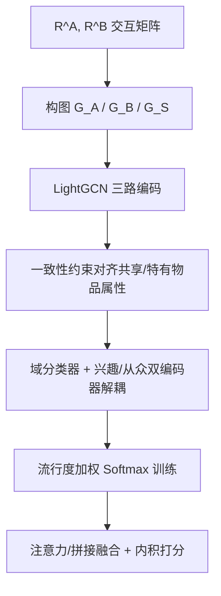
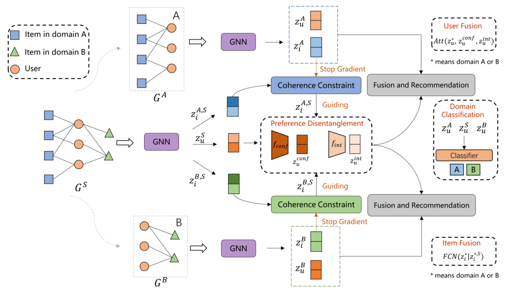

# Coherence-guided Preference Disentanglement for Cross-domain Recommendations (一致性引导的偏好解耦跨域推荐)

- **会议/期刊**: TOIS 2025 (ACM Transactions on Information Systems)
- **作者与机构**: Zongyi Xiang, Yan Zhang, Lixin Duan, Hongzhi Yin, Ivor W. Tsang（电子科技大学、查尔斯达尔文大学、昆士兰大学、A*STAR/NTU）
- **推荐链路定位**: 召回（双目标跨域协同过滤表征学习）
- **研究方向**: 跨域与多场景推荐 / 自监督对比与交互去噪
- **论文原文**: [https://arxiv.org/abs/2410.20580v2](https://arxiv.org/abs/2410.20580v2)
- **开源代码**: [https://github.com/XiangZongyi/CoPD](https://github.com/XiangZongyi/CoPD)

## TL;DR (1分钟核心速览)

双目标跨域推荐（CDR）长期受困于**重叠用户稀疏**与**共享物品稀缺**：现有解耦方法只按"域共享/域特有"切分用户表征，既无法定位"哪些偏好被迁移"，也把用户因从众（popularity 驱动）产生的点击误当作真实兴趣，造成负迁移。CoPD 提出全局-局部图编码器，用**一致性约束**（stop-gradient + cosine）从共享域物品表征中剥离冗余属性，得到跨域共享物品属性；再以该属性为锚、用**流行度加权 Softmax 损失**把共享用户偏好解耦为"兴趣 (interest)"与"从众 (conformity)"，最后注意力融合域共享/域特有表征做内积打分。在 6 组 Amazon/Douban 双目标任务、Leave-One-Out + 999 负采样协议下，HR@10 相对最强基线最高提升约 37%（Sport&Cloth 0.2247 vs. 0.2001）。

## Background & Motivation (背景与核心矛盾)

- **主流范式**: 双目标 CDR 以重叠用户为桥，用 GNN（BiTGCF/PPGN）或解耦正则（DisenCDR/DIDA-CDR/UniCDR）在域间迁移共享偏好，两域同时受益。
- **前人局限一**: 解耦粒度停留在"域"层面（shared vs. specific），**未触及用户点击的意图来源**——用户点言情书可能只是因为它火，而非喜欢言情，模型却把这种从众信号当作共享兴趣迁移到另一域（图 1 的误推荐即此）。
- **前人局限二**: 共享物品属性（category、popularity）虽被证明有用，但两域物品**完全不重叠**，全局图传播会把另一域的冗余属性灌入共享物品表征，缺乏显式过滤机制。
- **核心洞察 (Key Insight)**: 若把域特有物品表征视为"干净锚点"（stop-gradient 冻结），强制共享物品表征向其对齐，即可在保留共享属性的同时剔除跨域噪声；而 popularity 与兴趣呈**负相关**、与从众呈**正相关**，可作为无需人工标注的解耦监督信号。
- **本文切入点**: 先对齐物品属性、再用对齐后的属性去引导用户偏好解耦，形成"属性→偏好"的级联引导链。

## Method (核心方法设计)

### 1. 整体框架 (Overall Architecture)

输入为两域交互矩阵 $\mathbf{R}^A$、$\mathbf{R}^B$，拼接得全局矩阵$\mathbf{R}^S=\mathbf{R}^A\|\mathbf{R}^B$，据此构图$G_A$、$G_B$、$G_S$。三个 LightGCN 编码器分别产出域特有表征$z^A_u,z^A_i$、$z^B_u,z^B_i$与共享表征$z^S_u,z^S_i$（后者按域切分为$z^{A,S}_i$、$z^{B,S}_i$）。第一阶段用一致性约束对齐$z^{A,S}_i$与$z^{A}_i$，剥离冗余属性；第二阶段用域分类器保证$z^S_u$ 的域不变性，再由兴趣/从众双编码器解耦，并以对齐后的物品属性 + 流行度加权 Softmax 训练；最后物品侧拼接+FC 融合、用户侧域感知注意力融合，内积打分，多任务联合优化。

<figure class="paper-figure" markdown="span">
  <figcaption>图 3. CoPD 框架包含三个主要组件：一致性引导的物品属性对齐、由对齐属性引导的用户偏好解耦，以及嵌入融合与推荐。该过程首先使用三个 GNN 模型生成图增强嵌入。随后，我们对齐物品属性嵌入并解耦用户偏好嵌入。最后，我们将领域共享的用户/物品嵌入与其对应的领域特有嵌入融合，以生成全面的推荐。</figcaption>
</figure>

### 2. 关键设计拆解 (Key Designs)

1. **一致性引导的物品属性对齐（Coherence Constraint）**：痛点在于全局图传播使 $z^{A,S}_i$ 混入 B 域噪声。做法是以域特有表征为锚并 stop-gradient 冻结，用 cosine 相似度做正负对齐：

$$\mathcal{L}^A_{cc}=1-\frac{z^{A,S}_i\cdot \mathrm{SG}(z^A_i)}{\|z^{A,S}_i\|\|z^A_i\|}+\max\!\left(0,\frac{z^{A,S}_i\cdot \mathrm{SG}(z^A_j)}{\|z^{A,S}_i\|\|z^A_j\|}\right)$$

直觉：SG 阻断梯度回传，使锚点不被共享域的噪声污染，共享表征只能"单向靠拢"干净属性，等价于在表征空间做一次有监督的属性蒸馏。

2. **流行度加权 Softmax 偏好解耦**：痛点在于 CDR 中负样本难采样、且兴趣/从众无法区分。做法是设 $p_i$为 min-max 归一化流行度，从众损失权重取$p_i$、兴趣损失权重取$1-p_i$：

$$\mathcal{L}^A_{conf}=-\!\!\sum_{(u,i)\in\mathcal{D}^A_{train}}\!\! p^A_i\log\frac{\exp(z^{conf}_u\cdot z^{A,S}_i/\tau)}{\sum_{k\in\mathcal{I}^A}\exp(z^{conf}_u\cdot z^{A,S}_k/\tau)},\quad \mathcal{L}^A_{int}\ \text{同式取}\ (1-p^A_i)$$

直觉：热门物品的梯度几乎全部流向从众通道，冷门物品的梯度流向兴趣通道，从而在**无意图标签**下实现因果意义上的"反事实"分离；Softmax 全库分母天然提供多负样本，缓解 CDR 负采样困难。

3. **训练目标、负采样与推理效率**：总损失 $\mathcal{L}=\mathcal{L}_{rec}+\mathcal{L}_{dom}+\lambda_1\mathcal{L}_{cc}+\lambda_2\mathcal{L}_{pd}$，其中$\mathcal{L}_{rec}$为两域 BPR（每正样本 1 个随机负样本），$\mathcal{L}_{dom}$用 KL+CE 约束$z^S_u$标签为 0.5、$z^A_u/y^A$、$z^B_u/y^B$。推理仅需三路 GNN 前向 + 内积，无额外候选生成开销；但需维护全局图$G_S$，物品数翻倍使邻接存储与传播成本约为单域的 2 倍。

## Experimental Setup & Evaluation Protocol (实验设置与评估协议)

- **数据集与预处理**: Amazon 四域（Elec/Phone/Sport/Cloth）过滤 <5 交互用户与 <10 交互物品；Douban 三域（Movie/Book/Music）过滤 <5；均转隐式反馈、仅保留重叠用户、测试集剔除冷启物品。

| 数据集对 | #Users | #Items | #Interactions | 密度 | 场景说明 |
| :--- | :---: | :---: | :---: | :---: | :--- |
| Elec & Phone | 3,325 | 38,706 / 17,709 | 118,114 / 52,966 | 0.091% / 0.089% | 高相似 |
| Sport & Cloth | 9,928 | 30,796 / 39,008 | 100,938 / 95,369 | 0.033% / 0.024% | 高相似 |
| Sport & Phone | 4,998 | 20,845 / 13,655 | 54,256 / 46,445 | 0.052% / 0.068% | 低相似 |
| Elec & Cloth | 15,761 | 51,447 / 48,781 | 224,689 / 133,609 | 0.027% / 0.017% | 低相似 |
| Movie & Book | 2,106 | 9,555 / 6,777 | 907,219 / 95,974 | 4.508% / 0.672% | Douban |
| Movie & Music | 1,666 | 9,555 / 5,567 | 781,288 / 69,681 | 4.908% / 0.751% | Douban |

- **数据划分与防穿越**: `Leave-One-Out`（每用户留 1 个正样本作测试），沿用 DisenCDR 设置。
- **排名评测协议**: `Sampled Ranking`——1 正 + 随机 999 未交互负，报告 HR@10 与 NDCG@10（**非 Full-Ranking**，绝对值偏乐观）。
- **对比基线与超参**: 14 个基线分四类（单域 NeuMF/NGCF/LightGCN；单域解耦 DGCF/DICE；跨域 CDFM/CoNet/DDTCDR/PPGN/BiTGCF；跨域解耦 DisenCDR/DIDA-CDR/ETL/UniCDR）。$d=128$、batch 1024、lr 1e-3、dropout 0.3、GNN 3 层、$\tau=0.05$；$\lambda_1=1,\lambda_2=1$（高相似任务）或$\lambda_1=0.01,\lambda_2=1$（低相似任务）。

## Key Experimental Results (实验关键数据)

### 1. 主实验对比 (Main Results)

| 任务 | 指标 | LightGCN | DGCF | BiTGCF | DisenCDR | DIDA-CDR | UniCDR | **CoPD** | Improv.% |
| :--- | :---: | :---: | :---: | :---: | :---: | :---: | :---: | :---: | :---: |
| Elec (高相似) | HR@10 | 0.1917 | 0.1969 | 0.2214 | 0.2457 | 0.2121 | 0.2292 | **0.2742** | +11.6% |
| Elec (高相似) | NDCG@10 | 0.1028 | 0.1169 | 0.1220 | 0.1451 | 0.1252 | 0.1383 | **0.1653** | +13.9% |
| Phone (高相似) | HR@10 | 0.2325 | 0.2489 | 0.2571 | 0.2876 | 0.2517 | 0.2472 | **0.3275** | +13.9% |
| Sport (高相似) | HR@10 | 0.1319 | 0.1477 | 0.1483 | 0.1755 | 0.1890 | 0.1837 | **0.2594** | +37.2% |
| Cloth (高相似) | HR@10 | 0.1358 | 0.1114 | 0.1468 | 0.1631 | 0.2001 | 0.1785 | **0.2247** | +12.3% |
| Sport (低相似) | HR@10 | 0.1633 | 0.1882 | 0.1863 | 0.2017 | 0.1890 | 0.1655 | **0.2182** | +8.2% |
| Elec (低相似) | HR@10 | 0.1997 | 0.1645 | 0.2161 | 0.2371 | 0.2253 | 0.2092 | **0.2606** | +9.9% |
| Movie & Book | HR@10 | 0.1053 | 0.1567 | 0.1211 | 0.1639 | 0.1815 | 0.2187 | **0.2206** | +0.9% |
| Movie & Music | HR@10 | 0.0924 | 0.1510 | 0.1014 | 0.1631 | 0.1883 | 0.2022 | **0.2220** | +9.8% |

### 2. 消融实验 (Ablation Study)

| 变体 | Elec&Phone HR@10 | Sport&Cloth HR@10 | Sport&Phone HR@10 | Elec&Cloth HR@10 | 说明 |
| :--- | :---: | :---: | :---: | :---: | :--- |
| **CoPD (full)** | **0.2742** | **0.2247** | **0.2182** | **0.2606** | 完整模型 |
| w/o pd | 显著下降 | 显著下降 | 显著下降 | 显著下降 | 去掉兴趣/从众解耦 |
| w/o cc | 小幅下降 | 小幅下降 | 下降较大 | 下降较大 | 去掉一致性对齐 |
| w/o pop-weight | 下降 | 下降 | 下降 | 下降 | 等权 Softmax |
| CoPD-share | 低于 full | 低于 full | 低于 full | 低于 full | 不解耦、非加权 |
| CoPD-int | 低于 share | 低于 share | 低于 share | 低于 share | 仅兴趣通道 |
| CoPD-conf | 低于 share | 低于 share | 低于 share | 低于 share | 仅从众通道 |

### 3. 关键实验发现 (Key Findings)

1. **解耦比对齐更关键，但对齐在低相似域才显威力**：`w/o pd` 在所有任务上跌幅最大，说明兴趣/从众分离是主要增益来源；而 `w/o cc` 在高相似任务（Elec&Phone、Sport&Cloth）仅小幅下降，在低相似任务（Sport&Phone、Elec&Cloth）跌幅明显——因为低相似域物品属性几乎不重叠，必须靠一致性约束主动过滤冗余才能抽出共享属性。
2. **从众通道贡献大于兴趣通道，但二者缺一不可**：`CoPD-conf` 普遍优于 `CoPD-int`（用户大量点击由流行度驱动），而 `CoPD-share` 又优于任一单通道、`CoPD` 全面优于 `CoPD-share`，证明"解耦后再融合"严格优于"不解耦直接融合"；Elec&Cloth 的 Elec 域是兴趣通道少数占优的场景，恰与一致性对齐在该域收益最大相呼应。
3. **解耦在表征空间可验证**：t-SNE 显示域共享/域特有表征清晰分离，单独训练时兴趣与从众嵌入亦成簇；案例研究（用户 #22，Sport&Cloth）中从众通道 Top-4 物品流行度 0.40–0.46，兴趣通道仅 0.02–0.05，定量印证了流行度加权损失确实实现了预期分离。

## Highlights & Limitations (亮点、对比与审稿批判)

- **与代表作对比**: 相比 DisenCDR（互信息正则切分域共享/特有）与 DIDA-CDR（插值增强 + 域无关解耦），CoPD 首次把解耦推进到**意图层**并引入物品属性作为引导锚；相比 UniCDR 的对比学习对齐（双向梯度可能破坏域特有分布），CoPD 用 stop-gradient 单向对齐，保住域特有特征的独立性，这也是其在全部 6 组任务上稳定领先 UniCDR 的关键。
- **可迁移亮点**: ① "冻结锚点 + 单向 cosine 对齐"可作为通用的跨源表征去噪算子，迁移到多场景/多模态特征融合；② 用流行度作为**免标注**的解耦监督权重，可直接复用到单域 DICE 类兴趣/从众分离，无需额外意图标签。
- **审稿级局限批判**: ① 评测采用 1:999 采样排序而非 Full-Ranking，且仅报告 HR/NDCG@10，缺少 MRR/Recall 与显著性检验，绝对增益可能被高估；② 全局图需对两域物品做联合传播，物品规模翻倍，工业场景下 $G_S$的存储与每 epoch 重传播开销未做复杂度/时延分析；③$\lambda_1$ 对域相似度高度敏感（高相似取 1、低相似取 0.01，取 10 即崩），实际部署需按任务调参，泛化性存疑。

## Rating (四维评分)

- **方法创新性 (Novelty)**: ⭐⭐⭐⭐ （首次将 CDR 解耦从"域层"推进到"意图层"，一致性约束 + 流行度加权构成完整因果式解耦链，但各组件均为已有思想的组合迁移）
- **评估协议与实验扎实度 (Protocol & Experiments)**: ⭐⭐⭐ （6 组任务 + 14 基线较全面，但采样排序、单一截断 K=10、无显著性检验削弱说服力）
- **写作与数学规范度 (Clarity & Rigor)**: ⭐⭐⭐⭐ （三组件结构清晰、公式与算法伪代码完整，但符号表中 $z^{A,S}_i$与$z^S_i$ 的切分关系表述略绕）
- **工业落地与复现价值 (Industrial & Practical Value)**: ⭐⭐⭐⭐ （代码已开源、仅需 LightGCN 级骨干易落地，但全局图双倍传播开销与 $\lambda_1$ 任务相关调参增加工程成本）

