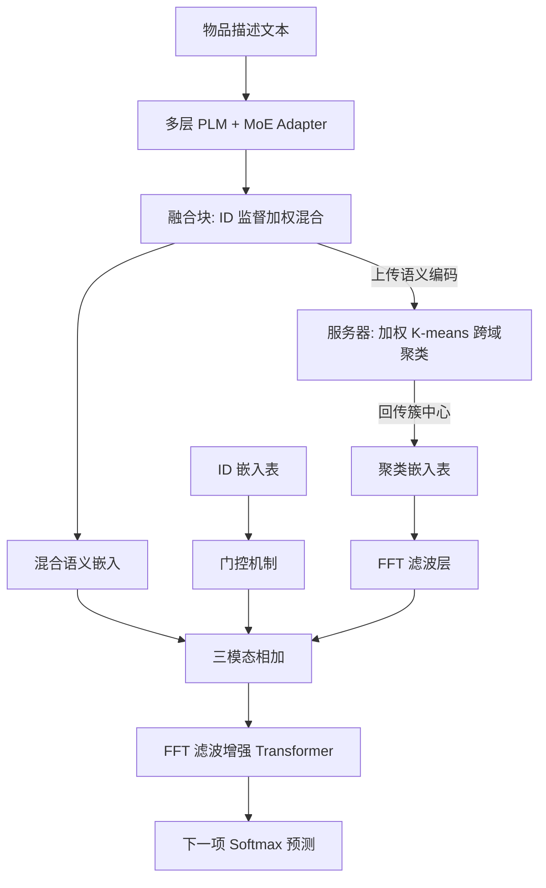
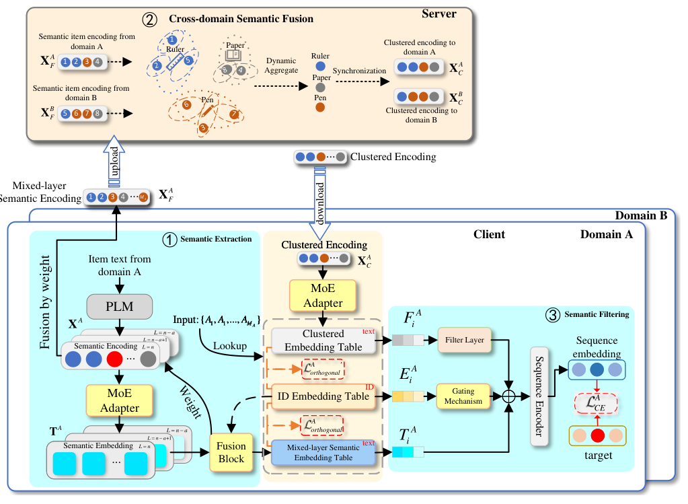

# Federated Semantic Learning for Privacy-preserving Cross-domain Recommendation (面向隐私保护跨域推荐的联邦语义学习)

- **会议/期刊**: ACM Transactions on Information Systems (TOIS)
- **作者与机构**: Ziang Lu, Lei Guo, Xu Yu, Zhiyong Cheng, Xiaohui Han, Lei Zhu（山东师范大学、中国石油大学（华东）、合肥工业大学、齐鲁工业大学、同济大学）
- **推荐链路定位**: 召回（跨域序列下一项预测）
- **研究方向**: 跨域与多场景推荐 / 去偏公平、可信隐私与工业架构
- **论文原文**: [https://arxiv.org/abs/2503.23026v1](https://arxiv.org/abs/2503.23026v1)
- **开源代码**: [https://github.com/Sapphire-star/FFMSR](https://github.com/Sapphire-star/FFMSR)

## TL;DR (1分钟核心速览)

针对**完全非重叠用户/物品**且**隐私不可共享**的跨域序列推荐，本文指出唯一先驱 PFCR 存在三重缺陷：PQ 量化丢失原始文本细粒度语义、仅用文本模态忽略 ID 协同信号、未过滤跨域融合引入的无关语义。FFMSR 以多层 PLM+MoE 保留深层语义、服务器端加权 K-means 聚类做跨域语义桥接、客户端 FFT 频域滤波+门控去噪。在 Office-Arts 与 OnlineRetail-Pantry 上采用 Leave-One-Out + Full-Ranking 协议，Recall@10 相对最优基线提升 2.7%–4.4%，NDCG@10 提升 1.4%–5.6%。

## Background & Motivation (背景与核心矛盾)

- **主流范式**: PPCDR 主流用联邦学习让各域本地训练、仅上传参数/表征；但绝大多数方法依赖**重叠用户**作为跨域桥梁（如 FedDCSR 解耦共享/独有表征、Zhao 等用元学习生成个性化偏好桥）。
- **前人局限**: 在 GDPR 类法规下用户身份不可跨平台对齐，重叠假设不成立；唯一处理非重叠场景的 PFCR 用 Product Quantization 把文本压成离散码，① 码本随训练漂移导致语义逐步偏离原文，② 仅用文本模态丢弃 ID 协同信号，③ 对融合后的无关语义毫无过滤。
- **核心洞察 (Key Insight)**: 自然语言具有跨域普适性——电影与图书描述若同含 "science fiction / universe"，其语义在向量空间天然邻近（图 1），因此**物品描述文本的深层语义可作为非重叠域之间的唯一合法桥梁**，且该信息不含用户交互、天然满足隐私约束。
- **本文切入点**: 放弃量化码本，改为"本地深层语义编码 → 服务器聚类对齐 → 回传聚类中心 → 本地频域滤波"的联邦语义学习闭环。

## Method (核心方法设计)

### 1. 整体框架 (Overall Architecture)

每个域作为一个 client：先用 BERT 提取物品描述文本**最后 $a$ 层**的 [CLS] 编码，经 MoE Adapter 转为各层语义嵌入表；融合块以**冻结的 ID 嵌入**为监督信号动态加权混合多层语义，得到 mixed-layer 语义编码并上传服务器；服务器用改进 K-means 跨域聚类，将每个物品替换为其所属簇中心并回传；客户端将聚类嵌入、门控后的 ID 嵌入、混合语义嵌入三者相加，经 FFT 滤波层增强的 Transformer 序列编码器输出用户表征，Softmax 预测下一项。训练分两阶段：联邦预训练（5 轮）+ 本地微调（冻结聚类编码，早停 patience=10）。

<figure class="paper-figure" markdown="span">
  <figcaption>图2. FFMSR的系统架构，主要由语义提取、跨域语义融合和语义过滤组件构成。(1) 语义提取模块旨在在PLM的多层级上学习项目描述文本的语义。其中的语义编码将上传至服务器以进行进一步融合。(2) 跨域语义融合旨在通过聚类融合不同域中的语义。聚类后的编码将发送回客户端进行本地更新。(3) 语义过滤旨在过滤掉无关的s</figcaption>
</figure>

### 2. 关键设计拆解 (Key Designs)

1. **多层语义 + ID 监督融合块（替代 PQ 量化）**：痛点在于 PQ 的离散码只反映子空间近似语义且随码本漂移。本文保留 BERT 末 $a$层编码，用 ID 嵌入$\boldsymbol{e}_i$与各层文本嵌入$\boldsymbol{t}_i^{L=j}$拼接后过 MLP 生成层权重：$w_{i,j}=\mathrm{Softmax}_j\big(\boldsymbol{W}_2\cdot\mathrm{LReLU}(\boldsymbol{W}_1[\boldsymbol{e}_i\oplus\boldsymbol{t}_i^{L=j}]+\boldsymbol{b}_1)+\boldsymbol{b}_2\big)$，再加权得$\boldsymbol{t}_i=\sum_{j=n-a}^{n}w_{i,j}\boldsymbol{t}_i^{L=j}$。直觉：ID 嵌入编码"哪些语义对协同过滤有用"，用它做注意力可让不同物品自适应选择语义层级；训练时冻结 ID 嵌入以防协同信号被语义污染。

2. **服务器端加权 K-means 跨域语义融合**：普通 K-means 的均值聚合会让远离中心的噪声点等权拉偏簇心。本文用 K-means++ 初始化，并将中心更新改为距离加权：$\boldsymbol{c}_j=\mathrm{Mean}\big(\sum_{\boldsymbol{x}_i\in C_j}w_i\boldsymbol{x}_i\big),\ w_i=1/(\|\boldsymbol{x}_i-\boldsymbol{c}_j\|+\epsilon)$。直觉：近中心的点语义更"典型"，应主导簇心；这使每个簇聚焦语义相关特征，缓解域间分布差异。

3. **FFT 频域滤波 + ID 门控 + 正交损失**：聚类回传的全局语义与多模态混合序列都含无关噪声。对序列嵌入做 $\tilde{\boldsymbol{Y}}=\boldsymbol{W}_c\odot\mathcal{F}(\boldsymbol{F})$、$\tilde{\boldsymbol{F}}=\mathcal{F}^{-1}(\tilde{\boldsymbol{Y}})$，可学习滤波器按频率分量抑制噪声而不破坏原信号；ID 侧用$\boldsymbol{w}_j^{ID}=\mathrm{Sigmoid}(\boldsymbol{e}_j\boldsymbol{W}^{ID})$动态降权冗余协同信号；总损失$\mathcal{L}=\mathcal{L}_{CE}+\lambda\|\boldsymbol{t}_i^{\top}\boldsymbol{e}_i\|_2^2+\lambda'\|\boldsymbol{f}_i^{\top}\boldsymbol{e}_i\|_2^2$，正交项强制文本/聚类语义与 ID 表征刻画物品的不同侧面。推理为全库 Softmax 打分，无额外负采样开销。

## Experimental Setup & Evaluation Protocol (实验设置与评估协议)

- **数据集与预处理**: 均采用 `5-core` 过滤，用户 ID 重编号以保证**零重叠**：

| 数据集 | #Users | #Items | #Interactions | 平均序列长 | 特征/场景说明 |
| :--- | :---: | :---: | :---: | :---: | :--- |
| Office | 87,436 | 25,986 | 684,837 | 7.84 | Amazon，title+category+brand 为文本 |
| Arts | 45,486 | 21,019 | 395,150 | 8.69 | Amazon，同上 |
| OnlineRetail | 16,520 | 3,469 | 519,906 | 26.90 | 英国电商，默认商品描述 |
| Pantry | 13,101 | 4,898 | 126,962 | 9.69 | Amazon，同上 |

- **数据划分与防穿越**: `Leave-One-Out`，序列末三项分别作测试/验证/训练目标，训练时使用目标项之前的全部交互。
- **排名评测协议**: 无偏 `Full-Ranking`（对全库物品排序），指标 Recall@{10,50} 与 NDCG@{10,50}，跨用户平均。
- **对比基线与超参**: 三类基线——ID-only（SASRec/Bert4Rec/FEARec）、跨域（CCDR/RecGURU，已移除重叠用户约束）、ID-Text（FDSA/S³Rec/UniSRec）、联邦（FedDCSR/PFCR）。PLM 输出 768 维，隐藏维 300，保留末 3 层，簇数 $K$=120（Office-Arts）/90（OR-Pantry），学习率 0.001，batch 1024，显著性$t$-test$p<0.05$。

## Key Experimental Results (实验关键数据)

### 1. 主实验对比 (Main Results)

| 数据集 | 指标 | SASRec | FEARec | UniSRec | FedDCSR | PFCR | **FFMSR** | Improv. |
| :--- | :--- | :---: | :---: | :---: | :---: | :---: | :---: | :---: |
| Office | R@10 | 0.1157 | 0.1155 | 0.1257 | 0.1022 | 0.1206 | **0.1312** | +4.38% |
| Office | N@10 | 0.0663 | 0.0756 | 0.0843 | 0.0787 | 0.0782 | **0.0890** | +5.58% |
| Office | N@50 | 0.0803 | 0.0897 | 0.0998 | 0.0896 | 0.0941 | **0.1054** | +5.61% |
| Arts | R@10 | 0.1048 | 0.1155 | 0.1219 | 0.0852 | 0.1153 | **0.1257** | +3.12% |
| Arts | N@10 | 0.0557 | 0.0620 | 0.0679 | 0.0591 | 0.0677 | **0.0711** | +4.71% |
| Arts | N@50 | 0.0753 | 0.0822 | 0.0919 | 0.0733 | 0.0904 | **0.0955** | +3.92% |
| OR | R@10 | 0.1484 | 0.1351 | 0.1591 | 0.1407 | 0.1561 | **0.1655** | +4.02% |
| OR | N@10 | 0.0684 | 0.0659 | 0.0752 | 0.0688 | 0.0739 | **0.0763** | +1.42% |
| Pantry | R@10 | 0.0467 | 0.0484 | 0.0677 | 0.0292 | 0.0616 | **0.0695** | +2.66% |
| Pantry | N@10 | 0.0207 | 0.0214 | 0.0309 | 0.0141 | 0.0293 | **0.0326** | +5.50% |
| Pantry | N@50 | 0.0385 | 0.0389 | 0.0550 | 0.0265 | 0.0503 | **0.0568** | +3.27% |

### 2. 消融实验 (Ablation Study)

| 变体 | Office R@10 | Office N@10 | Arts R@10 | OR N@10 | Pantry R@10 |
| :--- | :---: | :---: | :---: | :---: | :---: |
| w/o semantic fusion | 0.1292 | 0.0865 | 0.1231 | 0.0757 | 0.0679 |
| w/o adaptation filter | 0.1298 | 0.0887 | 0.1240 | 0.0741 | 0.0682 |
| w/o encoder filter | 0.1267 | 0.0869 | 0.1207 | 0.0755 | 0.0689 |
| w/o orthogonal losses | 0.1304 | 0.0857 | 0.1245 | 0.0744 | 0.0673 |
| w/o gating | 0.1307 | 0.0885 | 0.1240 | 0.0747 | 0.0694 |
| **FFMSR** | **0.1312** | **0.0890** | **0.1257** | **0.0763** | **0.0695** |

### 3. 关键实验发现 (Key Findings)

1. **联邦语义融合是最大增益源**：移除后 Office R@10 从 0.1312 降至 0.1292、Arts 从 0.1257 降至 0.1231，证明在零重叠约束下"聚类中心作为跨域桥"确实有效；而 PFCR 的 PQ 版本（FFMSR-PQ）在 Pantry 上 R@10 从 0.0679 暴跌至 0.0539，定量坐实了离散量化对稀疏文本域的语义破坏。
2. **序列编码器内的滤波比适配滤波更关键**：w/o encoder filter 在 Office R@50 掉至 0.1983（vs. 0.2069），说明多模态相加后的混合表征噪声更重，标准 Transformer 无力分离；而正交损失主要影响 NDCG（Office N@10 0.0857 vs. 0.0890），即它提升的是排序质量而非召回广度。
3. **核心模块具可迁移性且开销可控**：将语义融合+滤波移植到 FDSA/S³Rec/UniSRec 后全部基线均提升（如 UniSRec 在 Office R@10 由 0.1257→0.1304）；训练时间与 UniSRec 接近且随数据比例线性增长，$K$的最优值（30–60）与物品规模相关，$a>4$ 后性能反降。

## Highlights & Limitations (亮点、对比与审稿批判)

- **与代表作对比 (vs. Prior Work)**: 与 PFCR 的本质区别是"连续深层语义 + 聚类对齐"取代"离散 PQ 码本"，避免码本漂移且保留细粒度语义；与 UniSRec 的区别在于不只取 PLM 末层，而是多层 + ID 监督融合，并把 MoE 适配器用于跨域聚类编码而非单域泛化；与 FedDCSR 的区别是完全不依赖重叠用户，联邦只发生在无用户关联的语义层，天然规避异构性。
- **可迁移亮点**: ① 用冻结 ID 嵌入作注意力监督来挑选文本层级，可低成本移植到任何 ID-Text 双模态模型；② 服务器端"距离加权 K-means"是联邦场景下轻量、免梯度泄露的对齐手段，适合工业跨平台合作。
- **审稿级局限批判**: ① 仅验证两域配对，多域（>2 client）下簇心归属冲突与通信轮次开销未讨论；② 聚类数 $K$与保留层数$a$均需按数据集调参（OR 最优$a=1$、Pantry 更优$a$ 更大），且文本质量差的域（如 OR 的简短描述）增益明显收窄至 1.4%，泛化稳健性存疑。

## Rating (四维评分)

- **方法创新性 (Novelty)**: ⭐⭐⭐⭐ （以"多层语义+聚类桥+频域滤波"三件套系统替换 PQ 范式，单点不算全新但组合针对非重叠 PPCDR 空白场景，问题定义有价值）
- **评估协议与实验扎实度 (Protocol & Experiments)**: ⭐⭐⭐⭐ （四域两配对、Full-Ranking 无偏评测、$t$-test 显著性与五组消融齐备，但缺多域扩展与线上验证）
- **写作与数学规范度 (Clarity & Rigor)**: ⭐⭐⭐⭐ （模块划分清晰、公式完整，但 Eq.25/27 存在重复项笔误，部分符号如 $\boldsymbol{I}^A$ 定义略突兀）
- **工业落地与复现价值 (Industrial & Practical Value)**: ⭐⭐⭐⭐ （代码开源、仅上传无语义-用户关联的编码满足合规、训练开销接近 UniSRec，但依赖 PLM 推理与聚类通信，冷启动物品文本缺失时需额外兜底）

