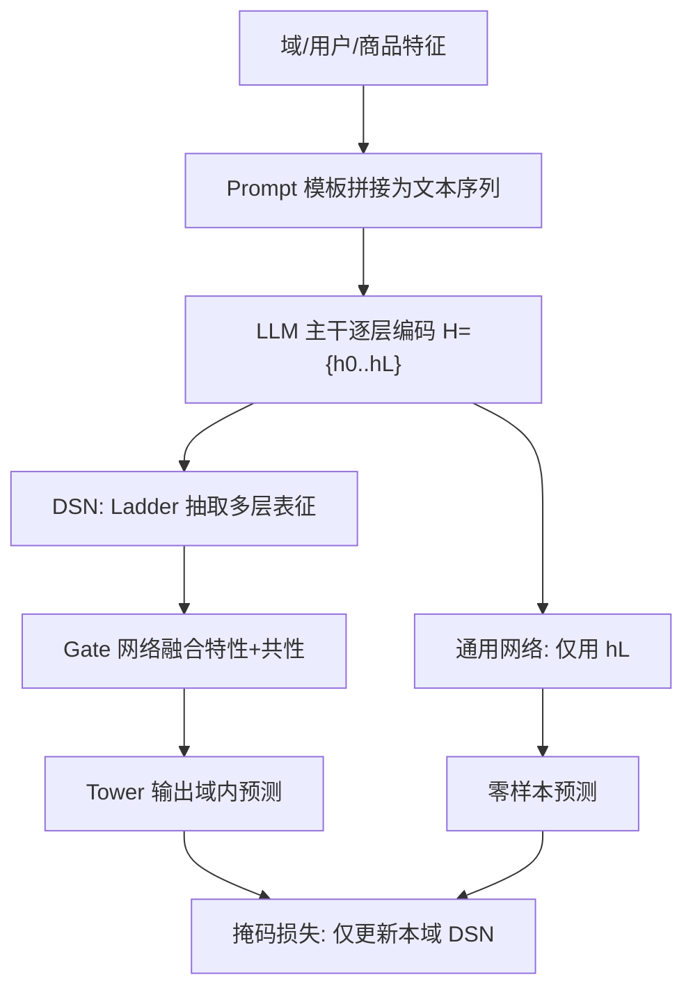
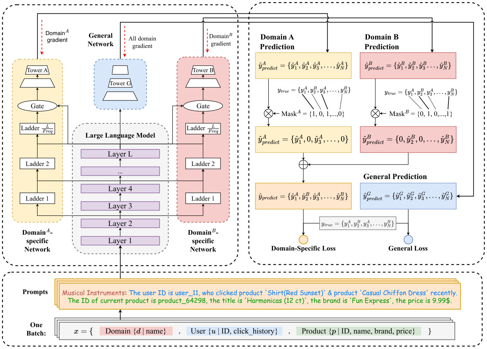

# A Unified Framework for Multi-Domain CTR Prediction via Large Language Models (基于大语言模型的多域 CTR 统一预测框架)

- **会议/期刊**: ACM Transactions on Information Systems (TOIS)
- **作者与机构**: Zichuan Fu, Xiangyang Li, Chuhan Wu, Yichao Wang, Kuicai Dong, Xiangyu Zhao, Mengchen Zhao, Huifeng Guo, Ruiming Tang（香港城市大学 & 华为诺亚方舟实验室）
- **推荐链路定位**: 精排（Ranking Stage）
- **研究方向**: CTR 预估与特征交叉 / 跨域与多场景推荐
- **论文原文**: [https://arxiv.org/abs/2312.10743v4](https://arxiv.org/abs/2312.10743v4)
- **开源代码**: [https://github.com/archersama/Uni-CTR](https://github.com/archersama/Uni-CTR)

## TL;DR (1分钟核心速览)

多域 CTR 的两大顽疾是数据稀疏导致的「跷跷板现象」与 one-hot ID 丢失语义导致的零样本泛化失效。Uni-CTR 把域/用户/商品特征拼成自然语言 Prompt 送入 LLM 主干，取**逐层隐状态**经 ladder 侧网络构建可插拔的域专属网络（DSN），并用**掩码损失**把各 DSN 的梯度严格解耦；另设通用网络承接末层表征做零样本预测。在 Amazon 五域（80/10/10 划分、AUC 评测）上，Fashion/Musical Instruments/Gift Cards 分别取得 24.22%/35.71%/63.35% 的 RelaImpr，未见域 All Beauty 零样本领先传统多域模型 6 个点以上。

## Background & Motivation (背景与核心矛盾)

- **主流范式**: MDCTR 采用「共享底座 + 域专属塔」的硬/软参数共享结构（Shared Bottom、MMOE、PLE、STAR），以缓解域间数据不均衡。
- **前人局限一（跷跷板）**: 数据富域主导训练，稀疏域（如 Gift Cards）性能被严重拖累；MMOE/PLE 的结构耦合使新增域必须重建模型，STAR 的逐元素相乘要求 DSN 与主干同构，参数量随域数乘性膨胀。
- **前人局限二（语义缺失）**: 商品标题、品牌等被 one-hot 编码为离散 ID，语义信息在嵌入层即被抹去，模型无法把「电脑」与「键盘」的关联迁移到冷启动域。
- **核心洞察 (Key Insight)**: LLM 的**不同层**天然编码不同粒度语义——底层聚合各域（共性），高层逐渐分离（粗粒度域特性），因此「分层抽取 + 侧网络精炼」可同时拿到共性与特性；且 LLM 的世界知识可补偿稀疏域的数据缺口。
- **本文切入点**: 以自然语言为跨域通用信息载体，用 LLM 做共享语义底座、用掩码损失保证 DSN 完全解耦，从而同时解决跷跷板、可扩展性与零样本泛化。

## Method (核心方法设计)

### 1. 整体框架 (Overall Architecture)

输入样本 $x=\{d,u,p\}$（域、用户、商品）先经模板拼成文本序列，由 Tokenizer 切分后送入$L$层 LLM 主干，得到逐层表征集合$H=\{h_0,h_1,\dots,h_L\}$。每个已见域挂一个 DSN：其 ladder 网络按频率$\phi$从第$\phi,2\phi,\dots$层抽取隐状态并逐级融合，gate 网络用 attention pooling 动态配比「域特性（ladder 输出）」与「域共性（末层$h_L$）」，再由 tower MLP 输出域内预测。通用网络仅用$h_L$经 MLP 输出$\hat{y}_G$，专司未见域零样本预测。训练时掩码损失只回传本域 DSN 的梯度，主干与通用网络则接收全部域梯度。

<figure class="paper-figure" markdown="span">
  <figcaption>图 2：Uni-CTR 的架构，其以提示为输入，利用 LLM 获得语义表示。其中，领域特定网络处理各领域的特性，而额外的通用网络旨在提取领域间的共性。</figcaption>
</figure>

### 2. 关键设计拆解 (Key Designs)

1. **Prompt 语义建模（把 ID 换成可读语义）**：传统 one-hot 在嵌入层即丢失语义。本文将域上下文、用户 ID 与点击历史（历史商品 ID 替换为其标题文本）、商品 ID/标题/品牌/价格统一填入固定模板，形成 `[Domain]: The user ID is ... who clicked ... The ID of the current product is ...` 的文本序列。直觉：LLM 的预训练语料已建立「运动服—运动视频」这类跨域语义关联，文本化输入使这种先验可直接被检索利用，而非从零学习 ID 共现。

2. **Ladder + Gate 的域专属网络（轻量侧网络替代同构塔）**：STAR 要求 DSN 与主干同构，参数量乘性增长。本文令 ladder 每 $\phi$ 层接一次主干：

$$lad_f=\begin{cases}\text{Ladder}_1(h_\phi) & f=1\\ \text{Ladder}_f(h_{f\cdot\phi}+lad_{f-1}) & f\ge 2\end{cases}$$

随后 gate 网络对 $O=\text{concat}(h_L,lad_F)$做 attention pooling：$A=\text{softmax}(\tanh(W_kO)W_q)$，$R=A^{\top}O$。直觉：底层表征提供细粒度短语级信号、高层提供抽象语义，逐级残差式融合让 DSN 以极小参数获得多层语义；gate 则让每个域自适应决定「借多少共性、留多少个性」。

3. **掩码损失与梯度解耦（可插拔性的关键）**：若所有 DSN 都对每个样本算损失，域间梯度互相污染。本文定义 $\text{mask}_{d_m}=[\mathbb{I}(d_1=d_m),\dots,\mathbb{I}(d_M=d_m)]$，域内损失为

$$\mathcal{L}_D=\sum_{i=1}^{M}\text{mask}_{d_m,i}\cdot\ell(\hat{y}_{d_i},y)=\ell(\hat{y}_{d_m},y)$$

总损失 $\mathcal{L}=\mathcal{L}_D+\mathcal{L}_G$，其中$\mathcal{L}_G=\ell(\hat{y}_G,y)$。由此对任意$n\neq m$有$\nabla_{\theta^{d_n}_{DSN}}\mathcal{L}=0$——新增/删除域只需增删对应 DSN，主干与其余 DSN 完全不动。训练用 BCE、LoRA（rank 8, alpha 32）微调主干，AdamW + CyclicLR$[1\times10^{-6},8\times10^{-5}]$，dropout 0.3；推理侧导出 ONNX 并用 TensorRT FP16 量化，batch 32、序列长 256 时单卡 V100 单样本约 2ms，AUC 损失 < 0.01。

## Experimental Setup & Evaluation Protocol (实验设置与评估协议)

- **数据集与预处理**: Amazon Review Data (2018)，取 5 个品类为域；评分 > 3 为正样本、$\le 3$ 为负样本；Ali-CCP/Ali-Mama 因特征全匿名化、无自然语言而被排除。

| 数据集 | #Users | #Items | #Interactions | 稀疏度/密度 | 特征/场景说明 |
| :--- | :---: | :---: | :---: | :---: | :--- |
| Fashion | 749,233 | 186,189 | 883,636 | 极稀疏 | 服饰，数据较富 |
| Digital Music | 127,174 | 66,010 | 1,584,082 | 较稠密 | 数字音乐 |
| Musical Instruments | 903,060 | 112,132 | 1,512,530 | 稀疏 | 乐器 |
| Gift Cards | 128,873 | 1,547 | 147,194 | 极稀疏 | 礼品卡，长尾域 |
| All Beauty | 319,335 | 32,486 | 371,345 | 稀疏 | 仅作零样本测试域 |

- **数据划分与防穿越 (Splitting Strategy)**: 沿用 CTRL/FLIP 的 **80%/10%/10% 比例划分**（训练/验证/测试），非时间戳切分；零样本实验用 Fashion、Musical Instruments、Gift Cards 三域训练，All Beauty 完全不参与训练。
- **排名评测协议 (Ranking Protocol)**: 采用 **AUC**（阈值无关的全样本二分类判别力），并报告 RelaImpr $=\left(\frac{\text{AUC}_{model}-0.5}{\text{AUC}_{base}-0.5}-1\right)\times100\%$；非 Full-Ranking 列表指标，负样本来自真实评分$\le 3$ 的交互而非随机采样。
- **对比基线与超参设置**: 单域基线 PNN/DCN/DeepFM/xDeepFM/DIEN/AutoInt/FiBiNET/IntTower；多域基线 Shared Bottom/MMOE/PLE/STAR/SAR-Net/DFFM。主干默认 Sheared-LLaMA-1.3B（24 层），DSN 含 4 个 ladder（小 Transformer 编码块），tower 为 $512\times256\times128$；显著性$p<0.05$。

## Key Experimental Results (实验关键数据)

### 1. 主实验对比 (Main Results)

| 类别 | 模型 | Fashion AUC | Musical Instr. AUC | Gift Cards AUC |
| :--- | :--- | :---: | :---: | :---: |
| 单域 | DeepFM | 0.6982 | 0.6880 | 0.5937 |
| 单域 | xDeepFM | 0.7031 | 0.6892 | 0.6121 |
| 单域 | AutoInt | 0.7003 | 0.6888 | 0.5976 |
| 多域 | Shared Bottom | 0.6946 | 0.6875 | 0.5907 |
| 多域 | MMOE | 0.6907 | 0.6857 | 0.6104 |
| 多域 | PLE | 0.6842 | 0.6813 | 0.6375 |
| 多域 | STAR | 0.6874 | 0.6831 | 0.6242 |
| 多域 | DFFM | 0.6973 | 0.6856 | 0.6324 |
| LLM 多域 | **Uni-CTR** | **0.7523** | **0.7569** | **0.7246** |
| — | RelaImpr vs 最优基线 | +24.22% | +35.71% | +63.35% |

### 2. 消融实验 (Ablation Study)

主干 DeBERTa-V3-Large（340M）下的消融：

| 配置 | Fashion | Musical Instr. | Gift Cards |
| :--- | :---: | :---: | :---: |
| Uni-CTR 完整 | **0.7391** | **0.7395** | **0.7073** |
| w/o ladder | 0.7084 | 0.6975 | 0.6723 |
| w/o LLM（换同层数 DNN + ID 输入） | 0.6954 | 0.6923 | 0.6100 |
| MMOE（同 340M 参数） | 0.7038 | 0.7005 | 0.6712 |
| STAR（同 340M 参数） | 0.7107 | 0.7016 | 0.6775 |

Prompt 语义消融（同主干）：Full Prompt 在 Fashion/Musical/Gift 为 0.7047/0.7008/0.6825，仅保留「ID+名称」降至 0.6960/0.6960/0.6749，仅保留 ID 进一步降至 0.6951/0.6835/0.6605。

### 3. 关键实验发现 (Key Findings)

1. **跷跷板被显著压平**：Uni-CTR 在数据最稀疏的 Gift Cards 上 RelaImpr 达 63.35%，远高于数据富域 Fashion 的 24.22%，说明 LLM 世界知识对稀疏域的补偿效应最强；而传统多域模型在 Gift Cards 上最好仅 0.6375（PLE），仍明显落后于富域表现。
2. **增益来自语义而非参数量**：把 MMOE/STAR 参数量扩到与 Uni-CTR 同量级（340M）后，Gift Cards 仅 0.6712/0.6775，仍低于完整 Uni-CTR 的 0.7073；而 w/o LLM 掉到 0.6100，证明 LLM 主干是稀疏域提升的主因，ladder 提供多层语义增益（去掉后三域分别掉 0.0307/0.0420/0.0350）。
3. **可插拔扩展与零样本均成立**：冻结已训三域参数、仅新增并训练 Digital Music 的 DSN，AUC 0.6140，较 STAR 的 0.6038 提升 9.83%、较全量重训单域基线至少提升 19.12%；零样本 All Beauty 上单域基线 AUC 约 0.51 或更低，Uni-CTR 领先传统多域模型 6 个点以上。工业两域数据上 AUC 相对提升超 10.26%。

## Highlights & Limitations (亮点、对比与审稿批判)

- **与代表作对比 (vs. Prior Work)**: 相比 MMOE/PLE 的紧耦合专家结构，本文用掩码损失实现 DSN 的**梯度级解耦**，新增域零干扰；相比 STAR 的同构塔逐元素相乘，ladder 侧网络参数量小一个量级且不要求与主干同构；相比 CTRL/FLIP 仅做单域语义增强，本文首次把 LLM 作为 MDCTR 的共享底座并显式分离共性与特性。
- **可迁移亮点**: (i) 「逐层隐状态 + 频率 $\phi$ 抽样」的 ladder 侧网络可低成本迁移到任何以 Transformer 为底座的推荐模型；(ii) 掩码损失这一「按域屏蔽梯度」的写法可直接用于多场景/多任务的可插拔扩展。
- **审稿级局限批判**: (i) 依赖自然语言特征，Ali-CCP 等匿名 ID 工业数据无法直接套用，落地前需先解决特征文本化管线；(ii) 单样本 2ms 虽可接受，但相对传统精排模型仍高一个量级，且 1.3B 主干的显存与训练成本对中小平台不友好；(iii) 零样本评测仅一个未见域（All Beauty），且基线在零样本下取三模型最优值，比较口径偏宽松。

## Rating (四维评分)

- **方法创新性 (Novelty)**: ⭐⭐⭐⭐ （首次将 LLM 分层表征与掩码梯度解耦结合用于 MDCTR，t-SNE 可视化佐证了「底层共性、高层分离」的直觉）
- **评估协议与实验扎实度 (Protocol & Experiments)**: ⭐⭐⭐⭐ （五域 Amazon + 工业数据 + 零样本 + 扩展性 + 参数量对齐消融齐全，但零样本仅单域、划分非时间切分）
- **写作与数学规范度 (Clarity & Rigor)**: ⭐⭐⭐⭐ （掩码损失的梯度推导逐项展开、符号清晰，公式 21–23 完整给出各参数梯度）
- **工业落地与复现价值 (Industrial & Practical Value)**: ⭐⭐⭐⭐ （代码开源、ONNX+TensorRT FP16 量化给出实测延迟，但依赖文本特征与 1.3B 主干抬高门槛）

