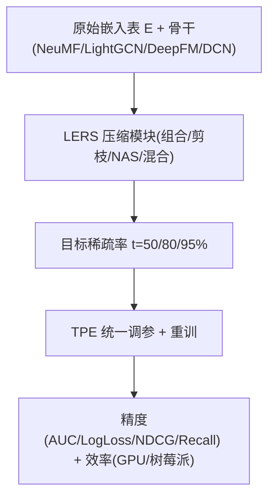

# A Thorough Performance Benchmarking on Lightweight Embedding-based Recommender Systems (轻量嵌入推荐系统全面性能基准评测)

- **会议/期刊**: TOIS 2025
- **作者与机构**: Hung Vinh Tran, Tong Chen, Nguyen Quoc Viet Hung, Zi Huang, Lizhen Cui, Hongzhi Yin（昆士兰大学、格里菲斯大学、山东大学）
- **推荐链路定位**: 召回（嵌入层压缩，贯穿训练与推理）
- **研究方向**: 去偏公平、可信隐私与工业架构 / 协同过滤
- **论文原文**: [论文原文链接](https://arxiv.org/abs/2406.17335v3)
- **开源代码**: [开源代码仓库链接](https://github.com/chenxing1999/recsys-benchmark)

## TL;DR (1分钟核心速览)

现代推荐系统的嵌入表占据 80% 以上参数（Meta 级模型达 96TB），催生大量轻量嵌入推荐系统（LERSs），但各文献在数据集、骨干、压缩率、指标上各自为政，性能无法横向比较。本文在 CTR（Criteo/Avazu）与 CF（Yelp2018/Gowalla）两大任务、四种骨干、三档压缩率（50%/80%/95%）下统一复现 7 种 LERSs，并提出极简的幅值剪枝基线 MagPrune。结果显示：低压缩率下简单方法即可媲美复杂方法，MagPrune 在 Criteo 上以 5% 参数逼近原模型（AUC 0.8080 vs. 0.8102），而 OptEmbed 在 LightGCN 上因维度截断导致 NDCG 从 0.0575 崩至 0.0287。

## Background & Motivation (背景与核心矛盾)

- **主流范式**: LERSs 分四类——组合嵌入（QR/TTRec/DHE，用小元表哈希组合）、嵌入剪枝（PEP/SSEDS，置零低幅值参数）、NAS（OptEmbed/AutoDim，搜索每特征维度）、混合（CERP/OptEmbed）。
- **前人局限一（协议不可比）**: DHE 用 ML-20M+AUC，CERP 用 Gowalla+Yelp2020+NDCG；即便同数据集，PEP 原始维度 24、OptEmbed 为 64，压缩后参数量不同，性能增益无法归因。
- **前人局限二（任务割裂）**: 方法按 CF 或 CTR 单任务设计并单任务评测，跨任务可迁移性完全未知；且只报参数量，不报推理时延与运行时内存，端侧可用性无从判断。
- **核心洞察 (Key Insight)**: 作者绘制特征频率 vs. 嵌入平均幅值（图 2），发现 CTR 数据中低频特征幅值天然趋零（仅受 $L_2$ 梯度支配），而 LightGCN 中高频节点因邻居聚合反而幅值更低——幅值本身就是"信息量"的廉价代理。
- **本文切入点**: 用统一协议 + TPE 调参做公平横评，并把"按幅值剪枝"提升为正式基线，同时补上跨任务与端侧效率两块空白。

## Method (核心方法设计)

### 1. 整体框架 (Overall Architecture)

本文是基准评测而非新模型：所有 LERSs 作为即插即用模块替换骨干的嵌入层，骨干固定为 CF 侧的 NeuMF/LightGCN 与 CTR 侧的 DeepFM/DCN-Mix。流程为：先训练带 $L_2$正则的原始模型 → 按各方法机制压缩嵌入表至目标稀疏率$t\in\{50\%,80\%,95\%\}$ → 在统一 TPE 调参预算（30 trials）下重训/微调 → 在 GPU 工作站与树莓派 4B 上分别测精度、时延与峰值内存。

### 2. 关键设计拆解 (Key Designs)

1. **MagPrune：幅值剪枝基线（本文唯一"新方法"）**：痛点在于 PEP 需软阈值重参数化+两阶段重训、OptEmbed 需超网+进化搜索，调参成本高。MagPrune 仅做一步：训练后按 $|\hat{E}|$全局排序，将最小的$t$比例元素置零，同时为每行保留至少$n_{\min}$个最大元素（CF 任务搜索$n_{\min}$，CTR 设 0）。直觉是$L_2$ 正则已把低贡献参数压向零，剪掉它们几乎无损；且一次训练可产出任意压缩率，天然适配多预算部署。

2. **跨任务迁移性度量（Performance Retain Ratio）**：定义压缩模型与原模型的指标比值 $\text{retain}=\text{metric}_{\text{compressed}}/\text{metric}_{\text{original}}$，在 CF 用 LightGCN+NDCG、CTR 用 DCN+AUC，两数据集取平均。该指标剥离了骨干差异，使"同一压缩范式在两类任务上的鲁棒性"首次可比。

3. **训练目标、负采样与推理效率**：各骨干沿用原损失——NeuMF 用 log loss + 负采样集 $\mathcal{V}^-$（大小 1–5 参与搜索），LightGCN 用 BPR + InfoNCE（$\tau=0.2$，作者实测带来约 50× 收敛加速），CTR 侧用交叉熵 +$L_2$。效率评测中，CF 推理时延只计"恢复全部用户/物品嵌入"的时间（1.87ms），因为其远大于点积打分（0.041ms）与排序（0.1ms），这一测量口径选择本身即是本文的工程贡献。

## Experimental Setup & Evaluation Protocol (实验设置与评估协议)

- **数据集与预处理**:

| 数据集 | #Users/实例 | #Items/特征 | #Interactions | 稀疏度 | 说明 |
| :--- | :---: | :---: | :---: | :---: | :--- |
| Criteo | 45.8M 实例 | 1.09M 特征 | 39 字段 | — | 数值特征取 $\lceil\log_2 x\rceil$，频次<10 归 OOV |
| Avazu | 40.4M 实例 | 4.43M 特征 | 22 字段 | — | 去掉唯一 ID 特征，频次<2 归 OOV |
| Yelp2018 | 31,668 | 38,048 | 1.56M | 99.87% | LightGCN 官方划分 |
| Gowalla | 29,858 | 40,981 | 1.03M | 99.92% | 训练集内再 9:1 切验证 |

- **数据划分与防穿越**: CTR 两数据集按 8:1:1 随机划分；CF 沿用 LightGCN 官方 train/test 划分，并从训练集内部再切 9:1 作验证，测试集全程不参与调参。
- **排名评测协议**: CF 采用 **Full-Ranking 全库排序**（对每用户打分后剔除训练集已交互项，取 Top-20），指标 NDCG@20 / Recall@20；CTR 用 AUC 与 LogLoss（AUC 提升 0.001 视为显著）。压缩率仅按嵌入表参数量计：$t=1-M(\hat{E})/M(E)$。
- **对比基线与超参**: 7 个 LERSs（QR、TTRec、DHE、PEP、OptEmbed、CERP、MagPrune）覆盖四大类；嵌入维度 CF 侧 64/32、CTR 侧 16；统一用 TPE 贝叶斯调参（10 次随机初始化 + 最多 30 trials），学习率、$L_2$ 系数、层数、dropout 等均在同一搜索空间内公平竞争。

## Key Experimental Results (实验关键数据)

### 1. 主实验对比 (Main Results)

CTR 任务（Criteo，DeepFM 骨干，节选）：

| Sparsity | Method | AUC | LogLoss | #Para |
| :--- | :--- | :---: | :---: | :---: |
| 0% | Original | **0.8102** | **0.4416** | 17.39M |
| ~50% | QR | 0.8081 | 0.4435 | 8.69M |
| ~50% | TTRec | 0.8075 | 0.4442 | 9.36M |
| ~50% | PEP | **0.8105** | **0.4414** | 8.67M |
| ~50% | MagPrune | 0.8102 | 0.4417 | 8.69M |
| ~80% | PEP | 0.8098 | 0.4419 | 3.47M |
| ~80% | MagPrune | 0.8101 | 0.4417 | 3.48M |
| ~95% | TTRec | **0.8087** | **0.4431** | 870K |
| ~95% | MagPrune | 0.8080 | 0.4436 | 869K |

CF 任务（Yelp2018，LightGCN 骨干，节选）：

| Sparsity | Method | N@20 | R@20 | #Para |
| :--- | :--- | :---: | :---: | :---: |
| 0% | Original | **0.0575** | **0.0727** | 4.46M |
| ~50% | PEP | 0.0560 | 0.0712 | 2.21M |
| ~50% | MagPrune | **0.0566** | **0.0718** | 2.23M |
| ~80% | PEP | **0.0539** | **0.0682** | 866K |
| ~80% | MagPrune | 0.0497 | 0.0633 | 892K |
| ~95% | DHE | **0.0400** | **0.0515** | 227K |
| ~95% | OptEmbed | 0.0287 | 0.0365 | 222K |

### 2. 消融实验 (Ablation Study)

本文为基准研究，其"消融"体现为跨骨干/跨任务/跨压缩率的因子拆解：

| 因子拆解 | 观察（以 NDCG@20 / AUC 计） |
| :--- | :--- |
| 骨干：LightGCN vs. NeuMF | LightGCN 全面胜出；95% 压缩下 PEP 在 NeuMF 上 N@20=0.0285，在 LightGCN 上仅 0.0396 |
| 任务：CF vs. CTR | MagPrune 在 CF 80% 保留率约 86%，在 CTR 80% 保留率约 99.9% |
| 压缩率：50%→95% | 简单方法（QR/MagPrune）优势随压缩率上升而消失，复杂方法（TTRec/CERP）反超 |
| 端侧：GPU vs. 树莓派 | 树莓派上所有方法训练时延放大数十倍，稀疏格式的元数据开销成为主瓶颈 |

### 3. 关键实验发现 (Key Findings)

1. **低压缩率下"简单即最优"**：Criteo 50% 压缩时 MagPrune（AUC 0.8102）与 PEP（0.8105）几乎追平原模型（0.8102），而 DHE 仅 0.8050；说明 50% 预算内复杂压缩的边际收益被调参噪声淹没，工业界可直接用一次训练+剪枝覆盖多档预算。
2. **高压缩率下方法-骨干强耦合**：OptEmbed 在 DCN 上 95% 压缩仍保 AUC 0.8109，但在 LightGCN 上 NDCG 从 0.0575 跌至 0.0287（保留率仅 50%），原因是其把嵌入后段维度置零，而 LightGCN 的邻域传播会把零维度扩散至全图；这提示 NAS 类方法不可跨骨干直接迁移。
3. **跨任务迁移性分化明显**：PEP 在 Criteo 上最优却在 Avazu 上最差（AUC 0.7564），TTRec 则在两数据集上表现最稳；DHE 因 MLP 表征力过强在低压缩率 CTR 上过拟合（AUC 0.8050），却在 CF 高压缩率下成为最佳（N@20=0.0400）——单一任务的 SOTA 声明对生产选型几乎无参考价值。

## Highlights & Limitations (亮点、对比与审稿批判)

- **与代表作对比 (vs. Prior Work)**: 相较 Zhang et al. 仅覆盖 CTR 且几乎不调参的评测，本文补齐 CF 任务、跨任务迁移与端侧效率三维；相较 Li et al. 的综述性梳理，本文给出可复现的定量结论；相较原始 PEP/OptEmbed 论文各自的最优声明，本文证明其优势高度依赖数据集与骨干组合。
- **可迁移亮点**: (1) "一次训练 + 全局幅值排序剪枝"可作为任何嵌入表的多预算部署默认基线；(2) 用特征频率-幅值散点图诊断嵌入表冗余度，成本极低且对剪枝/量化均适用。
- **审稿级局限批判**: (1) 仅评测 7 种方法且未纳入量化（PQ/SQ）与哈希类工业主流方案，覆盖度有限；(2) 端侧实验仅用树莓派 4B 单一硬件、且训练时延按 5%–20% epoch 线性外推，外推误差未量化；(3) MagPrune 在 CF 95% 压缩下崩溃（N@20=0.0197），说明其"通用基线"定位在高压缩区间并不成立，论文对此的讨论偏轻。

## Rating (四维评分)

- **方法创新性 (Novelty)**: ⭐⭐⭐ （MagPrune 本身是教科书级剪枝，创新主要在评测框架与跨任务 retain ratio 度量，而非算法）
- **评估协议与实验扎实度 (Protocol & Experiments)**: ⭐⭐⭐⭐⭐ （四数据集×四骨干×三压缩率×TPE 统一调参×双硬件，Full-Ranking 与显著性口径清晰，复现性极强）
- **写作与数学规范度 (Clarity & Rigor)**: ⭐⭐⭐⭐ （公式简洁、符号统一，OptEmbed 分布改造推导完整；但部分表格排版拥挤、跨任务结论散落多处）
- **工业落地与复现价值 (Industrial & Practical Value)**: ⭐⭐⭐⭐⭐ （全代码开源、含 CUDA/Numba 实现与树莓派部署脚本，直接回答"该选哪个 LERS"的工程问题）

