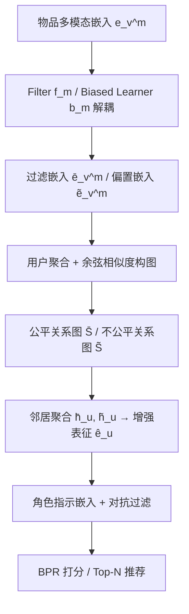

# Causality-Inspired Fair Representation Learning for Multimodal Recommendation (因果启发的多模态推荐公平表征学习)

- **会议/期刊**: ACM Transactions on Information Systems (TOIS) 2025
- **作者与机构**: Weixin Chen, Li Chen, Yuhan Zhao (香港浸会大学), Yongxin Ni (西湖大学)
- **推荐链路定位**: 召回（表征学习层）
- **研究方向**: 去偏公平与工业架构 / 多模态推荐
- **论文原文**: [https://arxiv.org/abs/2310.17373v3](https://arxiv.org/abs/2310.17373v3)
- **开源代码**: [https://github.com/WeixinChen98/FMMRec](https://github.com/WeixinChen98/FMMRec)

## TL;DR (1分钟核心速览)

多模态推荐（MMR）虽缓解数据稀疏，但本文实证发现：模态数量或种类越多，用户敏感属性（性别/年龄/职业）泄漏越严重——多模态内容作为混杂因子引入了敏感属性到推荐的额外因果路径。现有公平表征方法仅假设敏感信息来自交互数据，无法处理多模态场景。本文提出 FMMRec：先用对抗式模态解耦分离"偏置/过滤"模态嵌入，再据此挖掘公平/不公平用户-用户关系以净化用户表征。在 MovieLens 与 MicroLens 上，FMMRec 在保持精度可比（Recall 0.2214 vs LATTICE 0.2476）的同时，将隐式表征性别 AUC 从 0.5428 降至 0.5000（随机猜测水平），全面优于 AL/CAL/FairGo。

## Background & Motivation (背景与核心矛盾)

- **主流范式**: MMR 通过 GNN 将物品的视觉/文本/音频特征融入用户-物品交互建模（LATTICE、FREEDOM、DRAGON），精度显著提升；公平推荐则主流采用对抗学习（filter-discriminator min-max）滤除用户表征中的敏感信息（AL、CAL、FairGo）。
- **前人局限**: (1) 公平方法假设敏感信息仅从交互数据泄漏，忽略多模态内容这一新泄漏源；(2) 多模态内容与用户表征处于高度异构的语义空间，无法直接用于公平学习；(3) 多模态特征中敏感与非敏感信息纠缠，简单拼接会同时引入偏见。
- **核心洞察 (Key Insight)**: 作者用攻击者实验（图 2）验证：模态数量增加（quantity）或种类增加（variety）均单调提升敏感属性预测 AUC/F1，说明多模态内容构成敏感属性 $A_u$影响推荐分数$S_u$ 的额外因果路径（图 1b）。因此需从因果视角对模态表征做干预式解耦。
- **本文切入点**: 将多模态内容视为混杂/中介变量，通过"解耦 + 关系挖掘"两步控制敏感属性的因果效应，逼近反事实公平（定义 1：$Pr(L_{A\leftarrow a}|X=x,A=a)=Pr(L_{A\leftarrow a'}|X=x,A=a)$）。

## Method (核心方法设计)

### 1. 整体框架 (Overall Architecture)

FMMRec 分两阶段闭环：**阶段一（公平导向模态解耦）** 对每个模态 $m\in\{v,t,a\}$用 filter 网络$f_m$与 biased learner$b_m$将原始模态嵌入$\boldsymbol{e}_v^m$拆为过滤嵌入$\bar{\boldsymbol{e}}_v^m$（最小化敏感信息）与偏置嵌入$\tilde{\boldsymbol{e}}_v^m$（最大化敏感信息），并以两组判别器 + 重构损失 + 正交损失联合优化；**阶段二（关系感知公平学习）** 用解耦后的用户聚合模态嵌入计算余弦相似度，构建公平/不公平用户-用户图，聚合邻居后以$\hat{\boldsymbol{e}}_u=\boldsymbol{e}_u+\lambda_h(\bar{\boldsymbol{h}}_u-\tilde{\boldsymbol{h}}_u)$ 增强用户表征，最后对用户/物品表征施加带角色指示嵌入的对抗过滤，与 BPR 推荐损失联合训练。

### 2. 关键设计拆解 (Key Designs)

1. **公平导向模态解耦 (FMD)**：针对 C1（纠缠）。用 $f_m,b_m$生成双视图，两组判别器分别预测$K$个敏感属性，目标为$\min_{f_m,b_m}\mathcal{L}_{\text{Recon}}+\lambda_0^m(\mathcal{L}_{D_m^b}-\mathcal{L}_{D_m^f})+\lambda_1^m\mathcal{L}_{\text{Orth}}$，其中重构损失$\mathcal{L}_{\text{Recon}}=\frac{1}{|V_u|}\sum_v(1-\frac{\bar{\boldsymbol{e}}_v^m\cdot\boldsymbol{e}_v^m}{\|\bar{\boldsymbol{e}}_v^m\|\|\boldsymbol{e}_v^m\|})$保留非敏感信息，正交损失$\mathcal{L}_{\text{Orth}}=\frac{1}{|V_u|}\sum_v\max(0,\frac{\bar{\boldsymbol{e}}_v^m\cdot\tilde{\boldsymbol{e}}_v^m}{\|\bar{\boldsymbol{e}}_v^m\|\|\tilde{\boldsymbol{e}}_v^m\|})$ 防止 filter "作弊"。直觉：对抗 + 正交双约束迫使敏感信息单向流入偏置分支，实现因果干预式分离。

2. **公平/不公平关系挖掘 (FRM/UFRM)**：针对 C2（异构）。不强行对齐模态与用户空间，而是用解耦嵌入计算用户相似度 $\bar{S}_{uu'}^m=\frac{\bar{\boldsymbol{e}}_u^m\cdot\bar{\boldsymbol{e}}_{u'}^m}{\|\bar{\boldsymbol{e}}_u^m\|\|\bar{\boldsymbol{e}}_{u'}^m\|}$（负值截零 + kNN 稀疏化），按模态权重$\alpha_m$融合为$\bar{S}=\sum_m\alpha_m\bar{S}^m$，再聚合得$\bar{\boldsymbol{h}}_u=\sum_{u'\in\mathcal{N}(u;\bar{S})}\bar{S}_{uu'}\boldsymbol{e}_{u'}$。增强式$\hat{\boldsymbol{e}}_u=\boldsymbol{e}_u+\lambda_h(\bar{\boldsymbol{h}}_u-\tilde{\boldsymbol{h}}_u)$ 本质是"加公平邻居、减不公平邻居"的因果调整。

3. **角色指示对抗过滤与训练目标**：FairGo 的 filter 无法区分用户/物品输入，本文拼接角色嵌入 $\boldsymbol{r}_u,\boldsymbol{r}_v$后经共享组合 filter$\bar{\boldsymbol{e}}_u=\frac{1}{K}\sum_k f_k([\boldsymbol{r}_u;\hat{\boldsymbol{e}}_u])$，并对显式表征$\bar{\boldsymbol{e}}_u$与隐式表征$\bar{\boldsymbol{e}}_{V_u}$分别设判别器。总目标$\min_{\Theta\setminus\{D\}}\mathcal{L}_{\text{Rec}}-\lambda_{D_u}\mathcal{L}_{D_u}-\lambda_{D_v}\mathcal{L}_{D_v}$，判别器侧$\min\mathcal{L}_{D_u}+\mathcal{L}_{D_v}$，每步主更新后判别器更新 10 步。负采样沿用基座 BPR 的均匀负采样；kNN 稀疏化使训练复杂度降至$O(|U|d^2+|V|d^2)$，与基础对抗公平方法同阶。

## Experimental Setup & Evaluation Protocol (实验设置与评估协议)

- **数据集与预处理**:

| 数据集 | #Users | #Items | #Interactions | 稀疏度 | 模态维度 (V/T/A) |
| :--- | :---: | :---: | :---: | :---: | :--- |
| MovieLens | 6,040 | 3,706 | 1,000,209 | 95.53% | 1000/384/128 |
| MicroLens | 5,936 | 12,414 | 123,368 | 99.83% | 1000/768/128 |

- **数据划分与防穿越**: 交互按 **8:1:1 比例划分** 训练/验证/测试；敏感属性攻击者另按 80%/20% 划分训练/测试。
- **排名评测协议**: Top-20 推荐，指标 Recall@20 与 NDCG@20（未注明 Full-Ranking，按 MMR 框架惯例为全库排序）；公平性用攻击者分类器在（过滤后）显式/隐式用户表征上预测敏感属性，二值属性报 AUC、多类属性报 micro-F1，**越低越公平**。
- **对比基线与超参**: 5 个 MMR 基线（VBPR/MMGCN/LATTICE/FREEDOM/DRAGON）+ 3 个公平基线（AL/CAL/FairGo）；FMMRec 以 LATTICE（MovieLens）与 DRAGON（MicroLens）为基座。$d=d_r=64$，batch 2048，lr 0.001，$\lambda_0^m=\lambda_1^m=0.1$，$\lambda_h=\lambda_{D_u}=0.1$，$\lambda_{D_v}=0.05$；配对 t 检验$p<0.05$。

## Key Experimental Results (实验关键数据)

### 1. 主实验对比 (Main Results)

**MovieLens（性别/年龄/职业）**：

| 方法 | Recall↑ | NDCG↑ | Gen-AUC-E↓ | Gen-AUC-I↓ | Age-F1-I↓ | Occ-F1-I↓ |
| :--- | :---: | :---: | :---: | :---: | :---: | :---: |
| LATTICE | 0.2476 | 0.2378 | 0.7397 | 0.5428 | 0.3725 | 0.1747 |
| DRAGON | 0.2387 | 0.2331 | 0.7117 | 0.5803 | 0.3725 | 0.1614 |
| AL | 0.2163 | 0.2066 | 0.5172 | 0.5750 | 0.3891 | 0.1780 |
| CAL | 0.2143 | 0.2035 | 0.5340 | 0.5594 | 0.3717 | 0.1780 |
| FairGo | 0.2133 | 0.2003 | 0.5431 | 0.5000 | 0.3535 | 0.1647 |
| **FMMRec** | **0.2214** | **0.2079** | **0.5224** | **0.5000** | **0.3526** | **0.1507** |

**MicroLens（性别）**：

| 方法 | Recall↑ | NDCG↑ | AUC-E↓ | AUC-I↓ |
| :--- | :---: | :---: | :---: | :---: |
| DRAGON | 0.0860 | 0.0432 | 0.7582 | 0.7728 |
| FairGo | 0.0720 | 0.0356 | 0.5932 | 0.5329 |
| **FMMRec** | 0.0746 | 0.0379 | **0.5599** | **0.5050** |

### 2. 消融实验 (Ablation Study)

| 变体 | ML Recall↑ | ML Gen-AUC-E↓ | ML Occ-F1-I↓ | Micro Recall↑ | Micro AUC-I↓ |
| :--- | :---: | :---: | :---: | :---: | :---: |
| w/o FMD | 0.2048 | 0.5902 | 0.1531 | 0.0660 | 0.7543 |
| w/o FRM | 0.2194 | 0.5587 | 0.1623 | 0.0765 | 0.5553 |
| w/o UFRM | 0.2162 | 0.5321 | 0.1689 | 0.0755 | 0.6995 |
| w/o RI | 0.2048 | 0.5225 | 0.1623 | 0.0697 | 0.6601 |
| **FMMRec** | **0.2214** | **0.5224** | **0.1507** | 0.0746 | **0.5050** |

### 3. 关键实验发现 (Key Findings)

1. **解耦是公平与精度的双赢支点**：移除 FMD 后 MovieLens Recall 从 0.2214 跌至 0.2048、Gen-AUC-E 从 0.5224 升至 0.5902，MicroLens AUC-E 从 0.5599 暴涨至 0.7588——说明不解耦时敏感与非敏感信息纠缠，既损公平又损精度，FMD 是唯一同时改善两者的组件。
2. **隐式表征是公平主战场**：AL/CAL 对隐式表征几乎无效（AUC-I 0.5750/0.5594），而 FMMRec 与 FairGo 因对隐式表征施加过滤而显著下降；FMMRec 进一步将 MicroLens AUC-I 压至 0.5050（接近随机），较 FairGo 的 0.5329 再降 5.2%，归因于关系挖掘 + 角色指示的协同。
3. **公平代价可控且统计显著**：相对无公平约束的 LATTICE，FMMRec 精度仅降约 10.6%（0.2476→0.2214），但优于所有公平基线（FairGo 0.2133）；配对 t 检验 $p=6.28\times10^{-10}$（vs LATTICE）与$p=3.71\times10^{-3}$（vs FairGo）均显著。此外$\lambda_{D_v}$ 从 0.05 增至 1.0 时年龄隐式 AUC 从 0.3543 降至 0.0455 而 Recall 几乎不变，提示隐式侧可放心加大公平强度。

## Highlights & Limitations (亮点、对比与审稿批判)

- **与代表作对比 (vs. Prior Work)**: 相较 AL/CAL 仅从交互数据滤除敏感信息，FMMRec 首次显式建模多模态内容的因果路径；相较 FairGo 的"用户/物品共享 filter 但无法区分角色"，本文引入角色指示嵌入 + 模态解耦 + 关系挖掘，在隐式表征公平性上明显领先（MicroLens AUC-I 0.5050 vs 0.5329）。
- **可迁移亮点**: (1) "过滤/偏置双分支 + 重构 + 正交"的解耦范式可迁移到任何需分离敏感/有用信号的表征学习任务；(2) 用解耦嵌入构建"公平/不公平"双图并以 $\bar{\boldsymbol{h}}-\tilde{\boldsymbol{h}}$ 差值增强表征，是一种轻量、免额外参数的因果调整技巧。
- **审稿级局限批判**: (1) 公平性依赖攻击者分类器的容量与训练充分度，AUC 逼近 0.5 可能部分源于攻击者欠拟合而非真实去敏；(2) 两阶段训练 + 每步 10 次判别器更新带来额外训练开销，论文未报告实际 wall-clock 与线上延迟；(3) 仅在两个电影/微视频数据集验证，且 MicroLens 上精度略逊于 w/o FRM 变体，公平-精度权衡对敏感属性依赖度高度敏感。

## Rating (四维评分)

- **方法创新性 (Novelty)**: ⭐⭐⭐⭐ （首次从因果视角处理多模态推荐的敏感信息泄漏，解耦 + 双关系图设计有清晰因果直觉支撑）
- **评估协议与实验扎实度 (Protocol & Experiments)**: ⭐⭐⭐⭐ （双数据集、8 基线、消融/敏感性/群组公平/单模态对比齐全，含配对 t 检验；但缺 Full-Ranking 明确声明与效率实测）
- **写作与数学规范度 (Clarity & Rigor)**: ⭐⭐⭐⭐ （因果图与公式定义清晰、复杂度分析完整；部分符号在正文与算法间略有冗余）
- **工业落地与复现价值 (Industrial & Practical Value)**: ⭐⭐⭐⭐ （代码开源、基于 MMRec 框架、复杂度与基础对抗方法同阶；两阶段训练与攻击者评估的工程成本需权衡）

