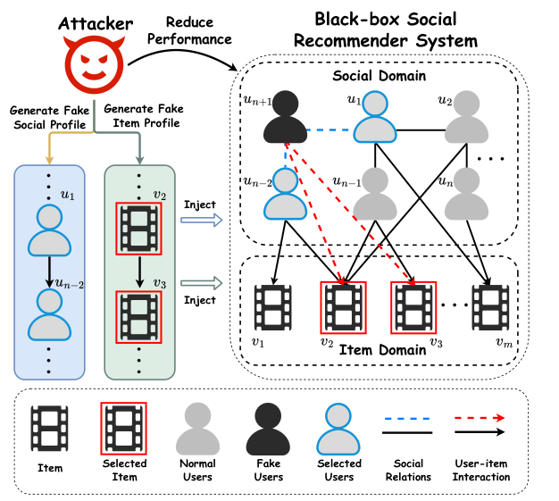
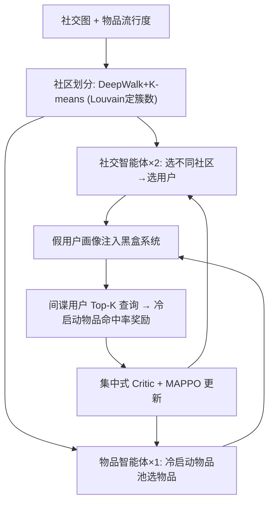

# Multi-agent Attacks for Black-box Social Recommendations (面向黑盒社交推荐的多智能体攻击)

- **会议/期刊**: ACM TOIS
- **作者与机构**: Shijie Wang, Wenqi Fan, Xiao-yong Wei, Xiaowei Mei, Shanru Lin, Qing Li（香港理工大学、香港城市大学）
- **推荐链路定位**: 召回（攻击目标为 GNN 社交推荐的 Top-K 召回列表）
- **研究方向**: 去偏公平、可信隐私与工业架构 / 社交与群组推荐
- **论文原文**: [https://arxiv.org/abs/2311.07127v4](https://arxiv.org/abs/2311.07127v4)
- **开源代码**: 暂未开源

## TL;DR (1分钟核心速览)

现有推荐攻击研究多聚焦白盒/灰盒下的**有目标**攻击（推高/打压特定物品），而社交推荐中"降低整体推荐质量"的**无目标黑盒**攻击几乎空白。本文先通过预实验发现两个关键杠杆：**冷启动物品**做填充画像、**跨社区社交连接**做社交画像，能显著拉低推荐性能；进而提出 MultiAttack——用去中心化 Actor-Critic 多智能体（2 个社交智能体 + 1 个物品智能体）协同生成两类画像，以"间谍用户 Top-K 中冷启动物品命中率"为奖励。在 LastFM/Ciao/Epinions 上，规避攻击使 GraphSAGE 社交推荐的 NDCG@10 相对下降 19.5%/10.8%/7.4%，且仅 6% 假用户被检测器识别。

## Background & Motivation (背景与核心矛盾)

- **主流范式**: GNN 社交推荐（GraphSAGE、SocialLGN、DiffNet 等）同时聚合用户-物品交互与用户-用户社交图；对应攻击研究则以 PoisonRec、KGAttack、CopyAttack 为代表，通过查询黑盒系统生成假用户物品画像。
- **前人局限**: 其一，现有黑盒攻击**完全忽略社交关系**这一社交推荐的核心信号，无法构造社交画像；其二，绝大多数工作做**有目标攻击**，而无目标攻击（拉低全体用户体验、为对抗训练提供负样本）在社交推荐黑盒场景下未被探索。
- **核心洞察 (Key Insight)**: 预实验（图 2、图 3）表明——注入 **Top 10% 冷启动物品**填充画像比注入热门物品更能拉低 NDCG/Recall（热门物品甚至反而提升性能）；**跨社区连接**比随机连接、社区内连接破坏性更强（社区内连接在 Ciao 上甚至提升性能）。
- **本文切入点**: 物品画像与社交画像高度耦合，独立优化易陷次优，故用**多智能体 RL 协同**二者生成，并以冷启动物品池 + 跨社区约束压缩动作空间。

<figure class="paper-figure" markdown="span">
  <figcaption>图 1. 社交推荐系统中非定向黑盒攻击的示意图。攻击者的目标是通过注入一个带有用户画像的虚假用户（即 𝑢𝑛+1）来降低整体推荐性能，该用户画像由虚假物品画像（即 {..., 𝑣2, 𝑣3, ...}）和虚假社交画像（即 {...,𝑢1,𝑢𝑛−2, ...}）组成。</figcaption>
</figure>

## Method (核心方法设计)

### 1. 整体框架 (Overall Architecture)

MultiAttack 将攻击建模为 DEC-POMDP：状态为假用户当前物品画像与社交画像的拼接，动作为"选社区-选用户"（社交）与"选物品"（物品），奖励来自对目标黑盒系统的查询。流程为：先用 DeepWalk + K-means（簇数由 Louvain 模块度确定）做社区划分；再由 3 个智能体分别生成跨社区社交画像与冷启动物品画像；最后注入假用户并向间谍用户发起 Top-K 查询获取奖励，用 MAPPO 更新策略。集中式 Critic 评估联合动作、去中心化 Actor 各自决策，从而在稀疏奖励下实现两类画像的协同。

### 2. 关键设计拆解 (Key Designs)

1. **跨社区社交画像的分层策略**：痛点是无目标攻击下社交画像无先验可依。两个社交智能体采用分层动作 $\pi(a_t|o_t)=\pi^c_\theta(c_t|o_t)\cdot\pi^u_\theta(u_t|o_t,c_t)$，并**强制两智能体选择不同社区**以构造跨社区边；社区选择策略为$\pi^c_\theta(c_t|o_t)=\mathrm{Softmax}(\mathbf{W}_{C,2}\mathrm{ReLU}(\mathbf{W}_{C,1}o_t)+\mathbf{b}_C)$。直觉：跨社区边把偏好差异大的用户强行拉入同一邻域，污染 GNN 的社交聚合，使表征向错误方向平滑。

2. **冷启动物品池 + 裁剪机制**：痛点是无目标攻击需从百万级物品中选填充物，动作空间爆炸。做法是仅取流行度最低的 Top-$m\%$（默认 10%）冷启动物品构成候选池$\mathcal{A}^i_t$，物品智能体在池内选物品，画像长度达$T$后裁剪去重得$P^{clip}_t$。直觉：冷启动物品在训练中交互极少、表征欠拟合，注入后会把大量长尾噪声推入 Top-K，直接稀释推荐质量。

3. **奖励设计与训练目标**：以间谍用户 $\hat{u}_i$的 Top-$k$列表中冷启动物品命中率作奖励$r(s_t,a_t)=\frac{1}{|\hat{U}|}\sum_{i=1}^{|\hat{U}|}\mathrm{HR}(\hat{u}_i,v^*,k)$，其中$\mathrm{HR}(\hat{u}_i,v^*,k)=|v_{\hat{u}}\cap v^*|/k$。总目标为最大化折扣累积奖励$\max_\pi \mathbb{E}_{\tau\sim\pi}[\sum_{t}\gamma^t r(s_t,A_t)]$，Critic 以 TD 平方误差$\mathcal{L}_\omega=\sum_i\sum_t(\sum_j\gamma^j R_{t+j}-V_\omega(o^1_t,\dots,o^n_t))^2$更新。**免负采样**（攻击侧不涉及 BPR 负例），推理开销从单智能体$O(|V|\times|U|^2)$降至$O(|A|)+2O(n\times|C|)$。

## Experimental Setup & Evaluation Protocol (实验设置与评估协议)

- **数据集与预处理**: 三个真实社交数据集，未做 5-core 过滤（原文未声明），统计如下：

| 数据集 | #Users | #Items | #Interactions | 交互密度 | 社交边数 / 密度 |
| :--- | :---: | :---: | :---: | :---: | :--- |
| LastFM | 1,892 | 17,632 | 92,834 | 0.278% | 25,434 / 0.711% |
| Ciao | 7,375 | 104,975 | 226,307 | 0.0281% | 111,781 / 0.2087% |
| Epinions | 40,163 | 139,738 | 664,824 | 0.0118% | 487,183 / 0.0118% |

- **数据划分与防穿越**: 采用**留出式划分**（训练/测试交互分离），攻击分两阶段：**Evasion**（模型参数冻结，仅测试期注入）与 **Poison**（注入后重训模型）。
- **排名评测协议**: 采用 **Full-Ranking 全库排序**（对全体未交互物品排序取 Top-K），指标为 NDCG@k、Recall@k、Precision@k（$k=5,10,20$）；**指标越低表示攻击越成功**。
- **对比基线与超参**: 基线含 ColdAttack、PopAttack、RandomAttack、DegreeAttack、PoisonRec-Untargeted、MultiAttack-Social、DoubleAttack；目标系统为 3 层 GraphSAGE（Evasion）、SocialLGN 与 SBPR（Poison）。画像长度 $T=30$，每 2 次注入查询 50 个间谍用户，学习率 0.0005，$\gamma=0.99$，PPO clip 0.2，假用户预算为 2%/2%/0.5%。

## Key Experimental Results (实验关键数据)

### 1. 主实验对比 (Main Results)

Evasion 攻击（目标：GraphSAGE 社交推荐，指标越低越好）：

| 数据集 | 方法 | N@5 | N@10 | R@10 | P@10 |
| :--- | :--- | :---: | :---: | :---: | :---: |
| LastFM | Without Attack | 0.1493 | 0.1567 | 0.1522 | 0.1373 |
| LastFM | DegreeAttack | 0.1409 | 0.1472 | 0.1429 | 0.1290 |
| LastFM | PoisonRec-Untargeted | 0.1407 | 0.1488 | 0.1460 | 0.1303 |
| LastFM | MultiAttack-Social | 0.1217 | 0.1264 | 0.1228 | 0.1081 |
| LastFM | **MultiAttack** | **0.1127** | **0.1184** | **0.1155** | **0.1045** |
| LastFM | Improv. | 19.9% | 19.5% | 19.1% | 19.0% |
| Ciao | Without Attack | 0.0992 | 0.1236 | 0.1815 | 0.0559 |
| Ciao | PoisonRec-Untargeted | 0.0966 | 0.1221 | 0.1786 | 0.0554 |
| Ciao | **MultiAttack** | **0.0823** | **0.1061** | **0.1605** | **0.0497** |
| Ciao | Improv. | 12.0% | 10.8% | 9.2% | 7.7% |
| Epinions | Without Attack | 0.1458 | 0.1946 | 0.3338 | 0.0684 |
| Epinions | PoisonRec-Untargeted | 0.1161 | 0.1661 | 0.3069 | 0.0595 |
| Epinions | **MultiAttack** | **0.1042** | **0.1542** | **0.2925** | **0.0549** |
| Epinions | Improv. | 10.5% | 7.4% | 4.6% | 7.8% |

Poison 攻击（目标：SocialLGN，LastFM）：N@5 由 0.2946 降至 **0.2851**，N@10 由 0.2533 降至 **0.2435**；SBPR 上 N@5 由 0.2084 降至 **0.1990**，验证跨模型可迁移性。

### 2. 消融实验 (Ablation Study)

| 变体 | 移除内容 | 攻击效果变化（NDCG@10，越低越好） |
| :--- | :--- | :--- |
| MultiAttack | 完整模型 | 最优（如 LastFM 0.1184） |
| -Community | 去掉跨社区约束，可连任意用户 | 明显变差，验证跨社区边是关键 |
| -Partition | 直接用 Louvain 替代 DeepWalk+K-means | 变差，验证嵌入聚类更优 |
| -MultiAgent | 去掉多智能体，随机选冷启动物品与跨社区用户 | 变差，验证协同必要性 |
| -Cold-Start | 全物品池选填充物 | 显著变差，验证冷启动杠杆 |

### 3. 关键实验发现 (Key Findings)

1. **协同 > 单侧**：仅做社交画像的 MultiAttack-Social 在 Epinions 上比完整模型差 20% 以上，说明物品画像与社交画像必须联合优化，单侧攻击会因耦合失配而次优。
2. **冷启动是核心杠杆**：ColdAttack 比 PopAttack 攻击效果提升约 5%–15%，而消融去掉冷启动池后性能显著回退，印证"注入长尾物品稀释 Top-K"的机制。
3. **隐蔽性突出**：在异常检测下 MultiAttack 假用户被检出率仅 **6%**（PoisonRec-Untargeted 与 DegreeAttack 分别达 22%、24%），同时 Precision@5 下降 25.6%，远高于后者的 6.9%，实现"低检出、高破坏"。

## Highlights & Limitations (亮点、对比与审稿批判)

- **与代表作对比 (vs. Prior Work)**: 相比 PoisonRec（单智能体、仅物品画像、无社交信号）与 KGAttack（依赖知识图谱），本文首次把社交画像纳入黑盒无目标攻击并用多智能体解耦动作空间；相比白盒社交攻击，本文仅需公开社交图与物品侧信息，实用性更强。
- **可迁移亮点**: ①"冷启动物品池 + 跨社区约束"作为动作空间剪枝技巧，可迁移到任何大规模离散动作的 RL 推荐/攻击任务；②以间谍用户 Top-K 命中率作黑盒奖励的构造方式，可复用于鲁棒性评测基准建设。
- **审稿级局限批判**: ①未报告攻击生成的实际 wall-clock 开销与查询次数，MAPPO 训练成本在百万级用户场景下存疑；②仅在三个中小规模学术数据集验证，缺乏工业级平台与真实检测器（如基于 GNN 的异常检测）的对抗评估；③社区划分依赖社交图完整可见的强假设，与部分平台隐私设置冲突。

## Rating (四维评分)

- **方法创新性 (Novelty)**: ⭐⭐⭐⭐ （首次将无目标黑盒攻击引入社交推荐，多智能体协同 + 冷启动/跨社区双杠杆设计有清晰预实验支撑）
- **评估协议与实验扎实度 (Protocol & Experiments)**: ⭐⭐⭐⭐ （三数据集 × 两阶段攻击 × 多目标系统 + 检测/防御/预算/长度分析完整，但缺 wall-clock 与工业规模验证）
- **写作与数学规范度 (Clarity & Rigor)**: ⭐⭐⭐⭐ （DEC-POMDP 建模与策略梯度公式清晰，复杂度分析到位；部分符号在正文与算法间略有冗余）
- **工业落地与复现价值 (Industrial & Practical Value)**: ⭐⭐⭐ （攻击视角对鲁棒推荐系统建设有直接价值，但未开源、训练开销与真实检测器对抗性待补）

