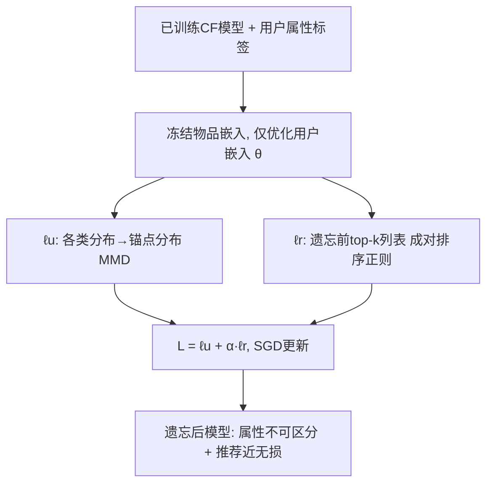
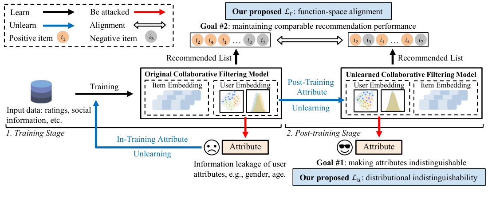

# Post-Training Attribute Unlearning in Recommender Systems (推荐系统中的训练后属性遗忘)

- **会议/期刊**: TOIS (ACM Transactions on Information Systems)
- **作者与机构**: Chaochao Chen, Yizhao Zhang, Yuyuan Li, Jun Wang, Lianyong Qi, Xiaolong Xu, Xiaolin Zheng, Jianwei Yin（浙江大学、杭州电子科技大学、OPPO研究院、中国石油大学、南京信息工程大学）
- **推荐链路定位**: 后处理 / 模型修正（Post-Training 阶段，不干预原训练）
- **研究方向**: 去偏公平、可信隐私与工业架构 / 协同过滤
- **论文原文**: [https://arxiv.org/abs/2403.06737v3](https://arxiv.org/abs/2403.06737v3)
- **开源代码**: 暂未开源

## TL;DR (1分钟核心速览)

现有推荐遗忘研究几乎都以训练输入（用户/物品/交互）为遗忘目标，但攻击者可从用户嵌入中推断出**从未参与训练**的敏感属性（性别、年龄、国家）。本文聚焦更严格的**训练后属性遗忘 (PoT-AU)**：仅能操作已训练模型、无训练数据可用。作者提出双分量损失——用**锚点分布 MMD** 将多类属性遗忘复杂度从 $O(T^2)$降至$O(T)$，并用**函数空间 top-$k$排序正则**替代参数空间$\ell_2$ 以保住推荐性能。在 4 个真实数据集、NMF/LightGCN 上，攻击者 BAcc 平均下降约 37.6%，推荐 NDCG 仅降 1.91%，且遗忘耗时较 Retrain 降低一个数量级。

## Background & Motivation (背景与核心矛盾)

- **主流范式**: 推荐遗忘（RecEraser、LASER 等）以训练输入为遗忘目标，依赖重训练或分片聚合实现"精确遗忘"。
- **前人局限**: ① 输入遗忘的 ground-truth 是"从零重训"，但属性从未显式参与训练，重训根本无法消除其隐式泄漏；② 已有属性遗忘工作（InT-AU，如对抗训练）必须干预训练过程，且需访问训练数据，部署不灵活。
- **核心洞察 (Key Insight)**: 用户嵌入的分布形状在不同属性标签间高度相似，差异主要体现为**分布间距离**；因此"不可区分"可等价为"分布对齐"。同时，参数空间的变化是函数空间（推荐列表）变化的**劣质代理**——实测 $\ell_2$与 RBO 的 Pearson 相关仅$-0.255$，而函数空间损失达$-0.766$。
- **本文切入点**: 把 PoT-AU 建模为**仅对用户嵌入表的优化问题**，用锚点分布 MMD 做多类不可区分、用无数据的 top-$k$ 排序正则做性能保持。

## Method (核心方法设计)

### 1. 整体框架 (Overall Architecture)

训练阶段完全不动，仅保留训练好的协同过滤模型与用户属性标签；后处理阶段冻结物品嵌入与其余参数，只更新用户嵌入矩阵 $\boldsymbol{\theta}\in\mathbb{R}^{M\times d}$。优化目标为双分量损失$\mathcal{L}(\boldsymbol{\theta})=\ell_u+\alpha\ell_r$：$\ell_u$把各属性类别的嵌入分布拉向锚点分布以实现不可区分（Goal #1），$\ell_r$用遗忘前的 top-$k$ 推荐列表做无数据排序对齐以保持推荐性能（Goal #2），用 SGD 迭代求解。

<figure class="paper-figure" markdown="span">
  <figcaption>图 2. 推荐系统中训练后属性遗忘（PoT-AU）与训练中属性遗忘（InT-AU）的概览。L𝑢表示为目标 #1 设计的可区分性损失，L𝑟表示为目标 #2 设计的正则化损失。橙色点表示位于推荐列表前 𝑙 位置的正样本，灰色点表示相反情况。为简洁起见，我们省略了协同过滤模型中除嵌入外的其他参数。</figcaption>
</figure>

### 2. 关键设计拆解 (Key Designs)

1. **锚点分布 MMD 不可区分损失（多类扩展）**：二类时直接最小化 $\mathrm{MMD}^2(\mathcal{P}_1,\mathcal{P}_2)$，多类时两两配对复杂度$O(T^2)$且不稳定。作者引入加权重心锚点分布$\mathcal{P}^*=\sum_{i=1}^{T}\beta_i\mathcal{P}_i$（$\beta_i=|\mathcal{P}_i|/M$），仅需计算各类与锚点的距离：
$$\ell_u=\frac{1}{T}\sum_{i=1}^{T}\mathrm{MMD}^2(\mathcal{P}_i,\mathcal{P}^*),\quad \mathrm{MMD}^2=\Big\|\frac{1}{n}\sum\phi(\boldsymbol{\theta})-\frac{1}{m}\sum\phi(\boldsymbol{\theta}')\Big\|_{\mathcal{G}}^2$$
用高斯核 RKHS 均值嵌入估计，复杂度降为 $O(T)$；直觉是"所有类都向同一重心靠拢"比"两两互拉"更稳定且保留分布形状。

2. **函数空间 top-$k$排序正则$\ell_r$**：无训练数据时，用遗忘前每个用户的 top-$k$列表作为函数行为的代理。构造两项 hinge 损失——保持 top-$k$内部相对顺序、并让 top-$k$正样本压过随机负样本；并引入与物品相似度负相关的自适应 margin 权重$w_{v_i,v_{i+1}}\propto 1-\mathrm{sigmoid}[\mathrm{sim}(\mathbf{e}_{v_i},\mathbf{e}_{v_{i+1}})\tau]$，避免固定 margin 放大相似物品的分数差：
$$\ell_r=\sum_{i=1}^{M}\Big[\sum_{j=1}^{k-1}\max(0,\hat{s}_{u_i,v_{ij+1}}-\hat{s}_{u_i,v_{ij}}+w\lambda)+\sum_{j=1}^{k}\max(0,\hat{s}_{u_i,\text{neg}_{ij}}-\hat{s}_{u_i,v_{ij}}+w\lambda)\Big]$$

3. **训练目标与效率**：总损失 $\mathcal{L}=\ell_u+\alpha\ell_r$，无需负采样训练（负样本仅用于$\ell_r$的 top-$k$ 对比），推理阶段零额外开销（仅嵌入表被改写）。遗忘本身是嵌入表上的轻量微调，500 epoch 即可收敛。

## Experimental Setup & Evaluation Protocol (实验设置与评估协议)

- **数据集与预处理**（过滤无有效属性用户，保留 ≥5 交互的 5-core 用户/物品）：

| 数据集 | #Users | #Items | #Interactions | 稀疏度 | 属性/场景 |
| :--- | :---: | :---: | :---: | :---: | :--- |
| ML-100K | 943 | 1,349 | 99,287 | 92.195% | Gender(2)/Age(3) |
| ML-1M | 6,040 | 3,416 | 999,611 | 95.155% | Gender(2)/Age(3) |
| LFM-2B | 19,972 | 99,639 | 2,829,503 | 99.858% | Gender(2)/Country(8) |
| KuaiSAR | 21,852 | 140,367 | 2,166,893 | 99.929% | Feat1(7)/Feat2(2) |

- **数据划分与防穿越**: 推荐评测用 `Leave-One-Out`（按时间戳留最后两个交互，一验证一测试）；攻击评测用 80% 用户训练攻击器、20% 测试，5 折交叉验证取 5 次均值。
- **排名评测协议**: 无偏 `Full-Ranking`（全库未交互物品排序），明确拒绝采样排序以保证 HR/NDCG 稳定；遗忘效果用攻击器 Micro-F1 与 Balanced-Accuracy（越低越好）。
- **对比基线与超参**: 基线含 Original、Retrain(InT)、Adv-InT(InT)、D2D-PR(前作 PoT)；模型为 NMF 与 LightGCN，嵌入维度 $d=32$，遗忘学习率 1e-3，$\alpha$按数据集在$\{2.5e{-4},1.5e{-6},5e{-5},1e{-5}\}$网格搜索，$k=20$、$\lambda=0.05$、$\tau=1e3$，结果取 10 次平均。

## Key Experimental Results (实验关键数据)

### 1. 主实验对比 (Main Results)

以 ML-1M（NMF）与 LFM-2B（NMF）为代表（F1/BAcc 越低越好，NDCG@10 越高越好）：

| 数据集/属性 | 方法 | F1↓ | BAcc↓ | NDCG@10↑ | HR@10↑ |
| :--- | :--- | :---: | :---: | :---: | :---: |
| ML-1M / Gender | Original | 0.7602 | 0.7597 | 0.0574 | 0.1121 |
| | Retrain | 0.5003 | 0.5009 | 0.0562 | 0.1108 |
| | Adv-InT | 0.5574 | 0.5551 | 0.0546 | 0.1062 |
| | D2D-PR | 0.4979 | 0.5118 | 0.0543 | 0.1053 |
| | **D2D-FR** | **0.4944** | **0.5035** | **0.0568** | **0.1104** |
| ML-1M / Age | Original | 0.7166 | 0.6061 | 0.0574 | 0.1121 |
| | Retrain | 0.5667 | 0.3338 | 0.0566 | 0.1092 |
| | Adv-InT | 0.6125 | 0.3707 | 0.0527 | 0.1064 |
| | D2D-PR | 0.5664 | 0.3334 | 0.0542 | 0.1078 |
| | **D2D-FR** | 0.5665 | **0.3334** | **0.0561** | **0.1087** |
| LFM-2B / Country | Original | 0.5199 | 0.4257 | 0.0123 | 0.0258 |
| | Retrain | 0.2214 | 0.1251 | 0.0112 | 0.0234 |
| | Adv-InT | 0.2545 | 0.1434 | 0.0109 | 0.0230 |
| | D2D-PR | 0.2210 | 0.1248 | 0.0110 | 0.0230 |
| | **D2D-FR** | **0.2210** | 0.1249 | **0.0114** | **0.0231** |

平均而言，D2D-FR 使攻击器 F1 下降 27.55%、BAcc 下降 37.6%（Retrain 为 27.33%/37.72%，Adv-InT 仅 20.79%/30.97%）；推荐侧 D2D-FR 的 NDCG/HR 平均仅降 1.91%/2.14%，远优于 D2D-PR（4.88%/5.05%）与 Adv-InT（6.25%/5.81%），逼近 Retrain（1.79%/2.05%）。

### 2. 消融实验 (Ablation Study)

| 配置 | 遗忘效果 (BAcc↓) | 推荐保持 (NDCG@10) | 说明 |
| :--- | :---: | :---: | :--- |
| 仅 $\ell_u$ (D2D) | 0.3333 | 显著下降（图7） | 无正则，推荐崩塌 |
| $\ell_u+\ell_2$ (D2D-PR) | 0.3333 | 0.0542 | 参数空间正则次优 |
| $\ell_u+\ell_r$ (D2D-FR) | 0.3334 | **0.0561** | 函数空间正则最优 |
| $k=10$/$k=30$/$k=50$| 0.3333/0.3335/0.3333 | 0.0552/0.0553/0.0541 |$k=20$ 最优 |

### 3. 关键实验发现 (Key Findings)

1. **函数空间正则才是性能保持的关键**：$\ell_r$与 RBO 的 Pearson 相关达$-0.766$，而$\ell_2$仅$-0.255$；优化过程中$\ell_2$ 甚至与 RBO 不总负相关，说明参数接近≠函数接近，这是 D2D-FR 推荐损失仅为 D2D-PR 约 40% 的根本原因。
2. **锚点分布带来数量级效率收益**：多类场景下 D2D-FR 在 LFM-2B/KuaiSAR 上较 D2D-PR 分别省时 51.48%/58.66%；整体遗忘耗时（如 ML-1M Age，NMF 72.66s）比 Retrain（943.57s）低一个数量级，且遗忘后 BAcc 已接近随机猜测（二类属性约 0.50）。
3. **对未知攻击器鲁棒**：在 DT/KNN/SVM/NB 与 RF/AdaBoost/XGBoost/GBDT 等攻击器下，D2D-FR 平均降 BAcc 35.36%，优于 Adv-InT 的 28.04%；而 Adv-InT 因针对 MLP 对抗训练，换攻击器后防御明显退化（MLP 下降 32.89%，非 MLP 平均仅 26.83%）。

## Highlights & Limitations (亮点、对比与审稿批判)

- **与代表作对比 (vs. Prior Work)**: 相比 RecEraser/LASER 等输入遗忘方法，本文处理的是"从未参与训练却被隐式学到"的属性，重训范式失效；相比前作 D2D-PR，本文把二类扩展到多类（$O(T^2)\to O(T)$）并用函数空间正则替换$\ell_2$，推荐保持从 4.88% 降到 1.91%；相比 InT-AU 的对抗训练，本文不碰训练过程、不需训练数据，部署更灵活且对未知攻击器更稳。
- **可迁移亮点**: ① "锚点分布 + MMD"是把任意两两分布对齐降为线性复杂度的通用技巧，可迁移到多群体公平性约束；② 用遗忘前 top-$k$ 列表做无数据函数空间正则，可迁移到持续学习/模型热更新的性能保持。
- **审稿级局限批判**: ① 攻击器假设为灰盒（仅暴露用户嵌入），若攻击者掌握完整模型参数或物品侧信息，遗忘保证是否仍成立未验证；② 仅评测 NMF/LightGCN 两类嵌入式 CF 模型，对序列模型、图模型深层非线性编码器的可迁移性与嵌入表规模带来的遗忘开销（LFM-2B 近 2 万用户仍需分钟级）尚缺讨论；③ 属性标签本身需已知，实际中敏感属性往往需先推断，存在"先泄漏后遗忘"的悖论。

## Rating (四维评分)

- **方法创新性 (Novelty)**: ⭐⭐⭐⭐ （锚点分布 MMD 与函数空间排序正则的组合有清晰的理论直觉与实证相关性支撑，但整体仍是前作框架的增量扩展）
- **评估协议与实验扎实度 (Protocol & Experiments)**: ⭐⭐⭐⭐ （4 数据集 × 2 模型 × 多类属性 × 多攻击器 + Full-Ranking + 5 折交叉验证，覆盖全面；缺线上或更大规模工业验证）
- **写作与数学规范度 (Clarity & Rigor)**: ⭐⭐⭐⭐ （MMD/重心推导完整、复杂度分析清晰，但部分符号在正文与公式间略有混用，公式 21 的下标标注存在笔误）
- **工业落地与复现价值 (Industrial & Practical Value)**: ⭐⭐⭐⭐ （后处理式遗忘不干扰训练、耗时低一个数量级、推理零开销，工程友好；但代码未开源、需已知属性标签，复现与落地仍需补齐）

