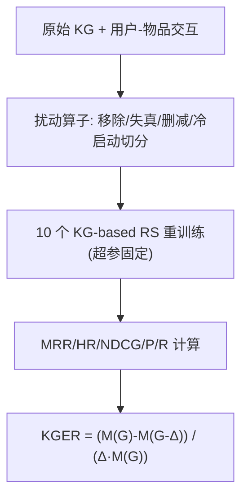
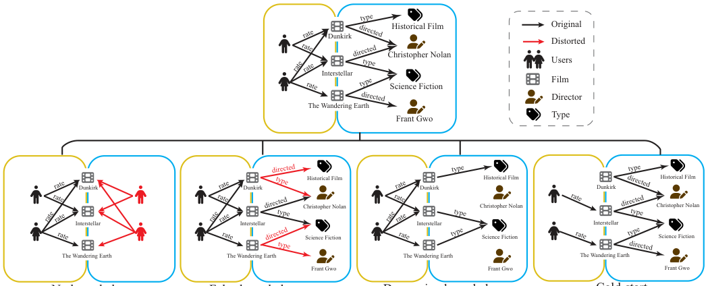

# KG4RecEval: Does Knowledge Graph Really Matter for Recommender Systems? (知识图谱对推荐系统真的重要吗？)

- **会议/期刊**: ACM Transactions on Information Systems (TOIS)
- **作者与机构**: Haonan Zhang, Dongxia Wang, Zhu Sun, Yanhui Li, Youcheng Sun, Huizhi Liang, Wenhai Wang（浙江大学 / SUTD / 曼彻斯特大学 / 纽卡斯尔大学）
- **推荐链路定位**: 召回/精排（KG 增强表征学习）的**评测与可信性分析**
- **研究方向**: 图神经网络与知识图谱推荐 / 去偏公平与工业评测
- **论文原文**: [https://arxiv.org/abs/2404.03164v2](https://arxiv.org/abs/2404.03164v2)
- **开源代码**: [https://github.com/HotBento/KG4RecEval](https://github.com/HotBento/KG4RecEval)

## TL;DR (1分钟核心速览)

本文质疑"KG 必然提升推荐精度"这一领域共识，提出评测框架 KG4RecEval 与指标 KGER（KG 在推荐中的利用效率），在 4 个数据集、10 个 SOTA KG-based RS 上系统施加"完全移除 / 随机失真 / 随机删减 / 冷启动"四类知识扰动。核心发现反直觉：把 KG 降级为纯用户-物品交互图、甚至随机扭曲 100% 事实，MRR 大多只在 87%–102% 区间波动，最高值常出现在被破坏的 KG 上；KGER 大量为负，说明现有模型对 KG 的利用效率远低于宣称。

## Background & Motivation (背景与核心矛盾)

- **主流范式**: KG-based RS（CFKG、CKE、KGCN、KGIN、RippleNet、KGAT、KGRec 等）将物品链接到 KG 实体，通过嵌入/路径/传播聚合邻居知识，普遍报告"引入 KG 后精度提升"，并被当作冷启动与稀疏性的解法。
- **前人局限**: ①现有工作只做"加 KG vs 不加 KG"的对比，但 KG 与推荐过程高度耦合，无法干净剥离，难以判断增益究竟来自 KG 还是模型容量/超参；②缺少对"知识质量"（真伪、多少）的受控实验，无法回答 KG 到底被利用了多少。
- **核心洞察 (Key Insight)**: 若 KG 真被有效利用，则知识被移除、失真或删减时精度应单调下降。作者据此设计可操作的扰动算子，把"KG 贡献"转化为可测量的因果式差分。
- **本文切入点**: 用"破坏知识 → 观察精度变化"的反证法，配合归一化指标 KGER，量化 KG 的真实边际贡献，并区分正常用户与冷启动用户。

## Method (核心方法设计)

### 1. 整体框架 (Overall Architecture)

KG4RecEval 不改动任何推荐模型结构，而是在 RecBole 统一环境下对输入 KG 施加四类可控扰动，再以 KGER 度量精度差分。关键工程技巧是：为每个不应被删的实体补一条无语义的占位自环事实 `<e, self_to_self, e>`，从而在删实体/删关系时**不触发 RecBole 对交互数据的级联过滤**，保证唯一变量是 KG。四类扰动分别对应 RQ1（无 KG）、RQ2（假知识）、RQ3（少知识）、RQ4（冷启动），RQ5 则比较"真实性"与"数量"哪个影响更大。

<figure class="paper-figure" markdown="span">
  <figcaption>图 1. 我们的评估设计示意图。为便于展示，我们以 ML-1M 中的 KG 为例。五个图均由两个方框组成，左侧（黄色）方框表示用户-物品交互，右侧（蓝色）方框表示关于电影的 KG。顶部的 KG 表示原始 KG，而无知识/错误知识/递减知识实验中的 KG 表示不同的设置。例如，在错误设置中，Dunkirk 的导演被认为是 Historical Film，这显然是错误的。而在递减设置中，The Wandering Earth 由……执导这一事实</figcaption>
</figure>

### 2. 关键设计拆解 (Key Designs)

1. **KGER 知识利用效率指标**：痛点是原始精度差不可跨数据集/模型比较。作者定义归一化差分
$\mathrm{KGER}(S,G,M,\Delta)=\frac{M(S,G)-M(S,G-\Delta)}{\Delta\cdot M(S,G)}$其中$S$为模型、$G$为 KG、$M$为评价指标（默认 MRR）、$\Delta$为知识削减比例。正值表示 KG 有正贡献，负值表示破坏 KG 反而更好，$|\mathrm{KGER}|$表示影响强度。除以$\Delta$与$M(S,G)$使不同扰动幅度、不同基线精度的结果可比；附录另给不除$\Delta$ 的 KGUS，结论一致。

2. **三类扰动算子（移除 / 失真 / 删减）**：移除用 Interaction KG（仅 `<u,interact,i>` 双向事实）与 Self KG（仅自环）两种降级方式；失真对任意事实 $<e_h,r,e_t>$从节点集$V$与关系集$R$ 中**均匀随机**替换三元组，失真度 0–100%；删减分三档——删事实（保留头尾实体）、删实体（连带其所有边）、删关系（删该关系全部边）。随机而非对抗式扰动是关键设计，避免退化为攻击/鲁棒性研究，保证结论反映"平均利用效率"而非最坏情况。

3. **冷启动协议与训练设置**：随机抽 10% 交互数 >25 的用户，每人仅保留 $T\in\{1,3,5\}$ 条交互入训练集、其余入测试集，模拟新用户。所有模型超参在原始 KG 上经 HyperOPT 网格搜索确定，扰动后**不重调**（附录 B 验证重调影响极小）；MRR 连续 50 epoch 不升即早停，5 次重复取均值。

## Experimental Setup & Evaluation Protocol (实验设置与评估协议)

- **数据集与预处理**:

| 数据集 | #Users | #Items | #Interactions | #Entity | #Relation | #Fact | 稀疏度 |
| :--- | :---: | :---: | :---: | :---: | :---: | :---: | :---: |
| ML-1M | 6,038 | 3,498 | 573,637 | 77,798 | 49 | 378,151 | 97.284% |
| Amazon-Books | 20,474 | 4,553 | 253,726 | 12,553 | 19 | 46,522 | 99.727% |
| BX | 17,860 | 14,910 | 69,873 | 77,903 | 25 | 151,500 | 99.974% |
| Last.FM | 1,872 | 3,846 | 21,173 | 9,366 | 60 | 15,518 | 99.706% |

  ML-1M 保留评分 ≥4；Amazon-Books 保留评分 ≥4 并采用 `20-core`；BX/Last.FM 沿用 RippleNet/KGCN 发布版本。KG 由 KB4Rec（ML-1M、Amazon-Books）与原文发布版（BX、Last.FM）构建。

- **数据划分与防穿越**: 随机按 `0.8 : 0.1 : 0.1` 比例划分训练/验证/测试（非时间切分，存在轻度未来信息泄漏风险，但四个数据集统一处理保证横向可比）。
- **排名评测协议**: `Sampled Ranking`——每个测试正样本均匀采样 **50 个未交互负样本**（正负比 1:50），报告 MRR、Hit@10、NDCG@10、Precision@10、Recall@10；KGER 默认以 MRR 计算。
- **对比基线与超参**: 10 个 SOTA，嵌入类 CFKG/CKE/KTUP/KGRec/DiffKG，传播类 KGCN/KGIN/RippleNet/KGNNLS/KGAT；超参网格见原文表 3/4，早停耐心 50 epoch，5 次运行取均值。

## Key Experimental Results (实验关键数据)

### 1. 主实验对比 (Main Results)

RQ1（无 KG）下各模型 MRR 与 KGER（括号内，负值表示移除 KG 反而更好）：

| 模型 | ML-1M Orig / Inter | Amazon Orig / Inter | BX Orig / Inter | Last.FM Orig / Inter |
| :--- | :---: | :---: | :---: | :---: |
| CFKG | 0.731 / **0.734** (-0.004) | 0.541 / **0.581** (-0.074) | 0.376 / **0.383** (-0.019) | 0.558 / **0.790** (-0.416) |
| CKE | 0.729 / **0.735** (-0.008) | 0.570 / **0.575** (-0.009) | 0.342 / **0.353** (-0.032) | **0.565** / 0.558 (0.012) |
| KGCN | **0.705** / 0.702 (0.004) | 0.533 / **0.537** (-0.008) | **0.340** / 0.322 (0.053) | **0.525** / 0.506 (0.036) |
| KGIN | **0.750** / 0.739 (0.015) | 0.548 / **0.551** (-0.005) | **0.349** / 0.282 (0.192) | **0.577** / 0.474 (0.179) |
| RippleNet | **0.707** / 0.669 (0.054) | 0.509 / **0.515** (-0.012) | 0.362 / **0.373** (-0.030) | **0.509** / 0.490 (0.037) |
| KGAT | 0.734 / **0.738** (-0.005) | 0.591 / **0.606** (-0.025) | 0.349 / **0.418** (-0.198) | 0.566 / **0.688** (-0.216) |
| KGRec | **0.672** / 0.533 (0.207) | 0.522 / **0.558** (-0.069) | **0.341** / 0.294 (0.139) | **0.538** / 0.537 (0.001) |
| DiffKG | 0.709 / 0.705 (0.006) | **0.591** / 0.586 (0.008) | **0.380** / 0.361 (0.049) | **0.598** / 0.578 (0.032) |

RQ2/RQ3 的 KGER（失真 F / 删减 D，比例 0.5，正常用户）显示大量负值：KGAT 在 BX 上 F=0.084 但 D=-0.053，DiffKG 在 ML-1M 上 F=-0.008、D=-0.024，KGRec 在 ML-1M 上 F=-0.020。冷启动下 KGER 波动范围扩大到 $[-1.89, 0.882]$，远大于正常用户的$[-0.02, 0.156]$ 量级。

### 2. 消融实验 (Ablation Study)

原文无传统模块消融，其"消融"即扰动梯度实验，此处汇总关键扰动幅度下的 MRR 相对变化：

| 扰动设置 | 幅度 | 典型模型 MRR 变化 | 结论 |
| :--- | :---: | :--- | :--- |
| 失真（RQ2） | 0→100% | 除 KGIN 外均在 87.01%–101.62% 波动 | 假知识不必然降精度 |
| 删事实（RQ3） | 0→100% | CKE/CFKG/KGCN/KGNNLS/KGAT/DiffKG 在 94.33%–102.86% 波动 | 少知识不必然降精度 |
| 删实体 vs 删事实 | 比例 <0.5 | 删实体影响更强 | 删一实体连带删多条边 |
| 冷启动 + 失真 | $T=3$ | BX 上 RippleNet 全失真反升 7.3%；Amazon 上 CFKG 降 25% | 数据集依赖极强 |
| 真实性 vs 数量（RQ5） | 比例 0.5 | 正常用户 $|KGER|$ 失真高 0.079；冷启动删减高 0.021 | 正常看真伪，冷启动看数量 |

### 3. 关键实验发现 (Key Findings)

1. **KG 的边际贡献常为负或近零**：ML-1M 上 10 个模型中 6 个在 Interaction/Self KG 下表现持平或更好；CFKG 在四个数据集上 Interaction KG 平均 KGER 为 $-0.171$，说明其"用 KG"实为负担。
2. **利用效率与数据集密度强相关**：最稠密的 ML-1M 上多数模型 $|KGER|$ 最小（图 12 红/绿柱最低），即交互越充分、KG 越被边缘化；稀疏数据集（BX、Last.FM）上 KG 影响更大但方向不定。
3. **冷启动并非 KG 的救命稻草**：冷启动下 $|KGER|$普遍大于正常用户（如 KGNNLS 在 Last.FM 上 D=$-1.588$、RippleNet D=$-1.890$），KG 影响被放大但常为负——模型更易被假知识误导，与"KG 缓解冷启动"的叙事相悖。

## Highlights & Limitations (亮点、对比与审稿批判)

- **与代表作对比 (vs. Prior Work)**: 相比 CFKG/KGAT 等"报告增益"的工作，本文首次做受控反证；相比攻击类研究（如 Zhang 等的事实可信度打分、Wu 等的 Q-learning 事实筛选），本文用**均匀随机**扰动而非对抗构造，度量的是平均利用效率而非最坏鲁棒性；相比 Kelpie 等链接预测解释框架，本文面向推荐精度且覆盖 10 个模型、4 个域。
- **可迁移亮点**: ①占位自环事实技巧可复用于任何"改 KG 但不能动交互数据"的受控实验；②KGER 的归一化差分范式可直接迁移到社交网络、多模态特征等其它侧信息的贡献度量。
- **审稿级局限批判**: ①采用 1:50 采样排序而非 Full-Ranking，负样本分布可能放大或掩盖 KG 效应，且随机 0.8/0.1/0.1 划分存在时间泄漏；②扰动后不重调超参虽经附录验证影响小，但对超参敏感的传播类模型（KGIN、RippleNet）结论稳健性存疑；③仅覆盖静态 KG 与 10 个模型，未涉及 LLM/KG 融合或动态 KG 场景。

## Rating (四维评分)

- **方法创新性 (Novelty)**: ⭐⭐⭐⭐ （反证式评测范式 + KGER 归一化指标新颖，但本质是评测框架而非新模型）
- **评估协议与实验扎实度 (Protocol & Experiments)**: ⭐⭐⭐⭐ （4 数据集 × 10 模型 × 4 类扰动 × 5 次重复极为充分，扣分在采样排序与随机划分）
- **写作与数学规范度 (Clarity & Rigor)**: ⭐⭐⭐⭐ （KGER 定义与扰动算子清晰，RQ 驱动结构严谨；部分图表信息密度过高）
- **工业落地与复现价值 (Industrial & Practical Value)**: ⭐⭐⭐⭐⭐ （代码开源、基于 RecBole 即插即用，直接警示工业界"别盲信 KG 增益"，并给出注意力筛选路径、保留有向边等可操作建议）

