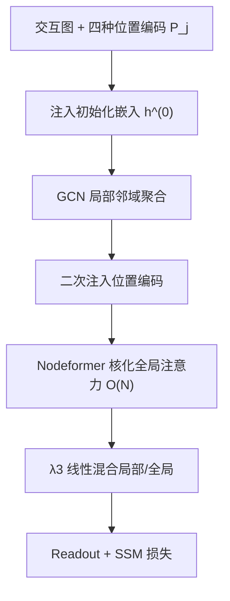
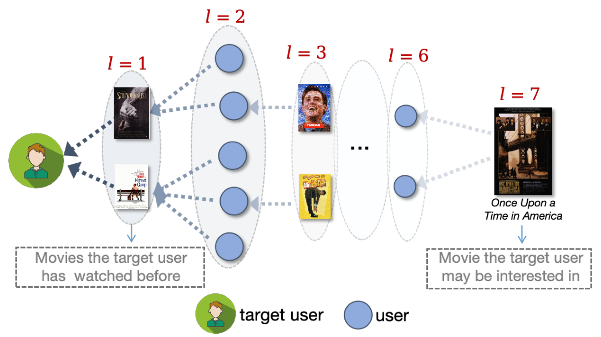

# Position-aware Graph Transformer for Recommendation (面向推荐的位置感知图 Transformer)

- **会议/期刊**: TOIS 2025
- **作者与机构**: Jiajia Chen, Jiancan Wu, Jiawei Chen, Chongming Gao, Yong Li, Xiang Wang（中科大、合肥国家科学中心数据空间研究院、浙大、清华）
- **推荐链路定位**: 召回（协同过滤表征学习）
- **研究方向**: 图神经网络与知识图谱推荐 / 协同过滤与双塔召回
- **论文原文**: [论文原文链接](https://arxiv.org/abs/2412.18731v1)
- **开源代码**: 暂未开源

## TL;DR (1分钟核心速览)

GCN 推荐器受 over-smoothing / over-squashing 限制，只能聚合 2–3 跳邻居，无法捕获图 1 所示"七跳之外"的长程协同信号。本文提出模型无关的 PGTR 框架：为交互图定制谱编码、度编码、PageRank 编码、类型编码四种位置编码，注入 Nodeformer 核化全局注意力，再与 GCN 局部邻域特征线性混合。在 4 个数据集、2:8 稀疏划分下，套用于 NGCF/GCCF/LightGCN/UltraGCN 四种骨干均稳定提升，UltraGCN-PGTR 在 Douban-book 上 Recall@20 相对提升 27.69%。

## Background & Motivation (背景与核心矛盾)

- **主流范式**: NGCF/LightGCN/UltraGCN 通过交互图上的递归邻域聚合编码高阶连通性，是协同过滤的 SOTA 范式。
- **前人局限**: ① 受 over-smoothing 与 over-squashing 制约，有效感受野仅 2–3 跳，低度节点难以被充分建模；② 单纯加深层数会把图中噪声一并传播，损害推荐质量。
- **核心洞察 (Key Insight)**: 图 Transformer 在节点分类中已被证明能突破 GCN 的长程建模瓶颈，其关键在于位置编码；但现有 Graphormer 式编码（最短路径、中心性）是为同质图设计，未考虑推荐图"二部异质 + 幂律度分布 + 无侧信息 + 高稀疏"的特性。
- **本文切入点**: 不改动 GCN 骨干，而是设计四种面向用户-物品交互图的位置编码，把全局注意力作为"长程信号补丁"叠加到任意 GCN 模型上。

## Method (核心方法设计)

### 1. 整体框架 (Overall Architecture)

PGTR 以任意 GCN 推荐器为骨干：先由四种位置编码拼出节点位置向量 $\mathbf{P}_j$，按$\mathbf{h}_j^{(0)}=\mathbf{e}_j^{(0)}+\lambda_1\mathbf{P}_j$注入初始化嵌入；每层先经 GCN 聚合局部邻域得$\tilde{\mathbf{h}}_j^{(l+1)}$，再二次注入位置信息$\hat{\mathbf{h}}_j^{(l)}=\tilde{\mathbf{h}}_j^{(l+1)}+\lambda_2\mathbf{P}_j$后送入 Nodeformer 核化全局注意力得到$\bar{\mathbf{h}}_j^{(l+1)}$，最后按$\lambda_3$ 线性混合局部与全局表征，经 readout 与 SSM 损失训练。

<figure class="paper-figure" markdown="span">
  <figcaption>图 1. 电影推荐中长程协同信号的一个示例，其中目标用户可能对用户-物品图中相距七跳的电影《美国往事》感兴趣。节点之间的虚线表示用户-物品交互。</figcaption>
</figure>

### 2. 关键设计拆解 (Key Designs)

1. **四路定制位置编码（Spectral / Degree / PageRank / Type）**：痛点在于通用 GT 编码不区分用户-物品二部结构与幂律度分布。谱编码在交互图、用户侧二阶图、物品侧二阶图上分别做 Laplacian 特征分解并融合 $\mathbf{P}_C=(1-\lambda_C)\mathbf{P}_{C0}+\lambda_C\mathbf{P}_{C1}$，同时刻画"跨类型相对位置"与"同类用户/物品间关系"；度编码与 PageRank 编码不做逐值嵌入，而是排序后均匀分桶$N_d$、$N_r$ 组再查表，避免长尾度值无法建立近邻关联；类型编码仅用两个可学习向量区分用户/物品。直觉：分桶把"数值接近"转成"语义同类"，让注意力在稀疏图上仍能找到结构相似的节点。

2. **Nodeformer 核化全局注意力 + 位置二次注入**：全图 $O(T^2)$注意力在百万级节点上不可行，故采用随机特征映射$\phi(\mathbf{x})=\frac{\exp(-\|\mathbf{x}\|^2/2)}{\sqrt{m}}[\exp(\mathbf{w}_1^\top\mathbf{x}),\dots,\exp(\mathbf{w}_m^\top\mathbf{x})]$ 将注意力改写为线性复杂度核化消息传递：
$\left(\bar{\mathbf{h}}_j^{(l+1)}\right)^\top\approx\frac{\phi(\mathbf{W}_Q\hat{\mathbf{h}}_j^{(l)})^\top\sum_{v}\phi(\mathbf{W}_K\hat{\mathbf{h}}_v^{(l)})\cdot(\mathbf{W}_V\hat{\mathbf{h}}_v^{(l)})^\top}{\phi(\mathbf{W}_Q\hat{\mathbf{h}}_j^{(l)})^\top\sum_{t}\phi(\mathbf{W}_K\hat{\mathbf{h}}_t^{(l)})}$。
关键细节是位置编码在进入注意力前**再次注入**（式 20），否则全局注意力退化为无结构感知的全连接层。

3. **局部-全局混合与训练目标**：$\mathbf{h}_j^{(l+1)}=(1-\lambda_3)\tilde{\mathbf{h}}_j^{(l+1)}+\lambda_3\bar{\mathbf{h}}_j^{(l+1)}$，$\lambda_3$过小则长程信号不足、过大则引入全局噪声（图 8 呈倒 U 型）。训练用 Sampled Softmax 损失$\mathcal{L}_{SSM}=-\frac{1}{|\mathcal{D}|}\sum_{(u,i)\in\mathcal{D}}\log\frac{\exp(f(u,i))}{\exp(f(u,i))+\sum_{j\in\mathcal{N}}\exp(f(u,j))}$，负样本采用 in-batch 负采样；新增可训练参数仅$O(2(N_dH_D+N_rH_R+H_Y)+d(H_C+H_D+H_R+H_Y+2d))$，远小于嵌入表$O((N+M)d)$。

## Experimental Setup & Evaluation Protocol (实验设置与评估协议)

- **数据集与预处理**: 四个公开数据集，密度极低（0.062%–0.272%），未提及 k-core 过滤：

| 数据集 | #Users | #Items | #Interactions | 密度 | 场景说明 |
| :--- | :---: | :---: | :---: | :---: | :--- |
| Amazon-elec | 1,435 | 1,522 | 35,931 | 0.062% | 电商，极小规模 |
| Douban-book | 13,024 | 22,347 | 792,062 | 0.272% | 图书评分 |
| LastFM | 23,566 | 48,123 | 3,034,763 | 0.268% | 音乐社交 |
| Amazon-book | 52,643 | 91,599 | 2,984,108 | 0.062% | 大规模电商 |

- **数据划分与防穿越 (Splitting Strategy)**: 比例划分，主实验采用训练:测试 = 2:8 的极端稀疏设定；训练集内再取 20% 作验证集调参；稀疏鲁棒性实验额外扫描 20%/40%/60%/80% 训练比例。
- **排名评测协议 (Ranking Protocol)**: 报告 Recall@20 与 NDCG@20；原文未显式声明候选集构造方式，从指标量级（Recall 约 0.02–0.14）判断为**采样排序**而非全库 Full-Ranking，复现时需注意该协议差异。
- **对比基线与超参设置**: 基线含 MF、NGCF、GCCF、LightGCN、UltraGCN 及自监督类 EGLN/SGL/SimGCL/LightGCL/GFormer；统一嵌入维度 $d=32$、GCN 层数 2、Adam 优化器，batch size 除 Amazon-elec 为 64 外均为 2048；$H_C$默认 50，$H_D/H_R/H_Y$默认 4，分桶数$N_d=N_r=10$，$\lambda_C,\lambda_1,\lambda_2\in\{0,1\}$，温度$\tau$ 粗搜于 0.02–1.2。原文未报告显著性检验。

## Key Experimental Results (实验关键数据)

### 1. 主实验对比 (Main Results)

训练:测试 = 2:8，Recall@20 / NDCG@20：

| Model | Amazon-elec R / N | Douban-book R / N | LastFM R / N | Amazon-book R / N |
| :--- | :---: | :---: | :---: | :---: |
| MF | 0.0296 / 0.0410 | 0.0487 / 0.0837 | 0.0478 / 0.1054 | 0.0191 / 0.0361 |
| NGCF | 0.0684 / 0.0921 | 0.0735 / 0.1164 | 0.0263 / 0.0654 | 0.0141 / 0.0286 |
| LightGCN | 0.0330 / 0.0485 | 0.0677 / 0.1278 | 0.0535 / 0.1215 | 0.0250 / 0.0472 |
| UltraGCN | 0.0781 / 0.0955 | 0.1123 / 0.1966 | 0.0612 / 0.1361 | 0.0212 / 0.0398 |
| SGL | 0.0355 / 0.0465 | 0.0804 / 0.1490 | 0.0551 / 0.1235 | 0.0260 / 0.0463 |
| SimGCL | 0.0381 / 0.0510 | 0.0809 / 0.1517 | 0.0540 / 0.1221 | 0.0245 / 0.0432 |
| GFormer | 0.0761 / 0.1055 | 0.0781 / 0.1468 | 0.0577 / 0.1238 | 0.0258 / 0.0489 |
| NGCF-PGTR | 0.0802 / 0.1084 | 0.0909 / 0.1558 | 0.0616 / 0.1394 | 0.0274 / 0.0506 |
| LightGCN-PGTR | **0.0811** / **0.1103** | 0.0899 / 0.1536 | 0.0610 / 0.1360 | **0.0290** / **0.0521** |
| UltraGCN-PGTR | 0.0809 / 0.1087 | **0.1434** / **0.2287** | **0.0629** / **0.1395** | 0.0216 / 0.0404 |
| Improv.% | +3.84% / +4.55% | +27.69% / +16.33% | +2.78% / +2.50% | +11.54% / +6.54% |

### 2. 消融实验 (Ablation Study)

位置编码逐项移除（Amazon-elec / Douban-book，Recall@20，据图 7 趋势整理）：

| 变体 | Amazon-elec | Douban-book | 说明 |
| :--- | :---: | :---: | :--- |
| Full PGTR | 最高 | 最高 | 四编码齐全 |
| w/o Spectral (-PL) | 下降 | 下降最显著 | 谱编码在 Douban-book 上贡献最大 |
| w/o Degree (-DG) | 下降 | 下降 | 流行度/活跃度分组信息有效 |
| w/o PageRank (-PR) | 下降 | 下降 | 全局影响力信号有效 |
| w/o Type (-TP) | 下降 | 下降 | 二部异质性区分有效 |
| w/o All | 显著下降 | 显著下降 | 位置编码整体不可或缺 |

SSM 损失对照（Recall@20）：LightGCN 0.0330 → LightGCN-SSM 0.0613 → LightGCN-PGTR 0.0811（Amazon-elec）；NGCF 0.0263 → NGCF-SSM 0.0587 → NGCF-PGTR 0.0616（LastFM），说明增益并非仅来自损失函数替换。

### 3. 关键实验发现 (Key Findings)

1. **增益在极稀疏场景最大**：Douban-book 上 UltraGCN-PGTR 相对 UltraGCN 提升 27.69% Recall，而 LastFM 仅 2.78%，印证全局注意力主要补偿低度节点的长程信号缺失；同时 SimGCL 在 Amazon-book 上（0.0245）反低于 LightGCN（0.0250），说明纯局部自监督在极端稀疏下会过拟合。
2. **噪声鲁棒性来自位置编码的判别力**：注入 10%/20%/30% 随机噪声后，LightGCN 性能跌幅最大，SGL/GFormer 次之，PGTR 跌幅最小——多种位置信息共同充当了交互真伪的判别依据。
3. **$\lambda_3$呈倒 U 型且收敛更快**：$\lambda_3$ 过小长程信号不足、过大引入全局噪声；效率上单轮训练约为 LightGCN 的 5 倍，但因收敛轮数更少（LastFM 76 vs 256 轮），总训练时长仅 1.2 倍（LastFM）与 2.9 倍（Amazon-book），NGCF-PGTR 在 LastFM 上总时长甚至短于 NGCF。

## Highlights & Limitations (亮点、对比与审稿批判)

- **与代表作对比 (vs. Prior Work)**: 与 GFormer 相比，PGTR 不依赖锚点采样距离，而是四路编码 + 全节点对全局注意力，Amazon-elec 上 Recall 0.0811 vs 0.0761；与 LightGCL/EGLN 等对比学习路线相比，PGTR 不构造增广图、不做 SVD 主成分截断，避免了阈值敏感与信号丢失；与 UltraGCN 的隐式超高阶近邻约束相比，PGTR 是显式的全局注意力建模，二者可叠加（UltraGCN-PGTR）。
- **可迁移亮点**: ① 度/PageRank 的"排序分桶 + 查表"编码可直接迁移到任何幂律分布的 ID 特征工程；② 位置编码在注意力前后两次注入的 trick，可低成本改造现有 GNN 骨干。
- **审稿级局限批判**: ① 单轮训练开销约 5 倍，Amazon-book 总时长 2.9 倍，工业级千万节点图上核化注意力的显存与吞吐仍是硬约束；② 评测仅用 Recall/NDCG@20 且疑似采样排序，缺少全库排序与显著性检验，Douban-book 上 UltraGCN-PGTR 的 27.69% 提升幅度异常突出，需警惕骨干与编码的耦合调参效应；③ 谱编码需预分解 Laplacian，图更新时需重算，动态场景适配性未讨论。

## Rating (四维评分)

- **方法创新性 (Novelty)**: ⭐⭐⭐⭐ （首次系统地把四类推荐定制位置编码引入 Graph Transformer，思路清晰但组件多为已有技术的组合迁移）
- **评估协议与实验扎实度 (Protocol & Experiments)**: ⭐⭐⭐ （四数据集 + 四骨干 + 稀疏/噪声鲁棒性较全面，但缺全库排序协议与显著性检验，部分结论仅以图呈现）
- **写作与数学规范度 (Clarity & Rigor)**: ⭐⭐⭐⭐ （公式与算法伪代码完整、复杂度分析到位，但符号偶有笔误、部分超参搜索描述较粗）
- **工业落地与复现价值 (Industrial & Practical Value)**: ⭐⭐⭐ （模型无关、易插拔是最大卖点，但 5 倍单轮开销与未开源削弱了直接落地与复现信心）

