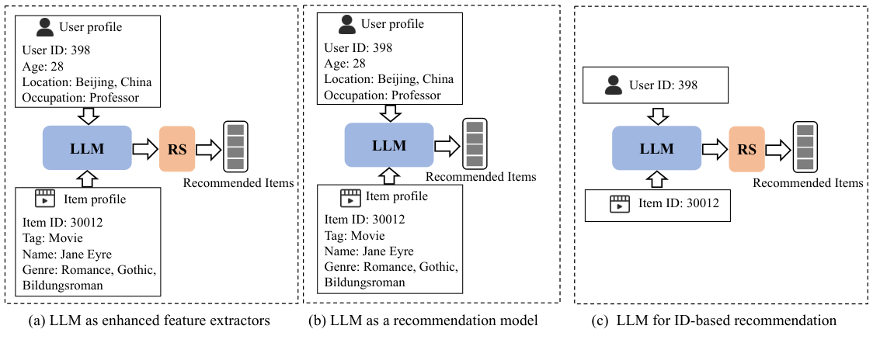
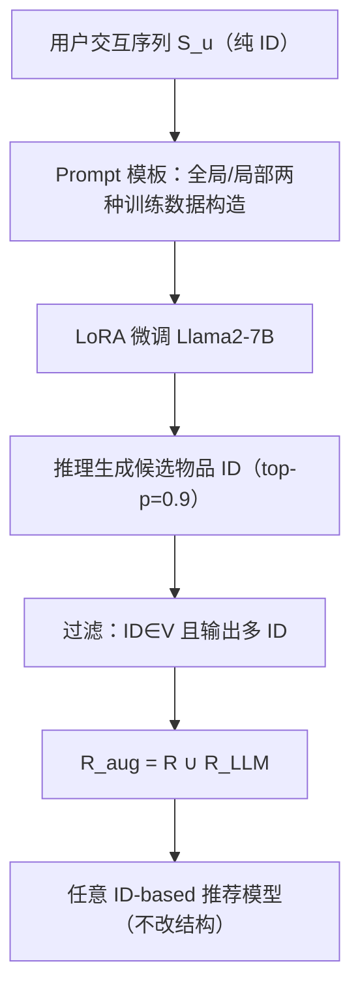

# Enhancing ID-based Recommendation with Large Language Models (用大语言模型增强纯 ID 推荐)

- **会议/期刊**: TOIS 2025
- **作者与机构**: Lei Chen, Chen Gao, Depeng Jin, Yong Li (清华大学), Xiaoyi Du, Hengliang Luo (美团), Meng Wang (合肥工业大学)
- **推荐链路定位**: 召回（数据增强层，模型无关）
- **研究方向**: 大语言模型推荐 / 协同过滤
- **论文原文**: [论文原文链接](https://arxiv.org/abs/2411.02041v1)
- **开源代码**: 暂未开源

## TL;DR (1分钟核心速览)

现有 LLM4Rec 几乎全部依赖物品标题、画像等**文本侧信息**，而工业界大量 ID-based 推荐场景只有纯 ID 交互矩阵。本文提出 LLM4IDRec：把用户 ID 与交互物品 ID 序列套入定制 prompt 模板，用 LoRA 微调 Llama2-7B 使其"续写"用户可能点击的物品 ID，经合法性 + 多 ID 双重过滤后与原始交互合并为增强数据 $R_{aug}$，**不改动任何推荐模型结构**即可注入 BPR/SimGCL/SASRec 等。在 Yelp、Amazon-kindle、Amazon-beauty 三个数据集、Full-Ranking 协议下，仅注入 0.48%–12.7% 的生成数据即带来平均 3%（非序列）与约 9%（序列）的相对提升。

## Background & Motivation (背景与核心矛盾)

- **主流范式**: LLM 进入推荐系统有两条路——(a) LLM 作特征提取器，从用户/物品文本画像抽取语义表征喂给推荐模型；(b) LLM 直接作推荐器，输入文本 prompt 输出推荐列表。二者共同前提是**存在文本描述**。
- **前人局限**: ① 在 ID-based 推荐（如 GCN 协同过滤、序列推荐）中，用户与物品仅有唯一 ID，无标题、无标签、无画像，上述两类范式**直接失效**；② 已有工作（如 P5、CID+IID）虽处理 ID 序列，但本质是把 ID 映射为语义 token 做生成式推荐，并未回答"LLM 能否真正理解纯数字 ID 背后的协同结构"。
- **核心洞察 (Key Insight)**: 作者提出一个可证伪的判据——**若 LLM 生成的 ID 数据能提升推荐性能，则说明 LLM 确实理解了 ID 数据与推荐任务**；反之若生成随机噪声，性能必然下降。这把"LLM 是否懂 ID"从哲学问题转化为可测量的数据增强实验。
- **本文切入点**: 不做新推荐模型，而是把 LLM 当作**离线数据增强器**，用"生成数据是否有用"反向验证 LLM 对 ID 的建模能力。

<figure class="paper-figure" markdown="span">
  <figcaption>图 1. 在推荐系统（RS）中比较 LLM 不同结构的示例。图 1(a) 和 (b) 展示了当前将 LLM 融入推荐模型的方法。两种方法均利用文本数据作为输入，例如用户和物品画像。然而，在基于 ID 的推荐场景中，仅能获得 ID 数据，不包含任何文本信息。针对仅依赖 ID 数据的推荐场景，我们研究了将 LLM 应用于基于 ID 的推荐，如图 1(c) 所示。</figcaption>
</figure>

## Method (核心方法设计)

### 1. 整体框架 (Overall Architecture)

两阶段范式：**阶段一（LLM 数据生成）** 将每个用户的交互序列 $S_u$通过 prompt 模板转成"给定用户 ID 与已点击物品 ID 列表，预测推荐物品 ID"的文本对，用 LoRA 微调 Llama2-7B；推理时以完整序列为输入，top-p 采样生成候选物品 ID，经两道过滤得到$R_{LLM}$。**阶段二（推荐模型）** 将$R_{aug}=R\cup R_{LLM}$ 直接喂入现成 ID-based 模型（BPR/SimGCL/NCL/XSimGCL/SASRec/BERT4Rec/CL4SRec），模型代码零改动。

### 2. 关键设计拆解 (Key Designs)

1. **ID 序列的 Prompt 化与全局/局部双视角训练数据构造**：LLM 无法直接吃 ID 矩阵，需转成"语言"。模板固定为 `Input: Given the user(f_ID(u))'s clicked list items: ..., predict what are items to recommend... Output: f_ID(v_i)`。关键增量在于**两种构造策略**：*Fully generating* 把完整 $S_u$填入，让 LLM 学用户**全局偏好**；*Randomly generating* 从$S_u$ 随机采样定长子序列填入、输出仍为被留出的目标物品，让 LLM 学**局部行为关联**。二者互补覆盖长尾与短序列用户，是纯 ID 场景下唯一可用的"数据增广"来源。

2. **LoRA 微调目标与"个性化约束"设计**：全参微调 7B 模型代价过高，采用 LoRA 仅训练低秩旁路。训练目标为标准的下一 token 似然：
$$\max_{\Theta}\sum_{u\in U}\sum_{(S_u,\hat{S}_u^n)}\sum_{i=1}^{n}\log P_{\Theta_{LLM}+\Theta_{LoRA}}\big(S_u^{sub}\mid S_u-S_u^{sub}\big)$$
其中 $S_u^{sub}$是被挖空的物品子集。**物理直觉**：由于 prompt 中显式写入用户 ID，且输出被约束在$S_u$ 内部，模型被迫学习"同一子序列在不同用户下应续写不同物品"的个性化映射，而非退化为全局热门 ID 复读。

3. **双重过滤与推理效率**：LLM 输出天然含随机噪声，设计两道过滤——① 输出 ID 必须属于物品全集 $V$（剔除幻觉 ID）；② 仅保留**输出多个 ID** 的样本（实测只输出单个 ID 多为随机猜测）。最终$R_{LLM}$ 占比极小（Yelp 0.88%、kindle 0.48%、beauty 12.70%），推理为一次性离线批量生成，在线服务零额外开销。

## Experimental Setup & Evaluation Protocol (实验设置与评估协议)

- **数据集与预处理**（过滤阈值：交互数 < 10 的用户/物品剔除）：

| 数据集 | #Users | #Items | #Interactions | 密度 | 场景说明 |
| :--- | :---: | :---: | :---: | :---: | :--- |
| Yelp | 31,668 | 38,048 | 1,561,406 | 0.130% | 非序列协同过滤 |
| Amazon-kindle | 138,333 | 98,572 | 1,909,965 | 0.014% | 非序列、极稀疏 |
| Amazon-beauty | 22,363 | 12,092 | 198,502 | 0.07% | 序列推荐 |

- **数据划分与防穿越**: Yelp/kindle 为**比例划分**（非序列）；Amazon-beauty 采用 `Leave-One-Out`，最后两次交互分别作验证/测试集。
- **排名评测协议**: 无偏 **Full-Ranking**——测试用户全部未交互物品作负样本，模型对全库打分排序，报告 Recall@{10,20,50} 与 NDCG@{10,20,50}。
- **对比基线与超参**: 非序列组 BPR / SimGCL / NCL / XSimGCL / P5；序列组 SASRec / BERT4Rec / CL4SRec / P5 / CID+IID。所有模型 embedding 维度统一 $d=64$，5 个随机种子取均值。LLM 侧 Llama2-7B + LoRA，最大长度 2048，学习率 1e-3，训练 ≤400 步，推理 top_p=0.9。

## Key Experimental Results (实验关键数据)

### 1. 主实验对比 (Main Results)

**Yelp（非序列，注入 0.88% 数据）**

| Model | R@10 | N@10 | R@20 | N@20 | R@50 | N@50 |
| :--- | :---: | :---: | :---: | :---: | :---: | :---: |
| BPR | 0.02778 | 0.03106 | 0.04914 | 0.03946 | 0.09772 | 0.05788 |
| BPR+LLM4IDRec | **0.02879** | **0.03215** | **0.05111** | **0.04064** | **0.10113** | **0.05927** |
| SimGCL | 0.04218 | 0.04839 | 0.07137 | 0.05892 | 0.13569 | 0.08261 |
| SimGCL+LLM4IDRec | **0.04393** | **0.05019** | **0.07371** | **0.06089** | **0.13991** | **0.08533** |
| XSimGCL | 0.04249 | 0.04859 | 0.07234 | 0.05943 | 0.13864 | 0.08389 |
| XSimGCL+LLM4IDRec | **0.04411** | **0.05036** | **0.07394** | **0.06104** | **0.14075** | **0.08581** |
| P5 | 0.04286 | 0.04951 | 0.07307 | 0.06050 | 0.13974 | 0.08558 |
| P5+LLM4IDRec | **0.04428** | **0.05110** | **0.07556** | **0.06220** | **0.14395** | **0.08804** |
| Improv. | +3.3~4.2% | +3.2~3.9% | +2.2~4.0% | +2.6~3.3% | +1.5~3.5% | +2.3~3.3% |

**Amazon-beauty（序列，注入 12.70% 数据）**

| Model | R@10 | N@10 | R@20 | N@20 | R@50 | N@50 |
| :--- | :---: | :---: | :---: | :---: | :---: | :---: |
| SASRec | 0.04991 | 0.03284 | 0.06771 | 0.03834 | 0.10637 | 0.04926 |
| SASRec+LLM4IDRec | **0.05446** | **0.03798** | **0.07271** | **0.04257** | **0.11439** | **0.05080** |
| BERT4Rec | 0.03510 | 0.01461 | 0.06055 | 0.02099 | 0.10897 | 0.03055 |
| BERT4Rec+LLM4IDRec | **0.03839** | **0.01705** | **0.06544** | **0.02385** | **0.12008** | **0.03464** |
| CL4SRec | 0.05224 | 0.03222 | 0.07268 | 0.03756 | 0.11326 | 0.04524 |
| CL4SRec+LLM4IDRec | **0.05455** | **0.03736** | **0.07642** | **0.04283** | **0.12360** | **0.05214** |
| CID+IID | 0.05010 | 0.03295 | 0.06881 | 0.03966 | 0.10976 | 0.04988 |
| CID+IID+LLM4IDRec | **0.05334** | **0.03645** | **0.07251** | **0.04355** | **0.11771** | **0.05549** |
| Improv. | +4.4~9.4% | +10.6~16.7% | +5.2~8.1% | +9.8~14.0% | +7.2~10.2% | +3.1~15.3% |

（Amazon-kindle 趋势一致，BPR 上 R@10 提升达 6.88%，此处从略。）

### 2. 消融与对照实验 (Ablation & Control)

| 配置 | 效果 | 说明 |
| :--- | :---: | :--- |
| 原始数据 $R$ | 基线 | 各 backbone 原始性能 |
| $R_{aug}=R+R_{LLM}$（本文） | **全面提升** | 平均 +3%（非序列）/ +9%（序列） |
| $R+R_{SASRec}$（用 SASRec 生成） | **性能下降** | 传统模型生成数据引入噪声 |
| $R+R_{BPR}$（用 BPR 生成） | **性能下降** | 同上，验证 LLM 生成质量优势 |
| 生成数据量强制增减 | 性能下降 | 当前自然生成量已近最优，增减均引入噪声 |

### 3. 关键实验发现 (Key Findings)

1. **生成数据与测试集重叠极低却仍有效**：Yelp 上生成数据仅 23.06% 与测试集重合、kindle 22.93%、beauty **0%**，但性能仍显著提升——说明 LLM 生成的是"符合用户偏好但不同于真实测试样本"的**补充性协同信号**，而非简单记忆测试答案，这是本文最有力的机制证据。
2. **序列场景收益远大于非序列**：beauty 上 NDCG 平均提升约 13%、Recall 约 7.8%，显著高于 Yelp/kindle 的 3%——归因于 LLM 本身是序列建模器，对序列 ID 模式的捕捉能力天然强于 GCN 类协同过滤。
3. **NDCG 提升普遍高于 Recall 且 K 越小增益越大**：Yelp 上 NDCG@10 平均 +3.70% 而 NDCG@50 仅 +2.61%，说明增强数据主要改善**头部排序精度**而非扩大召回面；同时四个稀疏度分桶用户组均获提升，验证对冷用户同样有效。

## Highlights & Limitations (亮点、对比与审稿批判)

- **与代表作对比**: 相比 P5/CID+IID 把 ID 映射为语义 token 做**生成式推荐**，本文让 LLM 只做**离线数据增强**、推荐仍由成熟 ID 模型完成，规避了 LLM 推理延迟与幻觉直接暴露给用户的风险；相比 LLMRec 依赖文本画像，本文是首个在**零文本**条件下验证 LLM 建模 ID 能力的工作。
- **可迁移亮点**: ① "生成数据是否有用"作为 LLM 领域理解能力的**可证伪探针**，可迁移到任何缺乏文本模态的领域（如纯行为序列风控）；② 全局/局部双视角训练数据构造，可直接复用于序列增广。
- **审稿级局限批判**: ① 生成数据量**不可控**——作者自承未约束生成规模，强制增减均致性能下降，缺乏自适应控制机制；② 仅用 Llama2-7B 单一模型、三个中等规模数据集，未验证更大模型或工业亿级物品库下的 ID 幻觉率与生成成本；③ 过滤策略依赖"多 ID 输出"这一经验启发式，缺乏理论保证。

## Rating (四维评分)

- **方法创新性 (Novelty)**: ⭐⭐⭐⭐ （首次系统回答"LLM 能否理解纯 ID"，以数据增强作可证伪判据，思路巧妙但技术组件均为现成拼装）
- **评估协议与实验扎实度 (Protocol & Experiments)**: ⭐⭐⭐⭐ （三数据集 + Full-Ranking + 5 种子 + 稀疏度分桶 + 生成数据组成分析，但缺显著性检验与更大规模验证）
- **写作与数学规范度 (Clarity & Rigor)**: ⭐⭐⭐ （框架清晰、公式简洁，但部分符号如 $S_u^{sub}$ 定义略松，实验表格存在个别数值排版疑误）
- **工业落地与复现价值 (Industrial & Practical Value)**: ⭐⭐⭐⭐ （模型无关、在线零开销、离线一次性生成，落地门槛低；但未开源且生成成本与 ID 幻觉率未量化）

