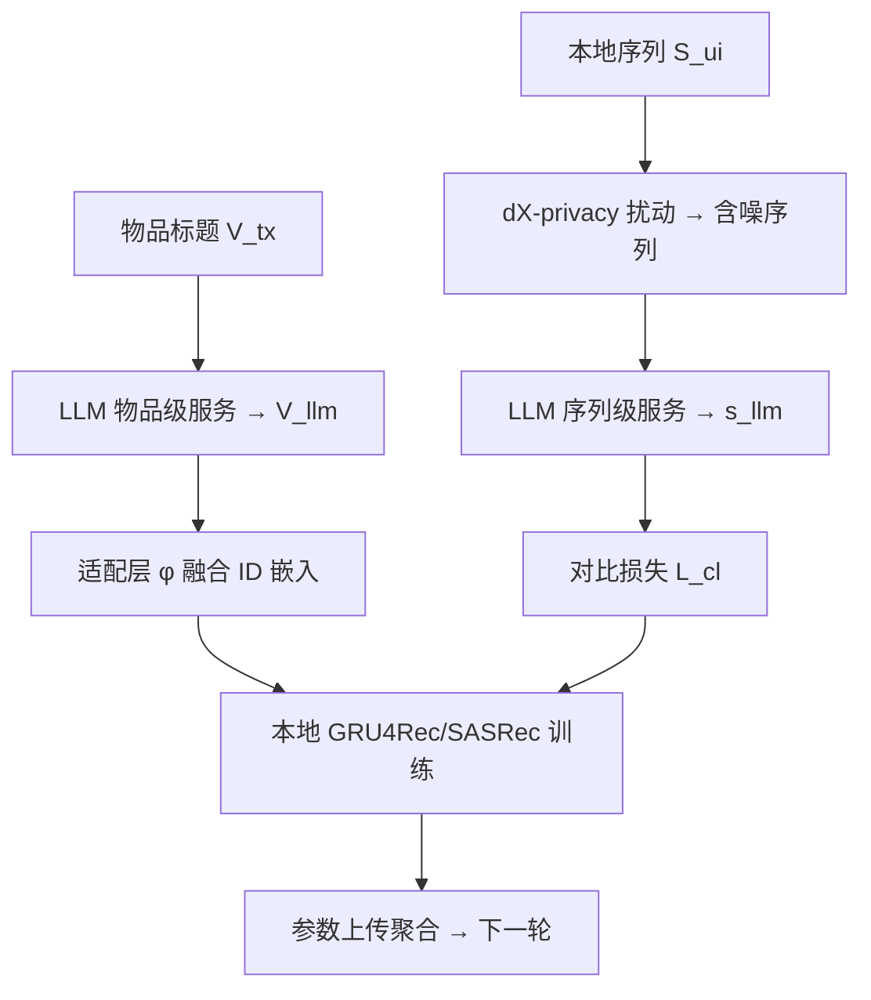

# FELLAS: Enhancing Federated Sequential Recommendation with LLM as External Services (以 LLM 为外部服务增强联邦序列推荐)

- **会议/期刊**: TOIS 2025
- **作者与机构**: Wei Yuan, Chaoqun Yang, Guanhua Ye, Tong Chen, Quoc Viet Hung Nguyen, Hongzhi Yin（昆士兰大学、格里菲斯大学、北京邮电大学）
- **推荐链路定位**: 召回（序列下一物品预测）
- **研究方向**: 大语言模型推荐 / 去偏公平、可信隐私与工业架构
- **论文原文**: [论文原文链接](https://arxiv.org/abs/2410.04927v2)
- **开源代码**: 暂未开源（实验基于 [Longformer](https://huggingface.co/allenai/longformer-base-4096) 等公开权重）

## TL;DR (1分钟核心速览)

联邦序列推荐（FedSeqRec）受通信带宽与端侧算力约束，只能部署极轻量模型，表征能力差、性能远逊集中式训练。本文提出 FELLAS：把预训练 LLM 当作**外部服务**，由中心服务器调用物品级文本嵌入、由客户端调用序列级嵌入，并用 $d_X$-privacy 扰动序列保护隐私、用对比学习把含噪序列表征迁移进本地小模型。在 Amazon 三数据集、Full-Ranking 协议下，FELLAS 使 GRU4Rec/SASRec 的 HR@20 相对 FedSeqRec 提升约 26%–93%，多数场景甚至超过集中式训练。

## Background & Motivation (背景与核心矛盾)

- **主流范式**: FedSeqRec 让用户在本地训练轻量序列模型（GRU4Rec/SASRec），仅上传参数由中心服务器聚合；近期工作尝试把 LLM 直接作为 FedSeqRec 的骨干并做 LoRA 微调。
- **前人局限**: 其一，LLM 骨干参数量巨大，即便高效微调仍带来通信开销暴涨，端侧 GPU/电量根本无法支撑训练与推理；其二，split training 虽缓解算力问题，却因每轮前向/反向都要传中间结果而使通信更糟。
- **核心洞察 (Key Insight)**: NLP 领域已证明"LLM 即服务"（调用 embedding API）能让简单下游模型获得强性能；而 FedSeqRec 的瓶颈恰恰是**表征能力**而非模型结构，因此无需把 LLM 搬上端侧，只需把 LLM 的表征"借"过来。
- **本文切入点**: 保持 FedSeqRec 原始训练协议不变，仅在旁路挂接 LLM 服务提供物品级与序列级嵌入，并用隐私扰动 + 对比学习解决"序列不能明文外传"这一关键障碍。

## Method (核心方法设计)

### 1. 整体框架 (Overall Architecture)

FELLAS 在原始 FedSeqRec 的黑盒流程外挂两个绿色服务模块：训练开始前，中心服务器把全部物品标题 $\mathcal{V}^{tx}$一次性发给 LLM 服务器，取回文本嵌入$\mathbf{V}^{llm}=\mathcal{F}^{llm}(\mathcal{V}^{tx})$，经适配层$\phi$对齐维度后与 ID 嵌入相加，得到增强的物品表下发给客户端；每轮训练中，客户端在本地对交互序列做$d_X$-privacy 扰动得到$\tilde{S}_{u_i}$，连同一条随机序列一起查询 LLM 序列服务，得到含噪序列向量$\mathbf{s}^{llm}_{u_i}$，再通过对比损失$\mathcal{L}_{cl}$将其知识蒸馏进本地序列模型；本地用$\mathcal{L}_{rec}+\alpha\mathcal{L}_{cl}$ 更新后照常上传参数聚合。推理阶段完全不调用 LLM，保持轻量模型的毫秒级响应。

### 2. 关键设计拆解 (Key Designs)

1. **物品级文本嵌入融合（Item-level Service）**：ID 嵌入在极稀疏交互下几乎学不动，本文用 LLM 编码物品标题补足语义。核心算子为 $\mathbf{V}\leftarrow\phi(\mathbf{V}^{llm})+\mathbf{V}$，即适配后残差相加。由于只传公开的物品元信息，该服务不引入任何隐私风险，且是一次性开销。

2. **$d_X$-privacy 序列扰动（Privacy-preserving Sequence Service）**：直接把序列发给第三方 LLM 会破坏联邦协议。本文对每个物品嵌入加噪$\bar{\mathbf{v}}^{llm,t}=\mathbf{v}^{llm,t}+\mathbf{z}$，其中$\mathbf{z}$采样自密度$\exp(-\epsilon\|\mathbf{z}\|)$的分布，再在物品库中取最近邻回填：$\tilde{v}_t=\arg\max_{v\in\mathcal{V}}\text{sim}(\mathbf{v}^{llm},\bar{\mathbf{v}}^{llm,t})$。直觉是：噪声尺度由$1/\epsilon$控制，$\epsilon$ 越小替换物品语义漂移越远、隐私越强，但因替换发生在**语义空间**而非随机物品，序列仍保留可用的偏好结构——这是它优于随机替换的关键。

3. **对比增强与训练目标**：含噪序列向量不能直接当特征用，本文把它视为原序列的"对比视图"，用 InfoNCE 拉近本地序列向量 $\mathbf{s}_{u_i}$与其变换$\psi(\mathbf{s}^{llm}_{u_i})$、推远随机序列视图：$\mathcal{L}_{cl}=-\log\frac{\exp(\text{sim}(\mathbf{s}_{u_i},\psi(\mathbf{s}^{llm}_{u_i})))}{\exp(\text{sim}(\mathbf{s}_{u_i},\psi(\mathbf{s}^{llm}_{u_i})))+\sum_{s_j\in\mathcal{S}^{rd}}\exp(\text{sim}(\mathbf{s}_{u_i},\psi(\mathbf{s}^{llm}_j)))}$，最终$\mathcal{L}=\mathcal{L}_{rec}+\alpha\mathcal{L}_{cl}$。负样本仅取 1 条随机序列以控制开销；本地负采样比例为 1:1，无需额外难负样本挖掘。

## Experimental Setup & Evaluation Protocol (实验设置与评估协议)

- **数据集与预处理**: Amazon 三域，评分二值化为隐式反馈，按时间戳排序，最大序列长度 50。

| 数据集 | #Users | #Items | #Interactions | 密度 | 场景说明 |
| :--- | :---: | :---: | :---: | :---: | :--- |
| Beauty | 20,574 | 10,020 | 164,268 | 0.07% | 美妆，极稀疏 |
| Office | 4,619 | 1,939 | 42,268 | 0.47% | 办公用品 |
| PLG | 1,518 | 751 | 10,439 | 0.91% | 园艺，最稠密 |

- **数据划分与防穿越 (Splitting Strategy)**: 采用 `Leave-One-Out` 变体——每序列最后两个物品分别作验证与测试，其余训练。
- **排名评测协议 (Ranking Protocol)**: 无偏 `Full-Ranking`，对用户未交互的全物品集排序，指标 HR@10/20、NDCG@10/20；隐私侧用两种推断攻击的 F1 衡量。
- **对比基线与超参设置**: 基线为 GRU4Rec 与 SASRec 的集中式版、FedSeqRec 版，以及"直接用 LLM 推荐"（Stand. LLM）；嵌入维度仅 $d=8$，Adam 学习率 0.001，全局 20 轮、每轮 256 客户端、本地 5 epoch；默认 LLM 为 Longformer，$\epsilon$默认 0.01，$\alpha$在$\{1.0,0.1,0.01,0.001\}$ 中搜索。

## Key Experimental Results (实验关键数据)

### 1. 主实验对比 (Main Results)

| 模型 | 设置 | Beauty H@20 | Beauty N@20 | Office H@20 | Office N@20 | PLG H@20 | PLG N@20 |
| :--- | :---: | :---: | :---: | :---: | :---: | :---: | :---: |
| GRU4Rec | Stand. LLM | 0.00155 | 0.00050 | 0.00757 | 0.00264 | 0.01646 | 0.00630 |
| GRU4Rec | Cent. | 0.03455 | 0.01410 | 0.03875 | 0.01390 | 0.05204 | 0.01917 |
| GRU4Rec | Fed. | 0.02751 | 0.01073 | 0.02836 | 0.01037 | 0.04018 | 0.01480 |
| GRU4Rec | **Ours** | **0.03465** | **0.01410** | **0.05477** | **0.02095** | 0.04874 | 0.01867 |
| SASRec | Cent. | 0.03494 | 0.01439 | 0.02987 | 0.01010 | **0.05994** | **0.02152** |
| SASRec | Fed. | 0.03052 | 0.01088 | 0.01623 | 0.00545 | 0.05401 | 0.02021 |
| SASRec | **Ours** | **0.04009** | **0.01633** | **0.03810** | **0.01290** | 0.05665 | 0.02182 |
| SASRec | Improv. vs Fed. | +31.4% | +50.1% | +134.8% | +136.7% | +4.9% | +8.0% |

### 2. 消融实验 (Ablation Study)

| 配置 | Beauty H@20 | Office H@20 | PLG H@20 |
| :--- | :---: | :---: | :---: |
| FELLAS 完整 | **0.04009** | **0.03810** | **0.05665** |
| w/o SeqEmb | 0.03766 | 0.03550 | 0.05467 |
| w/o SeqEmb & ItemEmb | 0.03052 | 0.01623 | 0.05401 |

### 3. 关键实验发现 (Key Findings)

1. **序列级服务是主增益来源，物品级服务是"地基"**：去掉序列服务后三数据集 HR@20 分别降约 8%/7%/4%；但若连物品嵌入也去掉，Office 直接跌回 FedSeqRec 原值 0.01623（降幅 57%），说明物品级语义融合是序列对比学习能生效的前提。
2. **隐私-效用存在清晰可调的权衡**：当 $1/\epsilon=0.001$时 SIAUI 攻击 F1 高达 0.88–0.91（隐私几乎失效）；$1/\epsilon\ge 0.01$时两种攻击 F1 已接近随机替换基线（SIA 甚至为 0），而推荐性能仅小幅下降，故$1/\epsilon=0.01$ 是实用工作点。
3. **小模型 + LLM 服务优于大模型硬扛**：$d=8$ 的 FELLAS 在 Office 上追平 4 倍参数量的 FedSeqRec、在 PLG 上超过 2 倍参数量版本；Beauty 因密度仅 0.07%，单纯放大模型完全不涨点，而 FELLAS 仍能提升，证明增益来自外部语义而非容量。

## Highlights & Limitations (亮点、对比与审稿批判)

- **与代表作对比 (vs. Prior Work)**: 相比 Zhao et al. 把 LLM 作为 FedRec 骨干微调（通信与端侧算力不可行），FELLAS 完全不改联邦协议、推理零 LLM 开销；相比 FedPA 仅提供物品文本嵌入且面向联邦协同过滤，本文额外打通了"序列级"服务这一隐私敏感通道，并用扰动 + 对比学习使其可用。
- **可迁移亮点**: ①"语义空间加噪 + 最近邻回填"的扰动范式可迁移到任何需要向第三方 API 传序列的场景；②把外部大模型表征当作对比视图、用 InfoNCE 蒸馏进小模型的套路，可直接用于端侧推荐或冷启动表征增强。
- **审稿级局限批判**: ①隐私保证仅覆盖"查询外部 LLM"这一环，未讨论 LLM 服务器自身嵌入/IP 的泄露，也未与 FedSeqRec 内部防御做端到端联合评估；②序列服务需每轮（或定期）调用 LLM，客户端与外部服务的调用频次、时延与费用未量化，且 $\alpha$ 最优值在 Beauty(0.001) 与 Office/PLG(0.1) 间相差两个数量级，超参敏感、迁移成本高。

## Rating (四维评分)

- **方法创新性 (Novelty)**: ⭐⭐⭐⭐ （首次将"LLM 即服务"引入 FedSeqRec，语义空间扰动 + 对比蒸馏的组合有巧思，但单点技术均为已有组件的巧妙拼接）
- **评估协议与实验扎实度 (Protocol & Experiments)**: ⭐⭐⭐⭐ （三数据集 × 两骨干 × Full-Ranking 较规范，并自建两种攻击做隐私实证；但缺少与 FedPA 等 LLM+联邦基线的直接数值对比）
- **写作与数学规范度 (Clarity & Rigor)**: ⭐⭐⭐⭐ （$d_X$-privacy 给出定理与证明思路、算法伪码完整；但攻击威胁模型与效用评估的耦合分析略粗）
- **工业落地与复现价值 (Industrial & Practical Value)**: ⭐⭐⭐⭐ （推理零额外开销、通信增量极小，工程友好；但依赖第三方 LLM 服务的成本与合规性未量化，且未开源代码）

