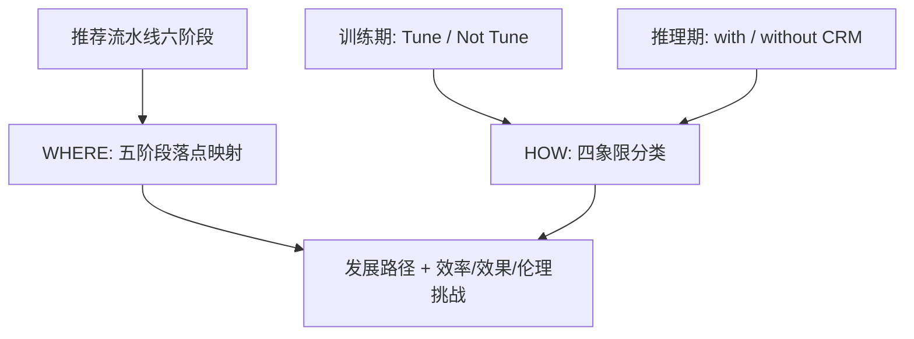

# How Can Recommender Systems Benefit from Large Language Models: A Survey (推荐系统如何从大语言模型中获益：综述)

- **会议/期刊**: ACM Transactions on Information Systems (TOIS)
- **作者与机构**: Jianghao Lin, Xinyi Dai, Yunjia Xi, Weinan Zhang, Ruiming Tang 等（上海交通大学 & 华为诺亚方舟实验室）
- **推荐链路定位**: 全链路（特征工程 / 特征编码 / 打分排序 / 用户交互 / 流程控制）
- **研究方向**: 大语言模型推荐 (LLM4Rec) / 生成式推荐
- **论文原文**: [论文原文链接](https://arxiv.org/abs/2306.05817v6)
- **开源代码**: [开源代码仓库链接](https://github.com/CHIANGEL/Awesome-LLM-for-RecSys)

## TL;DR (1分钟核心速览)

针对传统推荐模型（CRM）缺乏开放世界知识、难以理解用户深层动机且不可自然语言交互的两大痛点，本文并非提出单一模型，而是构建了一套**“WHERE × HOW”双正交分类体系**：WHERE 维度把 LLM 的落点拆为特征工程、特征编码器、打分/排序函数、用户交互、流程控制器五阶段；HOW 维度以“是否微调 LLM”与“推理是否依赖 CRM”划出四象限。作者据此梳理上百篇工作，并指出“领域协同知识注入”是 LLM4Rec 的性能黄金法则——冻结 LLM 且无 CRM 的零样本方案普遍劣于轻量 CRM。

## Background & Motivation (背景与核心矛盾)

- **主流范式**: 现代推荐系统是基于离散 ID 特征的多阶段级联流水线（数据收集→特征工程→特征编码→打分排序→用户交互→流程控制），以点击/购买等隐式反馈做数据驱动优化。
- **前人局限**: 其一，ID 域内建模缺乏开放世界知识与跨域迁移能力；其二，隐式反馈难以刻画用户真实意图，推荐不可解释，用户也无法用自然语言主动定制结果。
- **核心洞察 (Key Insight)**: LLM 以自然语言为通用信息载体，其开放世界知识、逻辑推理与指令遵循能力恰好可补足上述两点；但已有综述多聚焦单一环节（prompting、生成式推荐、可解释推荐），缺少覆盖工业全链路的“技术地图”。
- **本文切入点**: 以真实工业推荐流水线为坐标系，用 WHERE（落点）与 HOW（训练/推理策略）两个正交问题对现有工作进行系统归档，并提炼发展路径。

## Method (核心方法设计)

### 1. 整体框架 (Overall Architecture)

本文是综述，其“方法”即分类学本身。作者先把深度学习推荐系统抽象为六阶段信息循环（图 2），再将 LLM 的适配位置映射到其中五个可干预阶段（数据收集阶段因涉及真实线上行为而不纳入），形成 WHERE 分类；随后在训练/推理两个时相上引入两条正交判据——训练期是否更新 LLM 参数（Tune / Not Tune，含全参微调与 LoRA、Prompt Tuning 等 PEFT）、推理期是否引入 CRM（Infer with / without CRM）——交叉得到四象限 HOW 分类（图 4）。每个象限内再按 LLM 规模（<1B / 1B–10B / 10B–100B / >100B）与所击败的最佳基线（Random/Popularity/MF/MLP/Attention-based）标注发展趋势，最终在效率、效果、伦理三方面归纳挑战。

### 2. 关键设计拆解 (Key Designs)

1. **WHERE 五阶段落点分类（回答“LLM 该放在哪”）**：痛点在于 LLM 在推荐中的角色被笼统称为“增强”，无法指导工程选型。作者按流水线阶段细分：特征工程（用户/物品级特征增广、实例级样本合成）、特征编码器（表征增强、跨域统一）、打分/排序（物品打分、物品生成、混合任务）、用户交互（任务导向、开放式）、流程控制器（工具调用与多阶段调度）。其价值在于同一工作可跨阶段（如 CUP 同时用于特征工程与打分），分类粒度足以支撑“从哪一阶段切入改造”的工程决策。

2. **打分/排序的三种输出范式（回答“LLM 如何产出分数”）**：LLM 原生输出离散 token，而打分需连续实数，作者归纳三条改造路径——(a) 单塔：丢弃 LM Head，取末层表示 $\hat{y}=F(u,i)=\mathrm{MLP}(\boldsymbol{h})$；(b) 双塔：$\hat{y}=d(T_u(x_u),T_i(x_i))$ 以余弦/L2 度量用户-物品距离；(c) 保留解码头，对 Yes/No 关键答案词做二维 softmax：

$$\hat{y}=\frac{\exp(p_{\text{Yes}})}{\exp(p_{\text{Yes}})+\exp(p_{\text{No}})}\in(0,1)$$

该归纳的物理直觉是：单/双塔把 LLM 降格为语义编码器以换取效率，保留解码头则保留生成式先验但需精心设计答案词映射。

3. **物品生成的开集 vs 闭集权衡（回答“生成式推荐怎么落地”）**：开集生成 $[\hat{i}_k]_{k=1}^N\leftarrow \mathrm{LLM}(x_u)$后需$\mathrm{Match}(\cdot,\mathcal{I})$做实体对齐，否则产生生成幻觉；闭集生成先$\mathcal{C}\leftarrow \mathrm{Pre\text{-}filter}(u,\mathcal{I})$再$\mathrm{LLM}(u,\mathcal{C})$ 排序，幻觉可控但受限于上下文窗口（候选通常 <20）与检索器上限，且对候选顺序敏感（shuffle 会改变输出）。二者优劣互补，选型取决于物品文本与 LLM 语言分布的契合度。

4. **训练与推理效率策略**：十亿级以上 LLM 普遍采用 LoRA 等 PEFT（更新参数 <1%）；更激进的发现是 ReLLa 仅均匀采样 **<10%** 训练样本微调，即可超越在全量数据上训练的 CRM，体现 LLM 的强少样本归纳能力——这直接决定了工业部署的可行性边界。

## Experimental Setup & Evaluation Protocol (实验设置与评估协议)

- **本文性质**: 综述论文，无自建实验；其“评估协议”体现为对纳入工作的横向对比口径统一。
- **纳入与排除标准**: 聚焦“利用 LLM 预训练参数处理文本特征”的工作，**排除**仅把 NLP 预训练范式套用到纯 ID 模型的工作（如 BERT4Rec）；同时把 BERT、GPT2 等较小语言模型纳入讨论以呈现完整演进脉络。
- **对比口径**: 以各原文报告的最佳击败基线（Random / Popularity / MF / MLP / Attention-based）与 LLM 规模作为二维坐标，横向可比地刻画方法强度。
- **附录查表**: 附录 Table 1 给出每篇工作的 LLM 落点阶段、骨干模型、微调策略等结构化字段，便于复现检索。

## Key Experimental Results (实验关键数据)

### 1. 主实验对比 (Main Results)

综述无统一主表，以下为作者从各象限代表性工作中提炼的“象限级”对比结论（定性归纳，非同一数据集数值）：

| 象限 | 训练策略 | 推理是否用 CRM | 代表工作 | 典型 LLM 规模 | 击败的最佳基线 | 综合表现 |
| :--- | :--- | :---: | :--- | :---: | :--- | :--- |
| Q1 | Tune | 是 | CoLLM, E4SRec, CTRL | 6B–13B | Attention-based | **最优**，语义+协同双知识对齐 |
| Q2 | Not Tune | 是 | ZESRec, UniSRec, VQ-Rec, KAR | BERT 级 | Attention-based | 较优，冻结 LLM 作辅助 |
| Q3 | Not Tune | 否 | Chat-REC, RecMind, ReLLa(zero-shot) | >100B | MF | **次优**，零样本普遍弱于轻量 CRM |
| Q4 | Tune | 否 | TALLRec, P5, RecFormer, LlamaRec | 0.1B–7B | MLP / Attention | 中等，依赖 PEFT 与样本降采样 |

### 2. 消融实验 (Ablation Study)

综述本身无消融，作者以“象限内技术增量”替代，归纳关键组件的边际贡献：

| 技术增量 | 所属象限 | 观察到的效果变化 |
| :--- | :---: | :--- |
| 单层线性 adapter → MoE / VQ adapter | Q2 | 跨域表征对齐显著改善，从“不理想”升至可击败 Attention 基线 |
| 全参微调 → LoRA/PEFT | Q1/Q4 | 训练成本大幅下降，性能基本持平 |
| 全量训练样本 → <10% 采样微调 | Q4 | 仍可超越全量训练的 CRM（ReLLa） |
| 截断近邻行为 → 语义行为检索 | Q3 | 缓解“长行为序列不理解”问题，零样本性能提升 |
| 无工具 → 工具调用（SQL/搜索引擎） | Q3 | 缓解幻觉与知识时效问题，但仍不及 CRM |

### 3. 关键实验发现 (Key Findings)

1. **领域协同知识注入是黄金法则**：Q3（冻结 LLM、无 CRM）即便用 >100B 模型并辅以行为检索与工具调用，仍普遍劣于在训练数据上微调的轻量 CRM；LLM 的知识是全局事实性的，而推荐需要偏好导向的个性化知识，二者存在本质错配。
2. **“是否引入 CRM”比“LLM 多大”更决定成败**：Q1 与 Q2 在 LLM 规模仅 0.1B–13B 时即可击败 Attention 基线，而 Q3 即使规模破百亿也仅击败 MF，说明协同信号的接入优先级高于模型扩容。
3. **PEFT 与样本降采样共同解锁工业可行性**：LoRA 将可训练参数压至 <1%，ReLLa 进一步证明 <10% 样本微调即可超越全量训练的 CRM，二者叠加使十亿级 LLM 进入推荐训练预算的现实区间。

## Highlights & Limitations (亮点、对比与审稿批判)

- **与代表作对比 (vs. Prior Work)**: 相较 Wu et al.（按判别式/生成式与调优策略划分）、Fan et al.（按预训练/微调/提示划分），本文的差异在于以**工业全链路阶段**为第一坐标轴，并额外引入“推理是否依赖 CRM”这一工程判据，因而能解释“为何零样本大模型打不过小 CRM”这类既有综述未覆盖的现象。
- **可迁移亮点**: ①“WHERE×HOW”双轴归档法可直接迁移到多模态推荐、Agent 推荐等新兴方向的文献梳理；②开集/闭集生成的幻觉-上下文权衡分析，可作为生成式推荐系统选型的决策清单。
- **审稿级局限批判**: ①四象限归类依赖各原文自报的最佳基线，跨论文的实验设置（数据集、划分、负采样）不统一，象限间的强弱比较仅为趋势性而非严格可比；②对效率的讨论停留在定性层面，缺少对 LLM 推理延迟、显存占用与线上 QPS 约束的量化分析，工业落地指导性偏弱；③文献截止于 2023 年中后期，2024 年后的生成式检索与语义 ID 路线覆盖不足。

## Rating (四维评分)

- **方法创新性 (Novelty)**: ⭐⭐⭐⭐ （分类学贡献扎实，“WHERE×HOW”双正交视角与四象限发展轨迹具有原创组织力，但非算法层面创新）
- **评估协议与实验扎实度 (Protocol & Experiments)**: ⭐⭐⭐ （覆盖面广、附录查表详尽，但缺乏统一基准上的定量对比与统计显著性检验）
- **写作与数学规范度 (Clarity & Rigor)**: ⭐⭐⭐⭐ （五阶段与四象限定义清晰、公式归纳简洁，符号体系一致，适合作为入门地图）
- **工业落地与复现价值 (Industrial & Practical Value)**: ⭐⭐⭐⭐ （GitHub 仓库持续维护、附录结构化字段利于检索复现，但效率与部署成本分析偏定性）

