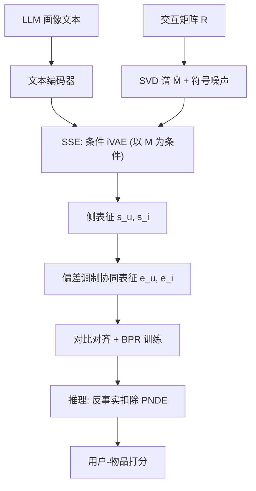

# Mitigating Propensity Bias of Large Language Models for Recommender Systems (缓解大语言模型推荐系统的倾向性偏差)

- **会议/期刊**: ACM Transactions on Information Systems (TOIS)
- **作者与机构**: Guixian Zhang, Guan Yuan, Debo Cheng, Lin Liu, Jiuyong Li, Shichao Zhang（中国矿业大学 / 南澳大学 UniSA / 广西师范大学）
- **推荐链路定位**: 召回（协同过滤表征增强，可插拔于任意 CF 骨干）
- **研究方向**: 大语言模型推荐 / 去偏与可信推荐
- **论文原文**: [https://arxiv.org/abs/2409.20052v2](https://arxiv.org/abs/2409.20052v2)
- **开源代码**: 暂未开源

## TL;DR (1分钟核心速览)

LLM 生成的用户/物品侧信息与协同信息做对比对齐时，会因 LLM 固有倾向性偏差（propensity bias）把表征压入低维子空间，引发**维度坍缩**，反而削弱推荐效果。本文提出 CLLMR：用**谱条件 iVAE 编码器 (SSE)** 把交互矩阵 SVD 谱作为观测条件注入侧信息编码，保证表征可辨识性；再用**反事实推断**在推理阶段扣除倾向性偏差的纯自然直接效应。在 Amazon/Yelp/Steam 三数据集、6 个 CF 骨干、全库排序协议下，Recall@10 最高相对提升 9.33%，NDCG@10 最高提升 12.80%。

## Background & Motivation (背景与核心矛盾)

- **主流范式**: 用 LLM 生成用户/物品画像文本，经文本编码器投影后，通过对比学习（RLMGen）或掩码重构（RLMCon）与 GNN 协同表征对齐，以缓解交互稀疏。
- **前人局限**: ① LLM 语料偏差导致画像"过度泛化"——如图 1 中用户 5596 偏好惊悚刺激类书籍，LLM 却笼统概括为"entertaining"，丢失个体细节；② 侧信息缺乏交互结构信息，与协同表征对齐时极易坍缩到低维子空间（图 2 奇异值谱低且平坦），使模型丧失区分能力。
- **核心洞察 (Key Insight)**: 倾向性偏差需二分——**与用户/物品相关的偏差**承载真实世界知识（应保留），**无关偏差**才是同质化与坍缩的元凶；且坍缩一旦发生，反事实推断也因无法区分细微特征而失效，二者必须联合解决。
- **本文切入点**: 用交互谱作为条件先验"隐式注入结构"防坍缩，再用因果图把无关偏差建模为中介变量并做反事实扣除。

## Method (核心方法设计)

### 1. 整体框架 (Overall Architecture)

训练阶段：ChatGPT-3.5 依据物品档案生成物品描述，再据用户历史物品描述推理用户画像，经文本编码器得 $\hat{\mathbf{s}}_u,\hat{\mathbf{s}}_i$；SSE 以交互矩阵 SVD 谱$\hat{M}$（加噪得$M$）为条件，将侧信息编码为可辨识低维表征$\mathbf{s}_u,\mathbf{s}_i$；随后与受倾向性偏差调制的协同表征$\mathbf{e}_u=\sigma(f_O(\mathbf{s}_u))\odot\hat{\mathbf{e}}_u$ 做对比对齐，并与 BPR 损失联合优化。推理阶段切换到反事实世界，按式 (21)(22) 扣除 PNDE 后打分。

### 2. 关键设计拆解 (Key Designs)

1. **谱条件侧信息编码器 SSE（防维度坍缩）**：痛点是对齐时侧表征缺乏结构、坍缩为低秩。做法是把交互谱当作 iVAE 的观测条件，构建条件生成模型 $p_\theta(X,Z|M)=p_f(X|Z)p_{T,\lambda}(Z|M)$，其中条件先验取指数族（高斯）形式$p_{T,\lambda}(Z|M)=\prod_i Q_i(z_i)\exp[\sum_j T_{i,j}(z_i)\lambda_{i,j}(m_i)]/N_i(m_i)$，以 ELBO 训练。谱条件迫使各隐维捕获独立变化因子，从而保持奇异值谱"高且分散"，从根源上避免低秩坍缩。

2. **谱噪声注入（提升泛化）**：误点击使原始谱过拟合，故加符号对齐噪声 $M=\hat{M}+\Delta,\ \Delta=\omega\odot\mathrm{sign}(\hat{M})$，$\omega\sim U(0,1)$。sign 保证扰动不改变原嵌入方向，仅做幅度扰动，兼顾鲁棒性与方向稳定性。

3. **反事实去偏推理（消除无关倾向偏差）**：构建因果图 $S\to O\to U$、$T\to P\to I$（$O,P$为倾向偏差中介）。总效应$TE(U_j)=U_j(s,O_j(s))-U_j(s^*,O_j(s^*))$，纯自然直接效应$PNDE(U_j)=U_j(s,O_j(s^*))-U_j(s^*,O_j(s^*))$，二者相减得$TE-PNDE=U_j(s,O_j(s))-U_j(s,O_j(s^*))$，即只保留经中介传递的偏差路径并予以扣除；推理时$\tilde{\mathbf{e}}_u=\mathbf{e}_u-\alpha\sigma(f_O(\mathbf{s}_u))$。

4. **训练目标与开销**：总损失 $\mathcal{L}=\mathcal{L}_a+\mathcal{L}_R$，其中对齐损失$\mathcal{L}_a$为 InfoNCE 形式（式 19），$\mathcal{L}_R$ 为 BPR（式 20）；负采样为标准均匀负采样。SSE 仅需一次 SVD 与轻量 VAE 前向，推理阶段只多一次 MLP 打分，开销可忽略。

## Experimental Setup & Evaluation Protocol (实验设置与评估协议)

- **数据集与预处理**（Amazon/Yelp 过滤评分 < 3 的交互）：

| 数据集 | #Users | #Items | #Interactions | 密度 | 场景说明 |
| :--- | :---: | :---: | :---: | :---: | :--- |
| Amazon | 11,000 | 9,332 | 120,464 | 1.2e-3 | 图书评论 |
| Yelp | 11,091 | 11,010 | 166,620 | 1.4e-3 | 本地商户文本 |
| Steam | 23,310 | 5,237 | 316,190 | 2.6e-3 | 游戏评论文本 |

- **数据划分与防穿越**: 按 3:1:1 比例划分训练/验证/测试（比例划分，非时间戳切分）。
- **排名评测协议**: 采用 `Full-Ranking` 全库未交互物品排序，指标 Recall@{10,30,50} 与 NDCG@{10,30,50}，5 次随机初始化取均值。
- **对比基线与超参**: 6 个 CF 骨干（LRGCCF、LightGCN、SGL、SimGCL、DirectAU、LightGCL）× 2 个 LLM 对齐基线（RLMGen 对比对齐、RLMCon 掩码重构）；嵌入维度统一 $d=32$，Adam，batch 4096，学习率 1e-3，早停；谱秩与噪声尺度网格搜索。

## Key Experimental Results (实验关键数据)

### 1. 主实验对比 (Main Results)

以最具代表性的 LightGCN 与 SGL 骨干为例（完整 6 骨干见原文表 4）：

| 骨干 | 方法 | Amazon R@10 | Amazon N@10 | Yelp R@10 | Yelp N@10 | Steam R@10 | Steam N@10 |
| :--- | :--- | :---: | :---: | :---: | :---: | :---: | :---: |
| LightGCN | Base | 0.08714 | 0.06682 | 0.06905 | 0.05699 | 0.08456 | 0.06808 |
| LightGCN | RLMGen | 0.09247 | 0.07159 | 0.07617 | 0.06220 | 0.09040 | 0.07251 |
| LightGCN | RLMCon | 0.09665 | 0.07313 | 0.07411 | 0.06088 | 0.08942 | 0.07243 |
| LightGCN | **CLLMR** | **0.09813** | **0.07357** | **0.07738** | **0.06331** | **0.09179** | **0.07396** |
| LightGCN | Improv. | +1.53% | +0.60% | +1.59% | +1.78% | +1.54% | +2.00% |
| SGL | Base | 0.10230 | 0.07742 | 0.07436 | 0.06099 | 0.09254 | 0.07451 |
| SGL | RLMGen | 0.10114 | 0.07778 | 0.07786 | 0.06391 | 0.09414 | 0.07513 |
| SGL | RLMCon | 0.10296 | 0.07859 | 0.07625 | 0.06234 | 0.09511 | 0.07601 |
| SGL | **CLLMR** | **0.10941** | **0.08083** | **0.08018** | **0.06521** | **0.09597** | **0.07712** |
| SGL | Improv. | +6.26% | +2.85% | +0.87% | +0.74% | +0.90% | +1.46% |

其余骨干上 CLLMR 亦全面最优：DirectAU 骨干 N@10 提升 12.80%（Amazon），SimGCL 骨干 R@10 提升 9.33%（Steam），LightGCL 骨干 N@10 提升 9.07%（Steam）。

### 2. 消融实验 (Ablation Study)

| 骨干 | 变体 | Amazon R@10 | Amazon N@10 | Yelp R@10 | Steam R@10 |
| :--- | :--- | :---: | :---: | :---: | :---: |
| LightGCN | CLLMR | **0.09813** | **0.07357** | **0.07738** | **0.09179** |
| LightGCN | w/o Conf. | 0.09500 (-3.19%) | 0.07138 (-2.98%) | 0.07327 (-5.31%) | 0.08868 (-3.39%) |
| LightGCN | w/o SSE | 0.09503 (-3.16%) | 0.07241 (-1.58%) | 0.07415 (-4.17%) | 0.08873 (-3.33%) |
| SGL | CLLMR | **0.10941** | **0.08083** | **0.08018** | **0.09597** |
| SGL | w/o Conf. | 0.09535 (-12.85%) | 0.07245 (-10.37%) | 0.07766 (-3.24%) | 0.09357 (-2.50%) |
| SGL | w/o SSE | 0.10188 (-6.88%) | 0.07830 (-3.13%) | 0.07688 (-4.21%) | 0.09452 (-1.51%) |
| LightGCL | w/o SSE | 0.08662 (-12.22%) | 0.06562 (-11.37%) | 0.06870 (-12.96%) | 0.08644 (-4.92%) |

### 3. 关键实验发现 (Key Findings)

1. **两模块存在强耦合，缺一不可**：单独保留反事实推断而移除 SSE（w/o SSE）时，性能甚至低于纯对比对齐基线（如 LightGCL 骨干 R@10 掉 12.22%），说明维度坍缩会使反事实推断失效——必须先保证表征可辨识，因果扣除才有意义。
2. **SSE 的收益在强对比骨干上更显著**：SGL 骨干 Amazon R@10 提升 6.26%、DirectAU 骨干 N@10 提升 12.80%，而对 LRGCCF 仅 1.15%，表明谱条件编码与对比学习框架天然互补（对比学习本身易坍缩，SSE 正好补位）。
3. **谱秩与噪声需与隐维匹配**：秩取 16/32/64 时，秩 = 隐维 32 最优（一一映射充分利用结构且不过拟合）；噪声尺度从 0.001 增至 0.01 性能单调上升，超过 0.1 后谱信息被覆盖、性能回落。

## Highlights & Limitations (亮点、对比与审稿批判)

- **与代表作对比 (vs. Prior Work)**: RLMGen/RLMCon 只做"对齐"而不管 LLM 偏差与表征几何，本文首次把倾向性偏差拆成"有用/无关"两类并给出因果识别方案；与 LightGCL 等谱增强方法相比，本文的谱不是用于图增广，而是作为 iVAE 的条件先验约束侧信息隐空间，目标不同。
- **可迁移亮点**: ① "SVD 谱 + 符号噪声"作为条件先验注入任意文本侧信息编码器，是低成本防坍缩的通用插件；② 推理期"减去 PNDE"的轻量去偏算子（仅一次 MLP + 线性扣减）可直接移植到其他 LLM 增强召回链路。
- **审稿级局限批判**: ① 因果识别依赖四个"无未观测混杂"强假设，实际推荐场景中曝光/流行度混杂几乎必然存在，论文未做敏感性分析；② 侧信息由 ChatGPT-3.5 离线生成且限 200 词，LLM 版本、prompt 与生成成本对结论的影响未评估；③ 提升幅度在部分骨干上仅 0.04%–0.6%，且未报告显著性检验，统计可靠性存疑。

## Rating (四维评分)

- **方法创新性 (Novelty)**: ⭐⭐⭐⭐ （谱条件 iVAE 防坍缩 + 因果中介扣除的组合较新颖，但 iVAE 与反事实推断均为已有工具的迁移拼接）
- **评估协议与实验扎实度 (Protocol & Experiments)**: ⭐⭐⭐⭐ （6 骨干 × 3 数据集 × 全库排序 + 奇异值谱可视化充分，但缺显著性检验与时间切分）
- **写作与数学规范度 (Clarity & Rigor)**: ⭐⭐⭐ （因果假设与 PNDE/TNIE 推导清晰，但式 (22) 将 $\tilde{\mathbf{e}}_i$误写为$\mathbf{e}_u$，且部分符号前后不一致）
- **工业落地与复现价值 (Industrial & Practical Value)**: ⭐⭐⭐⭐ （插件式设计、推理开销极低、易嵌入现有召回；但依赖离线 LLM 画像生成且未开源，复现成本中等）

