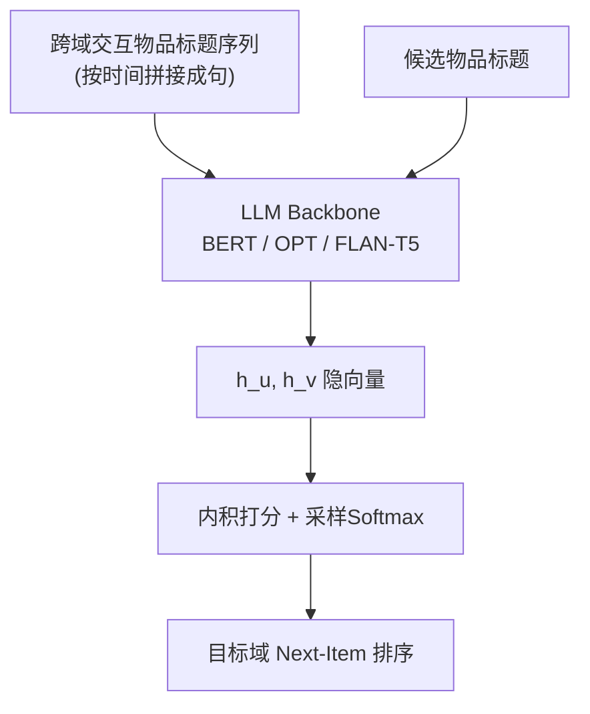
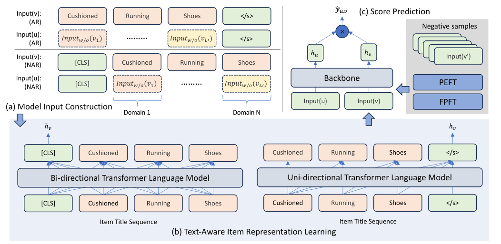

# One Model for All: Large Language Models are Domain-Agnostic Recommendation Systems (一模型通吃：大语言模型即域无关推荐系统)

- **会议/期刊**: ACM Transactions on Information Systems (TOIS)
- **作者与机构**: Zuoli Tang, Zihao Li, Lixin Zou, Chenliang Li (武汉大学) 等；Zhaoxin Huan, Xiaolu Zhang, Jun Hu, Chilin Fu, Jun Zhou (蚂蚁集团)
- **推荐链路定位**: 召回（序列式 next-item 检索）
- **研究方向**: 大语言模型推荐 / 跨域与多场景推荐
- **论文原文**: [https://arxiv.org/abs/2310.14304v2](https://arxiv.org/abs/2310.14304v2)
- **开源代码**: [https://github.com/WHUIR/LLMRec](https://github.com/WHUIR/LLMRec)

## TL;DR (1分钟核心速览)

针对多域序列推荐中 ID 表征无法跨域对齐语义、且成对跨域模型复杂度随域数呈 $O(N^2)$ 膨胀的痛点，本文提出 LLM-Rec：把用户跨域交互物品的**标题按时间拼成一句话**，直接交给预训练 LLM 编码出用户/物品向量并做内积打分，实现"一个模型服务所有域"。在 Amazon 五子域构建的 SPIAO 上，采用采样 1000 负例的排序评测，LLM-Rec 较最优基线 MAMDR 在 Recall@10 上相对提升约 19%（SPIAO 31.47 vs 26.37）。

## Background & Motivation (背景与核心矛盾)

- **主流范式**: 多域推荐分两派——图方法（BiTGCF、PPGN 建跨域统一图传播）与多任务方法（ADI、MAMDR 用 MMoE/PLE 式专家网络共享+域特异）。
- **前人局限**: 其一，成对跨域设计难以扩展，$N$个域需$C_N^2$ 个对比目标或连接度量，训练复杂度爆炸；其二，源域-目标域的单向假设只优化目标域，忽视源域收益。
- **核心洞察 (Key Insight)**: 作者用 SASRec 直接拼接多域 ID 序列做预实验（图 2），发现**简单合并多域行为不但无增益甚至掉点**——根因是 ID 是无语义的数字编码，无法承载可迁移信息；而 LLM 的世界知识（如"战争电影爱好者也读二战书籍"，图 1）天然可桥接跨域语义。
- **本文切入点**: 用物品标题替代 ID 作为唯一符号化载体，让 LLM 在 token 级语义空间完成跨域对齐，从而绕开任何显式跨域结构设计。

## Method (核心方法设计)

### 1. 整体框架 (Overall Architecture)

模型输入构造分两级：物品级把标题 token 化后加 `[CLS]`（双向/NAR）或 `</s>`（单向/AR）；用户级把该用户**所有域**交互物品的标题按时间线拼成一个长句（去掉各物品的首尾特殊符，仅保留句首/句尾一个）。用户句与物品句分别送入同一 LLM backbone，取最后一层 `[CLS]` 或 `</s>` 隐向量作为 $h_u, h_v \in \mathbb{R}^{1\times d}$，以内积$\tilde{y}_{u,v}=h_u h_v^{\top}$ 打分，采样 softmax 交叉熵训练。推理时对目标域候选物品逐一编码后内积排序。

<figure class="paper-figure" markdown="span">
  <figcaption>图3. 所提出的LLM-Rec的概览</figcaption>
</figure>

### 2. 关键设计拆解 (Key Designs)

1. **标题拼接的域无关用户句 (Domain-Agnostic User Sentence)**：痛点是用 ID 拼接多域序列时跨域物品无法语义对齐（图 2 已证伪）。本文改为把 $L'$个跨域物品标题串成$Input(u)=[[CLS], Input^{w/o}(v_1),\dots,Input^{w/o}(v_{L'})]$，让 LLM 的自注意力在 token 级直接建模"办公用品→文具→美术剪刀"这类跨域语义链。有效性直觉：语义相近的物品即使来自不同域也共享子词，注意力可自然建立关联，无需任何域标签或域对齐损失。
2. **统一编码器替代成对跨域结构**：用户编码器与物品编码器**共享同一 LLM**，域数从 $N$增至任意值都不增加任何模块或损失项，彻底消除$C_N^2$ 复杂度；同时所有域同时受益（非单向迁移），这是相对 C2DSR/MIFN 的本质简化。
3. **训练目标、负采样与推理效率**：损失为采样 softmax 交叉熵
$$\ell=\sum_{j=1}^{B}-\log\frac{\exp(\tilde{y}_{u_j,v_j})}{\exp(\tilde{y}_{u_j,v_j})+\sum_{v_{j'}\in\mathcal{S}}\exp(\tilde{y}_{u_j,v_{j'}})}$$
其中 $\mathcal{S}$为**同域随机采样**的$S$ 个负例（ID 模型与 UniSRec 取 64，MoRec/LLM-Rec 因显存取 10），无 in-batch 或难负例挖掘。推理侧开销是硬伤：batch=1 时 OPT-125M 单例 7.3ms、OPT-1.3B 17.3ms，而 SASRec 仅 1.1ms；序列长 25（约 650 token）时 100M 级模型编码约 3ms，1B 以上必须配加速策略。

## Experimental Setup & Evaluation Protocol (实验设置与评估协议)

- **数据集与预处理**: Amazon Reviews 五个子类构成五域，剔除无标题物品，`5-core` 过滤（用户跨域总交互≥5、物品出现≥5），合并后称 SPIAO：

| 数据集 | #Users | #Items | #Interactions | 说明 |
| :--- | :---: | :---: | :---: | :--- |
| Scientific | 142,139 | 14,586 | 329,123 | 单域 |
| Pantry | 55,890 | 6,224 | 208,791 | 单域 |
| Instruments | 88,249 | 14,626 | 348,513 | 单域 |
| Arts | 184,207 | 32,196 | 723,017 | 单域 |
| Office | 259,687 | 37,380 | 1,154,924 | 单域 |
| SPIAO | 310,136 | 105,012 | 2,764,368 | 五域混合，80%+ 用户跨≥2 域 |

- **数据划分与防穿越 (Splitting Strategy)**: `Leave-One-Out`——每用户最后一条测试、倒数第二条验证、其余训练；跨域序列按全局时间线排序，严格保证测试物品晚于历史。
- **排名评测协议 (Ranking Protocol)**: `Sampled Ranking`，每个目标物品从**同域**随机采 1000 个负例排序，指标 Recall@{1,10} 与 NDCG@10（N=1 时二者相等故省略 NDCG@1）。
- **对比基线与超参设置**: 8 个基线覆盖单域（GRU4Rec、SASRec、FEARec、LightGCN）、多域（ADI、BiTGCF+、MAMDR）、文本（UniSRec$_t$、MoRec）；backbone 取 BERT-110M / OPT-125M / FLAN-T5 约 110M 量级对齐比较；序列长 10、标题截断 40 token、batch 96、学习率 5e-5（BERT/OPT）与 3e-4（FLAN-T5），早停 10 轮。

## Key Experimental Results (实验关键数据)

### 1. 主实验对比 (Main Results)

SPIAO 混合集与代表性单域结果（%，加粗为最优）：

| 数据集/指标 | SASRec | MAMDR | UniSRec$_t$ | MoRec | BERT | FLAN-T5 | Improv.(vs 最优基线) |
| :--- | :---: | :---: | :---: | :---: | :---: | :---: | :---: |
| Scientific R@10 | 19.16 | 20.85 | 16.62 | 21.40 | **25.61** | 25.56 | +19.7% |
| Pantry R@10 | 15.18 | 16.53 | 15.16 | 16.41 | **20.42** | 20.00 | +23.5% |
| Instruments R@10 | 23.30 | 26.12 | 20.36 | 25.09 | **30.57** | 30.51 | +17.0% |
| Arts R@10 | 28.25 | 30.73 | 24.70 | 30.66 | 36.58 | **36.78** | +19.7% |
| Office R@10 | 25.14 | 27.41 | 23.64 | 26.58 | 32.58 | **32.74** | +19.4% |
| SPIAO R@10 | 24.13 | 26.37 | 21.93 | 25.95 | 31.47 | **31.55** | +19.6% |
| SPIAO N@10 | 15.78 | 16.97 | 14.18 | 15.76 | **20.27** | 20.09 | +19.4% |

### 2. 消融实验 (Ablation Study)

原文以"特征增删"形式做消融（Recall@10，%）：

| 变体 | Scientific | Pantry | Instruments | Arts | Office | SPIAO |
| :--- | :---: | :---: | :---: | :---: | :---: | :---: |
| OPT-125M LLM-Rec | 24.26 | 18.92 | 28.91 | 35.01 | 32.02 | 30.36 |
| + ID 前缀 | **25.17** | **21.11** | **30.33** | **36.38** | **32.83** | **31.50** |
| + Prompt | 23.94 | 18.88 | 28.88 | 34.40 | 31.43 | 29.90 |
| OPT-1.3B LLM-Rec | 25.06 | 19.15 | 29.16 | 35.48 | 32.15 | 30.69 |
| + ID 前缀 | **26.62** | **22.02** | **31.25** | **37.50** | **33.33** | **32.33** |
| + Prompt | 24.29 | 18.71 | 28.92 | 35.22 | 31.87 | 30.30 |

### 3. 关键实验发现 (Key Findings)

1. **跨域数据是主要增益来源，且混合粒度越细越好**：单域训练 < 域导向混合 S²PIAO < 用户导向混合 SPIAO（图 5）；在测试序列与目标域完全正交的 `Diff` 分组上，LLM-Rec 相对 SASRec 的 Recall@10 提升达 38.6%，显著高于 `Mix`(31.2%) 与 `Same`(25.9%)，直接证明 LLM 世界知识在做跨域语义桥接。
2. **LLM 主要靠"记忆"而非"理解"**：长尾 0-20% 物品上 40M 模型甚至不如 ID 模型，随规模增大才追平；曝光分析显示所有规模 LLM 仍存在明显 Matthew 效应（Head 0-1% 曝光约 77-81%），说明其依赖物品级协同过滤信号；但在零样本域 Food/Home 上曝光与频次几乎无关（Tail/Medium/Head 约 46%/27%/26%），语义能力可无偏迁移。
3. **"越大越好"在推荐中不成立，PEFT 在小模型上失效**：BERT 40M→110M 带来 10% 相对提升，但 110M→340M 仅 2-5%；OPT-125M 已近最优，6.7B 增益有限；LoRA($R=32$) 在 <1B 模型上大幅掉点（如 FLAN-T5-125M 仅 1.39 vs FPFT 8.38），1B 以上 OPT 才接近 FPFT，与 NLP 结论相反。

## Highlights & Limitations (亮点、对比与审稿批判)

- **与代表作对比 (vs. Prior Work)**: 相比 UniSRec/MoRec 的"先文本编码再序列模型"两阶段范式，LLM-Rec 让 LLM 直接吃用户整句、在 token 级捕捉物品间细粒度关联，故 MoRec 在 SPIAO 仅 25.95 而 LLM-Rec 达 31.55；相比 MAMDR/BiTGCF+ 的成对/多任务结构，本文零跨域模块、域数可无限扩展。
- **可迁移亮点**: ①"标题拼接成句 + 共享编码器"可作为冷启动/新域接入的零成本 baseline；②用曝光率分布 + 零样本域曝光作为"语义理解 vs 协同记忆"的诊断探针，方法论可复用到任何文本化推荐模型。
- **审稿级局限批判**: ①评测仅用 1000 负例采样排序，未做 Full-Ranking，且负例同域采样可能高估绝对指标；②推理延迟比 SASRec 高 7-16 倍，1B 以上模型需分布式训练（OPT-6.7B FPFT 单卡 OOM），工业落地成本未量化；③"LLM 靠记忆"的结论与标题"域无关语义系统"存在张力，且未与 ID+文本混合的强基线（如 +ID 变体已涨 1.1-1.6 点）做充分对照。

## Rating (四维评分)

- **方法创新性 (Novelty)**: ⭐⭐⭐⭐ （"标题拼句+共享 LLM"极简却有效，跨域复杂度从 $O(N^2)$降到$O(1)$，但机制本身偏工程直觉、缺理论刻画）
- **评估协议与实验扎实度 (Protocol & Experiments)**: ⭐⭐⭐ （五域+零样本域+规模/微调/成本多维分析很全面，但仅采样 1000 负例排序、无 Full-Ranking 与显著性检验）
- **写作与数学规范度 (Clarity & Rigor)**: ⭐⭐⭐⭐ （公式与输入构造定义清晰、Q1-Q3 问题驱动结构好，但 Transformer 基础章节占比偏大、部分图表坐标标注略乱）
- **工业落地与复现价值 (Industrial & Practical Value)**: ⭐⭐⭐ （代码开源、结论"100M 级模型即可"极具工程指导性，但 7-17ms 级延迟与 1B+ 训练成本对实时召回仍是硬约束）

