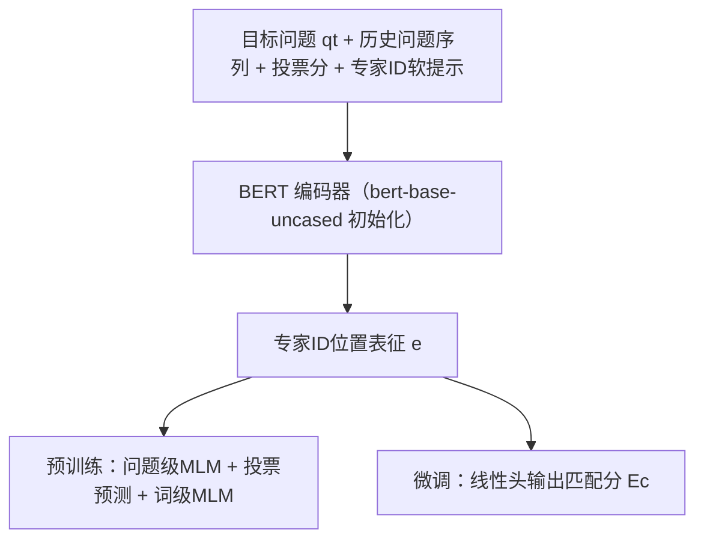
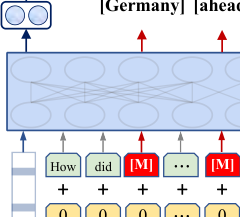

# PEPT: Expert Finding Meets Personalized Pre-training (专家发现遇上个性化预训练)

- **会议/期刊**: TOIS 2025（EMNLP 2022 会议版的扩展与修订）
- **作者与机构**: Qiyao Peng, Hongyan Xu, Yinghui Wang, Hongtao Liu, Cuiying Huo, Wenjun Wang（天津大学、北京控制与电子技术研究所、度小满科技、海南热带海洋学院）
- **推荐链路定位**: 召回（问题→专家路由）
- **研究方向**: 大语言模型推荐 / 冷启动与长尾推荐
- **论文原文**: [论文原文链接](https://arxiv.org/abs/2312.12162v2)
- **开源代码**: 暂未开源

## TL;DR (1分钟核心速览)

CQA 专家发现的核心痛点是：现有 PLM 方法把专家历史问题简单拼接，只学到词级文本表征，既丢失问题级兴趣，也无法刻画"专家能否答好某题"的专长差异，更忽略专家个性化。PEPT 提出个性化预训练范式：把"目标问题 + 历史问答 + 投票分 + 专家 ID 软提示"拼成候选感知的专家级输入单元，用问题级 MLM 与投票导向双任务预训练，再以同构输入直接微调打分。在 6 个 StackExchange 域上，20 候选专家排序协议下 MRR 相对最强基线 ExpertPLM 提升约 1.4%–3.4%，且数据稀疏与零样本场景优势更明显。

## Background & Motivation (背景与核心矛盾)

- **主流范式**: 早期用 CNN/HIN/注意力网络从历史回答学专家向量（NeRank、PMEF、EFHM）；近期转向 PLM 预训练（ExpertBert、ExpertPLM），在无标注 CQA 语料上先学专家/问题表征再微调。
- **前人局限**: ① 兴趣建模停留在词级——历史问题被直接拼接，无法捕捉"问题级"语义关联；② 专长建模缺失——同一专家在不同问题上得票可从 +26 到 −5，纯文本表征无法区分其答题能力；③ 个性化缺失——不同专家对同一问题的关注点不同，但现有方法不区分个体。
- **核心洞察 (Key Insight)**: 投票分是专长的天然弱监督信号，专家 ID 是个人化的天然标识；二者都可在预训练阶段注入，而无需等到下游监督数据。
- **本文切入点**: 把异构信息（历史问题、投票分、专家 ID、目标问题）统一进一个候选感知的输入单元，用多任务预训练同时学兴趣与专长，并让预训练与微调输入完全同构以消除 gap。

## Method (核心方法设计)

### 1. 整体框架 (Overall Architecture)

输入层将目标问题 $q_t$、专家历史问题序列$Q_i^u$（以 `[HSEP]` 分隔）、逐问题对齐的投票分嵌入、以及置于序列首位的专家 ID 软提示拼接为统一序列；经 BERT 编码后，专家 ID 位置的输出向量$e$ 作为专家级表征。预训练阶段同时优化三个任务：问题级 MLM（学兴趣）、投票导向任务（学专长）、标准词级 MLM（保语言知识）；微调阶段复用完全相同的输入构造，仅加一层线性头输出专家-问题匹配分，用负采样交叉熵优化。

<figure class="paper-figure" markdown="span">
  <figcaption>图 1. PEPT 个性化预训练框架。我们将异构信息统一到预训练模型中，为学习专家表示提供丰富信息。在预训练过程中，我们额外设计了问题级掩码语言模型和投票导向任务，以赋予模型捕捉专家兴趣和专长的能力。</figcaption>
</figure>

### 2. 关键设计拆解 (Key Designs)

1. **候选感知的专家级输入单元 + 投票分嵌入对齐**：痛点是把历史问题当纯文本拼接，模型看不到"专家面对此题"的语境。做法是把目标问题前置、历史问题用 `[HSEP]` 分隔，并将每个历史问题的投票分经嵌入矩阵映射为与问题 token 等长的向量矩阵 $R_v$，与文本表征逐位相加：$R_{in} = R_{token} + R_{seg} + R_{pos} + R_v$，目标问题位置用 `[PAD]` 占位待预测。直觉是让"答得好不好"的信号在 token 粒度上与"答了什么"对齐，模型才能学到领域内的专长差异。

2. **专家 ID 软提示（Soft Prompt）个性化**：直接把百万级专家 ID 加入词表会导致词表爆炸。PEPT 改为维护独立嵌入矩阵 $C^u \in \mathbb{R}^{M \times d}$，取$c_i^u = C^u f(i)$（$f(i)$ 为 one-hot），拼接到输入序列首位。这样 ID 不占词表、可端到端学习，且作为"个性化前缀"引导模型对不同专家产出不同表征。

3. **双粒度预训练任务与训练目标**：问题级 MLM 借鉴 SpanBERT，整段掩码某个历史问题的全部标题词，仅凭上下文问题预测，迫使模型建模问题间关联（兴趣）；投票导向任务用专家表征 $e$预测目标问题将获得的投票档位（专长）。总损失$\mathcal{L}_{pt} = \mathcal{L}_{ql} + \mathcal{L}_{vs} + \mathcal{L}_{wm}$。投票分先做"平移消负 + 对数压缩 + 归一化到 0–9 整数"以抑制长尾方差。微调时用$k=9$ 负采样 + 交叉熵，推理仅需一次前向，开销与单塔 BERT 打分持平。

## Experimental Setup & Evaluation Protocol (实验设置与评估协议)

- **数据集与预处理**: 预训练语料为 StackExchange 抽取的 326,781 条专家级输入；下游评测 6 个域，按历史回答记录构造，每专家对应其历史问题序列：

| 数据集 | #Questions | #Answerers | #Answers | 密度(%) | 平均标题长度 |
| :--- | :---: | :---: | :---: | :---: | :---: |
| English | 46,692 | 4,781 | 104,453 | 0.0468 | 9.68 |
| Gis | 50,718 | 3,168 | 70,034 | 0.0435 | 9.75 |
| CodeReview | 36,947 | 2,242 | 57,622 | 0.0696 | 7.27 |
| Es | 36,271 | 3,260 | 50,801 | 0.0429 | 10.05 |
| Biology | 8,704 | 630 | 11,411 | 0.2081 | 9.84 |
| Electronics | 56,614 | 3,084 | 102,214 | 0.0585 | 9.28 |

- **数据划分与防穿越**: 按时间顺序 80%/10%/10% 切分为训练/验证/测试；验证与测试集不参与预训练，属严格时间切分。
- **排名评测协议**: 采用 **Sampled Ranking**——候选集为"曾回答该问题的原始回答者 + 从回答者池补充"，共 20 人；以"被采纳答案"作者为唯一 ground truth。指标为 MRR、P@1、P@3、NDCG@20。训练负采样固定 9 个，各方法负样本数一致以保证公平。
- **对比基线与超参**: 神经基线 CNTN、NeRank、TCQR、RMRN、UserEmb、EFHM、PMEF；PLM 基线 ExpertBert、ExpertPLM。BERT-base（$d=768$），batch 16，预训练 lr$5e^{-5}$、微调 lr$5e^{-6}$，dropout 0.2/0.3，预训练 50k 步，三次重复取均值，$t$检验$p<0.05$。

## Key Experimental Results (实验关键数据)

### 1. 主实验对比 (Main Results)

选取 3 个代表性域（完整 6 域结论一致），指标为 %：

| 数据集 | 方法 | MRR | P@1 | P@3 | NDCG@20 |
| :--- | :--- | :---: | :---: | :---: | :---: |
| English | PMEF | 49.47 | 28.65 | 63.14 | 58.75 |
| English | ExpertBert | 52.01 | 32.32 | 64.97 | 62.38 |
| English | ExpertPLM | 52.50 | 31.68 | 65.12 | 61.17 |
| English | **PEPT** | **53.22** | **33.28** | **65.66** | **63.18** |
| Gis | PMEF | 48.61 | 33.11 | 58.88 | 59.11 |
| Gis | ExpertPLM | 50.85 | 34.56 | 60.58 | 61.78 |
| Gis | **PEPT** | **52.81** | **35.99** | **61.16** | **62.95** |
| CodeReview | PMEF | 50.20 | 31.39 | 61.61 | 61.70 |
| CodeReview | ExpertPLM | 51.15 | 32.63 | 63.13 | 62.42 |
| CodeReview | **PEPT** | **52.88** | **35.27** | **63.65** | **63.58** |
| Biology | ExpertPLM | 49.56 | 33.53 | 58.68 | 59.29 |
| Biology | **PEPT** | **51.06** | **34.53** | **60.00** | **62.13** |
| Electronics | ExpertPLM | 60.03 | 43.56 | 70.25 | 70.46 |
| Electronics | **PEPT** | **61.23** | **44.70** | **71.33** | **71.98** |

相对最强基线 ExpertPLM，MRR 提升：English +1.37%、Gis +3.86%、CodeReview +3.38%、Biology +3.03%、Electronics +2.00%；P@1 在 CodeReview 上提升最大（+2.64 个点）。

### 2. 消融实验 (Ablation Study)

以 CodeReview / Gis 为例（Fig 3，数值为相对趋势）：

| 变体 | 移除内容 | 性能趋势 |
| :--- | :--- | :--- |
| FT Bert | 不做领域预训练，直接微调 | 最低，仅靠文本相似度匹配 |
| Only Em | 仅用词级 MLM 在专家级语料上继续预训练 | 优于 FT Bert，但明显低于 PEPT |
| w/o Expertise | 去掉投票分嵌入与投票导向任务 | 显著下降 |
| w/o Interest | 去掉问题级 MLM | 下降幅度大于 w/o Expertise |
| w/o Personalized | 去掉专家 ID 软提示 | 稳定下降 |
| **PEPT** | 完整模型 | **最优** |

### 3. 关键实验发现 (Key Findings)

1. **兴趣比专长更关键**：`w/o Interest` 的跌幅大于 `w/o Expertise`，说明问题级兴趣建模是主要增益来源；作者据此推测真实场景中专家先看兴趣再看能力。
2. **预训练优势在稀疏数据下放大**：微调数据从 100% 降到 20% 时，PEPT 与 PMEF 的 MRR 差距（GAP）持续扩大（CodeReview 上从约 2 个点扩至约 8 个点），验证预训练表征可缓解标注稀疏。
3. **零样本可迁移**：仅在 Biology 上微调后直接迁移到 Es/Electronics，P@3 仍保持较高水平，说明预训练已捕获跨域通用的专家-问题匹配知识；此外掩码词比例 0.15、问题掩码比例需按域调整（Biology 15%、Electronics 20%，与平均回答数 18.11 vs 33.14 相关）。

## Highlights & Limitations (亮点、对比与审稿批判)

- **与代表作对比 (vs. Prior Work)**: 相比 ExpertPLM（会议版自身），本文新增专家 ID 个性化、问题级双任务与候选感知输入，把粗粒度专家表征升级为细粒度；相比 ExpertBert 的半监督预训练，本文完全在无标注语料上预训练且显式建模专长；相比 PMEF 等多视图注意力模型，本文用投票分提供能力弱监督而非仅靠文本匹配。
- **可迁移亮点**: ① "异构信号逐 token 对齐相加"（投票分嵌入与问题 token 等长对齐）可迁移到评论质量、回答采纳预测等场景；② 用软提示承载高基数 ID 避免词表爆炸，适用于用户量极大的推荐预训练。
- **审稿级局限批判**: ① 投票分受问题热度混淆，冷门领域低分不等于低能力，作者自己也承认需因果去偏（IPW）或 LLM 评分辅助，但均未落地；② 评测为 20 人采样式排序而非全库 Full-Ranking，且候选集含"原始回答者"，存在曝光偏差，绝对数值可能偏乐观；③ 预训练需 50k 步 BERT 级算力，且问题掩码比例对域敏感，跨域部署需重新调参。

## Rating (四维评分)

- **方法创新性 (Novelty)**: ⭐⭐⭐⭐ （首个把个性化 ID 软提示与投票弱监督统一进专家发现预训练的工作，思路清晰但组件均为已有技术的组合）
- **评估协议与实验扎实度 (Protocol & Experiments)**: ⭐⭐⭐⭐ （六域 + 消融 + 稀疏 + 零样本 + 超参 + 案例齐全，但采样排序协议与候选集构造削弱了结论强度）
- **写作与数学规范度 (Clarity & Rigor)**: ⭐⭐⭐⭐ （输入构造与三任务损失定义清楚，投票分归一化公式完整；部分表格排版有笔误，理论分析偏弱）
- **工业落地与复现价值 (Industrial & Practical Value)**: ⭐⭐⭐⭐ （推理仅单次 BERT 前向、ID 软提示易扩展至百万级专家，但代码未开源且预训练成本较高）

