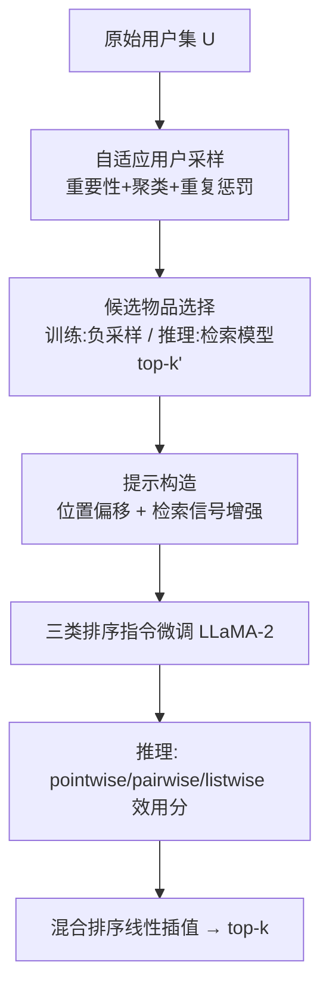
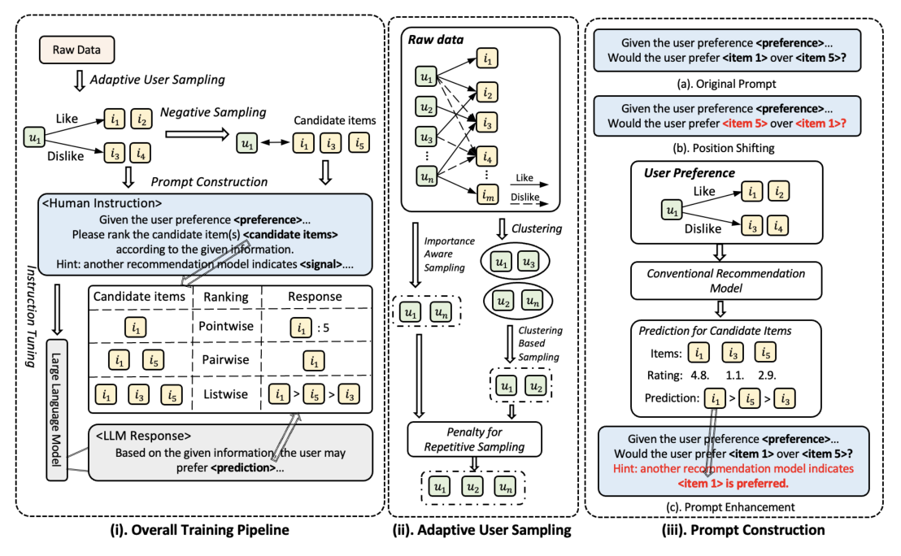

# RecRanker: Instruction Tuning Large Language Model as Ranker for Top-k Recommendation (指令微调大语言模型作为 Top-k 推荐重排器)

- **会议/期刊**: TOIS 2025
- **作者与机构**: Sichun Luo, Bowei He, Haohan Zhao, Wei Shao, Yanlin Qi, Linqi Song 等；香港城市大学、中科院香港创新研究院、哈工大（深圳）、港中文、杭州电子科技大学、夏威夷大学、商汤研究院
- **推荐链路定位**: 重排（检索模型召回 $k'$候选$\to$LLM 重排至 top-$k$）
- **研究方向**: 大语言模型推荐 / 多任务学习与列表级重排
- **论文原文**: [https://arxiv.org/abs/2312.16018v3](https://arxiv.org/abs/2312.16018v3)
- **开源代码**: [https://github.com/sichunluo/RecRanker](https://github.com/sichunluo/RecRanker)

## TL;DR (1分钟核心速览)

现有 LLM 重排工作直接用随机采样数据做指令微调、只用物品文本、且仅做单一排序任务，导致微调数据质量低、协同信号缺失、不同排序任务输出不一致。RecRanker 提出自适应用户采样（重要性 + 聚类 + 重复惩罚）、位置偏移与检索模型信号增强的提示构造，并统一 pointwise/pairwise/listwise 三类排序指令微调 LLaMA-2，推理时用线性插值混合排序。在 ML-100K/ML-1M/BookCrossing 的 Leave-One-Out 全库排序协议下，相对 7 个骨干模型 HR@3 最高提升 154%、NDCG@3 最高提升 213.95%。

## Background & Motivation (背景与核心矛盾)

- **主流范式**: 两阶段——先用 MF/LightGCN/SASRec 等检索模型把全库缩到 $k'$ 候选，再由 LLM 以 pointwise/pairwise/listwise 提示做重排；近期工作（TALLRec、InstructRec）开始用指令微调对齐推荐目标。
- **前人局限**: ① 微调数据多为均匀随机采样，长尾分布下大量低交互用户贡献噪声指令，LLM 潜力未被激发；② 提示仅含用户/物品文本，丢弃了协同过滤的高阶协同信号；③ 只训练单一排序任务，LLM 随机性导致不同任务答案互相矛盾，结果不可靠。
- **核心洞察 (Key Insight)**: 排序任务本身是"多视图"的——pointwise 判断绝对偏好、pairwise 判断相对偏好、listwise 判断全局次序，三者错误模式互补；按 self-consistency 思想，多数视图一致的答案更可能正确，故可集成。
- **本文切入点**: 把"数据质量—提示质量—任务一致性"三个环节同时补齐，用高质量指令数据 + 增强提示 + 混合排序把 LLM 重排器做扎实。

## Method (核心方法设计)

### 1. 整体框架 (Overall Architecture)

训练阶段四步闭环：先对原始用户集做自适应采样得到多重集 $\mathcal{U}_{ins}$；对每个采样用户从"喜欢/不喜欢/未交互（负采样）"三类物品中抽候选；再按三类排序任务构造提示，注入位置偏移与检索模型打分；最后用 Alpaca 式交叉熵指令微调 LLaMA-2。推理阶段改用检索模型对全库打分取 top-$k'$作为候选，构造同分布提示，LLM 分别执行三类排序，输出经效用分线性插值融合后取 top-$k$。

<figure class="paper-figure" markdown="span">
  <figcaption>图 2. (i). RecRanker 的整体训练流程。(ii). 自适应用户采样模块，我们提出重要性感知采样、基于聚类的方法以及对重复采样的惩罚来采样用户。对于每个采样用户，相应的候选物品从用户喜欢、不喜欢和未交互过的物品中随机选择。(iii). 提示构建，我们引入位置偏移和提示增强策略以提升模型性能。</figcaption>
</figure>

### 2. 关键设计拆解 (Key Designs)

1. **自适应用户采样（重要性 + 聚类 + 重复惩罚）**：均匀采样在长尾数据上会淹没高信息用户。先按交互数对数重要性采样得 $\mathcal{U}_1$，$p_{u,\text{importance}} = \ln(q_u) / \sum_{v}\ln(q_v)$，对数尺度防止超级用户垄断；再用检索模型用户向量做 K-means，按簇大小比例采样得$\mathcal{U}_2$，$p_{u,\text{clustering}} \propto |\{v: k_v = k_u\}|$，保证兴趣多样性；最后对$\mathcal{U}_3=\mathcal{U}_1+\mathcal{U}_2$施加重复惩罚$\psi_u = C^{M_3(u)}$（$C=0.92$），$p_{u,\text{penalty}} = \psi_u/\sum_v \psi_v$，抑制优势群体重复入选。三者叠加同时买到"高质量、代表性、多样性"。

2. **位置偏移 + 检索信号增强的提示构造**：LLM 存在位置偏置，会按列表位置而非相关性作答。训练与推理均随机打乱候选顺序，只保留与位置无关的一致回答。同时把 MF（pointwise 打分）与 LightGCN（pairwise/listwise 排序）的预测转成自然语言描述拼入提示，使 LLM 同时看到文本语义与协同信号。此外将 pairwise 的 $O(k'^2)$次比较压缩为$O(k)$：只随机抽$k$对"top-$k$内 vs. top-$k$ 外"的物品对，因为同侧互换不改变 HR。

3. **混合排序与训练目标**：三类任务输出映射到统一效用空间——$U_{\text{pointwise}} = -m\cdot C_1 + P$（$P$为 LLM 评分，$m$为检索名次），$U_{\text{pairwise}} = C_2$（被偏好者得分），$U_{\text{listwise}} = -m'\cdot C_3$；最终$U_{\text{hybrid}} = \alpha_1 U_{\text{pointwise}} + \alpha_2 U_{\text{pairwise}} + \alpha_3 U_{\text{listwise}}$，$\alpha$均取$1/3$。训练为逐 token 交叉熵$\min_\Theta \sum_{(x,y)\in\mathcal{D}_{ins}}\sum_{t=1}^{|y|} -\log P_\Theta(y_t \mid x, y_{[1:t-1]})$；训练负采样为随机未交互物品，推理免负采样、由检索模型全库打分。开销：7B 模型 56K 指令在 16×A800 上训练约 4.6 小时，单卡推理约 0.059 秒/物品。

## Experimental Setup & Evaluation Protocol (实验设置与评估协议)

- **数据集与预处理**:

| 数据集 | #Users | #Items | #Interactions | 密度 | 说明 |
| :--- | :---: | :---: | :---: | :---: | :--- |
| ML-100K | 943 | 1,682 | 100,000 | 0.0630 | 电影评分 |
| ML-1M | 6,040 | 3,706 | 1,000,209 | 0.0447 | 电影评分 |
| BookCrossing | 1,820 | 2,030 | 41,456 | 0.0112 | 图书 1–10 细粒度评分，10-core 过滤 |

- **数据划分与防穿越**: `Leave-One-Out`——最后一条交互为测试、倒数第二条为验证、其余为训练；BookCrossing 无时间戳，历史交互由随机采样重建。
- **排名评测协议**: 无偏 `Full-Ranking`（全库未交互物品排序），指标 HR@$\{3,5\}$与 NDCG@$\{3,5\}$；检索候选$k'=10$。
- **对比基线与超参**: 骨干含直接推荐 MF/LightGCN/MixGCF/SGL 与序列推荐 SASRec/BERT4Rec/CL4SRec，逐一对比 Base 与 RecRanker 四种排序变体；LLM 为 LLaMA-2-7B（另测 13B），学习率 $2\times10^{-5}$、上下文 1024、batch 4 + 梯度累积 2、6000 步、DeepSpeed ZeRO-3 + FlashAttention，vLLM 推理（temperature 0.1）；结果取 5 次平均。

## Key Experimental Results (实验关键数据)

### 1. 主实验对比 (Main Results)

直接推荐（节选 MF 与 LightGCN 骨干，完整表见原文 Table 4）：

| 骨干 | 方法 | ML-100K H@3 | ML-100K N@3 | ML-1M H@3 | ML-1M N@3 | BookCrossing H@3 | BookCrossing N@3 |
| :--- | :--- | :---: | :---: | :---: | :---: | :---: | :---: |
| MF | Base | 0.0455 | 0.0325 | 0.0255 | 0.0187 | 0.0503 | 0.0389 |
| MF | **RecRanker$_{hybrid}$** | **0.0690** | **0.0513** | **0.0312** | **0.0230** | **0.0873** | **0.0720** |
| MF | Improv. | +51.65% | +57.85% | +22.35% | +22.99% | +73.56% | +85.09% |
| LightGCN | Base | 0.0492 | 0.0343 | 0.0273 | 0.0197 | 0.0645 | 0.0499 |
| LightGCN | **RecRanker$_{hybrid}$** | **0.0731** | **0.0527** | **0.0320** | **0.0232** | **0.1088** | **0.0888** |
| LightGCN | Improv. | +48.58% | +53.64% | +18.68% | +17.77% | +68.68% | +77.96% |
| SGL | Base | 0.0505 | 0.0380 | 0.0284 | 0.0206 | 0.0609 | 0.0476 |
| SGL | **RecRanker$_{hybrid}$** | **0.0690** | **0.0525** | **0.0325** | **0.0235** | **0.0950** | **0.0791** |
| SGL | Improv. | +37.23% | +38.16% | +14.44% | +14.08% | +56.16% | +66.60% |

序列推荐（节选 SASRec，完整表见原文 Table 5）：

| 骨干 | 方法 | ML-100K H@3 | ML-100K N@3 | ML-1M H@3 | ML-1M N@3 | BookCrossing H@3 | BookCrossing N@3 |
| :--- | :--- | :---: | :---: | :---: | :---: | :---: | :---: |
| SASRec | Base | 0.0187 | 0.0125 | 0.0277 | 0.0165 | 0.0150 | 0.0086 |
| SASRec | **RecRanker$_{hybrid}$** | **0.0232** | **0.0160** | **0.0304** | **0.0212** | **0.0381** | **0.0270** |
| SASRec | Improv. | +48.13% | +52.00% | +11.19% | +28.48% | +154.00% | +213.95% |
| BERT4Rec | Base | 0.0153 | 0.0104 | 0.0107 | 0.0069 | 0.0179 | 0.0119 |
| BERT4Rec | **RecRanker$_{hybrid}$** | **0.0191** | **0.0130** | **0.0135** | **0.0094** | **0.0422** | **0.0305** |
| BERT4Rec | Improv. | +26.80% | +27.88% | +30.84% | +37.68% | +135.75% | +156.30% |

### 2. 消融实验 (Ablation Study)

ML-100K + MF 骨干 + pairwise 排序（原文 Table 6）：

| 变体 | H@3 | N@3 | H@5 | N@5 |
| :--- | :---: | :---: | :---: | :---: |
| RecRanker 完整版 | **0.0533** | **0.0368** | **0.0783** | **0.0471** |
| w/o Adaptive User Sampling | 0.0472 | 0.0347 | 0.0759 | 0.0465 |
| w/o Position Shifting | 0.0472 | 0.0337 | 0.0764 | 0.0456 |
| w/o Prompt Enhancement | 0.0494 | 0.0358 | 0.0742 | 0.0459 |

数据规模消融：56K / 28K / 5.6K 指令对应 H@3 = 0.0533 / 0.0481 / 0.0475，性能随指令量单调上升。

### 3. 关键实验发现 (Key Findings)

1. **pointwise 是"稳"的，混合是"强"的**：pointwise 在所有 7 个骨干上均稳定超过 Base，而 pairwise/listwise 在 MixGCF、SGL 等强骨干上反而掉点（如 LightGCN+pairwise 的 H@3 从 0.0492 跌至 0.0414）；但把弱任务并入 hybrid 后仍能超过 pointwise（MF 上 H@3 0.0660→0.0690），验证了 self-consistency 式集成的增益。
2. **骨干越弱，重排收益越大**：BookCrossing 上 SASRec 的 N@3 提升 213.95%，而 ML-1M 上仅 28.48%；作者归因于强检索模型已充分挖掘协同信息，留给 LLM 的重排空间更小，说明 RecRanker 的价值主要在"补短板"而非"锦上添花"。
3. **三个组件缺一不可且量级相当**：去掉自适应采样、位置偏移、提示增强分别使 H@3 下降 11.4%、11.4%、7.3%，其中提示增强（引入 LightGCN 协同信号）的绝对贡献最大，说明纯文本提示确实是 LLM 重排的信息瓶颈；同时 13B 模型全面优于 7B，且混合排序在 13B 上增益更明显。

## Highlights & Limitations (亮点、对比与审稿批判)

- **与代表作对比 (vs. Prior Work)**: 相比 TALLRec（二分类"喜欢/不喜欢"、单一任务）与 InstructRec（依赖闭源 GPT 生成指令、单一任务），RecRanker 是首个系统对比 pointwise/pairwise/listwise 并做集成的开源指令微调重排框架；相比纯提示工程的 LLM 零样本重排（如 Hou et al.），它通过指令微调真正对齐了推荐目标，实验中也确实优于 GPT-3.5 与 GPT-4 的零样本 listwise 重排。
- **可迁移亮点**: ① "top-$k$内 vs. top-$k$外"抽样把 pairwise 复杂度从$O(k'^2)$降到$O(k)$，且不损 HR，可直接用于任何 LLM 列表重排；② 把传统模型打分转成自然语言注入提示的"信号增强"范式，可低成本迁移到 CTR 精排或对话推荐。
- **审稿级局限批判**: ① 效率硬伤——单物品推理 0.059 秒、7B 模型需 16 卡训练 4.6 小时，作者自认百万用户级工业场景不可行，且未给出蒸馏/量化的实测结果；② 评估面偏窄——仅 3 个中小规模数据集、$k'=10$ 的浅候选池、未与 TALLRec/InstructRec 直接对比，且 BookCrossing 无时间戳、历史交互靠随机采样重建，Leave-One-Out 下全库排序的绝对 HR 值普遍低于 0.1，统计显著性检验亦未报告。

## Rating (四维评分)

- **方法创新性 (Novelty)**: ⭐⭐⭐ （三个组件单看均属工程改良，但"多排序任务集成 + 检索信号注入提示"的组合视角在 LLM 重排中较新，缺乏理论分析）
- **评估协议与实验扎实度 (Protocol & Experiments)**: ⭐⭐⭐ （7 个骨干 × 3 数据集 × 4 排序变体覆盖充分，但缺显著性检验、缺与同类指令微调方法的正面对比）
- **写作与数学规范度 (Clarity & Rigor)**: ⭐⭐⭐⭐ （符号表、算法伪代码、复杂度分析齐全，三类排序任务的提示示例清晰，公式推导简洁）
- **工业落地与复现价值 (Industrial & Practical Value)**: ⭐⭐⭐ （代码与数据构造流程完全开源、基于 SELFRec 易复现，但 7B 级推理延迟与算力门槛限制了大规模线上部署）

