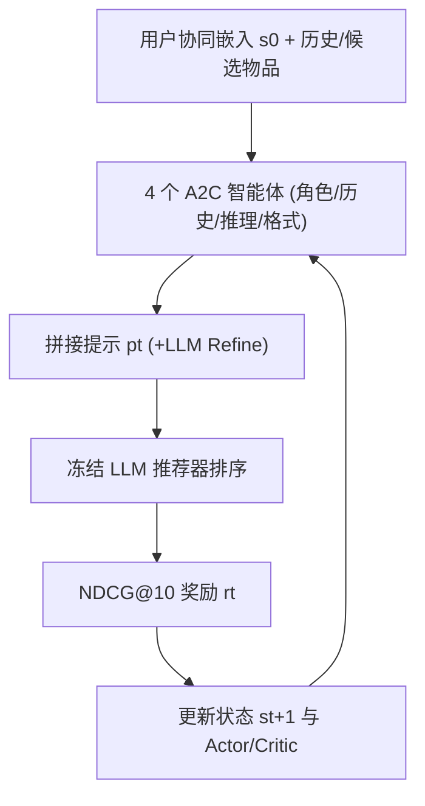
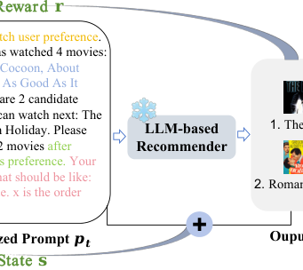

# Reinforced Prompt Personalization for Recommendation with Large Language Models (面向大语言模型推荐的强化提示个性化)

- **会议/期刊**: ACM Transactions on Information Systems (TOIS)
- **作者与机构**: Wenyu Mao, Jiancan Wu, Weijian Chen, Chongming Gao, Xiang Wang, Xiangnan He（中国科学技术大学、合肥综合性国家科学中心数据空间研究院）
- **推荐链路定位**: 重排（LLM 列表级排序，冻结 LLM 推理）
- **研究方向**: 大语言模型推荐 / 强化学习与动态探索推荐
- **论文原文**: [https://arxiv.org/abs/2407.17115v2](https://arxiv.org/abs/2407.17115v2)
- **开源代码**: [https://github.com/maowenyu-11/RPP](https://github.com/maowenyu-11/RPP)

## TL;DR (1分钟核心速览)

现有 LLM 推荐几乎全部采用**任务级提示（task-wise prompting）**——所有用户共享同一套固定模板，忽视了用户意图差异与 LLM 对措辞的极端敏感性。本文提出**实例级提示（instance-wise prompting）**，把提示拆成角色扮演、历史记录、推理引导、输出格式四种句式模式，用四个 A2C 智能体在 CTDE 范式下逐句选择动作组合成个性化提示，以 LLM 输出的 NDCG@10 为奖励迭代训练；RPP+ 进一步用 LLM 动态润色所选句子。在 ML-1M/Games/Lastfm 的 10 候选排序协议下，RPP+ 相比最优任务级提示（Enumeration）NDCG@10 相对提升 107%–132%，并全面超越 SASRec 等传统模型。

## Background & Motivation (背景与核心矛盾)

- **主流范式**: 将推荐重构为语言建模任务，人工设计一套含四种模式的固定模板（如 "You are a movie expert… Please rank…"），全用户共享。
- **前人局限**: ① 用户兴趣周期差异巨大（图 1 中用户 1 需两周前 10 部科幻片才能刻画偏好，用户 2 仅需最近 2 部喜剧片），固定历史长度必然误判；② LLM 对提示措辞高度敏感，单一模板牺牲了不同表达带来的收益。
- **核心洞察 (Key Insight)**: 提示个性化本质是**受限组合优化**——无需在词表逐词搜索，只需在四类模式的高质量候选句集合中做选择，搜索空间从 $O(LD)$骤降到$O(S)$。
- **本文切入点**: 用多智能体 RL 自动为每个用户"选句"，以推荐指标为奖励闭环优化，兼顾效率与质量。

## Method (核心方法设计)

### 1. 整体框架 (Overall Architecture)

对用户 $u$，以 LightGCN 协同嵌入初始化状态$s_0$；四个 A2C 智能体分别负责角色扮演、历史记录、推理引导、输出格式，各自基于全局状态$s_t$输出一个句子动作$a_t^{(k)}$，拼接成提示$p_t$（RPP+ 额外经 LLM 润色）；$p_t$与冻结 LLM 推荐器交互得到排序列表$o_t$，据此计算 NDCG@10 奖励并更新状态$s_{t+1}$，迭代至收敛。推理时仅需一次前向选句 + 一次 LLM 调用。

<figure class="paper-figure" markdown="span">
  <figcaption>图 2. 我们提出的 RPP/RPP+ 的框架。MARL 作为核心组件，使用对应的智能体以四种不同模式对实例级提示进行个性化。它基于冻结的基于 LLM 的推荐器的输出进行迭代训练以最大化奖励。训练完成后，MARL 可以根据用户数据从四种模式中选择最优动作，为每个用户生成个性化提示，从而有效地提示基于 LLM 的推荐器进行定制化推荐。除 RPP 外，“Refine”模块专为 RPP+ 设计，以增强所选内容的灵活性和质量。</figcaption>
</figure>

### 2. 关键设计拆解 (Key Designs)

1. **句式级动作空间（Sentence-Level Action Space）**：逐词搜索（RLPrompt/AutoPrompt）空间爆炸且生成句不可靠。本文将动作定义为人工+LLM 协同筛选的整句，如历史记录模式的动作是"追加 $\hat{l}_t$条交互"，即$l_t = l_{t-1} + \hat{l}_t$，使智能体学到"短期 vs 长期兴趣"的自适应截断；推理引导含 6 类子动作（直接排序 / 依历史 / 先推断偏好 / CoT / 反思精炼 / 相似度计算）。整句动作保证语义合法，同时把搜索复杂度压到$O(NS)$。
2. **CTDE 多智能体 A2C 与状态编码**：四种模式需要不同"专业知识"，单 PPO 难以兼顾。每个智能体有独立 Actor $g^{(k)}$与 Critic$h^{(k)}$，但共享全局状态$s_t = \mathrm{BERT}(p_t) + \mathrm{GRU}(\hat{\mathbf{i}}_1,\dots,\hat{\mathbf{i}}_M)$——GRU 编码 LLM 排序序列以捕捉顺序信息（消融显示优于 mean-pooling）。奖励直接取$r_t = \mathrm{NDCG@}M(o_t)$，优势函数$\hat{R}_t - v_t^{(k)}$ 驱动策略梯度。
3. **RPP+ 的 Refine 模块与训练开销**：固定动作集灵活性有限，RPP+ 在每轮用另一 LLM 以 "Please refine this sentence to effectively prompt LLMs for recommendations" 润色所选句子，扩展有效动作空间而无需扩充候选集。总目标即最大化 $\mathbb{E}[\sum_t \gamma^{t} r_t]$，$\gamma=0.95$；**无需负采样**（奖励来自 LLM 排序），MARL 参数量相对 LLM 可忽略，ChatGPT 约 3 轮、LLaMa2 在三个数据集分别 2/7/8 轮收敛。

## Experimental Setup & Evaluation Protocol (实验设置与评估协议)

- **数据集与预处理**（`5-core` 过滤，按时间戳升序组织序列）：

| 数据集 | #Users | #Items | #Interactions | 场景说明 |
| :--- | :---: | :---: | :---: | :--- |
| ML-1M | 6,040 | 3,885 | 1,000,210 | 电影评分 |
| Games | 50,545 | 16,858 | 389,718 | Amazon 视频游戏评论 |
| Lastfm | 2,100 | 17,632 | 92,835 | 音乐收听记录 |

- **数据划分与防穿越**: 沿用 LLMRank 设定，按时间戳排序后取最后交互为测试目标；训练阶段随机抽 200 用户优化策略，测试阶段在 100/200 个独立样本上评估。
- **排名评测协议**: **Sampled Ranking**——每个样本从训练集随机采 9 个候选 + 1 个测试集真实正例共 $M=10$，故 HitRatio@10 恒为 1 而无意义，主指标为 NDCG@{1,5,10}，辅以 MRR@5/10、HR@5；提示类方法报告至少 5 次重复的均值±标准差。
- **对比基线与超参**: 传统模型（Pop/BPRMF/LightGCN/SASRec）、少样本（BM25/VQ-Rec/UniSRec）、提示方法（Manual/Enumeration/GRIPS）；冻结 LLM 覆盖 LLaMa2-7B-chat、GPT-3.5-turbo（temperature=0.2）、LoRA 微调 Alpaca；初始历史长度 $l_0=1$，动作数 3/9/5（角色/推理/格式）。

## Key Experimental Results (实验关键数据)

### 1. 主实验对比 (Main Results)

LLaMa2-7B-chat 上的 NDCG 对比（加粗为最优，`Improv.` 为 RPP+ 相对 Enumeration 的绝对提升）：

| 方法 | ML-1M N@1 | N@5 | N@10 | Games N@10 | Lastfm N@1 | N@10 |
| :--- | :---: | :---: | :---: | :---: | :---: | :---: |
| SASRec | 0.68 | 0.84 | 0.85 | 0.85 | 0.81 | 0.89 |
| Manual (task-wise) | 0.03 | 0.35 | 0.41 | 0.35 | 0.05 | 0.43 |
| Enumeration (task-wise) | 0.04 | 0.36 | 0.42 | 0.37 | 0.05 | 0.44 |
| GRIPS (instance-wise) | 0.43 | 0.70 | 0.73 | 0.72 | 0.19 | 0.66 |
| RPP | 0.82 | 0.85 | 0.87 | 0.85 | 0.87 | 0.91 |
| **RPP+** | **0.82** | **0.85** | **0.87** | **0.86** | **0.93** | **0.95** |
| Improv. (vs Enum.) | +0.78 | +0.49 | +0.45 | +0.49 | +0.88 | +0.48 |
| 相对提升 | 1950% | 136% | 107% | 132% | 1760% | 109% |

跨 LLM 泛化（NDCG@10）：Alpaca 上 RPP 达 0.93/0.97/0.93（ML-1M/Games/Lastfm），ChatGPT 上 RPP+ 为 0.66/0.75/0.85，均显著优于 GRIPS。

### 2. 消融实验 (Ablation Study)

单模式个性化（LLaMa2，NDCG@10）：

| 变体 | ML-1M | Games | Lastfm |
| :--- | :---: | :---: | :---: |
| 仅角色扮演 | 0.84 | 0.76 | 0.89 |
| 仅历史记录 | 0.77 | 0.76 | 0.87 |
| 仅推理引导 | 0.84 | 0.80 | 0.89 |
| 仅输出格式 | 0.82 | 0.76 | 0.89 |
| RPP（四模式全个性化） | **0.87** | **0.85** | **0.91** |
| RPP-pool（GRU→mean-pool） | 0.86 | 0.81 | 0.93 |
| PPO-1 / PPO-4（单智能体） | 均低于 RPP（图 6a） | — | — |

### 3. 关键实验发现 (Key Findings)

1. **任务级提示全面溃败**：Manual/Enumeration 的 NDCG@10 仅 0.35–0.44，甚至被 SASRec 拉开 0.43–0.48，说明"一套模板服务所有用户"在 LLM 推荐中几乎不可用；而实例级 GRIPS 已能追平 SASRec，验证个性化本身是主要增益来源。
2. **推理引导模式贡献最大**：单模式消融中"仅推理引导"在 Games 上达 0.80，高于角色扮演（0.76）与历史记录（0.76），说明让 LLM 显式分解"先推断偏好再排序"比赋予角色更有效；四模式组合再涨 0.05，证明模式间互补。
3. **多智能体优于单智能体、GRU 优于池化**：PPO-1/PPO-4 均不及四智能体 RPP，说明不同模式需独立策略；RPP-pool 在 Games 上掉 0.04，验证排序序列的顺序信息不可丢。此外候选数从 5 增至 20 时所有 LLM 方法性能下降，但 RPP 与 Enumeration 的差距保持稳定，鲁棒性良好。

## Highlights & Limitations (亮点、对比与审稿批判)

- **与代表作对比 (vs. Prior Work)**: 相比 InstructRec/Chat-REC 的固定指令格式，本文首次把"提示"作为可学习决策变量；相比 GRIPS 的编辑操作搜索与 RLPrompt 的词级搜索，句式级动作空间在合法性与效率上双赢；相比 Peprec 依赖相似用户聚类迭代改写，本文用 MARL 对四模式做结构化分解优化。
- **可迁移亮点**: ① "模式分解 + 每模式一个智能体"的提示优化范式可直接迁移到对话推荐、可解释推荐理由生成；② 用传统协同嵌入（LightGCN）初始化 RL 状态，是把协同信号注入 LLM 提示的低成本接口。
- **审稿级局限批判**: ① 评估仅 10 候选的 Sampled Ranking，与真实全库排序差距大，且训练/测试用户仅 200/100 量级，统计效力有限；② 每用户需多轮 LLM 交互（LLaMa2 最多 8 轮）才能收敛，线上冷启动用户难以承受该延迟；③ RPP+ 的 Refine 增益仅 0.00–0.06 却引入额外 LLM 调用，性价比存疑。

## Rating (四维评分)

- **方法创新性 (Novelty)**: ⭐⭐⭐⭐ （首次将实例级提示形式化为受限组合优化并用 CTDE 多智能体求解，思路清晰但 RL 组件本身较常规）
- **评估协议与实验扎实度 (Protocol & Experiments)**: ⭐⭐⭐ （三数据集 + 三类 LLM + 消融充分，但 10 候选采样排序与百级用户测试规模削弱结论强度）
- **写作与数学规范度 (Clarity & Rigor)**: ⭐⭐⭐⭐ （MDP 建模与 A2C 目标公式完整，动作空间设计交代细致，复杂度分析到位）
- **工业落地与复现价值 (Industrial & Practical Value)**: ⭐⭐⭐ （代码开源、MARL 开销小，但多轮 LLM 迭代推理延迟是线上部署的主要障碍）

