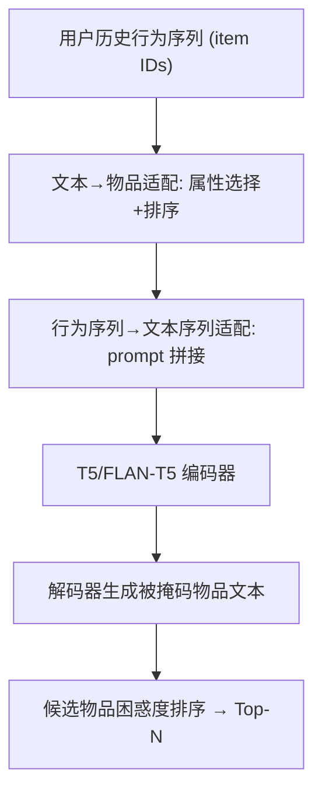
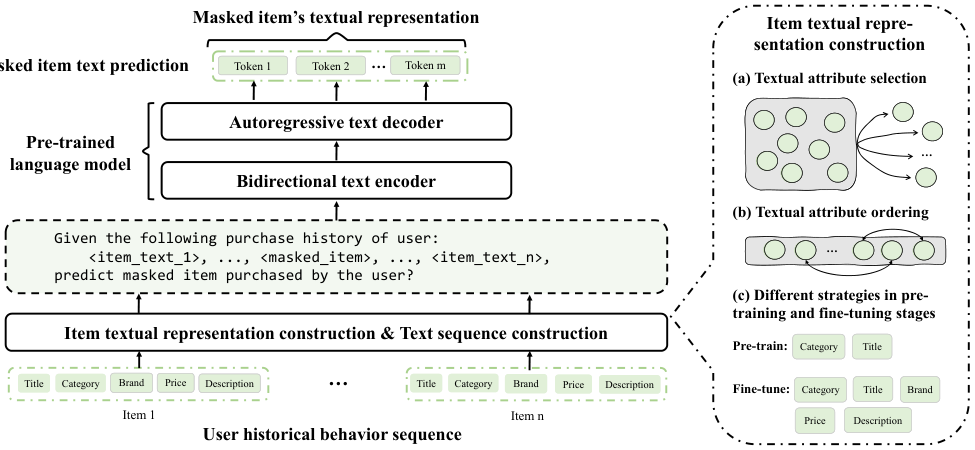

# Thoroughly Modeling Multi-domain Pre-trained Recommendation as Language (将多域预训练推荐彻底建模为语言)

- **会议/期刊**: TOIS 2025（arXiv 2023）
- **作者与机构**: Zekai Qu, Ruobing Xie, Chaojun Xiao, Yuan Yao, Zhiyuan Liu, Fengzong Lian, Zhanhui Kang, Jie Zhou（中国地质大学(北京)、腾讯、清华、NUS）
- **推荐链路定位**: 端到端生成式（兼作重排模块）
- **研究方向**: 大语言模型推荐 / 序列推荐
- **论文原文**: [https://arxiv.org/abs/2310.13540v3](https://arxiv.org/abs/2310.13540v3)
- **开源代码**: 暂未开源

## TL;DR (1分钟核心速览)

现有 PLM4Rec 要么把 PLM 当物品编码器（UniSRec），要么仍用排序损失做 next-item 分类（RECFORMER），行为信息与文本信息之间存在巨大鸿沟。UPSR 把序列推荐**彻底**改写为文本生成：物品文本表示 + 行为序列文本序列 + 掩码物品文本预测（MITP），并用自然度、域一致性、信息量、噪声歧义、文本长度五项指标指导"文本→物品"与"行为序列→文本序列"的双向适配。在 Amazon 七数据集上，新域 NDCG@1 相对最优基线提升 12.76%–23.00%，零样本与重排场景同样全面领先。

## Background & Motivation (背景与核心矛盾)

- **主流范式**: 序列推荐以 item ID 为 token 做序列建模（SASRec/BERT4Rec）；PLM 增强路线则用固定 PLM 编码物品文本再喂给 ID 序列模型（UniSRec），或用 PLM 编码文本序列但仍以排序损失预测（RECFORMER）。
- **前人局限**: ① 固定 PLM 编码文本会丢失细粒度属性信息，域适配器难以把文本嵌入对齐到行为模式，标题歧义大的 Books/Movies 域尤其失效；② 纯 prompt 式 LLM 推荐（ChatRec）缺乏行为调优，交互充足时打不过 ID 模型；③ 已有工作对"选哪些文本属性、按什么顺序拼接、预训练与微调是否该用同一套表示"几乎未做系统探索。
- **核心洞察 (Key Insight)**: SR 与语言建模在输入形式（token 序列）和目标（next token prediction）上天然同构，真正的障碍是**行为与文本的信息鸿沟**——个性化 vs 通用知识、百万级 ID vs 千级词表、极端稀疏 vs 稠密语料。因此破局点不在换 backbone，而在**行为-文本的相互适配细节**。
- **本文切入点**: 用五项可量化指标把"物品文本表示构造"形式化，并让预训练与微调阶段采用**不同**的属性选择与顺序，从而同时保留通用行为模式与域内判别力。

## Method (核心方法设计)

### 1. 整体框架 (Overall Architecture)

输入侧做两级适配：物品级将属性按 `category→title→(brand, price, description)` 顺序拼接为物品文本表示 $R(v)$；序列级用 prompt 函数$g(\cdot)$把历史行为拼成 `Given the following purchase history of user: <item_text_1>, ..., <masked_item>, predict masked item purchased by the user?` 的长文本$T$。T5/FLAN-T5 编码$T$ 后由解码器自回归生成被掩码物品的文本，推理时对候选物品文本逐一算困惑度取最小者。训练分两段：多域行为增强预训练（仅用 category+title，追求泛化）→ 目标域微调（追加 DPT，追求判别）。

<figure class="paper-figure" markdown="span">
  <figcaption>图1. 我们提出的UPSR模型的整体框架。它将用户历史行为序列转换为纯文本序列，并直接使用在预训练和目标推荐数据集的行为信息上调优的PLM来理解用户偏好，并生成下一物品的文本作为下游推荐任务的预测结果。</figcaption>
</figure>

### 2. 关键设计拆解 (Key Designs)

1. **五项指标驱动的分阶段文本表示（Text→Item Adaptation）**：痛点是不加区分地堆砌属性会引入噪声、拉长序列、并在跨域时产生语义冲突。作者用自然度（困惑度量化）、域一致性、信息量（信息熵量化）、噪声歧义、文本长度五项指标筛选属性：预训练只用 `category+title`（高自然度、高域一致性、低域特异信息，抑制过拟合源域），微调再追加 brand/price/description 组成的 DPT（提升信息量与同域物品区分度）。直觉是"预训练学共性、微调学个性"，避免域特异信息污染跨域迁移。
2. **掩码物品文本预测 MITP（Behavior→Text Adaptation）**：把 BERT4Rec 的 cloze 与 T5 的 span corruption 融合——随机将历史中 10% 物品的文本替换为哨兵 token `<extra_id_i>`，要求模型双向利用上下文生成原文本；同时以 9:1 比例混入"只掩码最后一项"的样本，弥合 MITP 与 next-item 目标之间的任务间隙。损失为标准自回归交叉熵：

$$\mathcal{L}=-\frac{1}{|y|}\sum_{j=1}^{|y|}\log P_\theta(y_j\mid T, y_{1:j-1})$$

3. **困惑度式推理与免负采样训练**：训练阶段完全不需要负采样（生成式目标天然规避了 BPR/Softmax 的负样本构造）；推理时对候选集 $\mathcal{C}$ 中每个物品文本计算

$$PP(c_i)=P(w_1,\dots,w_N)^{-\frac{1}{N}}$$

取困惑度最低者为推荐结果。这使模型对**难负样本**天然鲁棒——语义相近但行为不相似的物品，其文本生成概率依然低，这正是其在重排阶段优势的来源。

## Experimental Setup & Evaluation Protocol (实验设置与评估协议)

- **数据集与预处理**: Amazon Review 七个子集，预训练域 4 个（Books/Clothing/Sports/Movies），新域 3 个（Arts/Instruments/Pantry）。预训练域按 `5-core` 过滤；新域仅过滤交互数 <4 的用户以**模拟冷启动**；跨域不共享用户 ID、不重叠物品。

| 数据集 | #Users | #Items | #Interactions | 平均序列长 | 角色 |
| :--- | :---: | :---: | :---: | :---: | :--- |
| Books | 197,891 | 504,085 | 1,990,164 | 10.1 | 预训练 |
| Clothing | 135,041 | 294,788 | 1,004,679 | 7.4 | 预训练 |
| Sports | 39,477 | 87,235 | 262,998 | 6.7 | 预训练 |
| Movies | 30,570 | 44,410 | 289,176 | 9.5 | 预训练 |
| Arts | 131,149 | 138,116 | 718,628 | 5.5 | 新域 |
| Instruments | 62,691 | 53,899 | 403,135 | 6.4 | 新域 |
| Pantry | 22,601 | 8,249 | 179,735 | 8.0 | 新域 |

- **数据划分与防穿越**: `Leave-One-Out`（最后一项测试、倒数第二项验证）；另设 next-1/2/3 的时序鲁棒性实验，留最后三项作测试。
- **排名评测协议**: `Sampled Ranking`，每正样本随机采 100 个负样本，报告 HR@{1,5,10} 与 NDCG@{1,5,10}；重排实验则由 SASRec 召回 100–500 候选后重排。
- **对比基线与超参**: SASRec、BERT4Rec、UniSRec（同数据同属性重训以保证公平）；backbone 为 T5-base / FLAN-T5（12 层、12 头、$d=768$），预训练 20 epoch、lr$3e^{-4}$、batch 128/64，物品文本截断 40 token、序列截断 512 token，掩码率 0.1，以 NDCG@10 早停。

## Key Experimental Results (实验关键数据)

### 1. 主实验对比 (Main Results)

| 数据集 | 指标 | BERT4Rec | SASRec | UniSRec | UPSR(T5) | UPSR(FLAN-T5) | Improv. |
| :--- | :--- | :---: | :---: | :---: | :---: | :---: | :---: |
| Arts | NDCG@1 | 32.21 | 36.92 | 36.81 | 40.88 | **42.79** | +15.89% |
| Arts | NDCG@10 | 45.41 | 52.62 | 52.05 | 54.84 | **56.73** | +7.39% |
| Instruments | NDCG@1 | 36.55 | 38.79 | 37.80 | 42.17 | **43.74** | +12.76% |
| Instruments | HR@10 | 64.45 | 71.38 | 69.20 | 71.02 | **73.26** | +2.63% |
| Pantry | NDCG@1 | 13.36 | 15.22 | 13.62 | 18.32 | **18.72** | +23.00% |
| Pantry | NDCG@10 | 24.82 | 28.63 | 24.69 | 30.08 | **30.98** | +8.21% |
| Books | NDCG@1 | 32.10 | 38.34 | 28.23 | 39.82 | **41.76** | +8.92% |
| Clothing | NDCG@1 | 23.98 | 26.54 | 28.60 | 31.79 | **32.63** | +14.09% |
| Sports | NDCG@1 | 18.97 | 22.06 | 25.13 | 26.66 | **28.34** | +12.77% |
| Movies | NDCG@1 | 37.68 | 40.28 | 34.37 | 41.35 | **43.43** | +7.82% |

零样本（不微调直接迁移新域）下，UPSR(预训练) 在 Pantry/Instruments 的 NDCG@10 为 19.84/29.41，远超 UniSRec 的 12.77/23.03；即便去掉预训练的 UPSR 也已大幅领先 UniSRec。

### 2. 消融实验 (Ablation Study)

| 配置 | Sports NDCG@10 | Movies NDCG@10 | 说明 |
| :--- | :---: | :---: | :--- |
| T（仅标题） | 34.44 | 43.51 | 信息量最低 |
| T+C | 38.14 | 48.97 | 引入类目，信息量 3.94→4.79 / 2.77→4.12 |
| T+C+D | **38.23** | **54.80** | DPT 对标题歧义大的 Movies 增益巨大 |
| 顺序 T→C→D | 37.54 | 54.65 | 由细到粗 |
| 顺序 D→C→T | 37.74 | 52.79 | 最差 |
| 顺序 C→T→D | **38.23** | **54.80** | 由粗到细，困惑度最低 |
| 预训练/微调 C+T / C+T+D | 38.23 | 54.80 | 本文最终策略 |
| 预训练/微调 C+T+D / C+T+D | 38.23 | 54.80 | 零样本下显著退化（Instruments NDCG@10 23.29 vs 29.41） |

### 3. 关键实验发现 (Key Findings)

1. **增益集中在排序质量而非召回广度**：新域 NDCG@1 提升 12.76%–23.00%，但 HR@10 仅提升 1.11%–3.76%，说明 UPSR 的核心价值是把正样本推到列表最前端，天然适配重排环节；重排实验中候选集从 100 增至 500 时 UPSR 指标单调上升，而 SASRec/BERT4Rec 波动下降，证明其对难负样本更鲁棒。
2. **分阶段属性策略是零样本成败的关键**：主场景下 C+T+D/C+T+D 与 C+T/C+T+D 几乎持平，但零样本下前者在 Instruments 的 NDCG@10 跌至 23.29（后者 29.41），直接验证"预训练阶段注入过多域特异信息会损害泛化"这一指标假设。
3. **时序鲁棒性显著优于 ID 模型**：next-1→next-3 预测中 BERT4Rec/SASRec 的 NDCG@1 分别下滑约 10.6%/12.9%，UPSR 仅下滑 4.3%，说明文本侧长期信息缓解了 leave-one-out 设定下对最近一次点击的过拟合；此外 T5-small（61M）相对 T5-base（223M）性能仅轻微下降，预训练数据扩至 10 倍（36.7M 交互）还能进一步提升，具备工程可行性。

## Highlights & Limitations (亮点、对比与审稿批判)

- **与代表作对比**: 相比 UniSRec（PLM 仅作物品编码器 + 固定嵌入 + 域适配器），UPSR 让 PLM 端到端吃文本序列、吐文本序列，避免嵌入瓶颈；相比 RECFORMER（文本输入但排序损失输出），UPSR 输出侧也生成文本，彻底消除 ID 分类头；相比 P5/TallRec（单域指令微调），UPSR 面向多域预训练-微调范式且不依赖共享 ID。
- **可迁移亮点**: ① "预训练用低信息量高一致性属性、微调用高信息量属性"的分阶段表示策略可直接迁移到任何 LLM4Rec 的 prompt 构造；② 9:1 混合"随机掩码 + 末位掩码"的样本配比，是弥合 MLM 式预训练与 next-item 目标间隙的廉价技巧。
- **审稿级局限批判**: ① 推理需对每个候选物品做一次自回归生成并算困惑度，全库打分不可行，论文也承认只适合重排，但未给出延迟/吞吐的定量测量；② 评测采用 100 负采样的 Sampled Ranking 而非 Full-Ranking，且新域过滤掉了含未训练物品的样本，可能高估实际冷启表现；③ 五项指标中"域一致性"与"噪声歧义"仅靠人工经验判断，缺乏可复现的量化流程。

## Rating (四维评分)

- **方法创新性 (Novelty)**: ⭐⭐⭐⭐ （"彻底生成式"的端到端改造并非全新范式，但五项指标驱动的分阶段行为-文本适配是此前系统性缺失的增量，洞察扎实）
- **评估协议与实验扎实度 (Protocol & Experiments)**: ⭐⭐⭐⭐ （七数据集 + 微调/零样本/重排/时序鲁棒性/模型与数据规模五维分析非常完整，扣分在 Sampled Ranking 与样本过滤）
- **写作与数学规范度 (Clarity & Rigor)**: ⭐⭐⭐⭐ （指标定义与属性选择表清晰可操作，公式简洁；但部分指标仅定性描述，缺少形式化定义）
- **工业落地与复现价值 (Industrial & Practical Value)**: ⭐⭐⭐ （明确指向重排部署且小模型可用，但生成式打分开销大、代码未开源，落地需自建推理加速）

