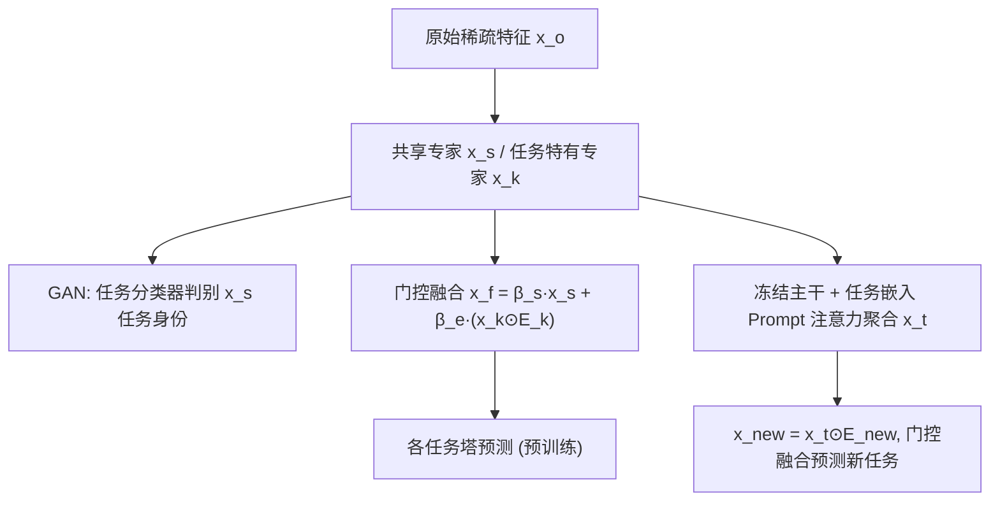

# Efficient Multi-task Prompt Tuning for Recommendation (面向推荐的高效多任务提示微调)

- **会议/期刊**: TOIS 2025
- **作者与机构**: Ting Bai, Le Huang, Yue Yu, Cheng Yang, Chuan Shi (北京邮电大学) ; Cheng Hou, Zhe Zhao (腾讯 AI Lab)
- **推荐链路定位**: 精排 (多任务 CTR/CVR 预估)
- **研究方向**: 多任务学习与列表级重排 / CTR 预估与特征交叉
- **论文原文**: [https://arxiv.org/abs/2408.17214v1](https://arxiv.org/abs/2408.17214v1)
- **开源代码**: 暂未开源

## TL;DR (1分钟核心速览)

真实推荐系统业务场景频繁新增任务（如新增"教育"预测、新业务场景转化），而现有 MTL 框架（MMOE/PLE/CSRec）面对新任务只能**全参数重训**：既拖慢训练，又因负迁移损害已优化任务。本文提出两阶段框架 MPT-Rec——预训练阶段用**任务感知 GAN**（共享专家作生成器、任务分类器作判别器）显式解耦任务共享/特有信息；提示微调阶段**冻结全部预训练参数**，仅用任务嵌入作 Prompt 从旧任务按实例级注意力迁移知识。在 Census-income / Ali-CCP / Byte-Rec 三数据集上 AUC 全面超越 CSRec（如 Ali-CCP T2 提升 +0.0371），新任务学习仅需约 10% 参数与 FLOPs，性能保持全量训练的 95.5%–99.7%。

## Background & Motivation (背景与核心矛盾)

- **主流范式**: 推荐 MTL 沿"硬共享 → 专家共享 (MMOE/PLE) → 稀疏子网共享 (Sparse Sharing/CSRec)"演进，核心都在设计知识共享机制以缓解负迁移。
- **前人局限**: ① 现有方法几乎不考虑**新任务泛化**——图 1 显示 MMOE 加入新任务 T3 后 T3 提升，但已优化的 T1/T2 双双下降；② 新任务到来必须**全参数重训**，业务频繁变更场景下训练成本不可接受。
- **核心洞察 (Key Insight)**: 负迁移的根源是任务共享信息与任务特有信息**混在一起**；若能在预训练阶段把二者显式分离，则新任务只需从"干净"的共享信息与可迁移的特有信息中取用，无需触碰主干。
- **本文切入点**: 借鉴 NLP Prompt Tuning 的"冻结主干 + 轻量适配"思想，把 MTL 拆成"多任务预训练 + 多任务提示微调"两阶段，用 GAN 保证共享信息质量、用任务嵌入 Prompt 实现实例级知识迁移。

## Method (核心方法设计)

### 1. 整体框架 (Overall Architecture)

输入原始稀疏特征经嵌入网络得 $\mathbf{x}_o$，分别送入任务共享专家$\mathcal{F}(\cdot,\theta_s)$与各任务特有专家$\mathcal{F}(\cdot,\theta_k)$得到$\mathbf{x}_s,\mathbf{x}_k$。预训练阶段：GAN 判别器迫使$\mathbf{x}_s$剥离任务身份信息，融合网络以门控加权$\mathbf{x}_f=\beta_s\mathbf{x}_s+\beta_e(\mathbf{x}_k\odot\mathbf{E}_k)$输出各任务预测。微调阶段：冻结嵌入网络、全部专家与融合网络，仅训练投影网络、新任务塔与新任务嵌入$\mathbf{E}_{new}$，通过注意力权重$\gamma_k$聚合旧任务特有表征$\mathbf{x}_t=\sum_k\gamma_k\mathbf{x}_k$，再与新任务嵌入逐元素相乘后与$\mathbf{x}_s$ 门控融合完成预测。

### 2. 关键设计拆解 (Key Designs)

1. **任务感知 GAN 解耦（共享专家=生成器，任务分类器=判别器）**：痛点在于 PLE 式共享专家仍混入任务无关噪声。本文令判别器 $\mathcal{K}(\mathbf{x}_s,\phi)$ 预测任务标签、生成器（共享专家）尽力混淆，损失为
$$\mathcal{L}_{gan}=\alpha\mathcal{L}_{e}+(1-\alpha)\sum_{k=1}^{N}\mathcal{L}_{s},$$
其中 $\mathcal{L}_{e}$为任务标签 NLL（标签由 EM 聚类无监督分配），$\mathcal{L}_{s}$为共享表征的预测损失。直觉：对抗训练迫使$\mathbf{x}_s$ 只保留"任何任务分类器都认不出归属"的纯共享信息，从源头切断负迁移通道。

2. **任务嵌入 Prompt 的实例级知识迁移**：痛点在于固定权重融合 (FW) 或任务级相似度加权 (TES) 粒度太粗。本文用投影网络 $\mathcal{P}$将输入映射为$\mathbf{h}_o$，与各旧任务嵌入做温度缩放注意力：
$$\gamma_k=\frac{\exp(\mathbf{h}_o\mathbf{E}_k^{\top}/T)}{\sum_{j=1}^{N}\exp(\mathbf{h}_o\mathbf{E}_j^{\top}/T)},\quad \mathbf{x}_t=\sum_{k=1}^{N}\gamma_k\mathbf{x}_k.$$
由于 $\mathbf{h}_o$ 依赖具体样本，权重随实例自适应变化，实现"同一新任务下不同样本取用不同旧任务知识"的细粒度迁移。

3. **训练目标与效率**：预训练总损失 $\mathcal{L}=\mathcal{L}_{gan}+\mathcal{L}_{f}$，$\mathcal{L}_f$为融合表征的 BCE 预测损失；微调阶段仅优化$\mathcal{L}_{new}=\ell_{rec}(\hat{y}_{new},y_{new})$。因冻结高维稀疏嵌入网络与全部专家，新任务可训练参数仅剩投影网络、新任务塔与$\mathbf{E}_{new}$，无需负采样设计（逐样本二分类 BCE），在线推理仅多一次轻量注意力聚合。

## Experimental Setup & Evaluation Protocol (实验设置与评估协议)

- **数据集与预处理**:

| 数据集 | #Train | #Test | #Feature | 场景说明 |
| :--- | :---: | :---: | :---: | :--- |
| Census-income | 199,523 | 99,762 | 40 | 人口普查，T1 收入>$50K / T2 婚姻状况 |
| Ali-CCP | 42.3M | 43M | 18 | 淘宝真实流量，T1 CTR / T2 CVR |
| Byte-Rec | 15.7M | 2M | 8 | 短视频，T1 完播 / T2 点赞 |

- **数据划分与防穿越**: 采用官方给定的 Train/Test 固定划分（非 Leave-One-Out），新任务 T3 通过剔除对应预测特征构造（Census 用 "education"、Ali-CCP 用 "business scenario"），并先用 Pearson 相关系数筛选与 T1/T2 相关性相近（Avg.Coef≈0.16）的任务以保证公平。
- **排名评测协议**: 二分类 AUC 指标（非 Full-Ranking 排序），沿用 MTL 领域惯例——AUC 提升 0.001 即视为显著，并附 $t$-test（$p<0.05$，标 `*`）。
- **对比基线与超参**: 基线含 Single Task、Shared Bottom、MMOE、PLE、STEM、Sparse Sharing、CSRec（SOTA）；嵌入维度 $D$分别为 127/90/32，特征嵌入维度$H$=128/64/64，学习率 1e-3/1e-4/1e-4，GAN 平衡系数$\alpha=0.1$，网格搜索调优。

## Key Experimental Results (实验关键数据)

### 1. 主实验对比 (Main Results)

| 方法 | Census T1 | Census T2 | Ali T1 | Ali T2 | Byte T1 | Byte T2 |
| :--- | :---: | :---: | :---: | :---: | :---: | :---: |
| Single Task | 0.9443 | 0.9834 | 0.5730 | 0.5903 | 0.7017 | 0.9340 |
| Shared Bottom | 0.9484 | 0.9897 | 0.5904 | 0.5860 | 0.7292 | 0.8442 |
| MMOE | 0.9494 | 0.9901 | 0.5881 | 0.5968 | 0.7289 | 0.8508 |
| PLE | 0.9493 | 0.9911 | 0.5890 | 0.5998 | 0.7276 | 0.8605 |
| STEM | 0.9487 | 0.9906 | 0.5938 | 0.5983 | 0.7385 | 0.9296 |
| Sparse Sharing | 0.9489 | 0.9914 | 0.5897 | 0.6065 | 0.7369 | 0.8923 |
| CSRec | 0.9502 | 0.9915 | 0.5913 | 0.6070 | 0.7412 | 0.8978 |
| **MPT-Rec** | **0.9517*** | **0.9926*** | **0.5990*** | **0.6274*** | **0.7485*** | **0.9339*** |
| Improv.% (vs CSRec) | +0.16% | +0.11% | +1.30% | **+3.36%** | +0.98% | +4.02% |

新任务泛化（T3，微调方案）：

| 方法 | Census AUC/T3 | #Params | Ali AUC/T3 | #Params |
| :--- | :---: | :---: | :---: | :---: |
| MAML | 0.8563 | 26k | 0.7155 | 1748k |
| Shared* | 0.8133 | 21k (21.2%) | 0.6279 | 6k (0.12%) |
| MMOE* | 0.8497 | 21k (9.4%) | 0.6862 | 7k (0.13%) |
| PLE* | 0.8617 | 118k (26.0%) | 0.6997 | 33k (0.62%) |
| **MPT-Rec** | **0.8626** (99.7%) | **27k (9.3%)** | 0.6968 (95.5%) | **8k (0.15%)** |

### 2. 消融实验 (Ablation Study)

| 变体 | Census T3 | Ali T3 | 说明 |
| :--- | :---: | :---: | :--- |
| MPT-Rec (Share) | 下降最大 | 下降最大 | 仅用共享信息，任务冲突严重 |
| MPT-Rec (Specific) | 中等下降 | 中等下降 | 仅用特有信息，丢失共享增益 |
| MPT-Rec (-GAN) | 低于 Specific | 低于 Specific | 不解耦反而更差 |
| MPT-Rec (FW) | 次优 | 次优 | 固定权重融合，粒度粗 |
| MPT-Rec (TES) | 次优 | 次优 | 任务级相似度加权，非实例级 |
| **MPT-Rec** | **最优** | **最优** | 完整模型 |

### 3. 关键实验发现 (Key Findings)

1. **解耦比融合更关键**：去掉 GAN 的 MPT-Rec(-GAN) 性能甚至低于只用特有信息的变体，说明混合表征中的任务噪声会主动伤害新任务，显式对抗解耦是性能增益的主要来源（图 4）。
2. **实例级 Prompt 优于任务级加权**：MPT-Rec 相对 FW/TES 的稳定领先证明"同一新任务内不同样本应取用不同旧任务知识"，粗粒度权重无法刻画样本异质性（图 5）。
3. **数据集越大，微调收益越显著**：Ali-CCP 上参数量仅占全量训练的 0.15%（Census 为 9.3%），因高维稀疏嵌入网络随特征维度急剧膨胀，冻结它带来的节省在大规模场景下被放大，同时性能仍保持 95.5%。

## Highlights & Limitations (亮点、对比与审稿批判)

- **与代表作对比 (vs. Prior Work)**: 相比 PLE（专家级共享但共享专家仍含噪声），MPT-Rec 用 GAN 对抗约束共享表征纯度；相比 STEM（嵌入级分离，跨数据集表现不稳定），本文在专家级解耦更鲁棒；相比 CSRec（对比学习评估参数贡献，仍需全量重训），本文彻底冻结主干，把新任务成本压到 10% 量级。
- **可迁移亮点**: ① "冻结嵌入层 + 仅训上层"的微调范式可直接迁移到任何高维稀疏特征的推荐精排模型，用于新业务冷启；② 用 EM 聚类伪标签 + 判别器实现无监督任务身份识别，可复用于缺乏显式任务标签的多场景建模。
- **审稿级局限批判**: ① 新任务 T3 是"剔除特征"人工构造的伪新任务，与真实业务中新任务的数据分布漂移仍有差距，泛化结论的外部效度存疑；② 微调阶段冻结共享专家意味着共享信息无法随新任务数据更新，若新任务与旧任务分布差异极大（如 T3="Sex" 低相关场景），性能保持率可能进一步下滑，论文未给出该极端情形的定量分析。

## Rating (四维评分)

- **方法创新性 (Novelty)**: ⭐⭐⭐⭐ （GAN 解耦 + 任务嵌入 Prompt 的两阶段组合在推荐 MTL 中较新颖，但各组件在 NLP/不变学习领域均有原型）
- **评估协议与实验扎实度 (Protocol & Experiments)**: ⭐⭐⭐⭐ （三数据集 + 参数/FLOPs 双维度效率对比 + 消融与 t-SNE 可视化完整，但新任务为人工构造、缺线上 A/B）
- **写作与数学规范度 (Clarity & Rigor)**: ⭐⭐⭐⭐ （公式简洁、符号统一，效率分析清晰；GAN 收敛性与 EM 伪标签质量缺乏理论讨论）
- **工业落地与复现价值 (Industrial & Practical Value)**: ⭐⭐⭐⭐⭐ （10% 参数完成新任务适配，直击业务频繁上新任务的痛点，工程价值极高；可惜代码暂未开源）

