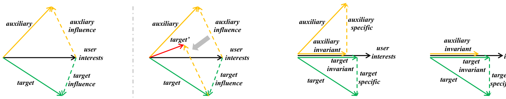
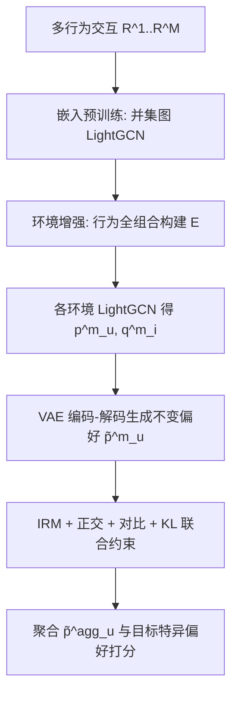

# User Invariant Preference Learning for Multi-Behavior Recommendation (用户不变偏好学习用于多行为推荐)

- **会议/期刊**: TOIS 2025
- **作者与机构**: Mingshi Yan, Yahong Han (天津大学); Zhiyong Cheng (合肥工业大学); Fan Liu (新加坡国立大学); Yingda Lyu (吉林大学)
- **推荐链路定位**: 召回（多行为用户表征学习）
- **研究方向**: 多任务学习与列表级重排 / 自监督对比学习与交互去噪
- **论文原文**: [https://arxiv.org/abs/2507.14925v1](https://arxiv.org/abs/2507.14925v1)
- **开源代码**: [https://github.com/MingshiYan/UIPL](https://github.com/MingshiYan/UIPL)

## TL;DR (1分钟核心速览)

多行为推荐（MBR）默认各行为共享用户偏好，却忽视了辅助行为偏好中混入的**行为特异成分**（季节、情绪等外部驱动），直接融合即引入噪声。本文提出 UIPL：把每个行为（及其组合）视为 IRM 的一个"环境"，用 VAE 编码-解码生成用户**不变偏好**，并以 IRM 损失替代标准重构损失，辅以正交损失与对比损失解耦不变/特异成分。在 Tmall/Taobao/Yelp/ML10M 四数据集、Leave-One-Out + Full-Ranking 协议下，HR@10 相对次优基线提升 1.41%–3.98%，NDCG@10 提升 2.30%–9.22%。

## Background & Motivation (背景与核心矛盾)

- **主流范式**: MBR 分两派——一派（MBGCN、s-MBRec）独立学各行为表征再加权融合；另一派（NMTR、CRGCN、MB-CGCN）按行为顺序做嵌入传播以建模行为间依赖。
- **前人局限**: ① 加权融合与顺序传播都默认"辅助行为信息有益"，未区分共享成分与行为特异成分，辅助行为的噪声会污染目标行为预测；② 近期去噪工作（PKEF 投影解耦、MBSSL 层间对比、BCIPM 专用网络）只"缓解"噪声，未从**噪声来源**上建模，且 BCIPM 在冷启动场景反而失效。
- **核心洞察 (Key Insight)**: 用户偏好可分解为**不变偏好**（跨行为一致的内在兴趣）与**行为特异偏好**（外部因素驱动）。图 1 的玩具示例表明：辅助行为偏好向用户内在兴趣的投影与目标行为一致，故只取不变部分即可避免噪声注入。
- **本文切入点**: 多行为数据天然构成多个数据分布，恰好对应 IRM 的"环境"概念——用 IRM 约束强制跨环境预测一致，从而把不变偏好"逼"出来。

<figure class="paper-figure" markdown="span">
  <figcaption>图 1. 一个玩具示例（用于说明用户不变偏好的存在性以及建模辅助行为信息时引入的噪声）。</figcaption>
</figure>

## Method (核心方法设计)

### 1. 整体框架 (Overall Architecture)

UIPL 分三段：**嵌入预训练**先用全部行为并集 $\mathrm{R}^0=\mathrm{R}^1\cup\cdots\cup\mathrm{R}^M$建全局图跑 LightGCN，得到粗粒度$\boldsymbol{p}^{pt}_u,\boldsymbol{q}^{pt}_i$；**环境表征学习**对行为集合$\Re$做全组合（如 3 行为生成 7 个环境）扩充环境集$\mathcal{E}$，每个环境各跑一次 LightGCN 得到$\{\boldsymbol{p}^m_u\}_{m=1}^{M}$与$\{\boldsymbol{q}^m_i\}$；**不变偏好生成**用 VAE 把每个$\boldsymbol{p}^m_u$编码-解码为$\tilde{\boldsymbol{p}}^m_u$，以 IRM 损失约束其跨环境预测能力，最终聚合$\tilde{\boldsymbol{p}}^{agg}_u=\sum_m\tilde{\boldsymbol{p}}^m_u$与目标行为特异偏好$\breve{\boldsymbol{p}}^{tar}_u$ 共同打分。

### 2. 关键设计拆解 (Key Designs)

1. **IRM 约束替代 VAE 重构损失（核心创新）**：标准 VAE 重构原输入，只会复刻含噪表征。本文将 Eq.2 的双层优化用 IRMv1 近似并落到多行为场景，令 $\Phi_m$为环境$m$学到的用户偏好、$\psi_i$ 为跨环境共享的物品表征，得到
$\min\sum_{m,n\in\mathcal{E},n\neq m}R_m(f(\phi^m_u,\psi_i|r^m_{ui}))+\lambda R_n(f(\phi^m_u,\psi_i|r^n_{ui}))$即"在环境$m$学的偏好必须也能预测环境$n$的交互"。因行为内偏好重要性远高于跨行为，取$\lambda=1$化简为$\min\sum_{n}\sum_{m}R(f(\phi^m_u,\psi_i|r^n_{ui}))$。直觉：只有真正跨行为稳定的成分才能同时压低所有$R_n$，噪声成分被自然淘汰。
2. **环境增强 + 正交/对比双辅助损失**：IRM 理论表明环境越多约束越强，故对行为做全组合扩充环境集（组合等价于混合噪声、改变数据分布，但不变偏好仍可提取）。正交损失 $\mathcal{L}_{ort}=\frac{1}{|\mathcal{U}||\mathcal{E}|}\sum_u\sum_m((\breve{\boldsymbol{p}}^m_u)^\top\tilde{\boldsymbol{p}}^m_u)^2$强制不变与特异成分（$\breve{\boldsymbol{p}}^m_u=\boldsymbol{p}^m_u-\tilde{\boldsymbol{p}}^m_u$）不相关；对比损失以同用户跨环境不变偏好为正对、不变-特异为负对做 InfoNCE，强化跨环境一致性。
3. **训练目标、负采样与推理效率**：总损失 $\mathcal{L}=\mathcal{L}_{rec}+\lambda\mathcal{L}_{irm}+\alpha\mathcal{L}_{ort}+\beta\mathcal{L}_{con}+\gamma\mathcal{L}_{kl}$，其中$\mathcal{L}_{rec}$为目标行为上的 BPR 损失（均匀负采样），$\mathcal{L}_{kl}$为 VAE 标准 KL 正则。打分$y_{ui}=(\tilde{\boldsymbol{p}}^{agg}_u)^\top\hat{\boldsymbol{q}}_i+(\breve{\boldsymbol{p}}^{tar}_u)^\top\hat{\boldsymbol{q}}_i$，物品侧仅聚合单行为环境的$\hat{\boldsymbol{q}}_i=\sum_{k=1}^{K}\boldsymbol{q}^k_i$ 以避免组合环境冗余。推理时环境数随行为数指数增长是主要开销来源。

## Experimental Setup & Evaluation Protocol (实验设置与评估协议)

- **数据集与预处理**: 仅保留每个交互的首次出现以去冗余；Yelp/ML10M 按评分切为 like（目标）/neutral/dislike 三行为。

| 数据集 | #Users | #Items | #Interactions | 稀疏度/密度 | 特征/场景说明 |
| :--- | :---: | :---: | :---: | :---: | :--- |
| Taobao | 48,749 | 39,493 | 1,953,631 | 极稀疏 | click/cart→purchase，电商 |
| Tmall | 41,738 | 11,953 | 2,292,594 | 极稀疏 | click/collect/cart→purchase，cart 极稀疏 |
| Yelp | 19,800 | 22,734 | 1,380,585 | 极稀疏 | tips/dislike/neutral→like，点评 |
| ML10M | 67,788 | 8,704 | 9,922,036 | 稀疏 | dislike/neutral→like，电影评分 |

- **数据划分与防穿越 (Splitting Strategy)**: `Leave-One-Out`——每用户最后一条交互作测试，其余训练。
- **排名评测协议 (Ranking Protocol)**: 无偏 `Full-Ranking`，对训练集未出现的全部物品排序，报告 HR@10 与 NDCG@10。
- **对比基线与超参设置**: 2 个单行为基线（MF-BPR、LightGCN）+ 7 个多行为基线（NMTR、MBGCN、S-MBRec、CRGCN、MB-GCGN、PKEF、BCIPM）；嵌入维度 $d=64$、batch 1024、GCN 2 层、Adam、lr$1e{-3}$；显著性用双尾 t 检验$p<0.05$。

## Key Experimental Results (实验关键数据)

### 1. 主实验对比 (Main Results)

| 数据集 | 指标 | LightGCN | MBGCN | S-MBRec | CRGCN | MB-GCGN | PKEF | BCIPM | **UIPL** | Improv. |
| :--- | :---: | :---: | :---: | :---: | :---: | :---: | :---: | :---: | :---: | :---: |
| Tmall | HR@10 | 0.0393 | 0.0549 | 0.0694 | 0.0840 | 0.1073 | 0.1118 | 0.1414 | **0.1434*** | 1.41% |
| Tmall | NDCG@10 | 0.0209 | 0.0285 | 0.0362 | 0.0442 | 0.0416 | 0.0630 | 0.0741 | **0.0790*** | 6.61% |
| Taobao | HR@10 | 0.0254 | 0.0434 | 0.0571 | 0.1152 | 0.0989 | 0.1097 | 0.1292 | **0.1328*** | 2.79% |
| Taobao | NDCG@10 | 0.0138 | 0.0259 | 0.0331 | 0.0629 | 0.0470 | 0.0627 | 0.0716 | **0.0782*** | 9.22% |
| Yelp | HR@10 | 0.0400 | 0.0356 | 0.0353 | 0.0367 | 0.0355 | 0.0423 | 0.0502 | **0.0522*** | 3.98% |
| Yelp | NDCG@10 | 0.0202 | 0.0183 | 0.0173 | 0.0178 | 0.0164 | 0.0210 | 0.0244 | **0.0254*** | 4.10% |
| ML10M | HR@10 | 0.0662 | 0.0469 | 0.0340 | 0.0502 | 0.0627 | 0.0591 | 0.0810 | **0.0835*** | 3.09% |
| ML10M | NDCG@10 | 0.0319 | 0.0228 | 0.0164 | 0.0239 | 0.0302 | 0.0264 | 0.0392 | **0.0401*** | 2.30% |

### 2. 消融实验 (Ablation Study)

| 配置 | Tmall HR | Tmall NDCG | Taobao HR | Taobao NDCG | Yelp HR | Yelp NDCG | ML10M HR | ML10M NDCG |
| :--- | :---: | :---: | :---: | :---: | :---: | :---: | :---: | :---: |
| $\mathcal{L}_{rec}$ only | 0.1272 | 0.0649 | 0.1203 | 0.0695 | 0.0416 | 0.0209 | 0.0534 | 0.0258 |
| w/o $\mathcal{L}_{kl}$ | 0.1309 | 0.0685 | 0.1305 | 0.0797 | 0.0495 | 0.0240 | 0.0584 | 0.0284 |
| w/o $\mathcal{L}_{irm}$ | 0.1311 | 0.0774 | 0.1302 | 0.0797 | 0.0508 | 0.0239 | 0.0653 | 0.0319 |
| w/o $\mathcal{L}_{ort}$ | 0.1403 | 0.0770 | 0.1319 | 0.0802 | 0.0511 | 0.0242 | 0.0686 | 0.0340 |
| w/o $\mathcal{L}_{con}$ | 0.1406 | 0.0773 | 0.1282 | 0.0786 | 0.0497 | 0.0238 | 0.0716 | 0.0351 |
| **UIPL** | **0.1434** | **0.0790** | **0.1328** | **0.0812** | **0.0532** | **0.0254** | **0.0835** | **0.0401** |

### 3. 关键实验发现 (Key Findings)

1. **IRM 损失是去噪主力**：去掉 $\mathcal{L}_{irm}$后 ML10M HR@10 从 0.0835 跌至 0.0653（-21.8%），跌幅远超去掉正交（0.0686）或对比（0.0716）损失，说明跨环境预测约束提供的全局信号比局部嵌入约束更关键；而完全去掉整个不变偏好生成损失（$\mathcal{L}_{rec}$ only）时 ML10M 仅 0.0534，验证"不变偏好"本身是收益来源。
2. **行为相关性决定收益结构**：Tmall/Taobao 行为相关性强，去掉目标特异偏好（w/o spe）优于去掉不变偏好（w/o inv），即不变偏好贡献更大；Yelp/ML10M 行为相关性弱，结论反转——这也解释了为何 Yelp/ML10M 上 NDCG 提升仅 2.30%–4.10%，而 Taobao 高达 9.22%。
3. **冷启动场景优势被放大**：随机抽 1000 用户清空其目标行为及辅助行为中相关交互后，UIPL 在四数据集全面领先 MBGCN/CRGCN/BCIPM；BCIPM 因只用辅助行为"训练而不取信息"，冷启动下反而失效，而 UIPL 仍可凭辅助行为学到的不变偏好给出预测。

## Highlights & Limitations (亮点、对比与审稿批判)

- **与代表作对比 (vs. Prior Work)**: 相比 MBGCN/s-MBRec 的"加权融合"与 CRGCN/MB-CGCN 的"顺序传播"，UIPL 首次从**偏好可分解性**出发定义噪声来源；相比 PKEF 的投影解耦与 MBSSL 的对比去噪，UIPL 用 IRM 的跨环境风险一致性给出更强的全局约束，且不依赖目标行为交互即可工作（冷启动优势）。
- **可迁移亮点**: ① "行为全组合 = 环境增强"这一零成本构造多分布的手段可直接迁移到跨域/多场景推荐；② 用 IRM 损失替换 VAE 重构损失、把生成模型改造为"生成不变成分"的思路，可复用到序列去噪与多模态对齐。
- **审稿级局限批判**: ① 环境集随行为数指数膨胀（$2^M-1$），每环境一次 LightGCN，训练开销显著，论文未给复杂度或耗时对比；② 环境增强在 Tmall 上因 cart 行为极稀疏导致大量环境对多数用户无效，HR 提升仅 1.41%，说明该策略对行为稀疏度敏感；③ 不变/特异偏好的融合权重固定为等权相加，作者在结论中也承认二者平衡"未充分解决"。

## Rating (四维评分)

- **方法创新性 (Novelty)**: ⭐⭐⭐⭐ （首次将 IRM 引入多行为推荐并给出偏好可分解的噪声来源分析，VAE+IRM 的组合有理论动机支撑）
- **评估协议与实验扎实度 (Protocol & Experiments)**: ⭐⭐⭐⭐ （四数据集 + 9 基线 + Full-Ranking + 显著性检验 + 冷启动专项，消融覆盖各损失与环境增强，但缺效率对比）
- **写作与数学规范度 (Clarity & Rigor)**: ⭐⭐⭐⭐ （从 Eq.2 到 Eq.7 的 IRM 落地推导链条完整，$\lambda=1$的化简有论证；部分符号如$\breve{\boldsymbol{p}}$与$\tilde{\boldsymbol{p}}$ 易混）
- **工业落地与复现价值 (Industrial & Practical Value)**: ⭐⭐⭐⭐ （代码已开源，模块均为 LightGCN+MLP 易部署；但环境指数膨胀需工程裁剪，线上需评估训练成本）

