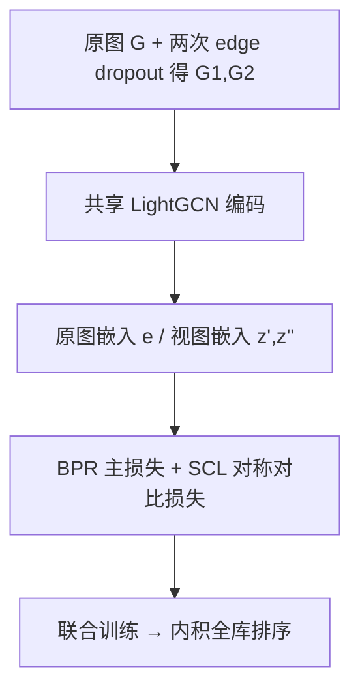
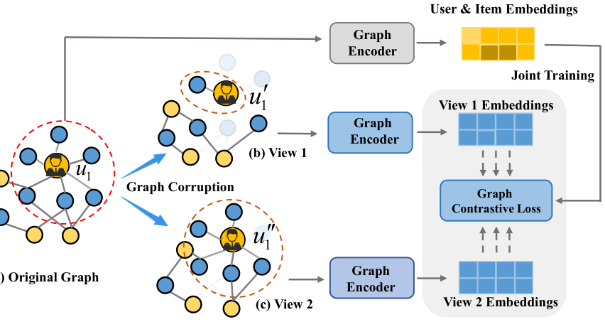

# Symmetric Graph Contrastive Learning against Noisy Views for Recommendation (面向噪声视图的对称图对比学习推荐)

- **会议/期刊**: TOIS 2025 (arXiv 2024-08)
- **作者与机构**: Chu Zhao, Enneng Yang, Yuliang Liang, Jianzhe Zhao, Guibing Guo, Xingwei Wang（东北大学软件学院 / 计算机学院）
- **推荐链路定位**: 召回（图协同过滤表征学习）
- **研究方向**: 自监督对比学习与交互去噪 / 图神经网络推荐
- **论文原文**: [https://arxiv.org/abs/2408.02691v1](https://arxiv.org/abs/2408.02691v1)
- **开源代码**: [https://github.com/user683/SGCL](https://github.com/user683/SGCL)

## TL;DR (1分钟核心速览)

图对比学习（GCL）靠 node/edge dropout 造对比视图，但删掉关键边会让生成视图与原图共享信息极少，本文将其定义为**噪声视图**（与原视图余弦相似度 < 0.1 的后 20% 视图），并用实验证明它会显著拉低推荐精度（最高 -17.96% NDCG@20）。作者提出模型无关的 **SGCL**：把 InfoNCE 换成满足对称条件的指数对比损失 SCL，理论上证明其对噪声视图鲁棒且是 WDM 下界。在 Yelp2020/Amazon-CD/Amazon-Book 三数据集上，相对 9 个 SOTA 基线 NDCG@20 最高提升 **12.25%**。

## Background & Motivation (背景与核心矛盾)

- **主流范式**: SGL/SimGCL/NCL 等 GCL 推荐方法通过随机 node/edge dropout 或嵌入扰动构造两个对比视图，再用 InfoNCE 拉近正对、推远负对，为稀疏交互补充自监督信号。
- **前人局限**: ① 随机扰动会删掉 betweenness centrality 高的关键边/节点，生成与原图语义严重偏离的视图，却被 InfoNCE 强行当作正对拉近；② AutoCF/AdaGCL/HCCF 等自适应方法虽绕开手工扰动，但只"回避"噪声、未刻画噪声如何损害推荐，且网络结构更复杂。
- **核心洞察 (Key Insight)**: 作者用 betweenness centrality 把边/节点分四档做 dropout 实验：删越重要的边，噪声视图越多、NDCG@20 掉得越狠（Amazon-CD 上 KGCL 在 Highest 档掉 17.96%，SGL 掉 11.50%）。这说明问题根源在**损失函数对噪声标签不具容忍性**，而非增广算子本身。
- **本文切入点**: 引入噪声容忍对称损失理论，把 GCL 改写成满足对称条件的指数对比损失，让模型"容忍"而非"消除"噪声视图。

## Method (核心方法设计)

### 1. 整体框架 (Overall Architecture)

SGCL 以 SGL（edge dropout 增广 + LightGCN 主干）为骨架：原图 $\mathcal{G}$与两个扰动图$\mathcal{G}_1,\mathcal{G}_2$分别过共享 GNN 得到$e_u,e_i$与$z'_u,z''_u$；主任务用 BPR 损失学协同过滤信号，辅助任务用 SCL 替代 InfoNCE 对齐两视图；两损失加权联合优化，推理时仅用原图嵌入做内积全库排序，无额外在线开销。

<figure class="paper-figure" markdown="span">
  <figcaption>图 1. 用于协同过滤的图对比学习整体框架。值得一提的是，视图 1 和视图 2 是 𝑢1（即原始图）生成的两个对比视图。我们观察到 𝑢′ 的结构</figcaption>
</figure>

### 2. 关键设计拆解 (Key Designs)

1. **噪声视图的形式化定义**：痛点是把"坏视图"当正对拉近。作者以余弦相似度量化视图与原图共享信息量，将相似度 < 0.1 的后 20% 视图定义为噪声视图，并给出可复现的构造协议（betweenness centrality 分档 + dropout ratio 0.1），使"噪声"从模糊直觉变成可度量、可实验的对象。

2. **对称对比损失 SCL**：InfoNCE 对 $s^+,s^-$的梯度之和不为常数，不满足对称条件$\mathcal{L}(f(x),y)+\mathcal{L}(f(x),\hat{y})=c$。SCL 改为
$$\mathcal{L}_{SCL}=-\frac{e^{p s^+}}{p}+\frac{\lambda\left(-e^{s^+}+\sum_{j=1}^{K}e^{s^-_j}\right)^{p}}{p},$$
当 $p=1$时退化为$\mathcal{L}_{SCL}=-(1+\lambda)e^{s^+}+\sum_j e^{s^-_j}$，对应指数损失$\mathcal{L}(y,s)=y e^{s}$，满足$\mathcal{L}(y,s)+\mathcal{L}(-y,s)=0$。直觉：指数损失对正负样本的惩罚在梯度上严格互补，噪声标签（把噪声视图标为正对）带来的风险被常数项吸收，最优解不偏移。

3. **鲁棒性证明与 WDM 下界**：作者证明当噪声率 $\eta\le\eta_{max}<0.5$时$R_\eta^{\mathcal{L}}(f^*_\eta)\le \delta/(1-2\eta_{max})$，即噪声风险最小化器与干净风险最小化器一致；并证明$-\mathbb{E}[\mathcal{L}_{SCL}^{p=1}]\le C\cdot \mathcal{I}_W(z';z'')$，SCL 是 Wasserstein 依赖度量意义下的互信息下界，比 KL 版 InfoNCE 更不敏感于单样本级扰动。训练目标为$\mathcal{L}=\mathcal{L}_{BPR}+\beta\mathcal{L}_{SCL}$，负样本为 batch 内 in-batch 负采样（$K$ 为 batch 节点数），无需显式噪声估计器。

## Experimental Setup & Evaluation Protocol (实验设置与评估协议)

- **数据集与预处理**:

| 数据集 | #Users | #Items | #Interactions | 密度 | 说明 |
| :--- | :---: | :---: | :---: | :---: | :--- |
| Yelp2020 | 71,135 | 45,063 | 1,430,480 | $4.6\times10^{-4}$ | 本地生活商户点评 |
| Amazon-CD | 22,947 | 18,394 | 328,779 | $7.9\times10^{-4}$ | 音乐 CD 品类 |
| Amazon-Book | 52,406 | 41,263 | 1,464,454 | $6.7\times10^{-4}$ | 图书品类 |

- **数据划分与防穿越**: 沿用 SELFRec 库标准划分（每用户留出固定比例交互作测试），训练/验证/测试严格隔离，测试集不参与增广。
- **排名评测协议**: 采用 **Full-Ranking 全库未交互排序**（非采样排序），指标为 Precision@10/20、Recall@10/20、NDCG@10/20。
- **对比基线与超参**: 9 个基线覆盖 MF（BasicMF）、GCN（LightGCN）、GCL（SGL/SimGCL/NCL/LightGCL）、自适应/生成式（DCCF/HCCF/AdaGCL/AutoCF/GFormer）；嵌入维度 $d=64$，层数$\{1,2,3\}$，$\beta\in\{1,\dots,10^{-5}\}$，$\lambda=p=0.01$，$\tau=0.2$，Adam lr=0.001，batch=4096。

## Key Experimental Results (实验关键数据)

### 1. 主实验对比 (Main Results)

| 数据集 | 方法 | P@20 | R@20 | NDCG@20 |
| :--- | :--- | :---: | :---: | :---: |
| Yelp2020 | SimGCL | 0.0269 | 0.0969 | 0.0663 |
| | SGL | 0.0256 | 0.0947 | 0.0644 |
| | AutoCF | 0.0258 | 0.0936 | 0.0654 |
| | GFormer | 0.0260 | 0.0974 | 0.0664 |
| | **SGCL** | **0.0279** | **0.1033** | **0.0710** |
| | Improv. | +2.95% | +6.06% | +6.93% |
| Amazon-CD | SimGCL | 0.0289 | 0.1563 | 0.1003 |
| | AutoCF | 0.0302 | 0.1571 | 0.1038 |
| | GFormer | 0.0297 | 0.1583 | 0.1036 |
| | **SGCL** | **0.0339** | **0.1741** | **0.1132** |
| | Improv. | **+12.25%** | +9.98% | +9.06% |
| Amazon-Book | AutoCF | 0.0469 | 0.1412 | 0.1123 |
| | HCCF | 0.0411 | 0.1263 | 0.1120 |
| | **SGCL** | **0.0520** | **0.1578** | **0.1232** |
| | Improv. | +10.87% | +11.76% | +9.71% |

### 2. 消融实验 (Ablation Study)

| 配置 | Amazon-CD NDCG@20 | Yelp2020 NDCG@20 | 说明 |
| :--- | :---: | :---: | :--- |
| SGL-ND | 0.0940 | 0.0650 | node dropout 增广 |
| SGL-ND w/ SCL | **0.1084** | **0.0661** | 换损失即 +15.3%/+1.7% |
| SGL-RW | 0.1024 | 0.0600 | random walk 增广 |
| SGL-RW w/ SCL | **0.1104** | **0.0670** | +7.8%/+11.7% |
| NCL | 0.0922 | 0.0621 | 结构对比基线 |
| NCL w/ SCL | 0.0939 | 0.0653 | 跨模型可插拔增益 |
| HCCF | 0.0970 | 0.0620 | 超图对比基线 |
| HCCF w/ SCL | **0.1050** | **0.0632** | 自适应方法同样受益 |

### 3. 关键实验发现 (Key Findings)

1. **损失函数是噪声鲁棒性的主开关**：仅把 SGL-ND 的 InfoNCE 换成 SCL，Amazon-CD 上 NDCG@20 从 0.0940 升至 0.1084（+15.3%），说明增益并非来自增广算子或网络结构，而是对称损失本身。
2. **SCL 可跨模型即插即用**：在 NCL、HCCF 这类自适应/嵌入增广方法上替换损失同样涨点；当训练数据注入 40% 假交互时，NCL w/ SCL 平均仍比 NCL 高约 27%，HCCF w/ SCL 高约 10%，验证了理论上的噪声容忍性。
3. **稀疏与扰动场景优势更明显**：训练集仅保留 20%–80% 交互时 SGCL 全程领先 LightGCN/SGL；edge dropout 扰动率从 10% 升到 80% 时 SGCL 曲线最平稳，而 SGL 在 Amazon-CD 上扰动率 60%→80% 时急剧下滑，印证稠密图上噪声视图危害更大。

## Highlights & Limitations (亮点、对比与审稿批判)

- **与代表作对比 (vs. Prior Work)**: 与 SGL/SimGCL 相比，SGCL 不改增广算子、只改损失，从"造好视图"转向"容忍坏视图"；与 AutoCF/AdaGCL/GFormer 相比，SGCL 不引入额外生成/去噪网络，结构复杂度与 SGL 同级；与图像域的 RINCE 相比，本文首次把对称损失落到用户-物品二部图的增广噪声场景，并给出 WDM 下界证明。
- **可迁移亮点**: ① "余弦相似度阈值 + 分位数"的噪声视图量化协议可直接复用到任何对比学习推荐的增广质量诊断；② 指数型对称损失可作为 InfoNCE 的即插即用替代，迁移到序列对比、跨域对比等任务。
- **审稿级局限批判**: ① 噪声视图定义（相似度 < 0.1、后 20%）是经验阈值，缺少对阈值敏感性的系统分析，换数据集可能需重调；② 实验仅在三个中等规模 Amazon/Yelp 数据集上做离线全库排序，无工业级千万级物品与线上 A/B 验证，且 $p\to1$ 的鲁棒性证明依赖指数损失与二分类假设，与多负样本 softmax 场景存在理论间隙。

## Rating (四维评分)

- **方法创新性 (Novelty)**: ⭐⭐⭐⭐ （把对称噪声容忍损失引入图对比推荐，问题定义清晰且有 WDM 下界与风险一致性双重理论支撑，但损失形式本身受 RINCE 启发）
- **评估协议与实验扎实度 (Protocol & Experiments)**: ⭐⭐⭐⭐ （三数据集 + Full-Ranking + 9 基线 + 跨模型消融 + 噪声/稀疏双鲁棒性分析齐全，缺显著性检验与更大规模数据）
- **写作与数学规范度 (Clarity & Rigor)**: ⭐⭐⭐⭐ （噪声视图定义、对称条件推导与证明链条完整，但部分符号前后不统一、公式排版有笔误）
- **工业落地与复现价值 (Industrial & Practical Value)**: ⭐⭐⭐⭐ （仅替换损失、推理零额外开销、代码开源，工程接入成本极低，适合作为 GCL 召回模块的默认损失升级）

