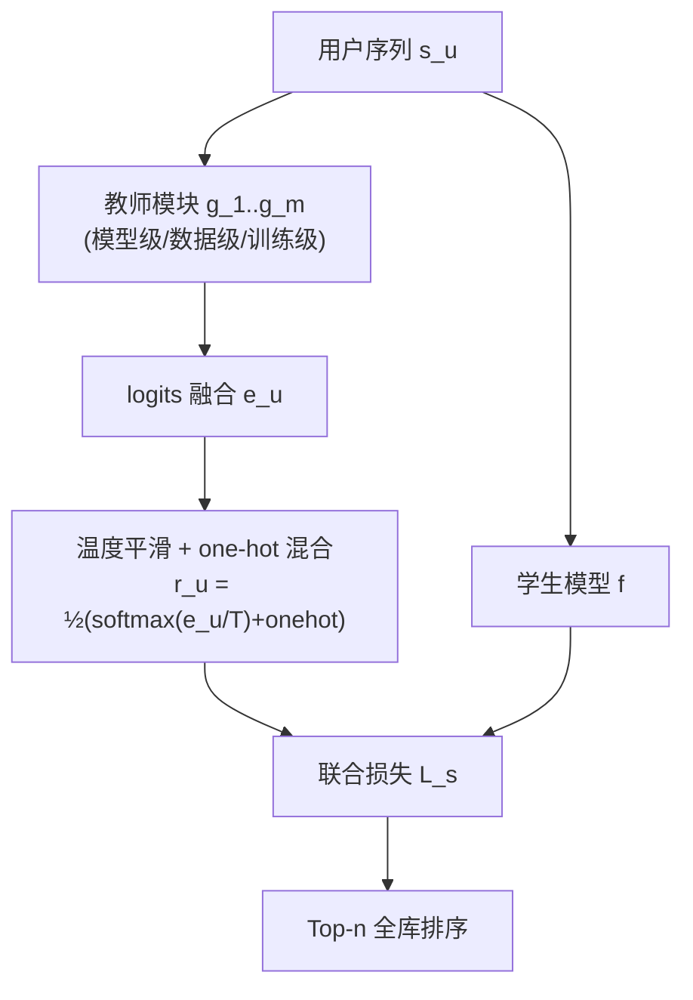

# Learning Robust Sequential Recommenders through Confident Soft Labels (通过高置信软标签学习鲁棒的序列推荐器)

- **会议/期刊**: TOIS (ACM Transactions on Information Systems)
- **作者与机构**: Shiguang Wu, Xin Xin, Pengjie Ren, Zhumin Chen, Jun Ma (山东大学)；Maarten de Rijke (阿姆斯特丹大学)；Zhaochun Ren (莱顿大学)
- **推荐链路定位**: 召回（Next-Item 序列召回）
- **研究方向**: 序列与会话推荐 / 自监督对比学习与交互去噪
- **论文原文**: [https://arxiv.org/abs/2311.02446v1](https://arxiv.org/abs/2311.02446v1)
- **开源代码**: [https://github.com/Furyton/CSRec](https://github.com/Furyton/CSRec)（基于 RecBole）

## TL;DR (1分钟核心速览)

序列推荐普遍把隐式反馈当作多分类任务、用 one-hot 标签 + softmax 训练，但 one-hot 标签稀疏且易被曝光偏差与未曝光噪声污染。本文提出 CSRec：用一个"教师模块"生成**高置信软标签**，与 one-hot 硬标签联合监督学生推荐器。教师模块给出三种构造方式——模型级（多种子集成）、数据级（多子集集成）、训练级（双教师 KL 一致性 + 低秩噪声矩阵正则）。在 4 个数据集、4 种学生模型（GRU4Rec/NextItNet/NARM/SASRec）上，采用 Leave-One-Out + **全库 Full-Ranking** 协议，Recall@10 相对 Base 最高提升约 11.5%（Last.FM/GRU4Rec），且在小众用户与低评分样本上鲁棒性显著更优。

## Background & Motivation (背景与核心矛盾)

- **主流范式**: 将用户序列 $\boldsymbol{s}_u$输入 GRU/CNN/Transformer 编码器，对全物品集做 softmax 多分类，最小化与真实下一项$i_{|\boldsymbol{s}_u|+1}$ 的交叉熵。
- **前人局限**: 其一，one-hot 标签把"未交互"一律视为负例，但未交互可能只是**未曝光**（user unawareness），交互也可能源于**曝光偏差**，标签本身被污染；其二，已有软标签方案（SoftRec 的流行度/用户级软标签、Liu 等的均匀曝光蒸馏）要么依赖昂贵难采的均匀曝光数据，要么软标签本身被训练数据与教师模型带偏。
- **核心洞察 (Key Insight)**: 作者将观测下一项建模为 $i_{|\boldsymbol{s}_u|+1}=\arg\max_{i\in\mathcal{I}}P(i|\boldsymbol{s}_u)+\epsilon$，噪声$\epsilon$可分解为模型级噪声$\epsilon_m$与数据级噪声$\epsilon_d$。**不同模型/不同数据子集捕获的噪声方向不同，而真实用户偏好应在各模型间保持一致**——因此多教师协作可在平均掉噪声的同时保留共性真实兴趣。
- **本文切入点**: 用"多教师一致性"作为置信度的代理，构造高置信软标签，仅训练期多模型、推理期单模型，兼顾鲁棒性与效率。

<figure class="paper-figure" markdown="span">
  ![图 1. 基础推荐模型与 SoftRec 方法 \[8\] 在不同用户群体上的性能。根据物品频率将物品划分为 20% 和 80% 两个区间。然后根据用户选择作为下一次交互的物品类型（热门或小众物品）划分用户。这两类用户群体分别称为热门型用户和小众型用户。我们分别评估每个群体上的推荐性能。我们在 (a) Yelp 和 (b) Electronics 数据集上选择 GRU4Rec \[28\] 作为基础推荐模型，SoftRec \[8\] 作为对比方法。小众型用户获得](../../../../assets/papers/2311.02446v1/figure_1.png)<figcaption>图 1. 基础推荐模型与 SoftRec 方法 [8] 在不同用户群体上的性能。根据物品频率将物品划分为 20% 和 80% 两个区间。然后根据用户选择作为下一次交互的物品类型（热门或小众物品）划分用户。这两类用户群体分别称为热门型用户和小众型用户。我们分别评估每个群体上的推荐性能。我们在 (a) Yelp 和 (b) Electronics 数据集上选择 GRU4Rec [28] 作为基础推荐模型，SoftRec [8] 作为对比方法。小众型用户获得</figcaption>
</figure>

## Method (核心方法设计)

### 1. 整体框架 (Overall Architecture)

CSRec 是"教师生成软标签 + 学生联合监督"的两段式学习框架。教师模块由 $m$个与学生同构的模型$\{g_1,\dots,g_m\}$组成，先各自训练（或按训练级方式协同训练），再将其 logits 融合为$e_u$；随后把融合 logits 经温度$T$平滑后与 one-hot 标签按等权混合，得到软标签$r_u$；学生模型$f$同时优化 one-hot 交叉熵与对$r_u$ 的 KL 散度。推理阶段只保留学生模型，教师全部丢弃，因此在线开销与 Base 完全一致。

### 2. 关键设计拆解 (Key Designs)

1. **模型级 / 数据级教师（集成式去噪）**：针对 $\epsilon_m$与$\epsilon_d$两类噪声，分别用"同架构不同随机种子"与"同架构不同数据子集（均匀采样比例$p$）"训练$m$个教师，输出取平均$e_u=\sum_k g_k(\boldsymbol{s}_u)/m$。直觉是模型特有噪声零均值化后被抵消，而跨模型一致的信号（真实偏好）在平均中保留，从而得到低方差软标签。

2. **训练级教师（端到端一致性正则）**：不做事后集成，而是让主教师 $g_1$在辅助教师$g_2$ 的引导下直接学出鲁棒输出。由贝叶斯展开可证负对数似然存在上界，导出鲁棒正则：
$$\ell_r=\alpha\,\mathrm{KL}(P_{g_2}\|P_{g_1})+(1-\alpha)\,\mathrm{KL}(P_{g_1}\|P_{g_2})-\sum_{j\in\mathcal{I}}\log(h_{i,j})\,P_{g_1}(j|\boldsymbol{s}_u)$$
其中 $h(i,j)\approx P(i|j)$用低秩分解$[h]=\mathbf{M}_{|\mathcal{I}|\times d}\mathbf{N}_{d\times|\mathcal{I}|}$建模为**全局噪声转移矩阵**，刻画"理想物品$j$被观测成$i$"的混淆概率。双向 KL 强制两教师互一致，末项则用噪声矩阵校正观测偏差——这是本文相对普通蒸馏损失的唯一增量项。

3. **训练目标、负采样与推理效率**：学生损失为 $\ell_s=(1-\beta)\ell_{ce}(\boldsymbol{s}_u,f,i_{|\boldsymbol{s}_u|+1})+\beta\,\mathrm{KL}(P_f(\cdot|\boldsymbol{s}_u)\|r_u)$，其中$r_u=\frac{1}{2}(\mathrm{softmax}(e_u/T)+\mathrm{onehot}(i_{|\boldsymbol{s}_u|+1}))$。**全程免负采样**（softmax 全库归一化），规避了 BPR/BCE 的采样分布敏感问题；训练需$m{+}1$个模型（$m=2$），推理仅 1 个。

## Experimental Setup & Evaluation Protocol (实验设置与评估协议)

- **数据集与预处理**: 全部采用 `5-core` 过滤，序列按固定长度切分（Last.FM 长度 20，其余为 10），过短补 padding、过长切子序列。

| 数据集 | #Users | #Items | #Interactions | 稀疏度 | 特征/场景说明 |
| :--- | :---: | :---: | :---: | :---: | :--- |
| Last.FM | 1,090 | 3,646 | 52,551 | 98.7% | 音乐收听，交互最稠密 |
| Yelp | 30,431 | 20,033 | 316,354 | 99.95% | 本地商户评论 |
| Electronics | 83,427 | 29,351 | 684,449 | 99.97% | 亚马逊电子产品，含评分 |
| Movies & TV | 47,966 | 21,035 | 625,813 | 99.94% | 亚马逊影视，含评分 |

- **数据划分与防穿越 (Splitting Strategy)**: `Leave-One-Out`——每用户最后一项作测试、倒数第二项作验证，其余训练。
- **排名评测协议 (Ranking Protocol)**: 无偏 `Full-Ranking`（全物品集作为候选，未采样负例）。指标 Recall@10 / NDCG@10；另在两个 Amazon 数据集上引入**过滤版指标** Recall+@10 / NDCG+@10，仅统计真实评分 $r_u\ge\delta=4$ 的样本，用于检验"推荐是否命中真实正偏好"（评分仅用于评测，不参与训练）。
- **对比基线与超参设置**: 学生模型 GRU4Rec / NextItNet / NARM / SASRec；训练方案 Base、SoftRec、CSRec-M/D/T。Embedding 维度 $d=64$，$\alpha,\beta\in\{0.25,0.5,0.75\}$，$T\in\{1,3,6,9\}$，$m=2$，$p=0.8$，Adam lr=0.001；显著性检验$p<0.05$/$p<0.1$。

## Key Experimental Results (实验关键数据)

### 1. 主实验对比 (Main Results)

Recall@10 (%)，节选最具代表性的四组（GRU4Rec / NextItNet / NARM / SASRec）：

| 数据集 | 方法 | GRU4Rec | NextItNet | NARM | SASRec |
| :--- | :--- | :---: | :---: | :---: | :---: |
| Last.FM | Base | 16.683 | 15.456 | 20.260 | 20.350 |
| | SoftRec | 17.427 | 15.473 | 20.486 | 20.746 |
| | **CSRec-D** | **18.607** | 16.201 | 20.739 | **21.131** |
| | CSRec-M | 18.165 | **16.466** | **20.819** | 20.874 |
| | Improv. vs Base | +11.5% | +6.5% | +2.8% | +3.8% |
| Yelp | Base | 5.812 | 8.077 | 8.587 | 8.523 |
| | SoftRec | 6.108 | 8.303 | 8.108 | 9.459 |
| | **CSRec-T** | **6.526** | **8.589** | 8.700 | 9.421 |
| | CSRec-M | 6.405 | 8.587 | **8.900** | **9.485** |
| | Improv. vs Base | +12.3% | +6.3% | +3.6% | +11.3% |
| Electronics | Base | 5.178 | 4.900 | 5.211 | 6.932 |
| | SoftRec | 5.431 | 5.204 | 5.490 | 6.963 |
| | **CSRec-T** | **5.595** | 5.356 | **5.905** | **7.001** |
| | CSRec-M | 5.545 | **5.666** | 5.787 | 6.737 |
| | Improv. vs Base | +8.1% | +15.6% | +13.3% | +1.0% |
| Movies & TV | Base | 8.413 | 7.377 | 9.383 | 11.191 |
| | SoftRec | 9.541 | 8.228 | 9.402 | 10.908 |
| | **CSRec-T** | **9.704** | 8.461 | 9.876 | 11.195 |
| | CSRec-M | 9.638 | **8.744** | **9.999** | **11.198** |
| | Improv. vs Base | +15.3% | +18.5% | +6.6% | +0.1% |

过滤版指标（Recall+@10）上，Electronics 的 GRU4Rec 由 Base 5.577 → CSRec-T **5.975**，Movies & TV 的 NARM 由 9.712 → CSRec-M **10.361**，说明增益并非来自"命中高曝光低评分物品"。

### 2. 消融实验 (Ablation Study)

| 消融对象 | 设置 | 关键指标变化 | 结论 |
| :--- | :--- | :--- | :--- |
| 教师数量 $m$（CSRec-M/D，NARM） |$m$: 1 → 2 → 3 → 4 |$m{=}2$时 NDCG@10 明显上升，$m\ge3$ 后基本持平 | 2 个教师即够，边际收益递减 |
| 子采样比例 $p$（CSRec-D） |$p\in\{0.5,0.6,0.7,0.8,0.9\}$|$p{=}0.8$最优；$p$过大子集重叠、教师趋同，$p$过小随机性过强 |$p=0.8$ 为稳健默认值 |
| 噪声矩阵项 $-\sum_j\log(h_{i,j})P_{g_1}(j\|\boldsymbol{s}_u)$（CSRec-T） | with vs. without | Electronics Recall@10 由 ~0.060 升至 ~0.066；Movies & TV 亦一致提升 | 低秩噪声转移矩阵是训练级教师的核心增益来源 |

### 3. 关键实验发现 (Key Findings)

1. **教师类型与数据稠密度强相关**：Last.FM（最稠密）上 CSRec-D 最优（GRU4Rec 18.607），而稀疏的 Yelp/Electronics 上 CSRec-T 更稳（Yelp GRU4Rec 6.526，较 SoftRec 再 +6.8%）；CSRec-M 则在四数据集上普遍稳健，可作默认选择。
2. **学生架构越"弱"收益越大**：RNN/CNN 学生（GRU4Rec、NextItNet）提升最显著（Movies & TV 上 NextItNet +18.5%），自注意力 SASRec 提升最小（+0.1%~+1.0%），与"Transformer 本身更抗噪"的既有结论吻合，但 CSRec 仍能在多数情形带来显著增益。
3. **软标签纠偏了流行度偏差**：图 3 显示 SoftRec 在小众型用户上反而掉点（图 1 已暴露该问题），而 CSRec 三种方法在 niche-type 用户上均回升，Yelp 上热门型与小众型用户同时提升——说明多教师一致性筛掉了"有害流行度偏差"，保留了跨模型一致的"有益大众兴趣"。

## Highlights & Limitations (亮点、对比与审稿批判)

- **与代表作对比 (vs. Prior Work)**: 相较 SoftRec（单一流行度教师，软标签被数据偏差污染、伤害小众用户），CSRec 用多教师一致性把"偏差"与"共识"分离；相较 Liu 等的均匀曝光蒸馏（需昂贵均匀曝光数据），CSRec 完全从有偏日志中自举软标签；相较 CV/NLP 的多教师蒸馏（目标是压缩模型、训练与推理均需集成），CSRec 的目标是**抗噪鲁棒性**且推理零额外开销。
- **可迁移亮点**: (i) "多随机种子/多子集教师平均"是极低成本、即插即用的正则手段，可直接套用到任何 softmax 多分类召回模型；(ii) 低秩噪声转移矩阵 $h=\mathbf{M}\mathbf{N}$ 的建模思路可迁移到曝光偏差校正与标签噪声学习。
- **审稿级局限批判**: (i) 训练需 $m+1$ 个完整模型串行训练，训练成本约为 Base 的 3 倍，论文自认"pipeline 低效"，且未给出训练耗时对比；(ii) 全库 softmax 在 8 万物品级数据集尚可，但未验证十万级以上物品集的可扩展性，也未与 sampled softmax 等高效方案对比；(iii) 过滤版指标仅覆盖两个 Amazon 数据集，鲁棒性结论的外部效度有限。

## Rating (四维评分)

- **方法创新性 (Novelty)**: ⭐⭐⭐⭐ （把"多教师一致性"重新诠释为软标签置信度代理，训练级方法有贝叶斯上界推导与低秩噪声矩阵支撑，但整体属蒸馏框架的巧妙迁移而非全新范式）
- **评估协议与实验扎实度 (Protocol & Experiments)**: ⭐⭐⭐⭐ （4 数据集 × 4 学生模型 × 5 训练方案的全库排序矩阵相当完整，另设评分过滤指标与流行度/长度/稀疏度分桶分析；扣分在于缺少训练开销与更大规模物品集的验证）
- **写作与数学规范度 (Clarity & Rigor)**: ⭐⭐⭐⭐ （三种教师模块的动机—公式—算法伪代码链条清晰，Eq.3–Eq.12 的 KL 上界推导完整；但 $h(i,j)$ 的条件独立假设略强，且部分符号在正文与附录间复用稍显紧凑）
- **工业落地与复现价值 (Industrial & Practical Value)**: ⭐⭐⭐⭐ （推理期零额外开销、免负采样、代码已开源于 RecBole 生态，落地门槛低；主要障碍是训练期 3 倍算力与教师超参 $m,p,\alpha,\beta,T$ 的调优成本）

