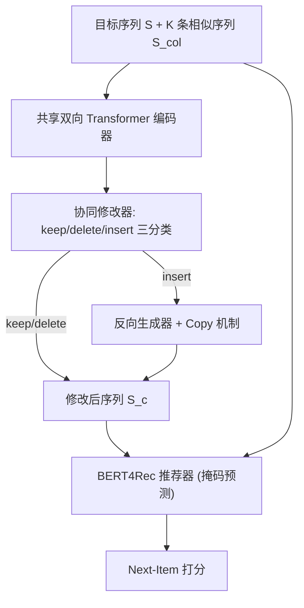
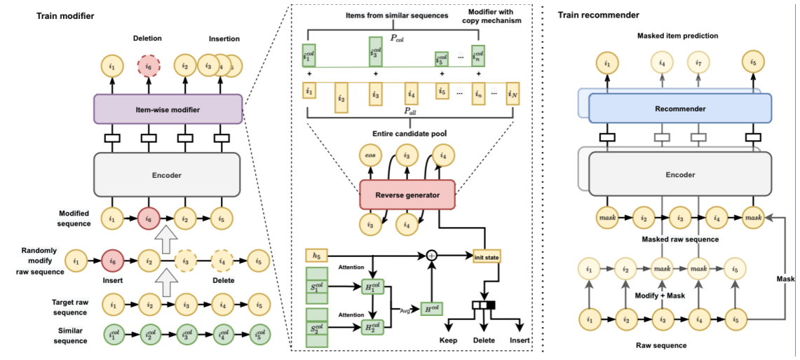

# Privacy-Preserving Sequential Recommendation with Collaborative Confusion (基于协同混淆的隐私保护序列推荐)

- **会议/期刊**: TOIS (ACM Transactions on Information Systems)
- **作者与机构**: Wei Wang, Yujie Lin, Pengjie Ren, Zhumin Chen, Tsunenori Mine, Jianli Zhao, Qiang Zhao, Moyan Zhang, Xianye Ben, Yujun Li（山东大学、之江实验室、山东科技大学、九州大学）
- **推荐链路定位**: 召回（序列推荐 Next-Item 预测）
- **研究方向**: 序列与会话推荐 / 去偏公平、可信隐私与工业架构
- **论文原文**: [https://arxiv.org/abs/2401.04423v1](https://arxiv.org/abs/2401.04423v1)
- **开源代码**: 暂未开源

## TL;DR (1分钟核心速览)

现有隐私保护推荐多基于差分隐私（加噪致精度骤降）或联邦学习（通信开销大），且几乎不覆盖序列推荐。本文提出 CLOUD：在推荐发生**之前**，用相似序列的协同信号驱动一个逐项修改器（keep/delete/insert）直接改写用户原始交互序列，并设计 copy 机制鼓励从相似序列插入物品以提升混淆度。在 Beauty/Yelp/Sports 三个数据集上，CLOUD 对序列的修改率达 30%–66%（Yelp 上 Jaccard 相似度仅 0.4178），而 HR/MRR 与最强基线 STEAM 差距不足 0.5%，相对 DuoRec 平均提升 1.12–1.82 个点。

## Background & Motivation (背景与核心矛盾)

- **主流范式**: 序列推荐以 BERT4Rec/SASRec 等 Transformer 架构为主，近年引入自监督（CL4SRec、DuoRec）与去噪（FMLP-Rec、STEAM）增强鲁棒性；隐私保护侧则依赖差分隐私加噪或联邦学习分布式训练。
- **前人局限**: (1) 差分隐私在 embedding/梯度上加噪，扰动中间参数，常导致显著精度下降；联邦学习虽隐私性更强，但分布式训练对通信与终端设备要求高，且限制模型复杂度。(2) 现有隐私保护研究主要面向协同过滤/矩阵分解，序列推荐场景几乎空白；唯一相关的 DeepRec 采用半分布式个性化微调，通信与时间成本高。
- **核心洞察 (Key Insight)**: 最相关的 STEAM 虽能改写输入序列（删误点、补漏点），但仅看单条目标序列，信息不足使其强烈倾向 keep 操作——Yelp 上 keep 比例高达 99.51%，修改率过低，无法形成有效混淆。
- **本文切入点**: 引入 K 条 Jaccard 相似序列作为协同信号共同决定操作类型，并用 copy 机制让相似序列中的物品更易被插入，从而在**源头**（数据存储前）提升序列困惑度，使攻击者即便拿到序列也难以分辨真实交互。

## Method (核心方法设计)

### 1. 整体框架 (Overall Architecture)

CLOUD 由编码器、逐项修改器（item-wise modifier）与推荐器三部分组成，修改器与推荐器**共享编码器**。编码器用双向 Transformer 将目标序列 $S$与 K 条相似序列$S_{col}$编码为隐表示；修改器基于目标与相似序列的共享表示，对每个位置预测 keep/delete/insert 三类操作，若为 insert 则由反向生成器逐项生成待插入物品（copy 机制偏向相似序列物品），反向插入到目标物品之前；修改后的序列$S_c$与原始序列$S_r$ 一同送入 BERT4Rec 式推荐器做掩码物品预测。训练时修改器通过"随机破坏—复原"的自监督任务学习删/插能力，二者以联合损失端到端优化；线上仅存储修改后序列。

<figure class="paper-figure" markdown="span">
  <figcaption>图 2. CLOUD 概览。编码器用于将目标原始序列和相似序列编码为隐藏表示。训练逐项修改器时，需要执行删除操作和插入操作以恢复随机修改后的序列。目标序列及其修改版本共同用于训练推荐器。最后，CLOUD 联合优化逐项修改器和推荐器的损失函数。</figcaption>
</figure>

### 2. 关键设计拆解 (Key Designs)

1. **协同修改器（Collaborative Modifier）**：痛点在于 STEAM 只看单序列、信息不足而倾向 keep。CLOUD 先用注意力聚合相似序列得到共享表示，再据此做三分类：
$$a_k=\mathrm{softmax}\left(H_e (H^k_{col})^{\top}\right),\quad H'_e=H_e+\frac{1}{K}\sum_{k=1}^{K}a_k H^k_{col},\quad P(\hat{o}_t|S)=\mathrm{softmax}(W h'_t)$$
直觉：相似序列提供了"该用户群体典型行为"的先验，使模型敢于执行 delete/insert，而非保守 keep。

2. **Copy 机制（Copy Mechanism）**：痛点在于若插入物品仅从全库 softmax 采样，插入的多为高频热门物，混淆性弱且与用户兴趣无关。CLOUD 用生成器末位表示 $h_n$对 K 条相似序列做注意力得到上下文$c_n$，再以门控混合"从相似序列复制"与"从全库生成"两路概率：
$$P(\hat{i}_j|S^{<i_t}_{1:n-1})=P(I_{col}|S_{col},h_n)\cdot P_{col}(i_j)+P(I_{all}|S_{col},h_n)\cdot P_{all}(i_j)$$
其中 $P_{col}(i_j)\propto \exp(e_j h_n)\times N$，$N$ 为物品在相似序列中的出现次数。直觉：插入物既"像该用户会交互的"又"不是真实记录"，兼顾混淆度与推荐可用性。

3. **训练目标、负采样与推理效率**：修改器用随机破坏序列 $S_m$复原$S_r$的自监督负对数似然$L_{mod}$；推荐器对$S_r$与$S_c$同时做掩码物品预测得$L_{rec}$；总损失$L=L_{mod}+L_{rec}$。训练时随机破坏概率$p_k{=}0.4,p_d{=}0.5,p_i{=}0.1$，掩码率$p_m{=}0.5$；验证/测试对每个正样本随机采 99 个负样本。推理时修改器仅需处理单用户短序列（≤50），可本地部署，通信开销远低于联邦学习。

## Experimental Setup & Evaluation Protocol (实验设置与评估协议)

- **数据集与预处理**: 过滤交互数 <5 的用户与物品（`5-core`），按时间排序成序列；相似序列取 Jaccard 相似度 >0.1 的前 10 条。

| 数据集 | #Users | #Items | #Interactions | 稀疏度/密度 | 特征/场景说明 |
| :--- | :---: | :---: | :---: | :---: | :--- |
| Beauty | 22,362 | 12,101 | 194,682 | 0.07% | Amazon 美妆评论 |
| Yelp | 22,844 | 16,552 | 236,999 | 0.06% | 本地商户（仅 2019 年） |
| Sports | 35,597 | 18,357 | 294,483 | 0.05% | Amazon 运动户外 |

- **数据划分与防穿越 (Splitting Strategy)**: `Leave-One-Out`——每序列最后一项为测试、倒数第二项为验证、其余训练。
- **排名评测协议 (Ranking Protocol)**: `Sampled Ranking`，每个验证/测试正样本随机采 99 个未交互负样本；另设全负样本（Full-Ranking）实验对比（表 6）。
- **对比基线与超参设置**: 基线含 GRU4Rec、SASRec、BERT4Rec、SRGNN（vanilla）、CL4SRec、DuoRec、STEAM（SSL）、FMLP-Rec（去噪）。嵌入维度 $d{=}64$，Transformer 1 层 1 头，dropout 0.5，Adam 学习率 0.001，梯度裁剪$[-5,5]$，序列最大长度 50、修改后上限 60，单点最多连续插入 5 项。

## Key Experimental Results (实验关键数据)

### 1. 主实验对比 (Main Results)

Beauty 数据集（99 负采样，节选）：

| Model | HR@5 | HR@10 | HR@20 | MRR@5 | MRR@20 | Sum |
| :--- | :---: | :---: | :---: | :---: | :---: | :---: |
| GRU4Rec | 0.3295 | 0.4259 | 0.5517 | 0.2163 | 0.2376 | 1.9902 |
| BERT4Rec | 0.3666 | 0.4728 | 0.6011 | 0.2337 | 0.2566 | 2.1790 |
| SASRec | 0.3657 | 0.4556 | 0.5763 | 0.2543 | 0.2744 | 2.1928 |
| FMLP-Rec | 0.3969 | 0.4872 | 0.5994 | 0.2800 | 0.2997 | 2.3554 |
| CL4SRec | 0.4067 | 0.5056 | 0.6199 | 0.2785 | 0.2994 | 2.4019 |
| DuoRec | 0.4094 | 0.5078 | 0.6200 | 0.2884 | 0.3092 | 2.4366 |
| STEAM | **0.4284** | 0.5256 | **0.6486** | 0.2899 | 0.3112 | **2.5069** |
| CLOUD | 0.4252 | **0.5258** | 0.6449 | **0.2910** | **0.3125** | 2.5041 |
| CLOUD-R | 0.4154 | 0.5210 | 0.6449 | 0.2749 | 0.2975 | 2.4429 |

Yelp 上 CLOUD Sum=3.7958（STEAM 3.8087，DuoRec 3.7078）；Sports 上 CLOUD Sum=2.5056（STEAM 2.5103，DuoRec 2.3965）。相对 DuoRec，CLOUD 在 Beauty/Yelp/Sports 上各指标平均提升 1.12/1.47/1.82 个点。

### 2. 消融实验 (Ablation Study)

隐私混淆能力消融（表 3，Similarity 越低越好）：

| 变体 | Beauty Sim. | Beauty Insert | Yelp Sim. | Yelp Insert | Sports Sim. | Sports Insert |
| :--- | :---: | :---: | :---: | :---: | :---: | :---: |
| STEAM | 0.7990 | 0.0801 | 0.8793 | 0.0028 | 0.7856 | 0.0055 |
| Variant-1 (去 copy) | 0.6642 | 0.1406 | 0.6682 | 0.2205 | 0.6564 | 0.1072 |
| Variant-2 (仅目标序列) | 0.6009 | 0.2096 | 0.5181 | 0.4251 | 0.6333 | 0.2042 |
| CLOUD | **0.5968** | **0.2505** | **0.4178** | **0.6646** | **0.6301** | **0.2577** |

### 3. 关键实验发现 (Key Findings)

1. **协同信号是修改率跃升的主因**：仅引入相似序列共享表示（Variant-1）就把 Yelp 的 keep 比例从 99.51% 压到 77.61%，再叠加 copy 机制（CLOUD）进一步降至 33.43%，说明"信息不足导致保守 keep"的诊断成立。
2. **插入比删除更有隐私价值**：CLOUD 的修改率提升主要来自 insert（Yelp 上 66.46%），删除后剩余记录仍全为真实交互，而插入才真正制造不可分辨的混淆；同时 CLOUD 在 Beauty 上甚至优于原始序列版本 CLOUD-R（Sum 2.5041 vs 2.4429），说明修改带来的自监督信号反哺了物品表示。
3. **鲁棒性与推荐器选择强相关**：在 40%/30%/30% 随机破坏的模拟测试集上，CLOUD 总分降幅最小（Beauty 甚至 +0.32%），BERT4Rec 降幅达 -10.89%；但全负样本评测下双向 Transformer 版本 CLOUD-bi 明显落后，单向版 CLOUD-uni 最强（Beauty Sum 0.4217 vs DuoRec 0.4121），负样本增至 499 时 CLOUD-bi 甚至弱于 SASRec——双向结构适合小规模排序，单向结构适合大规模粗排。

## Highlights & Limitations (亮点、对比与审稿批判)

- **与代表作对比 (vs. Prior Work)**: 相比差分隐私（扰动 embedding/梯度、精度损失大）与联邦学习（通信/设备负担重），CLOUD 在数据源头改写序列、集中式训练无额外通信；相比 STEAM（单序列、修改率极低、仅删不插），CLOUD 借相似序列与 copy 机制把修改率提升一个量级，且首次将隐私保护目标引入序列推荐。
- **可迁移亮点**: (1) "相似序列注意力 + copy 门控"的插入生成范式可迁移到序列数据增广与对比学习正样本构造；(2) 用随机破坏—复原的自监督任务训练编辑算子，可复用于去噪推荐与数据清洗。
- **审稿级局限批判**: (1) 训练阶段仍需真实交互数据，且修改器并不改写全部记录（Beauty 上仍有 68.8% keep），隐私保证是启发式而非可证明的（如 DP 的 $\epsilon$ 界）；(2) 隐私评估仅用 Jaccard 相似度与操作比例，缺少针对成员推断/序列重构攻击的实际攻击实验，混淆强度的安全性论证偏弱。

## Rating (四维评分)

- **方法创新性 (Novelty)**: ⭐⭐⭐⭐ （从"数据源头混淆"切入隐私保护，协同修改器 + copy 机制设计新颖，但整体是 STEAM 的自然扩展）
- **评估协议与实验扎实度 (Protocol & Experiments)**: ⭐⭐⭐ （三数据集 + 消融 + 鲁棒性 + 负样本敏感性分析较完整，但隐私侧缺乏真实攻击评测，主实验仅 99 负采样）
- **写作与数学规范度 (Clarity & Rigor)**: ⭐⭐⭐⭐ （模块拆解清晰、公式完整，但符号表与正文略有冗余，隐私性缺少形式化定义）
- **工业落地与复现价值 (Industrial & Practical Value)**: ⭐⭐⭐⭐ （修改器可本地轻量部署、推荐器可插拔替换，工程友好；但未开源、隐私收益需线上验证）

