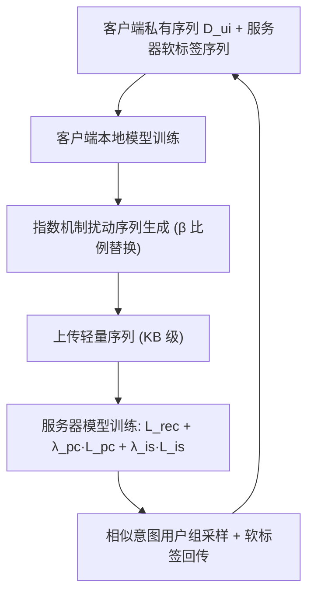
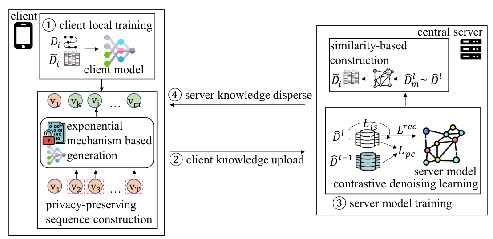

# PTF-FSR: A Parameter Transmission-Free Federated Sequential Recommender System (无参数传输的联邦序列推荐系统)

- **会议/期刊**: TOIS 2025 (arXiv 2024)
- **作者与机构**: Wei Yuan, Chaoqun Yang, Liang Qu, Quoc Viet Hung Nguyen, Guanhua Ye, Hongzhi Yin (昆士兰大学 / 格里菲斯大学 / 北邮)
- **推荐链路定位**: 端到端序列推荐（联邦训练范式）
- **研究方向**: 序列与会话推荐 / 去偏公平、可信隐私与工业架构
- **论文原文**: [论文原文链接](https://arxiv.org/abs/2406.05387v1)
- **开源代码**: 暂未开源

## TL;DR (1分钟核心速览)

现有 FedSeqRec 依赖在客户端与服务器间反复传输**全局共享模型参数**，导致服务商核心模型知识产权泄露且通信开销与参数量成正比（MoRec 单次传输超 100MB）。本文提出 PTF-FSR：客户端与服务器模型**异构且互不共享**，仅传输经指数机制扰动的**物品序列**作为知识载体，服务器端用偏好一致性 + 意图相似性两个对比任务从噪声序列中蒸馏高层模式。在 Cell Phone/Baby/MIND 三数据集、Full-Ranking 协议下，PTF-FSR(MoRec) 在 Cell Phone 上 HR@20 达 0.1260，较最强 FedSeqRec 基线提升约 133%，而单轮通信仅 1.2KB（较 Fed-SASRec 降低约 3 个数量级）。

## Background & Motivation (背景与核心矛盾)

- **主流范式**: FedSeqRec 采用参数传输协议——服务器下发全局序列模型，客户端本地训练后回传参数，服务器用 FedAvg 聚合。
- **前人局限一（模型隐私）**: 该协议强制服务商开源其精心调优的序列模型，模型即核心 IP，数字水印只能追踪无法阻止抄袭，服务商实际不愿公开。
- **前人局限二（通信开销）**: 通信量与参数量线性相关。ID-based 模型受物品嵌入表支配（物品数越多越贵），ID-free 模型（MoRec/BERT-small）单次传输即超 100MB，LLM 时代彻底不可行。
- **核心洞察 (Key Insight)**: 两大缺陷同源于"用参数承载知识"。若将知识载体从参数解耦为**模型无关的轻量序列**，则服务器可独享复杂模型、客户端跑简单公开模型，通信量仅与序列长度相关。
- **本文切入点**: 将作者前作 PTF-FedRec（面向 CF 的 $(u_i,v_j,\hat{r}_{ij})$ 三元组载体）扩展到序列场景——载体变为物品序列，需重新设计序列级隐私保护与知识迁移机制。

## Method (核心方法设计)

### 1. 整体框架 (Overall Architecture)

服务器持有高价值复杂模型 $\mathcal{F}_s$（GRU4Rec/SASRec/MoRec），各客户端持有轻量公开模型$\mathcal{F}_{u_i}$（小维度 SASRec），二者**异构**。每轮：①客户端在本地私有序列$\mathcal{D}_{u_i}$与服务器下发的软标签序列$\tilde{\mathcal{D}}_{u_i}$上训练；②客户端用训练好的本地模型 + 指数机制生成扰动序列$\hat{\mathcal{D}}^l_{u_i}$上传；③服务器在噪声序列上用推荐损失 + 两个对比辅助任务训练；④服务器按意图相似性采样序列、打软标签回传客户端。循环$L$ 轮后服务器模型收敛，推理时客户端上传扰动序列查询、服务器返回推荐。

<figure class="paper-figure" markdown="span">
  <figcaption>图 2. PTF-FSR 包括四个步骤。客户端首先在本地数据集上训练其客户端模型。之后，它们利用训练好的客户端模型通过指数机制生成序列，并将序列发送到中央服务器。服务器在噪声数据上通过若干对比辅助任务训练其精细模型。最后，中央服务器利用训练好的服务器模型向客户端返回一些知识。</figcaption>
</figure>

### 2. 关键设计拆解 (Key Designs)

1. **指数机制序列扰动（隐私-效用折中）**：全序列随机采样会摧毁语义（本地模型早期欠训练，期望分布本身不可靠）。本文只对原序列随机选比例 $\beta$ 的物品做指数机制替换，其余保留：
$$Pr[\hat{v}=v_j]=\frac{\exp(\frac{\epsilon}{2\Delta}r_{ij})}{\sum_{v_k\in\mathcal{V}'_{u_i}}\exp(\frac{\epsilon}{2\Delta}r_{ik})}$$
每个位置满足 $\epsilon$-DP，整条序列由组合定理满足$\epsilon\cdot T_{u_i}$-DP。混合真实与采样物品使服务器无法辨别真实交互，同时保留足够语义供服务器学习。

2. **双对比去噪（服务器端从噪声中提纯）**：噪声序列直接喂推荐损失效果有限，故加两个辅助任务。**偏好一致性** $\mathcal{L}_{pc}$：同一用户相邻两轮上传序列源于同一偏好，应互为正样本、其他用户为负；**意图相似性**$\mathcal{L}_{is}$：末位交互物品最相似的用户群$\mathcal{U}_{u_i}$ 视为意图相近，其序列表征应拉近：
$$\mathcal{L}_{is}=-\log\frac{\sum_{u_k\in\mathcal{U}_{u_i}}\exp(sim(\mathbf{e}^l_{u_i},\mathbf{e}^l_{u_k}))}{\sum_{u_k\in\mathcal{U}_{u_i}}\exp(sim(\cdot))+\sum_{u_j\in\mathcal{U}^l/\mathcal{U}_{u_i}}\exp(sim(\mathbf{e}^l_{u_i},\mathbf{e}^l_{u_j}))}$$
直觉：噪声是逐轮独立注入的，而用户偏好与意图是跨轮稳定的，对比学习恰好把"稳定信号"从"随机噪声"中分离出来。

3. **训练目标、负采样与推理效率**：服务器总损失 $\mathcal{L}_s=\mathcal{L}_{rec}+\lambda_{pc}\mathcal{L}_{pc}+\lambda_{is}\mathcal{L}_{is}$，$\mathcal{L}_{rec}$为标准 BPR 式下一物品预测，负样本从非交互池均匀采样；客户端对软标签序列做软标签匹配。通信量仅$T_{u_i}$ 个整数（<3KB），与模型规模完全解耦，故可承载 MoRec 级大模型。

## Experimental Setup & Evaluation Protocol (实验设置与评估协议)

- **数据集与预处理**（过滤 <5 次交互用户，最大序列长 20，最后两物品分别作验证/测试）：

| 数据集 | #Users | #Items | #Interactions | 密度 | 场景说明 |
| :--- | :---: | :---: | :---: | :---: | :--- |
| Cell Phone | 13,174 | 5,970 | 103,593 | 0.13% | 亚马逊手机评论 |
| Baby | 19,445 | 7,050 | 160,792 | 0.11% | 亚马逊母婴 |
| MIND | 6,260 | 14,505 | 96,125 | 0.10% | 微软新闻阅读 |

- **数据划分与防穿越**: `Leave-One-Out` 式——每用户序列最后两物品分别作验证与测试，其余训练。
- **排名评测协议**: 无偏 `Full-Ranking`（对全部未交互物品排序），指标 HR@20 / NDCG@20。
- **对比基线与超参**: 集中式 GRU4Rec/SASRec/MoRec；联邦式 FMSS、Fed-GRU4Rec、Fed-SASRec（Fed-MoRec 因算力不可行仅估通信）。客户端模型嵌入/隐层维度 8、单层；服务器 32 维、两层；MoRec 用 BERT-small。默认 $\epsilon=1.0,\beta=0.5,\lambda_{pc}=\lambda_{is}=0.01$，全局 20 轮，每子轮 256 客户端。

## Key Experimental Results (实验关键数据)

### 1. 主实验对比 (Main Results)

| 方法 | Cell Phone HR@20 | Cell Phone NDCG@20 | Baby HR@20 | Baby NDCG@20 | MIND HR@20 | MIND NDCG@20 |
| :--- | :---: | :---: | :---: | :---: | :---: | :---: |
| GRU4Rec (集中) | 0.0710 | 0.0299 | 0.0375 | 0.0141 | 0.1309 | 0.0581 |
| SASRec (集中) | 0.0869 | 0.0389 | 0.0386 | 0.0156 | 0.1525 | 0.0700 |
| MoRec (集中) | 0.1098 | 0.0453 | 0.0561 | 0.0225 | 0.0690 | 0.0286 |
| FMSS | 0.0541 | 0.0197 | 0.0253 | 0.0094 | 0.0744 | 0.0253 |
| Fed-GRU4Rec | 0.0529 | 0.0193 | 0.0240 | 0.0091 | 0.0702 | 0.0243 |
| Fed-SASRec | 0.0520 | 0.0189 | 0.0304 | 0.0104 | 0.0661 | 0.0230 |
| PTF-FSR(GRU4Rec) | 0.0879 | 0.0400 | 0.0355 | 0.0145 | 0.1316 | 0.0622 |
| PTF-FSR(SASRec) | 0.0973 | 0.0439 | 0.0430 | 0.0176 | 0.1380 | 0.0626 |
| **PTF-FSR(MoRec)** | **0.1260** | **0.0550** | 0.0541 | 0.0208 | 0.0840 | 0.0359 |

通信开销（单客户端单轮）：FMSS 6.2MB / Fed-GRU4Rec 3.0MB / Fed-SASRec 1.6MB / Fed-MoRec 约 234MB，而 **PTF-FSR 仅 1.2KB**（Cell Phone），降低约 3 个数量级。

### 2. 消融实验 (Ablation Study)

| 配置 | Cell Phone HR@20 | Baby HR@20 | MIND HR@20 |
| :--- | :---: | :---: | :---: |
| PTF-FSR(SASRec) +SK | **0.0973** | **0.0430** | **0.1380** |
| PTF-FSR(SASRec) -SK (随机共享) | 0.0844 | 0.0358 | 0.1062 |
| PTF-FSR(MoRec) +SK | **0.1260** | **0.0541** | **0.0840** |
| PTF-FSR(MoRec) -SK | 0.1169 | 0.0510 | 0.0811 |

（$\lambda_{pc}/\lambda_{is}=0$时性能均低于取 0.01 的默认值，验证两对比任务有效性；$\beta$ 在 0.5(SASRec)/0.3(MoRec) 处达峰。）

### 3. 关键实验发现 (Key Findings)

1. **联邦序列推荐的传统范式本身失效**：Fed-SASRec 在 Cell Phone 上 HR@20 仅 0.0520，远低于集中式 SASRec 的 0.0869——每客户端仅一条序列，本地梯度严重偏离最优；PTF-FSR 通过"服务器集中学习 + 客户端轻量辅助"绕开了这一根本瓶颈。
2. **模型越复杂收益越大，但受数据密度约束**：Cell Phone/Baby 上 PTF-FSR(MoRec) 超越集中式 MoRec（0.1260 vs 0.1098），而 MIND 上复杂模型反而退化（0.0840 < 0.1380），因 MIND 物品平均交互数过低无法支撑大模型训练。
3. **相似性知识共享是必要闭环**：去掉 +SK 后 PTF-FSR(SASRec) 在 MIND 上 HR@20 从 0.1380 骤降至 0.1062（-23%），说明回传"意图相近用户"的软标签序列对客户端模型质量提升至关重要。

## Highlights & Limitations (亮点、对比与审稿批判)

- **与代表作对比 (vs. Prior Work)**: 相比 FMSS（假标记 + 秘密共享，仍传参数）与 Fed-GRU4Rec/Fed-SASRec（FedAvg 参数聚合），本文首次将"无参数传输"从 CF 推广到序列场景，载体从三元组变为序列，并配套序列级 DP 与对比去噪；相比前作 PTF-FedRec，新增了序列隐私机制与双对比任务。
- **可迁移亮点**: ①"载体与参数解耦"思路可直接迁移到 LLM4Rec 的联邦微调，规避百 MB 级梯度传输；②用跨轮稳定性做对比去噪，可复用于任何带随机扰动的隐私保护训练。
- **审稿级局限批判**: ①$\epsilon$与性能呈负相关（本地模型早期欠训练导致大$\epsilon$ 反而放大错误期望），隐私预算的语义解释与调参缺乏理论指导；②服务器端仍需集中处理全部客户端上传序列，存在服务器侧推断风险，且未与 Secure Aggregation 等更强隐私原语结合；③仅在三个中等规模数据集验证，未给出真实工业部署的端到端延迟与收敛轮数分析。

## Rating (四维评分)

- **方法创新性 (Novelty)**: ⭐⭐⭐⭐ （将无参数传输范式成功移植到序列推荐，载体解耦 + 指数机制 + 双对比去噪组合新颖，但各组件单独看均有先例）
- **评估协议与实验扎实度 (Protocol & Experiments)**: ⭐⭐⭐⭐ （三数据集、Full-Ranking、覆盖 ID-based 与 ID-free 两类模型、含通信开销实测，但缺显著性检验与线上验证）
- **写作与数学规范度 (Clarity & Rigor)**: ⭐⭐⭐⭐ （协议与公式清晰，DP 组合定理引用规范；$\epsilon$ 负相关现象的解释偏经验性）
- **工业落地与复现价值 (Industrial & Practical Value)**: ⭐⭐⭐⭐ （KB 级通信与模型 IP 保护直击工业痛点，但代码未开源、服务器侧集中存储带来额外工程与合规成本）

