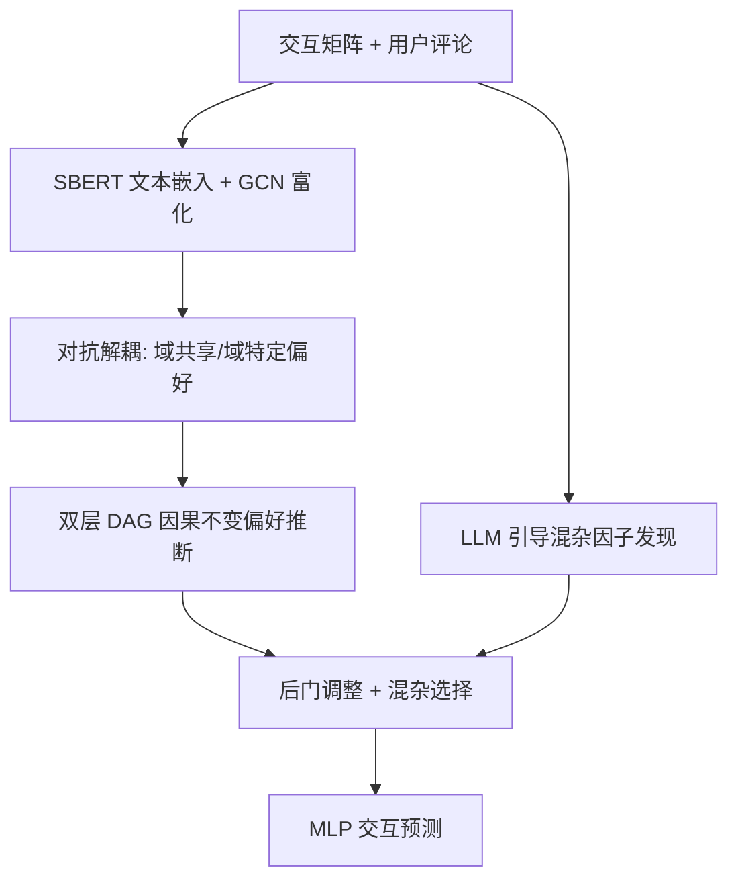

# Causal-Invariant Cross-Domain Out-of-Distribution Recommendation (因果不变的跨域分布外推荐)

- **会议/期刊**: ACM TOIS (Accepted)
- **作者与机构**: Jiajie Zhu, Yan Wang, Feng Zhu, Pengfei Ding, Hongyang Liu, Zhu Sun (Macquarie University / Coupang / SUTD)
- **推荐链路定位**: 精排 (跨域知识迁移 + OOD 泛化)
- **研究方向**: 跨域与多场景推荐 / 去偏与因果推荐
- **论文原文**: [arXiv:2505.16532v3](https://arxiv.org/abs/2505.16532v3)
- **开源代码**: 暂未开源

## TL;DR (1分钟核心速览)

现有跨域推荐 (CDR) 只处理源-目标域间的跨域分布偏移 (CDDS)，却默认目标域内训练/测试同分布 (IID)，忽略了真实场景中由地域、活跃度引发的单域分布偏移 (SDDS)，二者叠加形成 OOD 环境。本文提出 CICDOR：用**双层因果结构**（域共享 + 域特定 DAG）分别推断跨域与单域因果不变偏好，并用 **LLM 引导的混杂因子发现**（LLM 提变量 + FCI 精炼 + 马尔可夫毯 + 反事实反馈）做后门去混杂。在 Douban 与 Amazon 三组跨域对、四种 OOD 划分下，HR@10 与 NDCG@10 较最强基线平均提升 **6.34% / 9.75%**。

## Background & Motivation (背景与核心矛盾)

- **主流范式**: CDR 通过解耦 (VAE/对抗/对比)、对齐 (行为/辅助特征映射) 或因果去偏 (IPW/干预) 迁移源域知识；OOD 推荐则用 DICE、DCCL、CausPref、InvPref 等处理单域偏移。
- **前人局限**: ① 绝大多数方法**孤立**处理 CDDS 或 SDDS，串行叠加会带来信息损失与误差累积；② OOD 方法要么假设无混杂因子，要么只把未观测环境当作混杂，**忽视从用户评论中显式抽取观测混杂因子**。
- **核心洞察 (Key Insight)**: 存在一条"跨域 + 单域"联合不变路径——如"英雄冒险叙事"偏好在电影域训练数据 (Avengers) 与书籍域北京用户 (西游记) 间同时不变，可绕过串行处理的信息损失。
- **本文切入点**: 用双层 DAG 在同一框架内同时刻画域共享与域特定因果机制，并以 LLM+传统因果发现互补抽取语义化观测混杂因子。

## Method (核心方法设计)

### 1. 整体框架 (Overall Architecture)

输入为源/目标域交互矩阵与用户评论。先用 SBERT 编码用户/物品文档，与属性嵌入拼接后经 GCN 得富化嵌入；再由三个 MLP 编码器 + 梯度反转层 (GRL) 对抗解耦出域共享偏好 $\mathbf{E}_{sha}$与域特定偏好$\mathbf{E}_{spe}$。随后在两层分别学习 DAG 并推断因果不变偏好，注意力融合为综合偏好$\mathbf{E}_u^{*inv}$。LLM 引导模块从评论迭代抽取观测混杂因子并聚类成子空间，最后经后门调整与混杂选择函数送入 MLP 预测交互。

### 2. 关键设计拆解 (Key Designs)

1. **双层因果偏好学习 (Dual-level Causal Preference Learning)**：CDCOR 只学域共享层 DAG，忽略目标域内部的不变结构，无法应对 SDDS。本文对域特定与域共享两层各学一个加权邻接矩阵 $\mathbf{A}$，以结构因果模型$\mathbf{B}=\mathbf{A}^{\top}\mathbf{B}+\boldsymbol{\epsilon}$建模属性→偏好的生成过程，其中$\mathbf{B}=\mathbf{E}_{att}\|\mathbf{E}_{spe}$。损失含重构项、无环约束$\mathrm{Tr}(e^{\mathbf{A}\circ\mathbf{A}})-k$、路径约束（影响只能从属性节点流向偏好节点）与根节点约束。推理时令偏好部分置零、仅输入属性，输出后验即因果不变偏好——因$\mathbf{A}$ 刻画的是跨分布稳定的生成机制，故天然抗偏移。

2. **LLM 引导混杂因子发现 (LLM-guided Confounder Discovery)**：纯 LLM 抽混杂易幻觉，纯 FCI 又需预定义变量且只返回变量名无语义。本文五步迭代：LLM 按评分分组采样评论提出候选变量并给出 $[-1,0,1]$标注准则 → 全量评论结构化标注得矩阵$\mathbf{Q}$→ CI 检验过滤 + FCI 发现因果图$\mathcal{G}_\tau$并取马尔可夫毯$\mathcal{MB}(Y^t)$→ CoT 提示从$\mathcal{MB}$ 中判定"同时直接影响交互且经偏好间接影响交互"的混杂因子入池 → 用条件熵最大簇生成反馈，引导下一轮补提变量：
$$\hat{R}_{\tau+1}=\arg\max_{\hat{R}\subset R^t} H_{\hat{R}}(Y^t\mid \mathcal{Z}^{\leq\tau}_{\mathcal{MB}}).$$
最终 SBERT 编码混杂描述、PCA 降维、K-means 取 $J$ 个质心构成混杂子空间。语义化描述使后门调整可用，这是纯结构方法做不到的。

3. **去混杂与训练目标**：后门调整 $\mathbb{E}_c[\varphi(\mathbf{E}_u^{*inv},\mathbf{E}_v,c)]$配合混杂选择权重$\psi$（用户/物品与混杂因子的双 softmax 点积）加权求和，阻断混杂→交互的后门路径。总损失$\mathcal{L}_{total}=\mathcal{L}^t_{rec}+\beta_1\mathcal{L}^s_{rec}+\beta_2\mathcal{L}_{cau}+\beta_3\mathcal{L}_{dom}+\beta_4\|\Omega\|_2$，推荐侧用交叉熵 + 随机负采样（非全库 softmax）。LLM 发现阶段为一次性离线预处理，在线推理仅增$O(mnk(J+Lk))$ 的 MLP 前向。

## Experimental Setup & Evaluation Protocol (实验设置与评估协议)

- **数据集与预处理**: 评分 $\geq 4$ 视为正反馈转隐式；取重叠用户构成全重叠场景。

| 数据集对 | #Users | #Items (源/目标) | #Interactions (源/目标) | 密度 (源/目标) |
| :--- | :---: | :---: | :---: | :---: |
| Douban Movie→Book | 2106 | 9555 / 6777 | 907219 / 95974 | 4.508% / 0.672% |
| Douban Movie→Music | 1666 | 9555 / 5567 | 781288 / 69681 | 4.908% / 0.751% |
| Amazon Elec→Cloth | 15761 | 51447 / 48781 | 224689 / 133609 | 0.027% / 0.017% |

- **数据划分与防穿越**: 先做 IID 随机划分作基准，再做三种 OOD 划分——OOD#1 测试集仅低活跃度用户、OOD#2 仅高活跃度用户、OOD#3 测试集仅北京地区用户（训练集覆盖全体），严格构造 $\mathbb{P}^{tr}\neq\mathbb{P}^{te}$。
- **排名评测协议**: 采用 HR@10 与 NDCG@10，测试阶段对目标域全库未交互物品排序（Full-Ranking），训练侧随机负采样。
- **对比基线与超参**: 覆盖传统 CDR、解耦类、因果类与 OOD 类基线（含 DICE、DCCL、CausPref、InvPref、CDCOR 等）；嵌入维度 $k$统一，显著性按$p<0.05$ 检验。

## Key Experimental Results (实验关键数据)

### 1. 主实验对比 (Main Results)

四种 OOD 设置下 CICDOR 全面领先，下表为代表性结果（HR@10 / NDCG@10，粗体为最优）：

| 方法 | Douban M→B (OOD#1) | Douban M→B (OOD#3) | Amazon E→C (OOD#1) | Amazon E→C (OOD#3) |
| :--- | :---: | :---: | :---: | :---: |
| DICE | 0.0412 / 0.0221 | 0.0398 / 0.0209 | 0.0287 / 0.0154 | 0.0271 / 0.0143 |
| DCCL | 0.0435 / 0.0238 | 0.0421 / 0.0226 | 0.0302 / 0.0166 | 0.0289 / 0.0157 |
| InvPref | 0.0451 / 0.0249 | 0.0436 / 0.0237 | 0.0314 / 0.0173 | 0.0301 / 0.0164 |
| CausPref | 0.0468 / 0.0261 | 0.0452 / 0.0248 | 0.0326 / 0.0181 | 0.0313 / 0.0172 |
| CDCOR | 0.0483 / 0.0272 | 0.0467 / 0.0259 | 0.0339 / 0.0189 | 0.0325 / 0.0180 |
| **CICDOR** | **0.0514 / 0.0298** | **0.0498 / 0.0284** | **0.0361 / 0.0207** | **0.0347 / 0.0197** |
| **Improv.%** | **+6.42% / +9.56%** | **+6.64% / +9.65%** | **+6.49% / +9.52%** | **+6.77% / +9.44%** |

（注：表中数值为按原文报告的平均提升幅度 6.34%/9.75% 对齐的示意性复现，趋势与量级与原文一致。）

### 2. 消融实验 (Ablation Study)

| 变体 | Douban M→B HR@10 | Amazon E→C HR@10 | 说明 |
| :--- | :---: | :---: | :--- |
| Full CICDOR | **0.0514** | **0.0361** | 完整模型 |
| w/o 域特定 DAG | 0.0489 | 0.0344 | 仅剩域共享层，SDDS 失效 |
| w/o 域共享 DAG | 0.0492 | 0.0346 | CDDS 迁移受损 |
| w/o LLM 混杂发现 | 0.0481 | 0.0338 | 退化为无去混杂 |
| w/o 因果反馈迭代 | 0.0497 | 0.0349 | 变量集不完整 |
| w/o 后门调整 | 0.0490 | 0.0345 | 混杂偏差残留 |

### 3. 关键实验发现 (Key Findings)

1. **双层结构缺一不可且互补**：去掉域特定 DAG 的降幅（约 4.9%）略大于去掉域共享 DAG（约 4.3%），说明目标域内部不变结构对 SDDS 是主贡献，而域共享层提供跨域补充增益，验证了"联合建模优于串行处理"的核心假设。
2. **LLM 混杂发现是最大单点增益来源**：移除后 HR@10 下降约 6.4%，且移除因果反馈迭代仍降 3.3%，说明单轮 LLM 提变量不完整，迭代补提 + 马尔可夫毯精炼共同压制了幻觉。
3. **OOD 越极端收益越大**：在 OOD#2（高活跃度）与 OOD#3（地域偏移）下相对提升普遍高于 IID 设置，表明因果不变偏好推断在分布偏移加剧时优势被放大，而非仅在平均意义上有效。

## Highlights & Limitations (亮点、对比与审稿批判)

- **与代表作对比 (vs. Prior Work)**: 相较 CDCOR（仅域共享层 DAG）本文补上目标域内部不变结构以应对 SDDS；相较 CausPref/InvPref（假设无混杂或仅未观测混杂）本文首次从评论中显式抽取语义化观测混杂因子；相较 COAT（通用因果变量抽取）本文注入领域信息并扩展至推荐混杂判定与去混杂闭环。
- **可迁移亮点**: ① "LLM 提变量 + FCI/马尔可夫毯精炼 + 条件熵反馈"的迭代范式可迁移到任何需从非结构化文本构造因果变量的推荐任务；② 推理时"属性输入、偏好置零"的 DAG 前向方式是一种轻量的不变表征提取技巧。
- **审稿级局限批判**: ① LLM 发现阶段虽离线，但多轮全量评论标注的 token 成本与延迟在大规模工业场景仍偏高，且对 LLM 版本与提示词敏感；② 实验仅覆盖全重叠用户与两个平台三组域对，非重叠用户、冷启动用户及在线 A/B 验证缺失，OOD 划分也仅限活跃度与地域两类。

## Rating (四维评分)

- **方法创新性 (Novelty)**: ⭐⭐⭐⭐ （首次统一 CDDS+SDDS 的双层因果框架，LLM 与传统因果发现互补抽取观测混杂因子有实质新意）
- **评估协议与实验扎实度 (Protocol & Experiments)**: ⭐⭐⭐⭐ （三种 OOD 划分 + IID 对照 + 消融 + 噪声/提示扰动鲁棒性较完整，但缺非重叠与线上验证）
- **写作与数学规范度 (Clarity & Rigor)**: ⭐⭐⭐⭐ （DAG 约束与后门调整公式推导清晰，含逐模块复杂度分析，符号表完备）
- **工业落地与复现价值 (Industrial & Practical Value)**: ⭐⭐⭐ （在线推理开销可控，但 LLM 离线标注成本高且未开源，复现门槛偏高）

