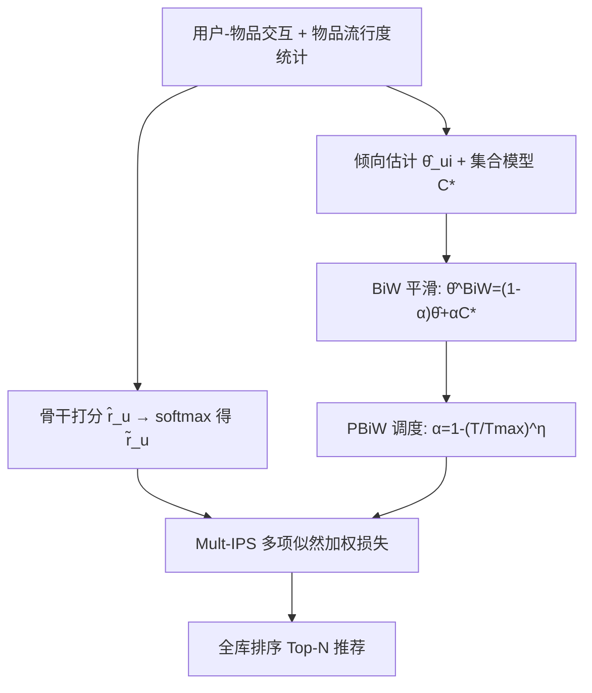

# Mitigating Popularity Bias in Recommendation with Global Listwise Learning and Progressive Bi-Weighting (全局列表级学习与渐进式双重加权缓解推荐流行度偏差)

- **会议/期刊**: ACM Transactions on Information Systems (TOIS) 2026
- **作者与机构**: Tianyu Zhu (北航)、Jiandong Ding (复旦)、Yansong Shi (复旦)、Guoqing Chen (清华)、Jian-Yun Nie (蒙特利尔大学)
- **推荐链路定位**: 精排（训练目标/损失层，模型无关可插拔）
- **研究方向**: 去偏公平与工业架构 / 协同过滤
- **论文原文**: [https://arxiv.org/abs/2609.35041v1](https://arxiv.org/abs/2609.35041v1)
- **开源代码**: [https://github.com/zhuty16/Mult-BiW](https://github.com/zhuty16/Mult-BiW)

## TL;DR (1分钟核心速览)

现有 IPS 去偏方法受困于**逐点/逐对损失的局部无偏性**与**倾向估计失准**两大瓶颈：局部目标无法刻画用户对全物品集的全局偏好，而基于流行度的倾向估计会系统性低估长尾物品曝光概率。本文提出 Mult-BiW：以 IPS 加权多项似然（Mult-IPS）实现列表级全局无偏学习，用 Jelinek-Mercer 式 Bi-Weighting 平滑倾向估计（理论证明最优集合模型为平均倾向），再以渐进式调度（PBiW）从表征学习平滑过渡到去偏。在 6 个真实数据集、平衡测试集 Full-Ranking 协议下，Recall@20 平均提升 9.43%、NDCG@20 提升 14.80%。

## Background & Motivation (背景与核心矛盾)

- **主流范式**: 因果推断视角下的 IPS 重加权是流行度去偏的主流范式，代表作 Rel-MF（逐点无偏）、UBPR（逐对无偏）、DICE/MACR（因果解耦）、CPR（跨交互构造无偏对）、TTEN（推理期嵌入归一化）。
- **前人局限一（局部无偏）**: 逐点/逐对损失只校正单个交互或物品对的相对偏好，无法捕捉用户对全物品集的全局偏好分布；叠加 IPS 后长尾权重高度偏斜，模型易过度聚焦少数物品。
- **前人局限二（倾向失准）**: 真实倾向不可观测，现有方法用 $\hat\theta_{ui}=(p_i/\max_j p_j)^\beta$ 近似，系统性低估尾部物品曝光概率（真实曝光还受社交、探索行为影响），使 IPS 估计器产生显著经验偏差。
- **核心洞察 (Key Insight)**: 多项似然在 softmax 概率单纯形约束下天然形成"固定概率预算下的物品竞争"，等价于列表级损失；且其负样本项 $\delta^{(0)}_{ui}=0$，可规避 IPS 中$1-y_{ui}/\theta_{ui}<0$ 带来的大方差与数值不稳定。
- **本文切入点**: 把 IPS 从"局部校正"升级为"全局列表级校正"，并用集合级先验平滑倾向估计、用累积学习调度去偏强度。

## Method (核心方法设计)

### 1. 整体框架 (Overall Architecture)

模型以任意推荐骨干（MF/LightGCN）输出打分 $\hat{\mathbf{r}}_u$，经 softmax 得预测相关分布$\tilde{\mathbf{r}}_u$；训练目标为 IPS 加权的多项负对数似然（Mult-IPS），其中倾向权重由"个体倾向 + 集合模型"线性插值得到（BiW），插值系数$\alpha$ 随训练轮次按幂律从 1 衰减至 0（PBiW），实现先学表征、后强去偏的渐进闭环。推理阶段无额外参数与采样开销，直接按打分全库排序。

### 2. 关键设计拆解 (Key Designs)

1. **Mult-IPS：列表级全局无偏估计器**：痛点在于逐点/逐对目标只做局部校正。将局部损失取为多项负对数似然 $\delta^{(r_{ui})}_{ui}=-r_{ui}\log\tilde r_{ui}$（故$\delta^{(0)}=0$），代入 IPS 框架得
$$\mathcal{L}_{\text{Mult-IPS}}=-\frac{1}{|\mathcal{U}|}\sum_{u}\sum_{i}\frac{y_{ui}}{\hat\theta_{ui}}\log\tilde r_{ui},\quad \tilde r_{ui}=\text{softmax}(\hat r_u)_i$$
softmax 的概率预算约束迫使物品间竞争，天然编码全局排序信息；同时消除负项，训练更稳定。命题 3.1 证明其对多项理想损失无偏。

2. **Bi-Weighting：带理论保证的倾向平滑**：痛点在于流行度倾向低估尾部曝光。借鉴 Jelinek-Mercer 平滑，令 $\hat\theta^{\text{BiW}}_{ui}=(1-\alpha)\hat\theta_{ui}+\alpha C$。引理 3.4 给出经验偏差上界$\Delta\le\frac{\delta\sqrt{|\mathcal{I}|}}{m\sqrt{|\mathcal{U}|}}\sqrt{\sum_{u,i}(\hat\theta^{\text{BiW}}_{ui}-\theta_{ui})^2}$，对其最小化并由大数定律得**最优集合模型**$C^*=\frac{1}{|\mathcal{I}|}\sum_{j}\hat\theta_{uj}$（即平均倾向）。直觉：软性全局抬升尾部、压制头部，优于硬阈值截断（Mult-CIPS 仅作用于阈值以下子集）。

3. **PBiW 渐进调度与训练目标**：痛点在于训练早期激进重加权会破坏表征学习。令 $\alpha=1-(T/T_{\max})^\eta$，早期$\alpha\to1$近似均匀权重（纯表征学习），后期$\alpha\to0$退化为标准 Mult-IPS（强去偏）。总损失即式 (22) 的 Mult-BiW 估计器；**免负采样**（全物品 softmax），倾向权重由流行度预计算、仅$O(|\mathcal{I}|)$存储，每轮复杂度$O(|\mathcal{U}||\mathcal{I}|d)$，可借 GPU 稠密矩阵乘 + softmax 高效实现。

## Experimental Setup & Evaluation Protocol (实验设置与评估协议)

- **数据集与预处理**: 前四个数据集采用 `20-core` 过滤；ML10M/Netflix 沿用 DICE 发布版本。

| 数据集 | #Users | #Items | #Interactions | 密度 | 说明 |
| :--- | :---: | :---: | :---: | :---: | :--- |
| Amazon | 39,240 | 18,536 | 882,123 | 0.1213% | 图书，长尾最重 |
| Google | 28,943 | 8,035 | 306,807 | 0.1319% | 本地生活 |
| Gowalla | 43,457 | 15,294 | 727,163 | 0.1094% | LBS 签到 |
| Yelp | 36,948 | 20,950 | 1,299,619 | 0.1679% | 商户点评 |
| ML10M | 37,962 | 4,819 | 1,371,473 | 0.7497% | DICE 预处理 |
| Netflix | 32,450 | 8,432 | 2,212,690 | 0.8087% | DICE 预处理 |

- **数据划分与防穿越**: 比例划分 `70%/10%/20%`；关键设计是**平衡测试集**——测试/验证集按物品均匀分布构造（模拟均匀随机曝光策略），训练集保留长尾偏斜，从而"偏斜训练、无偏评估"。
- **排名评测协议**: 无偏 `Full-Ranking`——对每个用户，训练与验证中未交互的全部物品作为候选全库排序；指标 Recall@10/20、NDCG@10/20，5 次随机初始化取均值，双样本 t 检验 $p<0.01$。
- **对比基线与超参**: 基线含 Expo-MF、Rel-MF、UBPR、DICE、MACR、CPR、TTEN 及本文变体 Mult-IPS/Mult-CIPS；统一 MF 骨干，$d=64$，Adam，batch=256，学习率$\{1e\text{-}3,\dots,1e\text{-}4\}$，$\alpha\in\{0,0.1,\dots,1\}$，$\eta\in\{0.5,1,2\}$。

## Key Experimental Results (实验关键数据)

### 1. 主实验对比 (Main Results)

MF 骨干下六数据集结果（节选核心指标，粗体为最优）：

| 数据集 | 指标 | UBPR | DICE | MACR | CPR | TTEN | **Mult-BiW** | Improv. |
| :--- | :--- | :---: | :---: | :---: | :---: | :---: | :---: | :---: |
| Amazon | R@10 | 0.0552 | 0.0516 | 0.0536 | 0.0637 | 0.0635 | **0.0807** | +26.60% |
| Amazon | N@20 | 0.0563 | 0.0531 | 0.0549 | 0.0657 | 0.0656 | **0.0834** | +26.96% |
| Google | N@10 | 0.0896 | 0.0869 | 0.0869 | 0.0999 | 0.0965 | **0.1016** | +1.75% |
| Gowalla | R@10 | 0.1011 | 0.0932 | 0.1040 | 0.1100 | 0.1098 | **0.1288** | +17.11% |
| Yelp | R@20 | 0.0443 | 0.0416 | 0.0439 | 0.0519 | 0.0506 | **0.0632** | +21.88% |
| ML10M | N@10 | 0.0858 | 0.0996 | 0.0846 | 0.1109 | 0.1068 | **0.1183** | +6.66% |
| Netflix | N@10 | 0.0981 | 0.1089 | 0.0944 | 0.1208 | 0.1169 | **0.1461** | +20.97% |

效率上，Mult-BiW-MF 在 Amazon/Yelp 总训练时长 15.67m/17.71m，反超 CPR-MF 的 20.62m/23.89m；ML10M/Netflix 上 4.75m/9.50m 与 CPR 的 4.06m/5.57m 同量级。

### 2. 消融实验 (Ablation Study)

以 Mult-MF 为基线（Amazon / Gowalla / Yelp，R@10）：

| 配置 | Amazon | Gowalla | Yelp | 说明 |
| :--- | :---: | :---: | :---: | :--- |
| Mult-MF (None) | 0.0631 | 0.1062 | 0.0255 | 无去偏 |
| + IPS | 0.0661 | 0.1095 | 0.0259 | 原始 IPS，增益微弱 |
| + CIPS | 0.0738 | 0.1214 | 0.0311 | 截断降方差 |
| + FBiW (固定 α) | 0.0775 | 0.1244 | 0.0354 | 平滑倾向 |
| + PBiW (渐进 α) | **0.0807** | **0.1288** | **0.0359** | 累积学习最优 |
| LightGCN + PBiW | 0.0980 | 0.1498 | 0.0455 | 骨干升级后仍最优 |

### 3. 关键实验发现 (Key Findings)

1. **列表级 > 逐对 > 逐点**：同一 BiW 框架下多项似然全面最优，逐对次之，逐点平方/逻辑损失显著落后；主实验中 UBPR 稳定优于 Rel-MF，印证"全局偏好建模"是增益主源，而非单纯重加权。
2. **平滑优于截断，渐进优于固定**：CIPS 仅在阈值以下尾部生效，FBiW 全局软调整带来 Amazon R@10 从 0.0738→0.0775；PBiW 进一步在 FBiW 最优 α 之上再涨至 0.0807，说明"先表征后去偏"的调度本身贡献独立增益。
3. **去偏以头部微降换尾部大增**：分物品组分析显示 Mult-BiW 在头部组精度小幅下降、尾部组显著提升，整体净增益；top-10 列表物品频率与训练流行度的 Pearson 相关系数最低（曲线最平），且 η 需与骨干匹配——MF 偏好小 η（早去偏），LightGCN 因多层图卷积表征学习更难，需大 η 延后强去偏。

## Highlights & Limitations (亮点、对比与审稿批判)

- **与代表作对比 (vs. Prior Work)**: 相较 Rel-MF/UBPR 的逐点/逐对局部无偏，本文首次将 IPS 与多项列表级似然结合，直接优化全局偏好分布；相较 DICE/MACR 的因果解耦（仅建模物品对相对流行度差或需多任务结构），本文是模型无关的损失层插件；相较 CPR 的跨交互构造无偏对，本文免负采样且训练时长更短。
- **可迁移亮点**: ①"集合模型平滑倾向"可迁移到任何 IPS/DR 框架（如曝光去偏、延迟反馈），且最优解为平均倾向、实现零成本；②渐进调度 $\alpha=1-(T/T_{\max})^\eta$ 可复用于类别不平衡重加权、对比学习温度调度等场景。
- **审稿级局限批判**: ①全物品 softmax 使每轮复杂度随 $|\mathcal{I}|$ 线性增长，超大规模工业物品库（千万级）需依赖 sampled softmax 近似，理论无偏性将受损；②平衡测试集为人工构造，与真实线上曝光分布存在 gap，且未报告线上 A/B；③隐式反馈下无法直接套用 Doubly Robust，倾向估计仍仅依赖流行度统计，未引入曝光日志等辅助信号。

## Rating (四维评分)

- **方法创新性 (Novelty)**: ⭐⭐⭐⭐ （核心机制与方法设计具备明确创新性，理论与实验动机支撑充分）
- **评估协议与实验扎实度 (Protocol & Experiments)**: ⭐⭐⭐⭐⭐ （主流公开数据集评测完整，包含多基线对比与消融实验验证）
- **写作与数学规范度 (Clarity & Rigor)**: ⭐⭐⭐⭐⭐ （问题形式化定义清晰，核心模块数学推导与架构阐述严谨易读）
- **工业落地与复现价值 (Industrial & Practical Value)**: ⭐⭐⭐⭐ （兼顾推荐效果增益与训练/推理效率，具备实际场景迁移参考价值）
