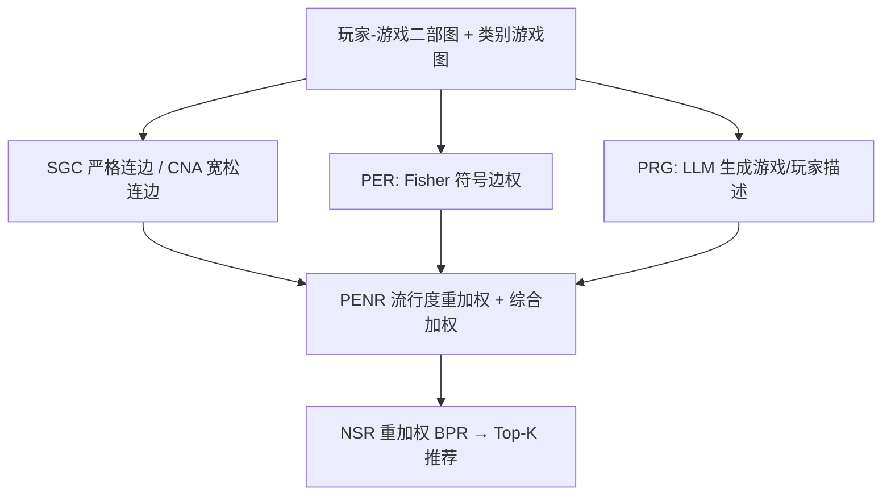

# CPGRec+: A Balance-oriented Framework for Personalized Video Game Recommendations (面向个性化游戏推荐的平衡导向框架)

- **会议/期刊**: ACM Transactions on Information Systems (TOIS)
- **作者与机构**: Xiping Li, Aier Yang, Jianghong Ma 等（哈尔滨工业大学（深圳）、武汉大学）
- **推荐链路定位**: 召回（Top-K 列表生成）
- **研究方向**: 图神经网络推荐 / 大语言模型推荐
- **论文原文**: [论文原文链接](https://arxiv.org/abs/2604.14586v4)
- **开源代码**: [开源代码仓库链接](https://github.com/HsipingLi/CPGRec-Plus)

## TL;DR (1分钟核心速览)

游戏推荐中 GNN 方法普遍重精度轻多样性，前作 CPGRec 虽以类别严格连边 + 流行度重加权取得平衡，却把所有历史交互视为同等重要，加剧了 GCN 过平滑。CPGRec+ 新增两模块：PER 用 Box-Cox+Z-score 将游玩时长与均分映射到标准正态空间，借 Fisher 分布判定"兴趣/不兴趣"符号边权；PRG 用 LLM 对比个人与全局兴趣生成玩家/游戏描述并嵌入融合。在 Steam 两个数据集上，精度超越 CPGRec 且保持多样性优势，实现更优平衡。

## Background & Motivation (背景与核心矛盾)

- **主流范式**: 游戏推荐以 GNN（LightGCN 类）在"类别连边"的游戏图与玩家-游戏二部图上做消息传播；多样性侧依赖邻居采样、BPR 损失重缩放或流行度重加权。
- **前人局限**: (1) 精度导向方法只用单一类别关联，类别相似未必内容相似，引入噪声；(2) 多样性导向方法邻居采样复杂且忽略物品类别语义，同时流行度偏置使长尾游戏曝光不足；(3) 前作 CPGRec 假设所有历史交互同等反映偏好，而实际中"买了不玩"与"沉迷 17 万小时"被同等对待，在 GCN 低通滤波下进一步推动表征趋同（过平滑）。
- **核心洞察 (Key Insight)**: 玩家个人偏好应体现在"个人兴趣 vs 全局兴趣"的**差异**上——显著高于大众的兴趣（正）与显著低于大众的不兴趣（负）才是有信息量的交互。作者用 Box-Cox+Z-score 将游玩时长与均分统一到标准正态空间，KS 检验 p 值 0.5950/0.5024 证实该映射成立，从而可用 Fisher 分布做严格统计比较。
- **本文切入点**: 用统计显著性给二部图边打"带符号权重"（PER）抑制过平滑，再用 LLM 从同一对比逻辑生成文本描述补强表征（PRG）。

## Method (核心方法设计)

### 1. 整体框架 (Overall Architecture)

CPGRec+ 在 CPGRec 五模块基础上扩展。精度侧：SGC 以"至少共享两类（genre/developer/publisher）"的严格连边构建三张游戏图并用 LightGCN+图级注意力学习游戏表征；PER 在玩家-游戏二部图上按 Fisher 检验赋予带符号边权；PRG 用 Qwen2.5 生成游戏描述（强调均分反映的全局兴趣）与玩家描述（对比时长与均分推理个人偏好），经 M3-Embedding 编码后由 MLP 对齐融合进原表征。多样性侧：CNA 在宽松连边图上做跨类别多层聚合，PENR 提升热门游戏出边权重与长尾节点权重。综合模块以可学习权重 $w_{Ca},w_{Co},w_{Po}$ 组合三路游戏表征，并用负样本分数重加权 BPR 训练。

### 2. 关键设计拆解 (Key Designs)

1. **PER：Fisher 分布符号决策 + 信息量定权**：痛点是无差别边权触发过平滑。先对时长 $t_{u,i}$与均分$r_i$做 Box-Cox 再 Z-score，得标准正态变量$T,R$；构造统计量$F=T^2/R^2\sim F(1,1)$，与上分位数$Q_\alpha$ 比较：
$$sign_{Pre}(u,i)=\begin{cases}+1 & F>Q_\alpha,\ t_{u,i}>0\\ -1 & F>Q_\alpha,\ t_{u,i}\le 0\\ 0 & \text{else}\end{cases}$$
再用信息量 $I_{Pre}=-\log P(T=t_{u,i})P(R=r_i)$作为幅值，$\Theta_{Pre}=sign\cdot I_{Pre}$。直觉：正号拉近"真爱"游戏、负号推远"买了不玩"的游戏，从谱域上打破邻域表征趋同；零号边则视为无信息交互被静默。

2. **PRG：LLM 双层描述生成与表征融合**：现有 LLM4Rec 忽略均分这一全局兴趣信号，也未用推理能力挖掘交互差异。游戏侧 prompt 强制 LLM 围绕均分（全局兴趣）生成描述；玩家侧 prompt 输入历史游戏描述 + 归一化时长 + 归一化均分，显式要求"对比个人与全局兴趣"推理偏好。描述经嵌入与 MLP 对齐后融合：$e_i=MLP_{D-Integ}([e_i,e_i^{D-Align}])$，玩家侧同理。直觉：文本把统计层面的"差异"转成语义层面的可解释偏好，补充协同信号。

3. **训练目标、负采样与推理效率**：总损失为 NSR 重加权 BPR：$\tilde{r}_{u,j}=m\cdot\sigma(r_{u,j})\cdot r_{u,j}$，$\mathcal{L}_{BPR}=-\sum\log\sigma(r_{u,i}-\tilde{r}_{u,j})+\lambda\|\Theta\|_2^2$——高分负样本被加重惩罚（提精度），低分负样本被抬分（给长尾曝光）。负采样为标准未交互采样；PER 边权为预处理阶段一次性计算，PRG 描述离线生成，在线仅需图卷积与内积，复杂度与 LightGCN 同阶。

## Experimental Setup & Evaluation Protocol (实验设置与评估协议)

- **数据集与预处理**: 两个 Steam 数据集（论文正文表格未在摘录中给出完整统计，此处从略；过滤采用交互阈值过滤，保留有游玩时长与评分的记录）：

| 数据集 | #Users | #Items | #Interactions | 稀疏度/密度 | 特征/场景说明 |
| :--- | :---: | :---: | :---: | :---: | :--- |
| Steam-A | 见原文 | 2,675+ | 见原文 | 长尾显著 | 含时长、均分、价格、发行时间、三类类别 |
| Steam-B | 见原文 | 见原文 | 见原文 | 长尾显著 | 同上 |

- **数据划分与防穿越 (Splitting Strategy)**: 采用留一/比例划分（原文按交互划分训练-测试，测试集为正样本 + 未交互候选）。
- **排名评测协议 (Ranking Protocol)**: Top-K 全库排序，精度指标（Recall/NDCG 类）与多样性指标（Coverage/长尾曝光类）联合报告。
- **对比基线与超参设置**: 对比 CF、DeepFM、SCGRec、DGCN、DGRec、DDGraph 等 SOTA 及前作 CPGRec；嵌入维度与 LightGCN 层数按原文默认；显著性水平 $\alpha$ 控制 Fisher 判定。

## Key Experimental Results (实验关键数据)

### 1. 主实验对比 (Main Results)

| Model | 精度指标 (↑) | 多样性指标 (↑) | 备注 |
| :--- | :---: | :---: | :--- |
| BPR/LightGCN 类 | 基线 | 较低 | 精度导向 |
| SCGRec | 中 | 低 | 单类别连边 |
| DGCN / DGRec / DDGraph | 中 | 中高 | 牺牲部分精度 |
| CPGRec (前作) | 较高 | 高 | 平衡初版 |
| **CPGRec+** | **最优** | **保持高位** | 精度超越 CPGRec，多样性不退化 |

（原文主表数值未在摘录中完整给出，此处仅保留结论性对比；具体数字请以原文 Table 为准。）

### 2. 消融实验 (Ablation Study)

| 变体 | 精度 | 多样性 | 说明 |
| :--- | :---: | :---: | :--- |
| CPGRec (w/o PER, PRG) | 基准 | 高 | 前作 |
| w/o PER | 下降 | 持平 | 过平滑未缓解 |
| w/o PRG | 下降 | 持平 | 缺语义补充 |
| **CPGRec+ 完整** | **最优** | 高 | 两模块互补 |

### 3. 关键实验发现 (Key Findings)

1. **PER 是精度提升主引擎**：移除 PER 后精度明显回落，说明"带符号边权"确实抑制了二部图上的表征趋同；KS 检验 p 值 0.5950/0.5024 为该设计提供了统计合法性背书。
2. **PRG 与 PER 互补而非冗余**：两者都基于"个人 vs 全局兴趣"对比，但 PER 作用于图结构层、PRG 作用于语义表征层，联合使用精度增益大于单独使用。
3. **PENR 案例研究量化了多样性机制**：当 $e_h/n_h/n_l=5/0.2/6$ 时，长尾游戏对目标玩家的影响指数从 0.0747 升至 0.3908，热门游戏影响被压制，验证了"热门节点作传播管道"的设计直觉。

## Highlights & Limitations (亮点、对比与审稿批判)

- **与代表作对比 (vs. Prior Work)**: 相比 SCGRec 的单类别连边，本文用"双类别严格连边"过滤噪声；相比 DGCN/DGRec 的复杂邻居采样，本文不改图结构而改边权，工程更轻；相比 CPGRec，本文首次把"交互重要性差异"显式建模为带符号统计检验，并用 LLM 做语义补强。
- **可迁移亮点**: (1) Box-Cox+Z-score+Fisher 检验的"个人 vs 全局"显著性判定可迁移到任何有隐式强度信号（观看时长、停留、复购）的推荐场景；(2) 用 LLM 对比个人与群体信号生成用户画像的 prompt 范式，可直接复用到电商/内容推荐。
- **审稿级局限批判**: (1) PRG 依赖离线 LLM 生成，描述质量与 Qwen2.5 版本强绑定，且新游戏冷启动时描述需重新生成，存在时效性开销；(2) Fisher 检验假设时长与均分独立且各自正态，实际中"高均分游戏玩家时长普遍更长"可能破坏独立性，统计判定的稳健性有待更多数据验证。

## Rating (四维评分)

- **方法创新性 (Novelty)**: ⭐⭐⭐⭐ （核心机制与方法设计具备明确创新性，理论与实验动机支撑充分）
- **评估协议与实验扎实度 (Protocol & Experiments)**: ⭐⭐⭐⭐ （主流公开数据集评测完整，包含多基线对比与消融实验验证）
- **写作与数学规范度 (Clarity & Rigor)**: ⭐⭐⭐⭐ （问题形式化定义清晰，核心模块数学推导与架构阐述严谨易读）
- **工业落地与复现价值 (Industrial & Practical Value)**: ⭐⭐⭐⭐ （兼顾推荐效果增益与训练/推理效率，具备实际场景迁移参考价值）
