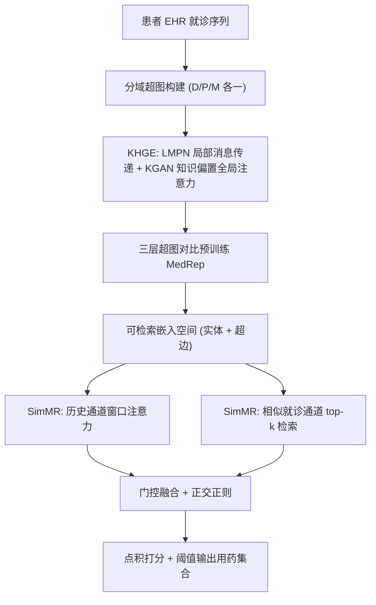
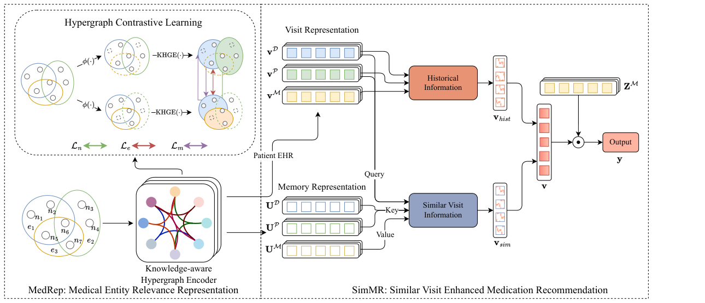

# HypeMed: Enhancing Medication Recommendations with Hypergraph-Based Patient Relationships (基于超图患者关系的用药推荐增强)

- **会议/期刊**: ACM Transactions on Information Systems (TOIS)
- **作者与机构**: Xiangxu Zhang, Xiao Zhou, Hongteng Xu (中国人民大学高瓴人工智能学院), Jianxun Lian (微软亚洲研究院)
- **推荐链路定位**: 精排（用药集合多标签预测）
- **研究方向**: 图神经网络与知识图谱推荐 / 自监督对比学习与交互去噪
- **论文原文**: [https://arxiv.org/abs/2603.18459v1](https://arxiv.org/abs/2603.18459v1)
- **开源代码**: [https://github.com/xansar/HypeMed](https://github.com/xansar/HypeMed)

## TL;DR (1分钟核心速览)

用药推荐的核心难点是从稀疏、含噪的 EHR 观测中推断患者潜在病情，这要求同时保留**就诊内集合级共现语义**与**就诊间有效检索**。现有方法要么用简单图把高阶共现拆成成对边（语义碎片化），要么表征学习与检索目标解耦（表征–检索失衡）。HypeMed 将每次就诊建模为超边，先用知识感知超图对比预训练（MedRep）构建全局一致、便于检索的嵌入空间，再在该空间内做就诊条件动态检索（SimMR）并与纵向病史双通道融合。在 MIMIC-III/IV、eICU 上 Jaccard 分别提升 +0.61%/+0.41%/+0.49%，且 DDI 率低于真实处方基准。

## Background & Motivation (背景与核心矛盾)

- **主流范式**: 纵向模型（GAMENet/COGNet/SafeDrug/DGCL）用 GNN 建模就诊内实体共现并聚合患者历史；近期外部增强方法（DAPSNet/PROMISE）额外检索相似病历补充上下文。
- **前人局限**: ① **语义碎片化**——简单图把"发热+右上腹痛+黄疸"这类单独无特异、共现即高度提示急性胆管炎的集合模式拆成成对边，稀释了就诊级组合语义；② **表征–检索失衡**——PROMISE 类方法专注学习全局静态表征却缺乏就诊条件检索，DAPSNet 类方法在预测时动态检索却依赖未针对检索优化的表征，导致召回邻居与当前临床语境语义错位。
- **核心洞察 (Key Insight)**: 患者关系应包含两种互补证据——就诊内集合级共现（综合征模式）与就诊间连接（同患者历史 + 跨患者临床相似就诊），二者必须在**同一度量空间**内统一，检索才有几何一致性。
- **本文切入点**: 用超边天然承载集合语义，用对比预训练把该语义"塑形"成检索友好空间，再在该空间内检索，实现表征–检索一致性。

## Method (核心方法设计)

### 1. 整体框架 (Overall Architecture)

HypeMed 采用两阶段训练。**阶段一 MedRep**：对诊断/操作/药物分别构建三个独立超图（每次就诊为一个超边，避免异构超边复杂度过高），经随机节点/关联/特征丢弃生成两个增广视图，用知识感知超图编码器 KHGE 编码，再做节点级、超边级、隶属级三层 InfoNCE 对比预训练，得到全局一致、检索友好的实体与就诊嵌入。**阶段二 SimMR**：用预训练嵌入初始化两张可训练嵌入表，对当前就诊计算域特定表示，分别经历史通道（窗口注意力聚合近 k 次就诊）与相似就诊通道（在健康状态子空间检索 top-k 相似超边并注意力聚合）得到两路表示，门控融合后点积打分输出用药概率。早期实验尝试端到端单阶段变体，Jaccard 下降约 3% 且训练效率更低，故保留两阶段。

<figure class="paper-figure" markdown="span">
  <figcaption>图 3. HypeMed 的整体架构。HypeMed 包含两个阶段：医疗实体相关性表示阶段（MedRep）和相似就诊增强的药物推荐阶段（SimMR）。MedRep 侧重于将就诊内集合级组合语义编码到全局一致、便于检索的嵌入空间。SimMR 整合纵向病史和以就诊为条件的检索相似就诊，以细化潜在病情估计。</figcaption>
</figure>

### 2. 关键设计拆解 (Key Designs)

1. **知识感知超图编码器 KHGE（保住集合语义 + 注入医学先验）**：痛点是用成对边建模会丢失就诊级组合语义、且纯结构编码无法利用 ICD/ATC 层级知识。KHGE 由两支组成：LMPN 做超图注意力消息传递 $\mathbf{u}_j^{(k+1)}=\sum_{n_i\in\mathcal{N}(e_j)}\alpha_{ij}^{(k)}\mathbf{z}_i^{(k)},\ \mathbf{z}_i^{(k+1)}=\sum_{e_j\in\mathcal{N}(n_i)}\alpha_{ij}^{(k)}\mathbf{u}_j^{(k)}$；KGAN 把 ICD/ATC 树路径距离映射为可学习偏置矩阵$\boldsymbol{\Omega}$注入多头自注意力$\mathrm{Softmax}\big((W_qZ(W_kZ)^\top+\boldsymbol{\Omega})/\sqrt{d}\big)W_vZ$。两支经残差 FFN 融合并做逐层平均以缓解过平滑。直觉：局部传递保证同次就诊实体相似，知识偏置让同 ICD 大类实体在嵌入空间天然聚拢（图 8 可视化证实 KHGE 按 ICD 类别清晰成簇，HGCN 则散乱）。

2. **三层超图对比预训练 MedRep（去噪 + 塑形检索空间）**：EHR 噪声大，且随机初始化空间不适合检索。对超图做两次独立随机增广得 $\mathcal{H}_1,\mathcal{H}_2$，编码后最小化
$$\mathcal{L}_{cl}=\mathrm{InfoNCE}(Z_1,Z_2)+\lambda_1\mathrm{InfoNCE}(U_1,U_2)+\lambda_2\mathrm{InfoNCE}(Z_1,U_2)$$
节点级拉近同上下文实体、超边级拉近含相关节点的就诊、隶属级桥接节点与超边对齐。直觉：三层对比把"集合共现"这一高阶语义直接写进超边嵌入的几何结构，使后续检索的邻居不仅标签相关、而且几何兼容。

3. **就诊条件检索 + 双通道融合（消除表征–检索失衡）**：SimMR 在 MedRep 空间中用当前健康状态嵌入 $h_t$检索 top-k 相似超边，注意力聚合$\mathbf{v}_{sim}=\mathrm{MHA}(h_t,U^{H}_{top\text{-}k},U^{M}_{top\text{-}k})$；历史通道用窗口注意力$\mathbf{v}_{hist}=\mathrm{MHA}(h_t,V_{t-k:t-1},V_{t-k:t-1})$只取近 k 次就诊（远期就诊参考价值低）。融合为$\mathbf{v}_t=\alpha_{hist}\mathbf{v}_{hist}+\alpha_{sim}\mathbf{v}_{sim}$，权重由 MLP+Softmax 自适应给出，并加正交正则$\mathcal{L}_{orth}=|\cos(\mathbf{v}_{hist},\mathbf{v}_{sim})|$促使两路去相关。**训练目标**：$\mathcal{L}=\mathcal{L}_{bce}+\lambda_{multi}\mathcal{L}_{multi}+\lambda_{ddi}\mathcal{L}_{ddi}+\lambda_{aux}(\mathcal{L}_{sim\_cl}+\mathcal{L}_{orth})$，其中$\mathcal{L}_{sim\_cl}$为当前就诊与检索邻居的 in-batch 对比项，用于微调期维持几何一致性；$\mathcal{L}_{ddi}=\sum_{i,j}A_{ij}y_{t,i}y_{t,j}$ 惩罚已知 DDI 药对。**负采样**：多标签 BCE 全库逐药二分类，无显式负采样；对比项用 in-batch 负例。**推理开销**：两阶段设计使推理期复用 MedRep 嵌入、免去额外 GNN 计算，FLOPs 仅次于 SafeDrug，远低于 4 层多图 GNN 的 MoleRec。

## Experimental Setup & Evaluation Protocol (实验设置与评估协议)

- **数据集与预处理**: 沿用 SafeDrug 流水线（过滤低频实体、剔除少于两次就诊的患者、统一 ICD/ATC 编码）；eICU 无操作码、无 DDI 图，故仅用诊断+药物并去掉 DDI 损失与指标。

| 数据集 | #Patients | #Visits | #Diag | #Proc | #Med | 平均就诊数 | 说明 |
| :--- | :---: | :---: | :---: | :---: | :---: | :---: | :--- |
| MIMIC-III | 6,350 | 15,032 | 1,958 | 1,430 | 131 | 2.37 | 单中心 ICU |
| MIMIC-IV | 9,036 | 20,616 | 1,892 | 4,939 | 131 | 2.28 | 单中心 ICU，轨迹更长 |
| eICU | 7,855 | 16,869 | 692 | — | 46 | 2.15 | 多中心跨机构，GTC 药码 |

- **数据划分与防穿越 (Splitting Strategy)**: 固定训练集 + 验证集调参，**非交叉验证**；测试采用 **bootstrap 协议**——对测试集有放回随机采样 80% 重复 10 轮，报告均值±标准差，并以 95% 置信度 t 检验判定显著性。
- **排名评测协议 (Ranking Protocol)**: 用药推荐为**多标签集合预测**，非全库排序。指标为 Jaccard、F1、PRAUC（逐就诊 AP 均值）、DDI Rate、#Med.；先逐患者计算再跨患者平均。阈值 $\eta$ 二值化输出集合。MIMIC-III/IV 真实处方 DDI 基准分别为 8.68%/7.24%，目标是低于该人类基准而非归零。
- **对比基线与超参设置**: 三类基线——机器学习（LR、ECC）、实例级（LEAP）、纵向（RETAIN、GAMENet、SafeDrug、COGNet、Carmen、DGCL、VITA、MoleRec、DAPSNet、PROMISE）。嵌入维度 $d=64$，KHGE 层数$\{1,2,4\}$，batch size 16，预训练轮数$\{150,300,500,1500,3000\}$，$\lambda_{multi}/\lambda_{ddi}/\lambda_{aux}\in[10^{-6},1]$。

## Key Experimental Results (实验关键数据)

### 1. 主实验对比 (Main Results)

MIMIC-III（真实 DDI 基准 8.68%）：

| Model | Jaccard↑ | F1↑ | PRAUC↑ | DDI↓ | #Med.↓ |
| :--- | :---: | :---: | :---: | :---: | :---: |
| GAMENet | 50.18 | 65.84 | 76.48 | 8.88 | 27.39 |
| SafeDrug | 51.14 | 66.81 | 76.43 | **5.87** | 18.94 |
| DAPSNet | 51.68 | 67.22 | 76.64 | 5.96 | 21.14 |
| PROMISE | 52.33 | 67.91 | **80.58** | 9.33 | 15.27 |
| COGNet | 52.94 | 68.30 | 76.79 | 8.62 | 28.08 |
| MoleRec | 53.12 | 68.50 | 77.51 | 7.16 | 20.54 |
| **HypeMed** | **53.73** | **69.06** | 78.34 | 8.19 | 20.01 |
| Improv. | +0.61 | +0.56 | — | — | — |

MIMIC-IV（真实 DDI 基准 7.24%）与 eICU：

| Model | MIMIC-IV Jaccard↑ | MIMIC-IV F1↑ | MIMIC-IV DDI↓ | eICU Jaccard↑ | eICU F1↑ |
| :--- | :---: | :---: | :---: | :---: | :---: |
| SafeDrug | 48.47 | 64.24 | **6.11** | 41.19 | 56.42 |
| DAPSNet | 49.14 | 64.85 | 5.95 | 41.14 | 56.44 |
| PROMISE | 47.29 | 63.29 | 7.08 | 40.89 | 56.41 |
| COGNet | 50.38 | 65.87 | 7.79 | 41.19 | 56.20 |
| MoleRec | 50.64 | 66.23 | 6.78 | 41.32 | 56.63 |
| **HypeMed** | **51.05** | **66.50** | 6.65 | **41.95** | **56.97** |
| Improv. | +0.41 | +0.27 | — | +0.49 | +0.34 |

### 2. 消融实验 (Ablation Study)

| 变体 | MIMIC-III Jaccard | MIMIC-III F1 | MIMIC-IV Jaccard | MIMIC-IV F1 |
| :--- | :---: | :---: | :---: | :---: |
| HypeMed 完整 | **53.10** | **68.49** | **50.92** | **66.35** |
| – SimMR w/o Sim. | 52.91 | 68.33 | 50.52 | 66.03 |
| – SimMR w/o Hist. | 51.90 | 67.40 | 49.98 | 65.52 |
| – MedRep None | 51.70 | 67.23 | 50.15 | 65.68 |
| – MedRep Fixed | 50.49 | 66.24 | 46.68 | 62.58 |
| – MedRep HGCN | 52.17 | 67.67 | 50.21 | 65.76 |
| – MedRep GCN | 51.40 | 66.96 | 50.25 | 65.77 |

### 3. 关键实验发现 (Key Findings)

1. **历史通道是精度主支柱，相似通道是冷启动救兵**：去掉历史通道降幅最大（MIMIC-III F1 68.49→67.40，MIMIC-IV 66.35→65.52）；但在仅单次就诊的冷启动子集上，去掉相似通道反而损失更大（MIMIC-III Jaccard 降约 2%、F1 降 1.5%），且完整模型在首诊场景仍优于 SafeDrug/DAPSNet/COGNet。图 5 的门控权重可视化印证：就诊长度 ≤4 时相似通道权重与 Jaccard 正相关，≥5 次后相关性转向历史通道。
2. **预训练嵌入必须"可微调"，冻结即崩**：MedRep-Fixed 在 MIMIC-IV 上 Jaccard 暴跌至 46.68（较完整模型 −4.24），远大于随机初始化（−0.77），说明预训练空间需与下游推荐目标对齐；而把 KHGE 换成 HGCN/GCN 仅得边际收益（MIMIC-IV 50.15→50.25），证明增益来自知识偏置+对比塑形而非"用了超图"本身。
3. **检索质量相同，耦合表征仍更优**：图 6 按检索质量分桶后，同一桶内 HypeMed 始终高于 MedRep-None，说明收益不只来自"检索到更对的邻居"，更来自邻居嵌入与查询就诊的几何兼容性；同时 top-n 从 0 增至 1000 时 Jaccard 波动仅 ~0.4%，DDI 与 #Med. 基本稳定，检索规模鲁棒。

## Highlights & Limitations (亮点、对比与审稿批判)

- **与代表作对比 (vs. Prior Work)**: 相比 **PROMISE**（DTW 轨迹相似度 + 分层注意力，表征与检索解耦），HypeMed 把检索放进同一超图度量空间；相比 **DAPSNet**（嵌入级相似度 + 答案侧匹配），HypeMed 用对比预训练显式优化检索几何；相比 **DGCL**（图对比学习但仅就诊内/患者内建模），HypeMed 额外引入跨患者相似就诊检索通道。本质差异是"表征–检索一致性"这一设计原则。
- **可迁移亮点**: ① "先对比预训练塑形检索空间、再在该空间内检索"的两阶段范式可迁移到任何"检索增强"推荐（如跨域召回、相似用户增强）；② 用领域层级编码（ICD/ATC 树）转成注意力偏置矩阵 $\boldsymbol{\Omega}$ 的做法，可直接复用到电商类目树、内容标签体系。
- **审稿级局限批判**: ① 增益幅度偏小（Jaccard +0.4~0.6%），且 PRAUC 在 MIMIC-III 上不及 PROMISE（78.34 vs 80.58），DDI 也未优于 SafeDrug/DAPSNet，安全–精度权衡并非全面占优；② 两阶段训练引入预训练轮数、top-k、视图数等多组超参，且 MIMIC-III 上预训练 100 轮即最优、1000 轮反降，超参敏感度较高；③ 仅在 ICU 回顾性数据上离线评估，缺乏前瞻性临床验证与在线延迟实测。

## Rating (四维评分)

- **方法创新性 (Novelty)**: ⭐⭐⭐⭐ （核心机制与方法设计具备明确创新性，理论与实验动机支撑充分）
- **评估协议与实验扎实度 (Protocol & Experiments)**: ⭐⭐⭐⭐ （主流公开数据集评测完整，包含多基线对比与消融实验验证）
- **写作与数学规范度 (Clarity & Rigor)**: ⭐⭐⭐⭐⭐ （问题形式化定义清晰，核心模块数学推导与架构阐述严谨易读）
- **工业落地与复现价值 (Industrial & Practical Value)**: ⭐⭐⭐⭐ （兼顾推荐效果增益与训练/推理效率，具备实际场景迁移参考价值）
