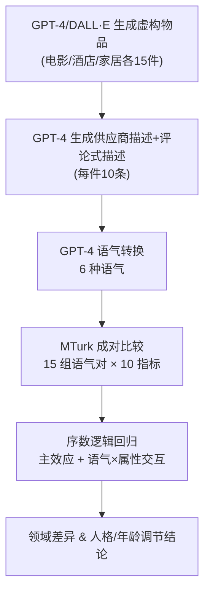

# Impact of Tone-Aware Explanations in Recommender Systems (推荐系统中语气感知解释的影响)

- **会议/期刊**: Transactions on Recommender Systems (TORS) 2025
- **作者与机构**: Ayano Okoso, Keisuke Otaki, Satoshi Koide (Toyota Central R&D Labs), Yukino Baba (The University of Tokyo)
- **推荐链路定位**: 重排/结果呈现层（解释生成与展示）
- **研究方向**: 对话推荐与智能体仿真 / 可解释推荐（HCI 用户研究）
- **论文原文**: [https://arxiv.org/abs/2405.05061v1](https://arxiv.org/abs/2405.05061v1)
- **开源代码**: 暂未开源（虚构数据集可应要求共享）

## TL;DR (1分钟核心速览)

现有可解释推荐研究几乎只关注解释**内容**（特征型/协同型/社交型），而把解释的**表达方式（语气）**当作固定模板忽略掉。本文用 GPT-4 在电影、酒店、家居三域生成虚构物品与六种语气（中性/吸引/幽默/浪漫/正式/简单）的解释，招募 470 名 MTurk 被试做 15 组成对比较，以序数逻辑回归建模。结果显示：除诚信外几乎所有感知指标都受语气显著影响；酒店域受影响最广，电影域最弱；外向性与年龄显著调节语气效应。核心结论是"语气应作为解释的新维度并按领域与用户画像个性化"。

## Background & Motivation (背景与核心矛盾)

- **主流范式**: 可解释推荐聚焦解释**内容**（feature-based / collaborative / social）与**呈现格式**（文本 vs 图表），以七类解释目标（透明性、可审查性、信任、有效性、说服力、效率、满意度）为评价框架。
- **前人局限**: ① 解释文本长期使用统一固定句式（如"与您偏好相似的用户也购买了…"），表达力被完全抹平；② 语气在语言学、心理学、AI 建议（advice-giving）中已被证明影响说服与信任，但在推荐解释场景下缺乏系统实证。
- **核心洞察 (Key Insight)**: 同一信息用不同语气表达会改变用户对推荐物品的印象；且语气效应可能随**领域消费风险**（娱乐短周期 vs 实用长周期）与**用户属性**（年龄、大五人格）而系统性变化。
- **本文切入点**: 提出新指标 **appeal（唤起兴趣能力）** 与七目标并列构成 10 项指标，通过受控在线成对比较实验，把"语气"确立为解释设计的一等变量。

## Method (核心方法设计)

### 1. 整体框架 (Overall Architecture)

本文不是模型论文，而是一套**受控用户研究协议**：先用 LLM 构造虚构物品与多语气解释数据集（消除先验品牌偏见与版权问题），再通过 MTurk 成对比较采集 7 点 Likert 偏好分数，最后用带交互项的序数逻辑回归分离"语气主效应"与"语气×用户属性"交互效应，并按 Benjamini–Hochberg 做多重比较校正。

### 2. 关键设计拆解 (Key Designs)

1. **LLM 驱动的虚构多语气解释数据集**：真实数据集（IMDb/TripAdvisor/Amazon）缺少供应商侧描述且存在品牌先验，故用 GPT-4 按"类型×价位/星级/地点"笛卡尔积生成 15 件虚构物品，每件生成 5 条供应商描述 + 5 条评论式描述（50–150 词），再转换为六种语气（中性、吸引、幽默、浪漫、正式、简单），覆盖正式度、幽默/浪漫、简洁度、吸引力四条语气主轴。这样保证**内容同源、仅语气变化**，是因果识别的关键前提。

2. **序数逻辑回归与效用差分建模**：成对比较分数 $S_i\in\{-3,\dots,+3\}$是有序类别，故用累积 logit 建模。定义语气$t$的效用$u_t=\beta_t+\sum_{e\in\mathcal{A}}\beta_{t,e}X_e$，其中$\mathcal{A}=\{\text{Age, Gender, Ex., Ag., Co., Ne., Op.}\}$，则

$$\mathrm{logit}\big(P(S_i\le j)\big)=\gamma_j-(u_{t_A}-u_{t_B})=\gamma_j-\sum_{t\in\mathcal{T}}\sum_{e\in\mathcal{A}}\big(\beta_t X_t+\beta_{t,e}X_tX_e\big)$$

其中 $X_t$在语气 A 取$+1$、语气 B 取$-1$、其余取$0$，中性语气为参照。**物理直觉**：把"选 A 还是 B"转化为两个语气效用的差，$\beta_t>0$即该语气相对中性更受偏好；交互项$\beta_{t,e}$ 直接量化"某类用户对某语气的额外敏感度"，从而把个性化语气问题化为可检验的系数。

3. **实验控制与偏差抑制**：15 件物品与 15 个语气对（$\binom{6}{2}$）一一配对，保证每位被试覆盖全部语气对；随机化语气对顺序、A/B 位置与 10 个问题的呈现顺序以抑制位置偏差；随机分配推荐物品以剥离推荐准确率对感知的干扰；设置注意力测试与 15 分钟最短作答时长过滤低质量样本。

## Experimental Setup & Evaluation Protocol (实验设置与评估协议)

- **数据集与预处理**: 非传统交互数据集，而是 LLM 生成的虚构物品-解释语料：

| 领域 | 物品数 | 生成输入维度 | 每件描述数 | 语气数 | 有效被试数 |
| :--- | :---: | :--- | :---: | :---: | :---: |
| 电影 | 15 | 5 类型 × 3 | 10 | 6 | 151 |
| 酒店 | 15 | 5 星级 × 3 地点 | 10 | 6 | 170 |
| 家居 | 15 | 5 品类 × 3 价位 | 10 | 6 | 149 |

- **数据划分与防穿越 (Splitting Strategy)**: 不适用（用户研究，无训练/测试划分）；通过虚构物品与随机物品分配消除"已知物品"先验。
- **排名评测协议 (Ranking Protocol)**: 非 Full-Ranking / Sampled Ranking，而是**成对比较协议（Pairwise Comparison）**：每位被试对 15 件物品各做一次语气对比较，10 个指标均用 7 点 Likert（A 更好 … B 更好）。
- **对比基线与超参设置**: 以**中性语气为参照基线**，其余五种语气为处理组；显著性水平 $\alpha=0.05$，Benjamini–Hochberg FDR 校正；人格分数按文献 [11] 简版量表计算并归一化至$[0,1]$，年龄与人格在回归中标准化（均值 0、方差 1）。

## Key Experimental Results (实验关键数据)

### 1. 主实验对比 (Main Results)

下表摘取各领域代表性语气相对中性语气的回归系数（仅列显著项，`*` 表示 $p<0.05$；完整 10 指标见原文表 8）：

| 领域 | 语气 | Trans. | Scrut. | Comp. | Benev. | Effec. | Pers. | Effi. | Satis. | App. |
| :--- | :--- | :---: | :---: | :---: | :---: | :---: | :---: | :---: | :---: | :---: |
| 电影 | Attractive | 0.27 | 0.44 | 0.26 | 0.21 | **0.48\*** | 0.24 | 0.20 | 0.38 | 0.19 |
| 电影 | Humorous | −0.13 | −0.09 | −0.11 | −0.15 | −0.13 | −0.27 | −0.09 | −0.25 | −0.09 |
| 酒店 | Attractive | **0.38\*** | 0.32 | **0.40\*** | **0.53\*** | **0.42\*** | 0.33 | **0.44\*** | 0.23 | **0.38\*** |
| 酒店 | Romantic | 0.31 | **0.47\*** | 0.32 | **0.55\*** | **0.53\*** | **0.37\*** | **0.38\*** | 0.24 | **0.40\*** |
| 酒店 | Formal | **0.52\*** | **0.48\*** | 0.21 | **0.42\*** | **0.46\*** | **0.42\*** | **0.51\*** | **0.36\*** | **0.44\*** |
| 家居 | Attractive | 0.35 | 0.24 | 0.29 | 0.21 | 0.30 | **0.41\*** | **0.42\*** | **0.42\*** | 0.31 |
| 家居 | Romantic | 0.37 | 0.38 | 0.31 | 0.31 | 0.27 | **0.49\*** | 0.37 | 0.17 | 0.32 |
| 家居 | Formal | 0.36 | **0.41\*** | 0.30 | 0.25 | 0.22 | **0.44\*** | 0.26 | 0.38 | 0.26 |

### 2. 消融实验 (Ablation Study)

本文无模型消融，等价分析为**语气×用户属性交互项**（原文表 9，仅列显著项）：

| 领域 | 交互项 | 受影响指标数 | 代表系数 |
| :--- | :--- | :---: | :--- |
| 电影 | 外向性 × Attractive/Humorous/Formal | 5–6 项（含 Trans./Scrut./Comp./Benev.） | 0.28–0.44* |
| 酒店 | 外向性 × Attractive/Humorous/Romantic | 6–9 项 | 0.22–0.39* |
| 酒店 | 年龄 × Attractive | 1 项（Integrity） | −0.30* |
| 家居 | 年龄 × Humorous/Romantic | 1–5 项（Satis./Effi./App.） | −0.29 ~ −0.35* |
| 电影 | 神经质 × Formal | 1 项（Satisfaction） | −0.39* |

### 3. 关键实验发现 (Key Findings)

1. **语气是独立于内容的显著变量**：10 项指标中除诚信（Integrity）外均在至少一个领域被语气显著影响，连本应只由信息量决定的透明性与能力信任也被语气左右，说明用户对"信息如何被说"与"说了什么"难以分离。
2. **领域效应与"娱乐低风险"直觉相反**：酒店域几乎全部指标显著（Formal 在 8 项指标上显著，系数 0.36–0.52），而电影域仅 Effectiveness 显著（Attractive 0.48），家居域集中在说服力/效率/满意度。作者解释为酒店兼具情感体验与实用决策，用户既需情绪唤起也需专业细节，正式语气恰好匹配。
3. **语气效应高度异质，可个性化**：高外向性用户在电影与酒店域对情感型语气（吸引/幽默/浪漫）普遍更敏感（系数 0.22–0.44），但在家居域完全无效应；年长用户对吸引/幽默/浪漫语气显著负向（家居域 Satisfaction −0.35、Appeal −0.30），提示老年用户偏好保守信息型语气。

## Highlights & Limitations (亮点、对比与审稿批判)

- **与代表作对比 (vs. Prior Work)**: 相比 Herlocker 等评估 21 类解释内容/格式、Kouki 等比较音乐域解释内容与人格偏好，本文首次把"语气"从固定模板中解耦为可控变量；相比 AI advice 文献（温暖 vs 能力）聚焦显式干预场景，本文针对干预更弱的推荐解释场景，并给出领域×属性的二维调节图谱。
- **可迁移亮点**: ① "LLM 生成虚构物品 + 同源多语气改写"是低成本、可控的解释 A/B 语料构造范式，可直接迁移到电商/内容平台的解释文案实验；② 用序数逻辑回归 + 效用差分 + 交互项建模成对偏好，比均值打分更能分离主效应与人群异质性。
- **审稿级局限批判**: ① 数据全为 LLM 虚构，生成过程含随机性且难完全复现，与真实服务文案分布存在差距，外部效度受限；② 语气与内容无法完全解耦——附录 A 显示情感型语气被感知为"细节更多"（ANOVA $F=7.82,p<0.05$），主实验效应可能混入内容感知差异；③ 仅 6 种离散语气、未覆盖文化背景与专业度，且未评估语气被滥用导致用户"高估"推荐质量的风险。

## Rating (四维评分)

- **方法创新性 (Novelty)**: ⭐⭐⭐⭐ （首次将语气确立为推荐解释的一等设计维度，并提出 appeal 指标，但本质是 HCI 实证而非算法创新）
- **评估协议与实验扎实度 (Protocol & Experiments)**: ⭐⭐⭐⭐ （三域 470 人成对比较、FDR 校正、注意力测试与附录内容一致性检验齐备，但样本以英美加 MTurk 为主、无真实平台验证）
- **写作与数学规范度 (Clarity & Rigor)**: ⭐⭐⭐⭐ （序数逻辑回归建模与虚拟变量定义清晰，假设检验流程规范；语气分类为离散类别、强度维度未建模）
- **工业落地与复现价值 (Industrial & Practical Value)**: ⭐⭐⭐ （结论可直接指导解释文案个性化，但无开源代码、依赖 LLM 生成管线，且需额外在线实验验证真实转化收益）

