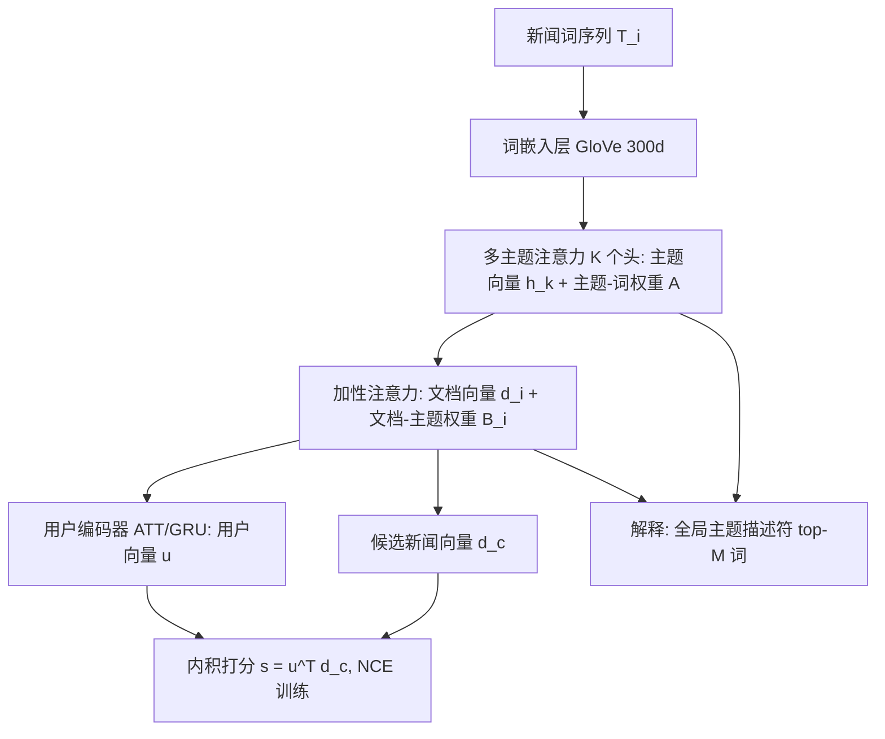

# Topic-Centric Explanations for News Recommendation (面向新闻推荐的主题中心式解释)

- **会议/期刊**: ACM Transactions on Recommender Systems (TORS)
- **作者与机构**: Dairui Liu, Derek Greene, Irene Li, Xuefei Jiang, Ruihai Dong（University College Dublin / University of Tokyo）
- **推荐链路定位**: 精排（候选新闻点击概率打分）
- **研究方向**: 对话推荐与智能体仿真（可解释推荐）/ 序列与会话推荐
- **论文原文**: [论文原文链接](https://arxiv.org/abs/2306.07506v2)
- **开源代码**: [开源代码仓库链接](https://github.com/Ruixinhua/ExplainedNRS)

## TL;DR (1分钟核心速览)

新闻推荐系统普遍是黑盒，用户不信任推荐结果，而现有解释工作只给高层类别名或仅做定性案例展示，缺乏可量化的可解释性评估。本文提出 BATM（Bi-level Attention-based Topical Model），用「多主题注意力 + 文档-主题加性注意力」双层结构，在编码新闻时同步产出主题词分布与文档-主题权重，从而在推荐打分之外给出主题级解释。在 MIND-SMALL/LARGE 上以 NCE 负采样训练、AUC/MRR/nDCG 评测，BATM-ATT 相对最强基线 NAML 在 MIND-SMALL 上 AUC 提升约 0.65 个点，并用 NPMI 与 W2V 两个主题一致性指标量化解释质量。

## Background & Motivation (背景与核心矛盾)

- **主流范式**: 新闻推荐主流是「新闻编码器 + 用户编码器 + 内积打分」的内容式深度模型（NRMS、NAML、LSTUR、NPA、DKN），性能持续提升但模型是黑盒。
- **前人局限**: 其一，解释工作多依赖注意力分数直接高亮词，但 Jain & Wallace 已指出注意力权重未必是「有意义的解释」；其二，少数可解释工作只提供定性案例，**缺少对解释质量的定量评估指标**；其三，用固定 category/subcategory 解释缺乏细粒度与时效性，高层类别下含大量演化子主题。
- **核心洞察 (Key Insight)**: 新闻文本本身富含主题信号（如 "seafood"、"restaurant" 指向美食主题），若把新闻嵌入的潜在维度显式对齐到「可命名的主题词分布」，则推荐打分过程天然可被主题解释（图 1 的核心思想）。
- **本文切入点**: 把主题建模内嵌进新闻编码器，让同一套注意力权重既服务推荐又充当解释，并用主题一致性指标（NPMI、W2V）把「可解释性」变成可测量对象。

## Method (核心方法设计)

### 1. 整体框架 (Overall Architecture)

输入为用户历史点击新闻序列 $\mathcal{H}$与候选集$\mathcal{C}$。共享新闻编码器 BATM 对每篇新闻做两级注意力：第一级$K$个主题注意力头从词嵌入中抽取$K$个主题向量并输出主题-词权重矩阵$\mathbf{A}$；第二级加性注意力把主题向量聚合成文档向量$d_i$并输出文档-主题权重$\mathbf{B}_i$。用户编码器对历史文档向量做加性注意力（BATM-ATT）或 GRU（BATM-GRU）得到用户向量$u$，以内积$s_i=u^{\top}d_i$打分，NCE 损失训练。推理阶段仅用 BATM-ATT 的解释通路：由全局主题分布取 top-$M$词作主题描述符，由用户-新闻注意力权重$\gamma$定位贡献最大的历史新闻，再由$\mathbf{B}$ 选出主导主题，形成「历史新闻主题 ↔ 推荐新闻主题」的对照解释。

### 2. 关键设计拆解 (Key Designs)

1. **多主题注意力层（把词分布拆成 K 个可命名主题）**：常规新闻编码器只输出一个稠密向量，维度语义不可读。本文用 $K$个注意力头，每个头$k$计算$g_{kj}=v_k^{\top}\tanh(W_K e_j+b_k)$，softmax 得$\alpha_{kj}$，加权求和得主题向量$h_k=\sum_j \alpha_{kj}e_j$。归一化后的$\mathbf{A}=\{\alpha_1,\dots,\alpha_K\}$ 即主题-词权重矩阵，直接充当「主题描述符」来源——这是解释性的物理载体：每个头被迫聚焦文档中一组共现语义的词。

2. **文档-主题加性注意力（决定哪几个主题主导这篇新闻）**：仅有主题向量还无法说明「这篇新闻主要讲什么」。第二级用 $\mu_k=V_I^{\top}\tanh(W_I h_k+b_I)$、$\beta_k=\mathrm{softmax}(\mu_k)$、$d_i=\sum_k \beta_k h_k$得到文档向量与文档-主题分布$\mathbf{B}_i$。$\beta_k$越大表示主题$k$ 对该新闻贡献越大，解释时只呈现 top 主题，避免主题噪声干扰。

3. **训练目标、负采样与推理效率**：点击预测用内积 $s_i=u^{\top}d_i$，损失为 NCE：$\mathcal{L}_{NCE}=-\sum_{p}\log\frac{\exp(s_p^{+})}{\exp(s_p^{+})+\sum_{m=1}^{M}\exp(s_m^{-})}$，每个 impression 内 1 正配$M=4$ 个同会话随机负样本（in-impression uniform negative）。推理仅需一次前向 + 内积，解释生成是注意力权重的后处理读取，无额外模型开销；但 BATM-GRU 变体因隐状态不可分解，**不参与解释生成**。

## Experimental Setup & Evaluation Protocol (实验设置与评估协议)

- **数据集与预处理**: 使用 MIND 的公开版本，新闻内容额外补充 body 文本（原文仅 title/abstract/category/URL）：

| 数据集 | #Users | #Items(News) | #Interactions(Clicks) | 稀疏度/密度 | 特征/场景说明 |
| :--- | :---: | :---: | :---: | :---: | :--- |
| MIND-SMALL | 94,057 | 65,238 | 347,727 | 230,117 impressions | 用户子集，短新闻平均长度 638 |
| MIND-LARGE | 750,434 | 130,379 | 3,958,501 | 2,609,219 impressions | 全量首周行为，平均长度 594 |

- **数据划分与防穿越 (Splitting Strategy)**: 按时间切分——训练集 11/9–11/14，验证集 11/15，测试集 11/15（原文如此，验证与测试同日，属潜在瑕疵）；新闻分类任务则随机划分 train/val/test。
- **排名评测协议 (Ranking Protocol)**: 采用 **Sampled Ranking（impression 内候选排序）**，指标为 AUC、MRR、nDCG@5、nDCG@10；训练负采样为同 impression 内随机 4 负。**未使用 Full-Ranking 全库排序**，故 AUC 数值偏高、跨论文比较需谨慎。
- **对比基线与超参设置**: 基线为 DKN、NAML、NRMS、LSTUR、NPA 五类深度内容式模型；统一 GloVe 300 维初始化、历史长度 50、新闻长度 100（标题 30 + 正文 70）、batch 64、Adam lr=1e-3 逐 epoch 减半、dropout 0.2；每个实验独立重复 5 次取均值，按验证集平均 AUC 选超参。

## Key Experimental Results (实验关键数据)

### 1. 主实验对比 (Main Results)

| Models | SMALL AUC | SMALL MRR | SMALL nDCG@5 | SMALL nDCG@10 | LARGE AUC | LARGE MRR | LARGE nDCG@5 | LARGE nDCG@10 |
| :--- | :---: | :---: | :---: | :---: | :---: | :---: | :---: | :---: |
| LSTUR | 67.26 | 31.44 | 35.20 | 41.43 | 69.31 | 33.38 | 37.39 | 43.57 |
| NAML | 67.14 | 31.58 | 35.20 | 41.52 | 69.24 | **33.96** | 37.85 | 44.02 |
| NPA | 66.24 | 31.06 | 34.37 | 40.69 | 68.95 | 33.37 | 37.26 | 43.39 |
| NRMS | 66.58 | 31.44 | 34.99 | 41.21 | 69.09 | 33.25 | 37.19 | 43.43 |
| DKN | 66.95 | 31.12 | 34.94 | 41.13 | 68.89 | 33.24 | 37.26 | 43.43 |
| BATM-ATT | **67.79** | **32.44** | **36.10** | **42.29** | **69.67** | 33.76 | 37.62 | 43.93 |
| BATM-GRU | 67.48 | 32.12 | 35.76 | 41.95 | 69.63 | **33.96** | **37.82** | **44.06** |
| Improv.% (vs 最强基线) | +0.78% | +2.72% | +2.56% | +1.85% | +0.52% | 0.00% | −0.08% | +0.09% |

### 2. 消融实验 (Ablation Study)

原文未提供严格逐组件消融，以下为可提取的等价对照（主题数 $K$ 与用户编码器替换）：

| 配置 | SMALL AUC | LARGE AUC | 说明 |
| :--- | :---: | :---: | :--- |
| BATM-ATT（完整，可解释） | **67.79** | **69.67** | 加性注意力用户编码，解释通路完整 |
| BATM-GRU（用户编码替换） | 67.48 | 69.63 | 序列建模略降 AUC，且丧失可解释性 |
| NAML（含 category/subcategory 显式主题） | 67.14 | 69.24 | 显式类别信息近似主题模块的对照 |
| 主题数 $K$扫描（10–500） | — | — | top-10% 主题 NPMI/W2V 随$K$ 变化，LDA > NC > NR |

### 3. 关键实验发现 (Key Findings)

1. **主题模块带来的是「免费」增益而非性能牺牲**：BATM-ATT 在 MIND-SMALL 上 AUC 67.79 vs NAML 67.14（+0.65），nDCG@5 36.10 vs 35.20（+0.90），说明把新闻编码拆成 $K$ 个主题头并未损失表征能力，反而因多头子空间分解略微增强；在 MIND-LARGE 上增益收窄至 +0.43 AUC，提示数据量增大后主题先验的边际收益递减。
2. **可解释性与推荐性能存在张力**：BATM-GRU 在 LARGE 上 MRR/nDCG@10 与 NAML 持平甚至略优（33.96/44.06），但 GRU 隐状态不可分解、无法生成主题解释；作者明确只对 BATM-ATT 做解释分析，即「最强性能变体」与「可解释变体」并非同一个，这是本文方法论的隐性代价。
3. **主题质量可量化但弱于经典 LDA**：NPMI 上 LDA 显著优于 BATM（NC > NR），W2V 上二者可比；超过 10% 的主题 NPMI > 0.2 且 W2V > 0.4，足以支撑「只解释 top 少数主题」的实际需求。后处理（去停用词、高频/低频词过滤）仅小幅提升分数，说明模型对非信息词鲁棒，而 LDA 高度依赖严格预处理。

## Highlights & Limitations (亮点、对比与审稿批判)

- **与代表作对比 (vs. Prior Work)**: 相比 NRMS/NAML 等纯性能导向模型，本文把主题结构内嵌编码器而非事后归因；相比 NPA 等仅用注意力高亮词的做法，本文给出主题级、可命名的解释并配套定量指标；相比纯 LDA 主题模型，本文主题与推荐目标联合训练，主题直接服务于打分而非语料探索。
- **可迁移亮点**: (1) 「多头注意力 = 多主题」的分解范式可迁移到短视频/电商标题的可解释召回；(2) 用 NPMI + W2V 双指标量化解释质量的做法，可作为可解释推荐论文的评测补充，弥补纯案例展示的缺陷。
- **审稿级局限批判**: 其一，验证集与测试集同为 11/15，存在信息泄漏风险，且仅用 Sampled Ranking 未做 Full-Ranking，AUC 绝对值不可跨论文直接比较；其二，解释质量在 NPMI 上明显落后 LDA，且缺少真实用户研究（作者自认 future work），「解释是否有用」仅有离线指标与单例 case study 支撑；其三，主题数 $K$ 需人工扫描，BATM-GRU 与 BATM-ATT 的性能-可解释性权衡未被系统量化。

## Rating (四维评分)

- **方法创新性 (Novelty)**: ⭐⭐⭐ （双层注意力解耦「主题捕获-主题重要性-决策」的思路清晰，但多头注意力做主题并非全新，理论支撑偏弱）
- **评估协议与实验扎实度 (Protocol & Experiments)**: ⭐⭐⭐ （5 次重复 + 方差报告规范，但验证/测试同日、仅 Sampled Ranking、缺严格逐组件消融）
- **写作与数学规范度 (Clarity & Rigor)**: ⭐⭐⭐⭐ （公式与符号定义完整、解释生成流程图文清晰，复杂度与预处理讨论到位）
- **工业落地与复现价值 (Industrial & Practical Value)**: ⭐⭐⭐⭐ （代码开源、解释为注意力后处理零额外推理开销，可直接嵌入现有新闻推荐精排链路）

