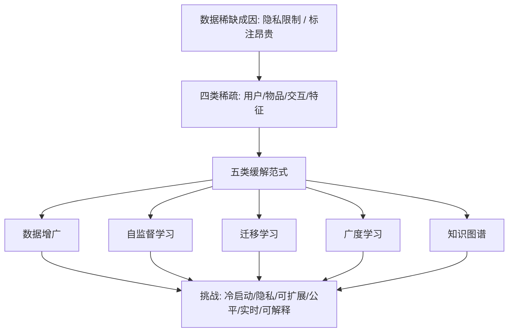

# Data Scarcity in Recommendation Systems: A Survey (推荐系统中的数据稀缺性综述)

- **会议/期刊**: ACM Transactions on Recommender Systems (TORS)
- **作者与机构**: Zefeng Chen, Wensheng Gan, Jiayang Wu, Kaixia Hu, Hong Lin（暨南大学）
- **推荐链路定位**: 召回 / 精排（数据层与表征层通用）
- **研究方向**: 冷启动与长尾推荐 / 自监督对比学习与交互去噪
- **论文原文**: [https://arxiv.org/abs/2312.10073v1](https://arxiv.org/abs/2312.10073v1)
- **开源代码**: 暂未开源

## TL;DR (1分钟核心速览)

本文是一篇面向"数据稀缺"的系统性综述，而非提出单一模型。作者将推荐系统的数据稀缺拆解为用户稀疏、物品稀疏、交互稀疏、特征稀疏四类，并归纳出五条缓解主线：数据增广、自监督学习、迁移学习、广度学习、知识图谱。文章的核心贡献在于建立"稀缺成因 $\to$技术范式$\to$ 落地挑战"的映射框架，指出知识迁移（尤其来自预训练语言模型）是跨域破局的关键杠杆，同时警示跨域迁移会引入数据分布差异、设计不当将产生负迁移。全文无自建实验，价值在于分类体系与未来议程。

## Background & Motivation (背景与核心矛盾)

- **主流范式**: 现有 RS 以协同过滤、内容、人口统计及混合范式为主，依赖用户-物品交互矩阵建模偏好，评估以 RMSE、Precision/Recall、F-measure、AUC 为核心。
- **前人局限**: ① 交互矩阵天然长尾——物品数常达百万级而反馈仅覆盖极小比例，多数物品训练样本近乎为零；② 隐私法规收紧与人工标注昂贵，使"获取足量高质量标注"本身成为瓶颈，传统模型在冷启动与长尾区间系统性失效。
- **核心洞察 (Key Insight)**: 数据稀缺不只是"样本少"，更是"特征空间分布不均"——低密度区域样本覆盖不全、类别分布失衡，导致模型无法推断该区域的真实分布；因此破局点不在单一模型，而在**从外部知识源补充信号**。
- **本文切入点**: 以"知识迁移"为统一视角，把增广、自监督、迁移、广度学习、知识图谱五类方法组织为互补的稀缺缓解工具箱，并给出挑战清单。

## Method (核心方法设计)

### 1. 整体框架 (Overall Architecture)

综述按"定义—成因—解法—挑战—展望"组织。第 2 节先给出 RS 的形式化目标：在用户 $u$、物品$i$、场景$s$下学习打分函数$f(u,i,s)$ 并对候选池排序；第 3 节将稀缺细分为数据稀缺（隐私/标注成本）与数据稀疏（分布不均）两层；第 4 节展开五类解法；第 5–6 节讨论隐私、可扩展性、冷启动、公平性等七大挑战与未来方向。整体逻辑是"稀缺成因决定技术选型"，而非罗列模型。

### 2. 关键设计拆解 (Key Designs)

1. **自监督推荐的四分分类体系（本文最具结构性的增量）**：针对"无标签交互如何自造监督信号"这一痛点，作者按 pretext task 性质将自监督推荐划分为对比式、生成式、预测式、混合式四类。对比式以同一实例的两个变体为正对、不同实例为负对，最小化正对距离并推开负对；生成式借鉴 BERT 掩码重建，对用户/物品画像做扰动后重建；预测式分样本预测与伪标签预测；混合式则加权融合多路自监督损失 $\mathcal{L}=\sum_k \lambda_k \mathcal{L}_k$ 以降低冗余。该分类的直觉价值在于：把"增广策略"与"监督信号来源"解耦，便于按稀疏类型选型。
2. **迁移学习的两级划分（跨系统 vs. 跨域）**：跨系统迁移在不同 RS 之间共享特征或融合模型（如基于主动学习建立实体对应关系）；跨域迁移则把源域兴趣迁移到目标域（如购物域 $\to$ 影视域），代表工作包括 TALMUD、TLRec（以重叠用户/物品为桥）、注意力对抗迁移网络与对偶学习框架。作者强调迁移的收益来自"源域正则效应"可缓解过拟合，但**数据分布差异会导致负迁移**，需选择性迁移（如引入经验预测误差与方差准则）。
3. **知识图谱的四类表示学习路线**：针对 KG 补全的稀疏问题，梳理嵌入式（TransSparse 用稀疏矩阵约束映射矩阵表达力、ComplEx 用复值嵌入增强语义灵活性）、路径/规则式（DacKGR、ComplEx-N3 用嵌入引导强化学习做动态路径补全）、嵌入+路径结合（TRE 只学关系嵌入以规避实体嵌入受稀疏影响、IterE 用关系公理增广数据）、GNN 式（ExpressGNN 引入最短路径等子结构、pGAT 做路径级注意力过滤噪声）与预训练式（K-BERT 联合掩码语言建模与 KG 补全预训练）。核心直觉：**当实体嵌入不可靠时，退化为只学关系/路径可显著提升稀疏鲁棒性**。

> 注：本文为综述，未提出统一损失函数与负采样策略，上述公式为对各范式的抽象归纳。

## Experimental Setup & Evaluation Protocol (实验设置与评估协议)

- **数据集与预处理**: 本文为综述，**未开展自建实验**，无数据集统计表。所评述的评估指标包括 RMSE、Precision、Recall、F-measure、ROC 曲线与 AUC。
- **数据划分与防穿越 (Splitting Strategy)**: 未涉及；原文未对所述工作进行统一的划分协议归一化。
- **排名评测协议 (Ranking Protocol)**: 未涉及；原文未区分 Full-Ranking 与 Sampled Ranking，这是该综述在评估严谨性上的明显缺口。
- **对比基线与超参设置**: 无统一基线对比与超参报告；各被引工作的实验设置分散于原文献。

## Key Experimental Results (实验关键数据)

### 1. 主实验对比 (Main Results)

本文为综述性文章，**不含主实验对比表**。其"结果"体现为分类体系的覆盖度与方法归置，而非数值指标。若需定量证据，须回溯至各被引原始工作（如 SGL/SimGCL 类对比学习、TLRec 跨域迁移、K-BERT 预训练补全等）。

### 2. 消融实验 (Ablation Study)

无消融实验。原文未对五类范式做统一受控对比，因而**无法回答"哪类方法在何种稀疏程度下最优"这一关键问题**。

### 3. 关键实验发现 (Key Findings)

由于缺乏自建实验，此处归纳的是作者基于文献梳理得出的定性结论：
1. **稀缺类型决定技术选型**：用户/交互稀疏优先自监督与增广，物品/特征稀疏优先知识图谱与广度学习，跨域冷启动优先迁移学习——五类范式并非互斥而是互补。
2. **负迁移是迁移学习的核心风险**：作者明确指出跨域数据差异若不加约束会损害目标域性能，需引入选择性迁移准则，这比"无脑预训练+微调"更稳健。
3. **稀疏下应降低对实体嵌入的依赖**：TRE 只学关系嵌入、IterE 用公理增广数据的思路表明，当实体样本不足时，转向关系级/规则级信号是更可靠的稀疏应对策略。

## Highlights & Limitations (亮点、对比与审稿批判)

- **与代表作对比 (vs. Prior Work)**: 相较于聚焦单一范式的综述（如仅讨论对比学习推荐或仅讨论跨域推荐），本文的差异在于以"数据稀缺"为统一问题轴，把五类异构技术纳入同一坐标系；与经典 RS 综述相比，其增量在于显式引入预训练语言模型作为外部知识源，并强调负迁移风险。
- **可迁移亮点**: ① 自监督推荐的"对比/生成/预测/混合"四分法可直接用于新论文的方法定位与 related work 组织；② "稀缺类型 $\to$ 技术选型"的映射表可作为工业冷启动方案选型的决策清单。
- **审稿级局限批判**: ① **缺乏定量与统一评估**——全文无受控实验、无 Full-Ranking 协议归一化、无各范式在相同稀疏度下的横向对比，结论停留在定性层面，说服力受限；② **分类边界模糊且时效性风险高**——"广度学习"与"迁移学习"、"知识图谱"与"自监督"存在明显重叠，且 2023 年截稿后 LLM4Rec、生成式推荐（语义 ID、扩散推荐）等主流稀缺缓解路线基本缺席，削弱了其"up-to-date"的宣称。

## Rating (四维评分)

- **方法创新性 (Novelty)**: ⭐⭐⭐ （无新模型，但自监督四分法与"稀缺类型—技术选型"映射具备组织性创新）
- **评估协议与实验扎实度 (Protocol & Experiments)**: ⭐⭐ （无自建实验、无统一划分与排名协议、无消融，定量支撑薄弱）
- **写作与数学规范度 (Clarity & Rigor)**: ⭐⭐⭐⭐ （结构清晰、分类图示完整、术语定义明确，但公式层面仅作抽象归纳）
- **工业落地与复现价值 (Industrial & Practical Value)**: ⭐⭐⭐ （可作为冷启动方案选型与 related work 参考，但无开源代码、无工程开销分析，直接落地需回溯原始工作）

