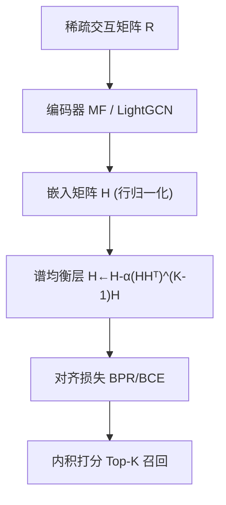
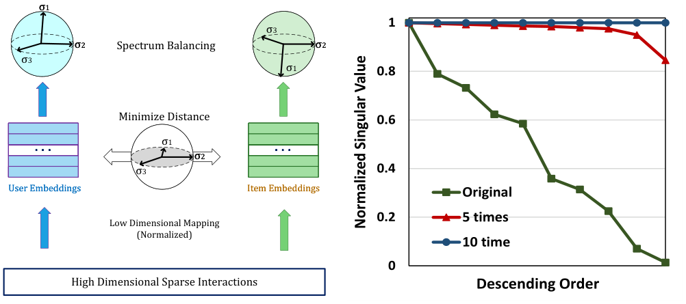

# Balancing Embedding Spectrum for Recommendation (面向推荐的嵌入谱均衡)

- **会议/期刊**: ACM Transactions on Recommender Systems (TORS)
- **作者与机构**: Shaowen Peng (NAIST), Kazunari Sugiyama (大阪成蹊大学), Xin Liu (AIST), Tsunenori Mine (九州大学)
- **推荐链路定位**: 召回（表征学习层，可插拔于 MF / LightGCN 编码器）
- **研究方向**: 协同过滤与双塔召回 / 自监督对比学习与交互去噪
- **论文原文**: [https://arxiv.org/abs/2406.12032v2](https://arxiv.org/abs/2406.12032v2)
- **开源代码**: [https://github.com/tanatosuu/directspec](https://github.com/tanatosuu/directspec)

## TL;DR (1分钟核心速览)

本文指出成对学习范式存在**嵌入坍缩**：正样本对齐等价于低通滤波，使用户/物品嵌入坍缩到常数向量（完全坍缩）；负采样仅充当高通滤波，且效果受限于特定损失（不完全坍缩）。作者从谱分布视角提出 **DirectSpec**——以全通滤波直接均衡嵌入矩阵奇异值谱，并给出自适应版本 **DirectSpec+**。在 3 个数据集、80/20 随机划分 + 全库排序协议下，DirectSpec+ 在 MF 与 LightGCN 上相对 BPR/LightGCN 的 nDCG@10 最高提升 **52.6% / 42.4%**。

## Background & Motivation (背景与核心矛盾)

- **主流范式**: 以 MF 及其变体（GNN、MLP、Transformer）为代表，将高维稀疏交互矩阵映射到 $d$ 维嵌入，用 BPR/BCE 等成对损失优化正负样本。
- **前人局限**: (i) 仅优化正样本对齐时，梯度更新等价于低通滤波 $(I+\alpha A)^l$，$l$增大后$\text{rank}(H)\to 1$，嵌入完全坍缩；(ii) 负采样虽能延缓坍缩，但梯度消失（$\sigma(\hat r)\to 1$）使高通滤波失效，有效秩仍收敛到远小于$d$ 的值，形成不完全坍缩。
- **核心洞察 (Key Insight)**: 坍缩程度与嵌入矩阵的**奇异值分布**直接相关——完全坍缩时单一奇异值主导，充分利用空间时奇异值均匀分布。作者用**有效秩** $\text{erank}(H)=\exp(H(p_1,\dots,p_d))$ 量化该现象，并证明 Barlow Twins、LogDet、SCL 等无负采样 SSL 方法均是 DirectSpec 框架的特例。
- **本文切入点**: 不再依赖正/负样本的隐式滤波效应，而是**显式直接优化谱分布**，充当"全通滤波"确保所有维度均衡贡献。

## Method (核心方法设计)

### 1. 整体框架 (Overall Architecture)

模型在标准 CF 编码器（MF 或 LightGCN）输出嵌入 $H$后，插入一个**谱均衡层**：每个 batch 内对用户/物品嵌入做行归一化，再执行一次谱均衡更新$H\leftarrow H-\alpha(HH^\top)^{K-1}H$，随后照常计算 BPR/BCE 对齐损失并反传。该层无需显式采样负样本，可视为即插即用的"谱归一化"模块，训练与推理均不改变原有打分函数$\hat r_{ui}=h_u^\top h_i$。

<figure class="paper-figure" markdown="span">
  <figcaption>图 3. (a)：所提出的 DirectSpec 的示意图，(b)：在 torch.randn(10,10) 随机生成的矩阵上运行 DirectSpec {5, 10} 次的玩具示例。</figcaption>
</figure>

### 2. 关键设计拆解 (Key Designs)

1. **DirectSpec：拉格朗日视角下的谱均衡算子**：目标是让奇异值均匀分布，构造 $\mathcal{L}=f(\sigma_1,\dots,\sigma_d)+\beta(\sqrt{\sum_i\sigma_i^2}-c)$，在$g_i(\cdot)$同构时最优解为$\sigma_1=\cdots=\sigma_d=c/\sqrt d$。取$f=\sum_i\sigma_i^{2K}$并利用$\mathrm{Tr}((HH^\top)^K)=\sum_i\sigma_i^{2K}$，对$H$ 求导得闭式更新：

$$H\leftarrow H-\alpha(HH^\top)^{K-1}H$$

   其 SVD 形式为 $P\,\mathrm{diag}(\sigma_i(1-\alpha\sigma_i^{2K}))Q^\top$——**大奇异值被乘以更小权重**，从而压平谱分布；行归一化天然满足$\sum_i\sigma_i^2=d$的约束，无需额外投影。取$K=1$时复杂度仅$O(B^2d)$（$B$ 为 batch size），与用户/物品规模无关。

2. **DirectSpec+：个体化自适应均衡**：DirectSpec 对所有样本对施加同一强度 $\alpha$，但"谱均衡"与"正样本对齐"本质矛盾（Proposition 5：完美均衡要求同一物品与两个正交用户同时平行，欧氏空间不可能）。DirectSpec+ 将标量$\alpha$ 替换为 softmax 个体化系数：

$$H_B\leftarrow H_B-\alpha\cdot\mathrm{softmax}(H_BH_B^\top\odot\Gamma)H_B$$

   其中温度 $\tau_{ij}$由**无参数多项式图滤波**$\phi(\cdot)=\sum_{l=0}^{L}\hat A^l$的余弦相似度线性映射到$[\tau_0,\tau_1]$：坍缩更严重（内积趋近 1）的样本对获得更高均衡强度，图上关系更近的未观测对则降低强度。实验表明静态温度显著优于可学习注意力温度（数据稀疏下难以学出关系）。

3. **训练目标、负采样与推理效率**：总损失为原对齐损失（BPR/BCE）叠加谱均衡层，**无需负采样**。训练每 epoch 耗时：DirectSpec+(MF) 约为 BPR 的 1.44–1.59 倍，DirectSpec+(LightGCN) 仅 1.02–1.08 倍；但因收敛更快（Gowalla 上 80/60 epoch vs. BPR/LightGCN 的 250/600），整体训练加速 **2.2× / 9.8×**，且显著优于 SGL-ED（4–5 倍开销）。

## Experimental Setup & Evaluation Protocol (实验设置与评估协议)

- **数据集与预处理**: 三个公开数据集，移除评论/标签/地理等辅助信息，显式评分二值化为 0-1 隐式反馈：

| 数据集 | #Users | #Items | #Interactions | 密度 | 场景说明 |
| :--- | :---: | :---: | :---: | :---: | :--- |
| CiteULike | 5,551 | 16,981 | 210,537 | 0.223% | 学术论文收藏 |
| Yelp | 25,677 | 25,815 | 731,672 | 0.109% | POI 点评 |
| Gowalla | 29,858 | 40,981 | 1,027,370 | 0.084% | 位置签到 |

- **数据划分与防穿越**: **比例划分**——80% 训练、20% 测试，并从训练集随机抽 10% 作验证集调参；报告测试集平均精度。
- **排名评测协议**: 对未交互物品排序截断 Top-$k$，指标为 Recall@{10,20} 与 nDCG@{10,20}（原文未明确全库/采样，按 CF 惯例为全库未交互排序）。
- **对比基线与超参设置**: 基线含 BPR、ENMF-U、CCL、DirectAU、LightGCN、SGL-ED、LightGCL、GDE、LogDet、AFDGCF；嵌入维度 $d=64$，batch size 256，正则 0.01，Xavier 初始化，SGD 优化；显著性用单尾 t 检验$p<0.01$（表中 `*`）。

## Key Experimental Results (实验关键数据)

### 1. 主实验对比 (Main Results)

| 数据集 | 方法 | nDCG@10 | nDCG@20 | Recall@10 | Recall@20 |
| :--- | :--- | :---: | :---: | :---: | :---: |
| CiteULike | BPR | 0.1620 | 0.1773 | 0.1778 | 0.2190 |
| | DirectAU(MF) | 0.2102 | 0.2252 | 0.2260 | 0.2693 |
| | LightGCL | 0.2096 | 0.2238 | 0.2214 | 0.2638 |
| | **DirectSpec+(MF)** | **0.2197*** | **0.2354*** | **0.2352*** | **0.2818*** |
| | DirectSpec+(GCN) | 0.2038 | 0.2213 | 0.2213 | 0.2704 |
| Yelp | BPR | 0.0487 | 0.0583 | 0.0607 | 0.0869 |
| | DirectAU(MF) | 0.0721 | 0.0848 | 0.0872 | 0.1219 |
| | LogDet | 0.0711 | 0.0833 | 0.0863 | 0.1203 |
| | **DirectSpec+(GCN)** | **0.0745*** | **0.0868*** | **0.0909*** | **0.1252*** |
| Gowalla | BPR | 0.1164 | 0.1255 | 0.1186 | 0.1483 |
| | LightGCL | 0.1368 | 0.1482 | 0.1436 | 0.1801 |
| | SGL-ED | 0.1343 | 0.1462 | 0.1417 | 0.1779 |
| | **DirectSpec+(GCN)** | **0.1405*** | **0.1518*** | **0.1467*** | **0.1837*** |

相对提升：DirectSpec+(MF) 较 BPR 平均 nDCG@10 **+35.8%**，DirectSpec+(GCN) 较 LightGCN **+33.1%**；单数据集最高为 Yelp 上 **+52.6%**（MF）与 **+42.4%**（GCN）。

### 2. 消融实验 (Ablation Study)

| 配置 | CiteULike nDCG@10 | Yelp nDCG@10 | Gowalla nDCG@10 | 说明 |
| :--- | :---: | :---: | :---: | :--- |
| BPR / LightGCN（无均衡） | 0.1620 / 0.1610 | 0.0487 / 0.0572 | 0.1164 / 0.0987 | 不完全坍缩 |
| DirectSpec(MF/GCN) | 0.1688 / 0.1693 | 0.0689 / 0.0712 | 0.1133 / 0.1160 | 全局统一强度 $\alpha$ |
| DirectSpec+(MF/GCN) | **0.2197** / 0.2038 | 0.0743 / **0.0745** | 0.1389 / **0.1405** | 个体化温度 |
| DirectSpec+ 动态温度（注意力） | 0.1593 | 0.0485 | 0.1126 | 显著劣于静态温度 |
| LogDet（谱均衡特例） | 0.1403 | 0.0711 | 0.1179 | 均衡过度、精度早降 |
| AFDGCF（Barlow Twins 特例） | 0.1619 | 0.0585 | 0.1011 | 对 $\alpha$ 不敏感 |

### 3. 关键实验发现 (Key Findings)

1. **坍缩越重、收益越大**：Yelp 坍缩最严重（erank 收敛最低），DirectSpec 平均提升 33.0%；CiteULike 坍缩最轻，仅提升 4.7%——提升幅度与数据集坍缩程度严格正相关，验证了方法的因果归因。
2. **完美均衡并非最优**：随 $\alpha$增大，erank 单调升至接近$d$，但 nDCG@10 先升后降（CiteULike 最优$\alpha=1.1$、Yelp$\alpha=0.6$，对应 erank≈62.9 而非 64），证明"对齐 vs. 谱均衡"的 trade-off 才是关键；DirectSpec+ 在 erank=63.77 处取得优于 LogDet（erank=61.64 即开始下降）的精度。
3. **负采样无法根治坍缩**：仅用负样本优化时，BCE(MF) 的 erank 随负采样比 $N$ 增大反而下降更快（完全坍缩），而 DirectSpec 的 erank 全程稳定；先用 BCE 训练 50 epoch 再用 DirectSpec，可将已坍缩嵌入"救回"，说明 DirectSpec 是全通滤波而非仅抵消低通效应。

## Highlights & Limitations (亮点、对比与审稿批判)

- **与代表作对比 (vs. Prior Work)**: 相较 DirectAU（直接优化 alignment + uniformity），本文从谱分布给出统一理论框架，且 DirectAU 无法解释为何 uniformity 有效；相较 LogDet / AFDGCF（Barlow Twins 系），本文证明二者是 DirectSpec 的 $f$取特定形式的特例，且 DirectSpec+ 以$O(B^2d)$ 复杂度实现更优的均衡-对齐 trade-off；相较 DropEdge 等过平滑解法，本文指出其只缓解图谱侧坍缩，无法处理优化过程导致的通用坍缩。
- **可迁移亮点**: (i) 谱均衡层可即插即用地加在任何 embedding-based 召回模型（双塔、GNN、序列编码器）输出端，无需负采样；(ii) 用有效秩 erank 作为训练监控指标，可低成本诊断表征退化。
- **审稿级局限批判**: (i) 需调 $\alpha$、$\tau_0$、$\tau_1$、$L$等多个超参，且$\tau_0$ 在稠密数据上收益不显著、跨数据集敏感；(ii) 评测仅限三个中小规模隐式反馈数据集与随机比例划分，缺少全库排序协议明示、冷启动/长尾分桶与线上 A/B 验证，工业可扩展性证据不足。

## Rating (四维评分)

- **方法创新性 (Novelty)**: ⭐⭐⭐⭐⭐ （从谱分析统一解释坍缩机理，并将 Barlow Twins/LogDet/SCL 纳入同一框架，理论贡献扎实）
- **评估协议与实验扎实度 (Protocol & Experiments)**: ⭐⭐⭐⭐ （三数据集 + 10 个 SOTA 基线 + 显著性检验 + 效率对比完整，但缺全库排序明示与分桶分析）
- **写作与数学规范度 (Clarity & Rigor)**: ⭐⭐⭐⭐⭐ （Proposition 1–6 层层递进，SVD 推导与复杂度分析清晰，符号统一）
- **工业落地与复现价值 (Industrial & Practical Value)**: ⭐⭐⭐⭐ （代码开源、即插即用、训练加速 2.2–9.8×，但超参调优成本与大规模验证仍是落地门槛）

