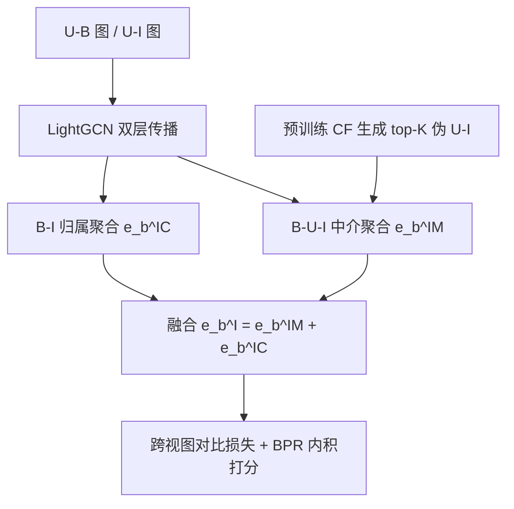
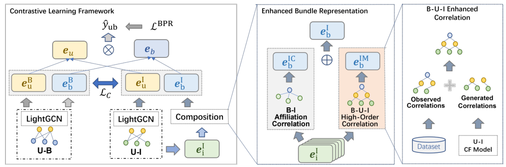

# Enhancing Item-level Bundle Representation for Bundle Recommendation (增强捆绑包推荐的物品级表征)

- **会议/期刊**: ACM Transactions on Recommender Systems (TORS)
- **作者与机构**: Xiaoyu Du, Kun Qian, Yunshan Ma, Xinguang Xiang（南京理工大学、新加坡国立大学）
- **推荐链路定位**: 召回（用户-捆绑包排序）
- **研究方向**: 协同过滤与双塔召回 / 自监督对比学习
- **论文原文**: [论文原文链接](https://arxiv.org/abs/2311.16892v1)
- **开源代码**: [开源代码仓库链接](https://github.com/answermycode/EBRec)

## TL;DR (1分钟核心速览)

捆绑包推荐中，物品级捆绑包表征仅由 B-I 归属图单向聚合而来，与用户真实偏好的 U-I 协同信号割裂，导致表征信息不足。EBRec 提出两个增强模块：以用户为中介构建 B-U-I 高阶关联补充 B-I 聚合，并用预训练 CF 模型生成伪 U-I 交互扩充该关联。在 NetEase/Youshu/iFashion 三数据集、全库排序协议下，Recall@20 相对 SOTA CrossCBR 平均提升 7.5%，iFashion 上 NDCG@20 提升达 17.0%。

## Background & Motivation (背景与核心矛盾)

- **主流范式**: 以 CrossCBR 为代表的两视图对比学习框架，捆绑包级表征来自 U-B 图 LightGCN 传播，物品级表征来自 B-I 归属图对物品嵌入的聚合，再用跨视图对比损失对齐两者。
- **前人局限**: 其一，物品级捆绑包表征只走 B-I 单通道，而物品嵌入本身由 U-I 图学得，两条通道各自独立、缺乏内在关联建模；其二，U-B 交互远比 U-I 稀疏（Youshu 仅 5.1 万条 U-B），B-U-I 路径上的可用协同信号被进一步稀释。
- **核心洞察 (Key Insight)**: 作者量化了"捆绑包关联用户所交互物品"与"捆绑包内归属物品"的交集比例，发现绝大多数低于 10%（图 4）——两类物品携带互补而非重复的信息，说明 B-U-I 路径确实能补充 B-I 看不到的用户意图。
- **本文切入点**: 把用户当作捆绑包与物品之间的中介节点，构造 B-U-I 高阶关联作为 B-I 聚合的并行分支，再用预训练模型生成的伪交互把这条稀疏路径"加粗"。

## Method (核心方法设计)

### 1. 整体框架 (Overall Architecture)

模型沿用 CrossCBR 的双层对比学习骨架：捆绑包级在 U-B 二部图上跑 LightGCN 得到 $\mathbf{e}_u^B,\mathbf{e}_b^B$；物品级在 U-I 二部图上跑 LightGCN 得到$\mathbf{e}_u^I,\mathbf{e}_i^I$，再经"增强捆绑包表征模块"的两条并行通路（B-I 归属聚合 + B-U-I 中介聚合）融合成$\mathbf{e}_b^I$。两视图拼接后由跨视图对比损失拉近，最终以内积打分并用 BPR 优化。B-U-I 增强关联模块在训练前用预训练 CF 模型离线生成 top-$K$ 伪交互，注入 U-I 图后重跑上述流程。

<figure class="paper-figure" markdown="span">
  <figcaption>图2. EBRec概览。我们在对比学习模块的整体框架下提出了增强捆绑包表示模块和B-U-I增强关联模块。</figcaption>
</figure>

### 2. 关键设计拆解 (Key Designs)

1. **增强捆绑包表征（B-U-I 中介聚合）**：痛点是 B-I 单向聚合丢失用户偏好信息。作者新增一条从物品经用户到捆绑包的隧道：先对捆绑包 $b$的关联用户集$\mathcal{N}_b^U$ 内每个用户取其交互物品均值，再对用户求均值，与 B-I 通路线性融合：

$$\mathbf{e}_b^{IM}=\frac{1}{|\mathcal{N}_b^U|}\sum_{u\in\mathcal{N}_b^U}\frac{1}{|\mathcal{N}_u^I|}\sum_{i\in\mathcal{N}_u^I}\mathbf{e}_i^I,\qquad \mathbf{e}_b^I=\mathbf{e}_b^{IM}+\mathbf{e}_b^{IC}$$

直觉是：与同一捆绑包交互的用户所点击的物品，反映了"为什么会选这个包"的意图，与包内物品的构成信息互补（图 4 的低重叠率即为证据）。

2. **B-U-I 增强关联（伪交互扩充）**：痛点是观测 U-I 稀疏使上式中的 $\mathcal{N}_u^I$过小。作者用预训练 CF 模型（MFBPR / UltraGCN / LightGCL 均可）对每个用户预测 top-$K$物品集$\mathcal{T}_u^{(K)}$，把中介关联的用户邻域改写为$\mathcal{N}_u^I=\{(u,i)\mid \mathbf{X}_{ui}=1 \lor i\in\mathcal{T}_u^{(K)}\}$。该模块与具体预测模型解耦，预测越准、注入的用户偏好越有代表性；但$K$ 过大会引入噪声，存在最优拐点。

3. **训练目标、负采样与推理效率**：总损失为 $\mathcal{L}=\mathcal{L}_{BPR}+\lambda_1(\mathcal{L}_{BC}+\mathcal{L}_{UC})+\lambda_2\|\Theta\|_2^2$，其中$\mathcal{L}_{BC},\mathcal{L}_{UC}$为捆绑包/用户侧的跨视图 InfoNCE（温度$\tau$），BPR 采用均匀随机负采样，数据增广仅保留边丢弃。空间复杂度$O((M+N+O)d)$ 与 CrossCBR 持平；时间上仅多出图聚合中新增的 B-I 增强边，预训练只做一次，整体开销可忽略。

## Experimental Setup & Evaluation Protocol (实验设置与评估协议)

- **数据集与预处理**: 直接沿用 CrossCBR 的划分与过滤结果：

| 数据集 | #Users | #Items | #Bundles | #U-I | #U-B | #B-I | 平均包内物品数 |
| :--- | :---: | :---: | :---: | :---: | :---: | :---: | :---: |
| NetEase | 18,528 | 123,628 | 22,864 | 1,128,065 | 302,303 | 1,778,838 | 77.80 |
| Youshu | 8,039 | 32,770 | 4,771 | 138,515 | 51,377 | 176,667 | 37.03 |
| iFashion | 53,897 | 42,563 | 27,694 | 2,290,645 | 1,679,708 | 106,916 | 3.86 |

- **数据划分与防穿越 (Splitting Strategy)**: 沿用 CrossCBR 的固定训练/验证/测试集划分，测试阶段对全部捆绑包排序。
- **排名评测协议 (Ranking Protocol)**: 无偏 `Full-Ranking`（全库未交互捆绑包排序），以验证集 NDCG@20 选模型，报告 Recall@{20,40} 与 NDCG@{20,40}。
- **对比基线与超参设置**: 基线含通用 CF（MFBPR、LightGCN、SGL、LightGCL）与捆绑包推荐专用（DAM、BundleNet、BGCN、MIDGN、CrossCBR）共 9 个；嵌入维度统一 $d=64$，Xavier 初始化；$\lambda_1\in\{0.01,\dots,1\}$、$\lambda_2\in\{10^{-5},\dots,10^{-3}\}$、$\tau\in\{0.1,\dots,0.5\}$、$K\in\{0,5,10,20,30,40,50\}$ 网格搜索。

## Key Experimental Results (实验关键数据)

### 1. 主实验对比 (Main Results)

Top-20 预测（R=Recall，N=NDCG）：

| Model | NetEase R@20 | NetEase N@20 | Youshu R@20 | Youshu N@20 | iFashion R@20 | iFashion N@20 |
| :--- | :---: | :---: | :---: | :---: | :---: | :---: |
| MFBPR | 0.0355 | 0.0181 | 0.1959 | 0.1117 | 0.0752 | 0.0542 |
| LightGCN | 0.0496 | 0.0254 | 0.2286 | 0.1344 | 0.0837 | 0.0612 |
| SGL | 0.0687 | 0.0368 | 0.2568 | 0.1527 | 0.0933 | 0.0690 |
| LightGCL | 0.0705 | 0.0371 | 0.2710 | 0.1556 | 0.0894 | 0.0653 |
| BGCN | 0.0491 | 0.0258 | 0.2347 | 0.1345 | 0.0733 | 0.0531 |
| MIDGN | 0.0678 | 0.0343 | 0.2682 | 0.1527 | 0.0856 | 0.0473 |
| CrossCBR | 0.0842 | 0.0457 | 0.2813 | 0.1668 | 0.1173 | 0.0895 |
| **EBRec** | **0.0899** | **0.0487** | **0.2858** | **0.1701** | **0.1329** | **0.1047** |
| Improv.% | +6.8% | +6.6% | +1.6% | +2.0% | +13.3% | +17.0% |

Top-40 上趋势一致：NetEase R@40 0.1359（+7.5%）、iFashion N@40 0.1238（+14.6%），三数据集平均提升 7.13%。

### 2. 消融实验 (Ablation Study)

| 变体 | NetEase R@20 | NetEase R@40 | Youshu R@20 | iFashion R@20 | iFashion N@20 |
| :--- | :---: | :---: | :---: | :---: | :---: |
| EBRec-E（去两模块，即 CrossCBR） | 0.0842 | 0.1264 | 0.2813 | 0.1173 | 0.0895 |
| EBRec-C（仅观测 B-U-I，无伪交互） | 0.0871 | 0.1340 | 0.2831 | 0.1291 | 0.0992 |
| **EBRec（完整）** | **0.0899** | **0.1359** | **0.2858** | **0.1329** | **0.1047** |

### 3. 关键实验发现 (Key Findings)

1. **两个模块各自有效且可叠加**：仅加观测 B-U-I 关联（EBRec-C）即在 iFashion 上把 N@20 从 0.0895 拉到 0.0992（+10.8%），再叠加伪交互增强进一步升至 0.1047，说明"补通道"与"补密度"解决的是两个独立瓶颈。
2. **收益与包内物品数强负相关**：iFashion 平均包内仅 3.86 个物品，B-I 聚合信息量最少，故提升最大（平均 +13.8%）；NetEase 包内 77.8 个物品、B-I 已较充分，提升回落至约 7%；Youshu 因 U-B 极稀疏（5.1 万条）提升最小（约 2%）。
3. **伪交互规模 $K$存在数据集相关的最优拐点**：iFashion 交集比例高，$K=10$即达峰值；NetEase 交集低，需$K=30$；继续增大$K$ 后噪声压过有效信号，精度反降。此外，去掉对比学习（EBRec-CL）后各层级性能显著下滑，且增强后的捆绑包级表征单独使用已超过 CrossCBR 的双层联合结果，说明增益主要经由对比学习传导至捆绑包级。

## Highlights & Limitations (亮点、对比与审稿批判)

- **与代表作对比 (vs. Prior Work)**: BGCN 用双视图 GCN 但两视图信息不交互；CrossCBR 引入跨视图对比对齐，却仍让物品级表征困在 B-I 单通道；EBRec 的关键差异是把用户显式建模为 B-I 与 U-I 之间的桥，并用生成式伪交互缓解桥上的稀疏，属于对 CrossCBR 的"结构性补丁"而非简单换损失。
- **可迁移亮点**: ①"中介节点聚合"范式可迁移到任何存在两级实体（如店铺-商品、歌单-歌曲）的场景，用共享用户补全缺失的跨级关联；②用预训练 CF 的 top-$K$ 预测做图增广，比随机边丢弃更语义化，且与具体预测器解耦，工程上易插拔。
- **审稿级局限批判**: ①伪交互由同一数据分布内的 CF 模型生成，存在流行度放大与自我强化风险，论文未做去偏或长尾分桶评估；②iFashion 上单 epoch 训练时间从 30.5s 增至 49.1s（+61%），且 $K$ 需按数据集调参，跨场景部署的调参成本与延迟收益比未被充分讨论。

## Rating (四维评分)

- **方法创新性 (Novelty)**: ⭐⭐⭐⭐ （B-U-I 中介聚合思路清晰且有交集率量化支撑，但整体是在 CrossCBR 骨架上的模块级增强，范式跃迁有限）
- **评估协议与实验扎实度 (Protocol & Experiments)**: ⭐⭐⭐⭐ （三数据集全库排序、9 个基线、消融与 $K$/预测器/层级分析齐全，但缺少显著性检验与长尾分桶）
- **写作与数学规范度 (Clarity & Rigor)**: ⭐⭐⭐⭐ （公式简洁、符号表完整、复杂度分析到位，部分符号如 $\mathcal{N}_b^U$ 在正文与表中定义略有出入）
- **工业落地与复现价值 (Industrial & Practical Value)**: ⭐⭐⭐⭐ （代码开源、空间复杂度不增、预训练一次性开销，唯训练时间增幅与 $K$ 调参需在线上权衡）

