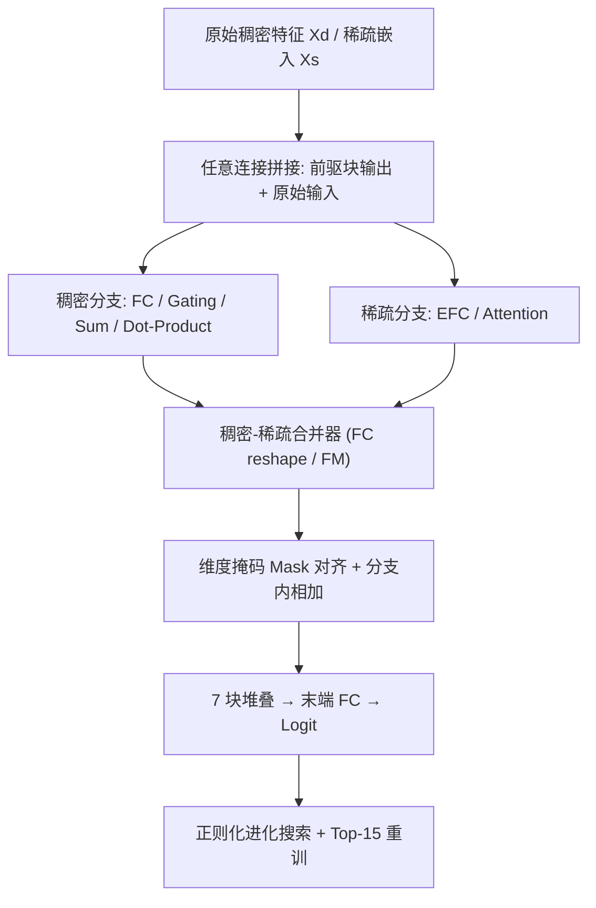
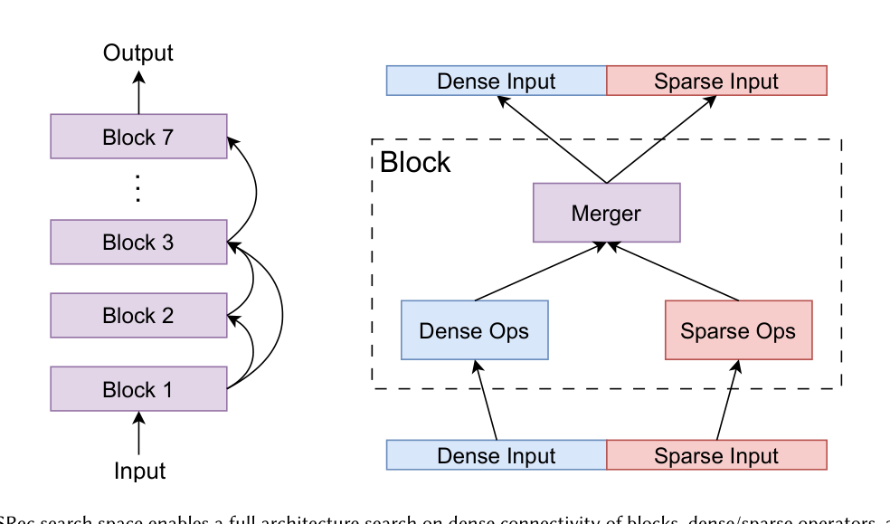

# Towards Automated Model Design on Recommender Systems (面向推荐系统的自动化模型设计)

- **会议/期刊**: ACM Transactions on Recommender Systems (TORS) 2024/2025
- **作者与机构**: Tunhou Zhang, Yudong Liu, Feng Cheng, Yufan Cao, Hai Li, Yiran Chen (Duke University)；Dehua Cheng, Yuchen He, Zhengxing Chen, Xiaoliang Dai, Liang Xiong, Wei Wen (Meta Platforms)；Feng Yan (University of Houston)
- **推荐链路定位**: 精排 (CTR 预估模型骨干自动设计)
- **研究方向**: CTR/CVR 预估与特征交叉 / 工业级全链路架构与评测基准
- **论文原文**: [https://arxiv.org/abs/2411.07569v1](https://arxiv.org/abs/2411.07569v1)
- **开源代码**: [https://github.com/facebookresearch/NasRec](https://github.com/facebookresearch/NasRec)

## TL;DR (1分钟核心速览)

推荐模型骨干长期依赖人工设计（Wide&Deep/DLRM/DeepFM），而现有 NAS 方案（AutoCTR/DNAS/PROFIT）搜索空间窄、强依赖人工先验算子、搜索代价高。本文提出 NASRec：以权重共享超网统一搜索**稠密连接 + 6 类异构算子 + 稠密/稀疏维度 + 稠密-稀疏合并器 + ReRAM 量化位宽**，并用「单算子-任意连接采样 + 算子均衡交互 + 训练后微调」解决超网排序失序。在 Criteo/Avazu/KDD Cup 2012 上（80/10/10 划分、LogLoss/AUC）取得 SOTA，Criteo 降 0.001、KDD 降 0.003 LogLoss，FLOPs 较 DLRM 降 8.5×，协同设计再获 1.5× 加速与 1.8× 能效。

## Background & Motivation (背景与核心矛盾)

- **主流范式**: CTR 模型靠人工堆叠特征交叉模块（FC、FM、Dot-Product、Attention、Gating），每换一个数据集/业务就要重新调骨干，人力成本极高。
- **前人局限一（空间窄）**: AutoCTR、DNAS 的搜索空间照搬 DLRM 设计哲学，仅含 FC 与 Dot-Product，靠人工塞入 FM/特征交互模块来"制造"异构性，本质仍是强先验约束下的局部搜索。
- **前人局限二（代价高/优化难）**: AutoCTR 计算开销巨大，DNAS 依赖难解的双层优化，导致只能在小空间搜索，压制了多样化特征交叉的探索。
- **核心洞察 (Key Insight)**: 推荐数据的多模态性（2D 稠密张量 + 3D 稀疏嵌入张量）与架构异构性，要求搜索空间本身必须"稠密连接 + 双分支算子"，而非视觉 NAS 那种同构 3D 输入 + 同构卷积的骨干搜索。
- **本文切入点**: 构建一个最小化人工先验的超网，让"任意块连任意前驱 + 稠密/稀疏双分支独立演化 + 合并器打通两支"，把架构设计与 PIM 硬件量化位宽纳入同一搜索闭环。

## Method (核心方法设计)

### 1. 整体框架 (Overall Architecture)

NASRec 将候选模型定义为 $N=7$个 choice block 的堆叠加末端 FC 输出 logit。每个 block 接收任意数量前驱块与原始特征的稠密/稀疏输入$X=(X_d,X_s)$，内部经稠密分支（FC/Gating/Sum/Dot-Product）与稀疏分支（EFC/Attention）并行变换，再由稠密-稀疏合并器（FC reshape 或 FM）双向打通，最后拼接聚合输出。超网$\mathcal{S}=(\mathcal{C},\mathcal{D},\mathcal{O})$ 囊括全部连接、维度与算子组合，所有子网共享权重；训练时按 mini-batch 采样子网，训练后用正则化进化在超网中搜索，并对 Top-15 子网从零重训选出 NASRecNet。协同设计版本进一步把 ReRAM 交叉阵列的 4/8-bit 量化位宽纳入搜索。

<figure class="paper-figure" markdown="span">
  <figcaption>图 1. NASRec 搜索空间支持对块的稠密连接、稠密/稀疏算子以及融合稠密/稀疏表示的合并器进行完整架构搜索。</figcaption>
</figure>

### 2. 关键设计拆解 (Key Designs)

1. **稠密连接 + 双分支异构超网（打破模态壁垒）**：痛点在于视觉 NAS 的同构 3D 输入假设在推荐域失效。本文让第 $n$块可连接任意前$n-1$ 块及原始特征，稠密/稀疏输出分别拼接：
$$X^{(N)}_d=\text{Concat}_{i=1}^{N-1}\left[Y^{(i)}_d\cdot\mathbb{I}_{\langle i,N\rangle\in C^{(N)}_{sample}}\right]$$
维度不匹配时用掩码 $Mask(V,d)$ 截断多余维，使 FC/EFC 输出维度可独立搜索。直觉：稠密连接让任意层级的特征都能被后续任意算子复用，天然覆盖 Wide&Deep、DLRM、AutoInt 等人工骨干为子网。

2. **算子均衡交互模块（消除 Dot-Product 参数霸权）**：$N_s$个稀疏嵌入的 Dot-Product 产生$N_s^2/2$个两两交互，为对齐维度还需$N_s^2\cdot dim_d/2$的投影层（$N_s=448,dim_d=512$时超 50M 参数），导致超网训练严重偏向 Dot-Product 子网、排序失真。本文在 Dot-Product 前插入 EFC 把稀疏嵌入数压到$\lceil\sqrt{2\,dim_d}\rceil$，使参数消耗从二次降为线性$dim_d^2+N_s\lceil\sqrt{2\,dim_d}\rceil$，各算子收敛速率拉平。

3. **单算子-任意连接采样 + 训练后微调（训练目标与搜索效率）**：每个 block 只采样 1 个稠密 + 1 个稀疏算子（解耦参数算子、避免 co-adaptation），但采样任意数量连接（保证连接覆盖）。超网用 Adagrad、lr=0.12、单 epoch 训练，损失即标准 CTR 交叉熵 $\mathcal{L}=-\frac{1}{B}\sum_i\left[y_i\log\hat{y}_i+(1-y_i)\log(1-\hat{y}_i)\right]$，无需负采样。超网训练后仅对末端 FC 微调 0.5K 步即可重校准被污染的共享权重；推理时子网为标准前馈，无额外开销。

## Experimental Setup & Evaluation Protocol (实验设置与评估协议)

- **数据集与预处理**（沿用 AutoCTR 预处理）：

| 数据集 | #Dense | #Sparse | #Samples | 特征/场景说明 |
| :--- | :---: | :---: | :---: | :--- |
| Criteo | 13 | 26 | 45.84M | 稠密+稀疏最丰富，最复杂 |
| Avazu | 0 | 23 | 40.42M | 纯稀疏特征，稠密交互需求低 |
| KDD Cup 2012 | 3 | 10 | 149.64M | 特征最少、数据最多，相对易训 |

- **数据划分与防穿越**: 比例划分 `80% / 10% / 10%`（train/valid/test），超网在 train 上训练，valid 上选 Top-15 子网，test 报告最终指标。
- **排名评测协议**: 标准 CTR 二分类评测，报告 `Log Loss` 与 `AUC`（非全库排序任务）；每次运行标准差约 ±0.0002，以 0.001 为显著提升阈值。
- **对比基线与超参**: 人工骨干 DLRM/xDeepFM/AutoInt+/DeepFM，NAS 骨干 DNAS/PROFIT/AutoCTR，外加同空间 Random Search；稠密维度搜索集 $\{16,\dots,1024\}$，稀疏维度$\{16,32,48,64\}$，进化种群 128、240 轮。

## Key Experimental Results (实验关键数据)

### 1. 主实验对比 (Main Results)

| Method | Criteo LogLoss | Criteo AUC | Avazu LogLoss | Avazu AUC | KDD LogLoss | KDD AUC | Search Cost (GPU days) |
| :--- | :---: | :---: | :---: | :---: | :---: | :---: | :---: |
| DLRM | 0.4436 | 0.8085 | 0.3814 | 0.7766 | 0.1523 | 0.8004 | - |
| AutoInt+ | 0.4427 | 0.8090 | 0.3813 | 0.7772 | 0.1523 | 0.8002 | - |
| DeepFM | 0.4432 | 0.8086 | 0.3816 | 0.7767 | 0.1529 | 0.7974 | - |
| DNAS | 0.4442 | - | - | - | - | - | - |
| PROFIT | 0.4427 | 0.8095 | 0.3735 | 0.7883 | - | - | ~0.5 |
| AutoCTR | 0.4413 | 0.8104 | 0.3800 | 0.7791 | 0.1520 | 0.8011 | ~0.75 |
| Random @ NASRec-Full | 0.4418 | 0.8098 | 0.3767 | 0.7853 | 0.1509 | 0.8071 | 1.0 |
| **NASRec-Small** | **0.4399** | **0.8118** | 0.3747 | 0.7887 | 0.1495 | 0.8135 | ~0.25 |
| **NASRec-Full** | 0.4408 | 0.8107 | **0.3737** | **0.7903** | **0.1491** | **0.8154** | ~0.3 |
| Improv. vs 最佳基线 | -0.0014 | +0.0014 | +0.0002 | +0.0020 | -0.0029 | +0.0143 | 1.7× 更快 |

### 2. 消融实验 (Ablation Study)

| 配置 (Criteo) | LogLoss | FLOPs(M) | 说明 |
| :--- | :---: | :---: | :--- |
| 单算子-任意连接 + 微调 (完整) | **0.4408** | **1.45** | 默认配置 |
| 单算子-单连接 + 微调 | 0.4417 | 1.78 | 连接覆盖不足 |
| 任意算子-任意连接 + 微调 | 0.4413 | 2.04 | 算子 co-adaptation |
| 单算子-任意连接，无微调 | 0.4410 | 3.62 | 权重污染未校准 |

| 路径采样策略 (NASRec-Full, Criteo) | 无微调 Pearson/Kendall | 有微调 Pearson/Kendall |
| :--- | :---: | :---: |
| 任意算子-任意连接 | 0.37 / 0.28 | 0.46 / 0.43 |
| 单算子-单连接 | 0.05 / 0.02 | 0.43 / 0.29 |
| **单算子-任意连接** | **0.46 / 0.43** | **0.57 / 0.43** |

### 3. 关键实验发现 (Key Findings)

1. **路径采样比微调更决定成败**：单算子-任意连接相比单算子-单连接，Kendall's $\tau$从 0.02 跃升至 0.43（无微调），最终 LogLoss 从 0.4417 降到 0.4408；而微调主要贡献是让弱采样策略"起死回生"（单连接策略$\tau$ 从 0.02→0.29）。
2. **算子均衡交互同时提升排序与效率**：加入该模块后 Kendall's $\tau$ 提升 0.11，搜索成本从 4 GPU 小时降至 1.5 GPU 小时；且因 Dot-Product 前先降维，最终模型 FLOPs 较 DLRM 降 8.5×（Criteo 26.92M→1.45M），实现"更准且更轻"。
3. **搜索空间越大越需强搜索器**：NASRec-Full 的随机搜索基线（Criteo 0.4418）明显弱于 NASRec-Small（0.4411），但 WS-NAS 在 Full 空间仍能挖出 Avazu/KDD 最优解（AUC 0.7903/0.8154），说明超网覆盖度 + 进化搜索可抵消空间膨胀带来的探索难度。

## Highlights & Limitations (亮点、对比与审稿批判)

- **与代表作对比 (vs. Prior Work)**: 相比 AutoCTR（仅 FC/DP/FM/EFC、无稠密连接、无协同设计），NASRec 增加 Gating/Sum/Attention 与稠密-稀疏双向合并器，且搜索成本仅 ~0.3 GPU days（AutoCTR ~0.75）；相比 PROFIT（只搜稠密连接），本文实现全架构搜索，Criteo 降 0.002 LogLoss；相比 DNAS（双层优化难解），本文用单次超网训练 + 进化搜索规避了双层优化。
- **可迁移亮点**: (1) "单算子-任意连接"采样可迁移到任何含参数算子与非参数连接的 NAS 场景（如序列推荐骨干搜索）；(2) 算子均衡交互的"先降维再交叉"思路可直接用于工业 Dot-Product/FM 层的参数瘦身。
- **审稿级局限批判**: (1) 协同设计仅在 NASRec-Small 空间验证，Full 空间与 PIM 的联合搜索留作未来工作，1.5×/1.8× 加速为仿真器理论值而非真实芯片实测；(2) 最优架构在 7 块空间中仅用 4 块，深层架构难以被发现，且 CTR-NAS 排序相关性（Top-50% Kendall's $\tau$=0.24）仍偏低，缺乏统计显著性检验与多随机种子方差报告。

## Rating (四维评分)

- **方法创新性 (Novelty)**: ⭐⭐⭐⭐ （首个把稠密连接+双分支异构算子+合并器+量化位宽统一进 WS-NAS 超网，算子均衡交互的理论直觉清晰）
- **评估协议与实验扎实度 (Protocol & Experiments)**: ⭐⭐⭐⭐ （三数据集 + 人工/NAS/随机搜索三类基线齐全，但缺显著性检验与真实硬件实测）
- **写作与数学规范度 (Clarity & Rigor)**: ⭐⭐⭐⭐ （超网形式化 $\mathcal{S}=(\mathcal{C},\mathcal{D},\mathcal{O})$ 与掩码公式严谨，部分符号与 NASRec 前作重叠较多）
- **工业落地与复现价值 (Industrial & Practical Value)**: ⭐⭐⭐⭐⭐ （Meta 开源代码，搜索仅 0.3 GPU days，FLOPs 降 8.5×，对工业 CTR 骨干自动化极具落地价值）

